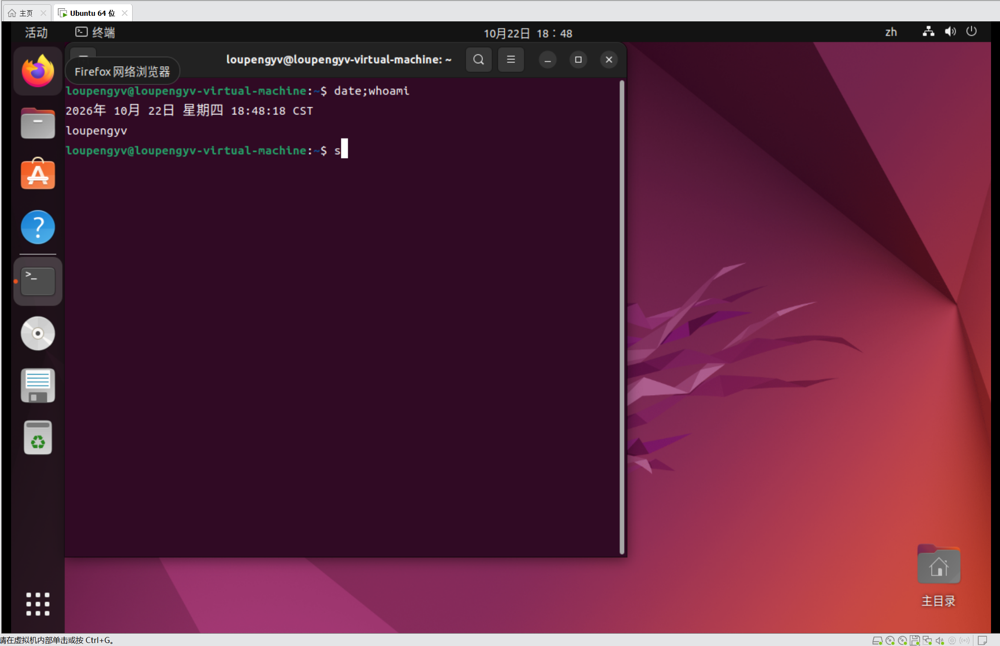
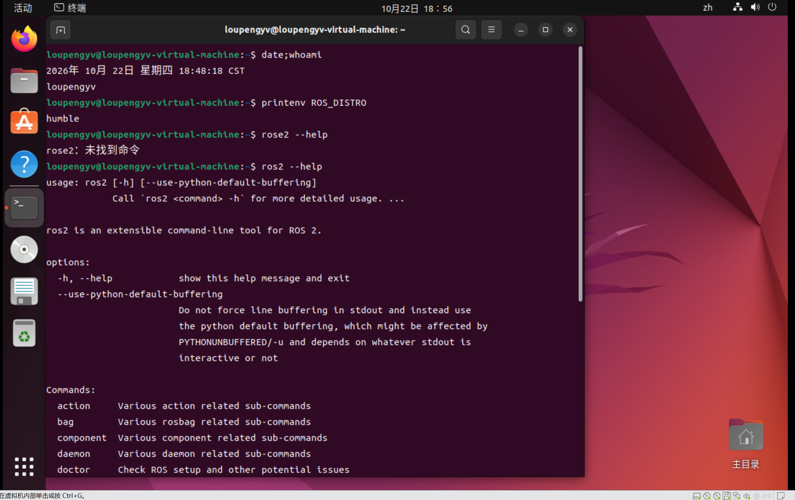
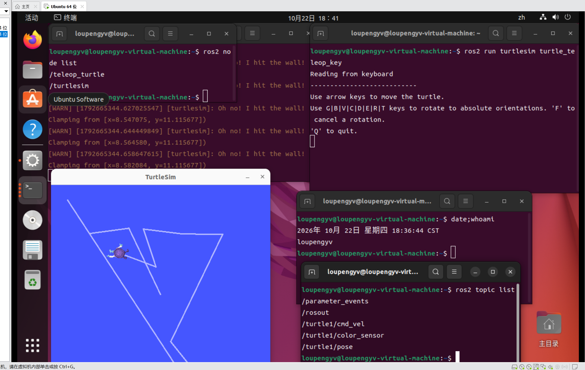
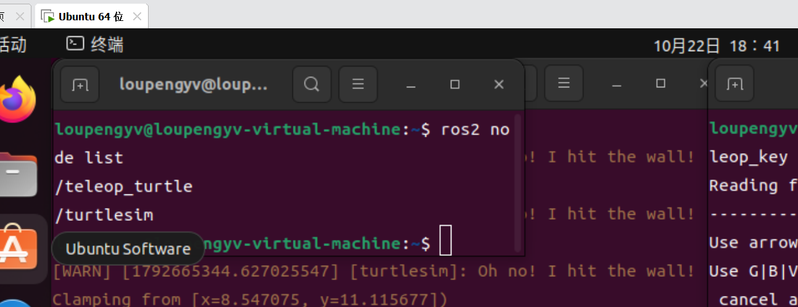
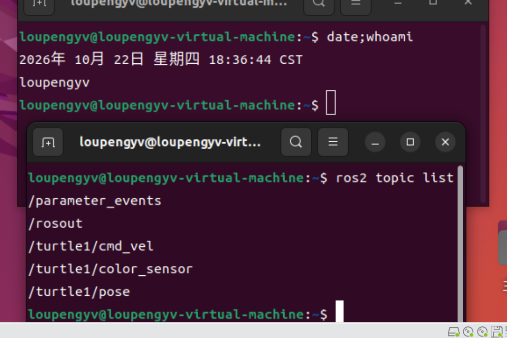

# 第 1 周考核 · loupengyv

- 姓名：娄鹏宇
- 姓名拼音：loupengyv
- 学号 / 联系方式：20263608
- 完成日期：2026-10-22

## 任务 1：系统安装与 ROS2 环境自检

用 VMware Workstation 17.6.3 装了 Ubuntu 22.04 虚拟机（没走双系统），ROS2 用鱼香 ROS 的一键脚本装了 Humble 桌面版。

装的过程中踩了四个坑：

1. **虚拟机连不上网**：VMware 的 `VMware NAT Service` 和 `VMnetDHCP` 两个服务是禁用状态，手动启动报「错误 1067 进程意外终止」，`VMnet8` 只能拿到 169.254.x 的无效地址。最后把网络适配器改成**桥接模式**，让虚拟机直接从路由器拿地址，才连上网。
2. **sudo 密码输不进去**：终端里一个字符都不回显，连输两次都提示「对不起，请重试」。后来发现是输入法停在中文状态，敲出来的字符不对，切回英文（Shift）再输就正常了。
3. **虚拟机和 Windows 之间不能复制粘贴**：这台虚拟机是用 VMware「轻松安装」建的，带了 `autoinst.iso` / `autoinst.flp` 应答文件，要装 `open-vm-tools-desktop` 才能互通。
4. **命令打错**：`wget` 打成 `wegt`、把大写 `O` 写成数字 `0`，报「无效的选项」。改成分两步（先 `wget <网址>` 再 `. install`）才跑通。

装完后自检：`printenv ROS_DISTRO` 输出 `humble`，`ros2 --help` 能正常打印出帮助信息。

## 任务 2：小乌龟

`turtlesim_node` 和 `turtle_teleop_key` 是**两个各自独立运行的节点**，谁也不知道对方的存在：

- `turtlesim_node` 负责「画」：它订阅 `/turtle1/cmd_vel` 话题，收到速度指令就更新乌龟的位置和朝向，再把新的位姿发布到 `/turtle1/pose`。
- `turtle_teleop_key` 负责「读键盘」：把我按下的方向键换算成线速度和角速度，发到 `/turtle1/cmd_vel`。

所以数据是这样流的：

```
键盘 → turtle_teleop_key（发布者）→ /turtle1/cmd_vel（话题）→ turtlesim_node（订阅者）→ 乌龟移动
```

我验证过：把 `turtle_teleop_key` 那个终端 `Ctrl+C` 掉，乌龟窗口还在、乌龟也不消失，但按方向键没反应了——因为没有节点再往 `/turtle1/cmd_vel` 里发消息。反过来只关 turtlesim，teleop 也还在正常跑，只是没人接收。这说明它们确实是两个独立进程，不是一个程序的两部分。

我对两个概念的理解：

- **节点（node）**：一个独立运行的程序，只干一件事（画乌龟 / 读键盘），用 `ros2 node list` 能看到。一个完整的机器人系统就是由很多个节点拼起来的。
- **话题（topic）**：一条有名字的、单向的数据通道（比如 `/turtle1/cmd_vel`）。发布者往里写，订阅者从里读，双方不需要认识对方，也可以有多个订阅者同时读。
- **关系**：节点之间靠话题通信，一个节点可以同时发布和订阅不同的话题——这就是 ROS2 的「发布 / 订阅」模型。

## 任务 3：Git 提交

这是我第一次完整走 Fork + Pull Request 流程：

1. 先在网页上 Fork 主仓库，再 clone **自己** fork 出来的仓库（一开始差点 clone 成主仓库）
2. 按 `Week1/<姓名拼音>/` 的目录规范放截图，再写这份说明
3. `git add` → `git commit` → `git push` → 在网页上发起 Pull Request

踩的坑：

- 浏览器把 GitHub 页面自动翻译成中文，`Fork` 显示成「分叉」、`Pull Request` 显示成「拉取请求」，找按钮找了半天。
- 一开始以为要往主仓库直接 push，后来才明白自己只有 fork 的写权限，主仓库只能通过 PR 合入。
- `git push` 不能用账号密码，必须用 Personal Access Token；而且 git-bash 里 `Ctrl+V` 粘不进去，得用鼠标右键 Paste。
- 中途 github.com 反复连不上，换了好几个 IP 才 push 成功。

---

## 截图

每张截图都带「姓名 + 实时时间戳」（终端里先执行 `date; whoami` 再截图）。

### 任务 1：Ubuntu 桌面与环境自检





### 任务 2：小乌龟与节点/话题






