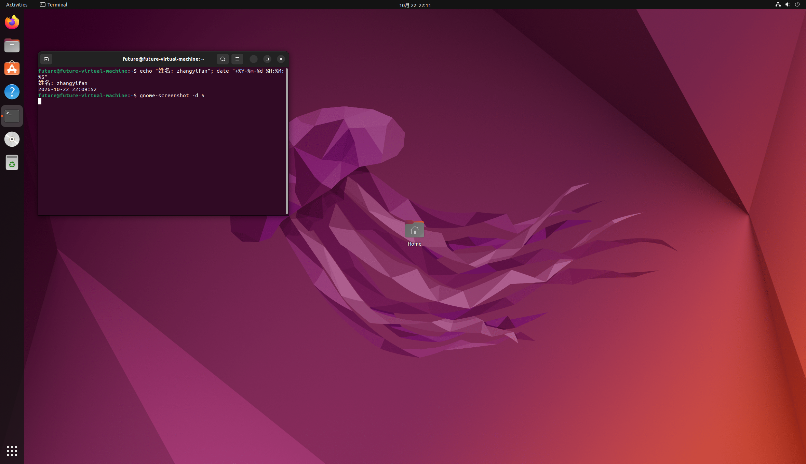
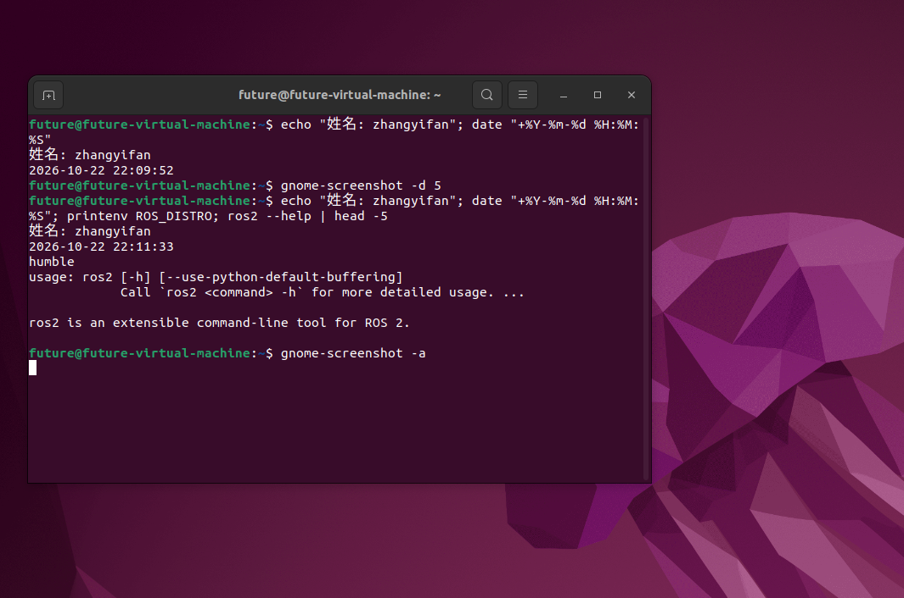
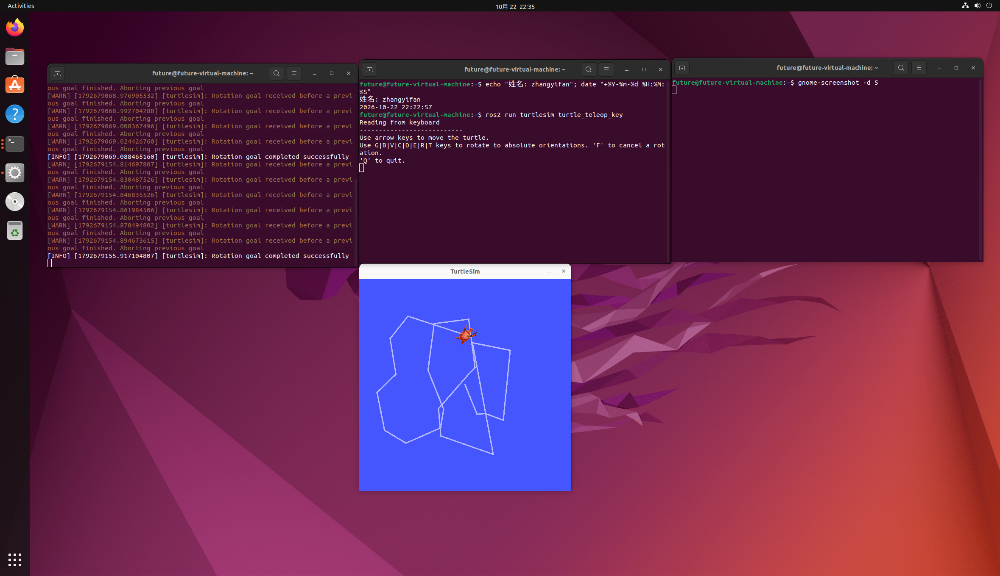
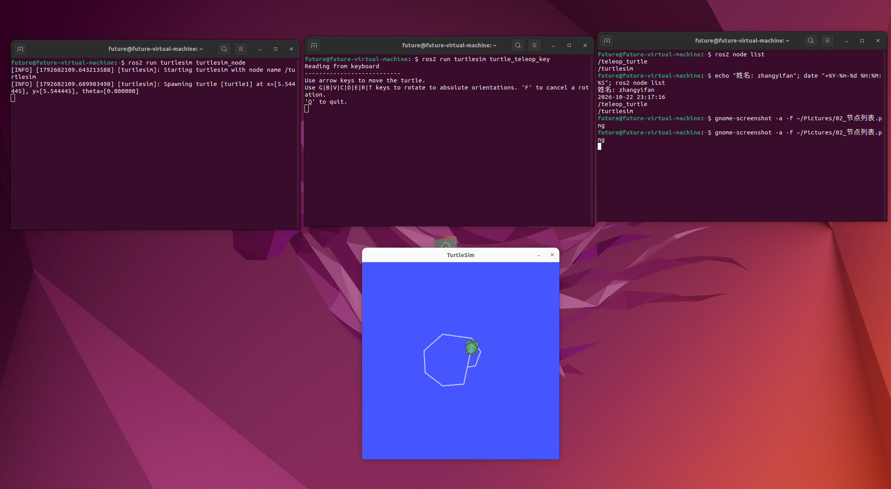
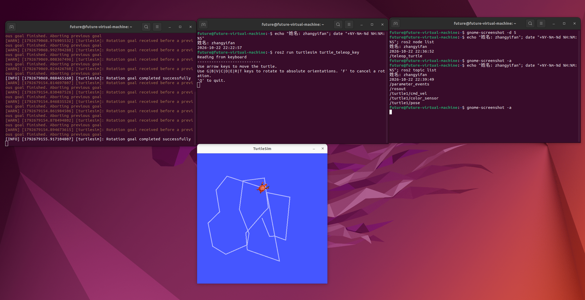

第 1 周考核 · zhangyifan
姓名：zhangyifan
学号 / 联系方式：20263652/19805480197
完成日期：2026-10-22
实验环境：VMware Workstation 17 / Ubuntu 22.04.5 LTS / ROS2 Humble
> 说明：所有截图均为本人操作时现场截取，图中带有姓名与实时时间戳。
---
任务 1：环境搭建与 ROS2 环境自检
我做了什么
装 Ubuntu 22.04：在 VMware Workstation 里新建虚拟机（4GB 内存、2 核 CPU、30GB 磁盘），挂载 Ubuntu 22.04.5 桌面版 ISO 完成安装。装完先拍了一个快照，命名 `baseline`，后面环境搞坏可以直接回滚。
配好虚拟机工具：`sudo apt install open-vm-tools-desktop`，重启后宿主机和虚拟机可以互相复制粘贴、拖拽文件。
装 ROS2 Humble：用鱼香 ROS 一键脚本
```bash
   wget http://fishros.com/install -O fishros \&\& . fishros
   ```
依次选择：`1` 一键安装 ROS → 更换系统源 → `humble(ROS2)` → 桌面版 → 是否安装 rosdep 选 `y`，等脚本自动装完。
自检：
```bash
   printenv ROS\_DISTRO   # 输出 humble
   ros2 --help           # 正常打印帮助信息，不报 command not found
   ```
截图


遇到的问题
（下载后无法在ubuntu上复制粘贴，我先安装了VMware Tools 结果发现vmtoolsd 在反复崩溃，之后问ai发现是apt源出问题了，在ai的指导下下了一些东西之后成功能够进行复制粘贴）
---
任务 2：小乌龟 —— 节点与话题
操作过程
开两个终端，分别启动两个节点：
```bash
# 终端 A：小乌龟本体（画窗口、算运动）
ros2 run turtlesim turtlesim\_node

# 终端 B：键盘遥控（读方向键，发速度指令）
ros2 run turtlesim turtle\_teleop\_key
```
在终端 B 里点一下窗口获取焦点，再用方向键控制，乌龟会移动并留下轨迹。
然后观察节点和话题：
```bash
ros2 node list
# /teleop\_turtle
# /turtlesim

ros2 topic list
# /parameter\_events
# /rosout
# /turtle1/cmd\_vel
# /turtle1/pose
```
截图



我的理解：节点是什么
节点就是一个"只干一件事"的程序进程。`turtlesim\_node` 负责画面和运动学，`turtle\_teleop\_key` 只负责读键盘。两个程序是独立启动的，代码里谁也没引用谁——它们甚至可以是不同语言写的。
我的理解：话题是什么
话题是节点之间传消息的命名通道。发布者往话题里写消息，订阅者从话题里取，双方不需要知道对方是谁、在不在线。
这次涉及的两个话题：
话题	谁发布	谁订阅	里面是什么
`/turtle1/cmd\_vel`	`turtle\_teleop\_key`	`turtlesim\_node`	速度指令，类型 `geometry\_msgs/msg/Twist`，`linear.x` 是前进速度、`angular.z` 是转向角速度
`/turtle1/pose`	`turtlesim\_node`	任意	乌龟当前的位置 (x, y) 和朝向 theta
两者的关系
```
turtle\_teleop\_key ──发布 /turtle1/cmd\_vel──▶ turtlesim\_node ──发布 /turtle1/pose──▶ 任何订阅者
```
三点体会：
启动顺序无所谓。先开 teleop 还是先开 turtlesim 都能跑，因为两个节点只认话题名字，不认进程——这就是解耦。
一个话题可以有多个订阅者。比如 `/turtle1/pose`，我可以用 `ros2 topic echo` 再订阅一份，乌龟照常动，完全不冲突。
可以旁路观察。执行 `ros2 topic echo /turtle1/cmd\_vel`，按方向键就能实时看到速度消息；`rqt\_graph` 里能直接看到两个节点中间那条话题连线，和上面这张图对得上。
我理解 ROS2 里"节点负责计算、话题负责连接"，把一个大系统拆成很多小节点之后，加一个新功能只需要多订阅一个话题（比如后面接到真实机器人，就是把速度指令换成发给底盘），不用改原来的节点。
---
任务 3：Git 提交
流程
在 GitHub 上 Fork 考核仓库到自己的账号；
clone 自己 Fork 出来的仓库（不是主仓库）：
```bash
   git clone https://github.com/<我的用户名>/cquick-recruitment.git
   cd cquick-recruitment
   ```
建目录并放入文件：
```bash
   mkdir -p Week1/zhangyifan
   ```
提交并推送：
```bash
   git add .
   git commit -m "docs(Week1): 添加环境自检与小乌龟截图及说明"
   git push
   ```
在自己仓库页面点 Contribute → Open Pull Request，目标为主仓库 `main` 分支。
PR 链接：https://github.com/woailuyao/cquick-recruitment/pull/38
踩过的坑
（在Ubuntu中截的照片不知道怎么弄出来，最后只能在windows写完模板后再Ubuntu中的Firefox登录github再导入图片）
---
附：命令速查
```bash
# 环境
printenv ROS\_DISTRO
source /opt/ros/humble/setup.bash

# 小乌龟
ros2 run turtlesim turtlesim\_node
ros2 run turtlesim turtle\_teleop\_key
ros2 node list
ros2 topic list
ros2 topic echo /turtle1/cmd\_vel
ros2 topic info /turtle1/cmd\_vel -v
rqt\_graph

# Git
git status
git log --oneline
```
