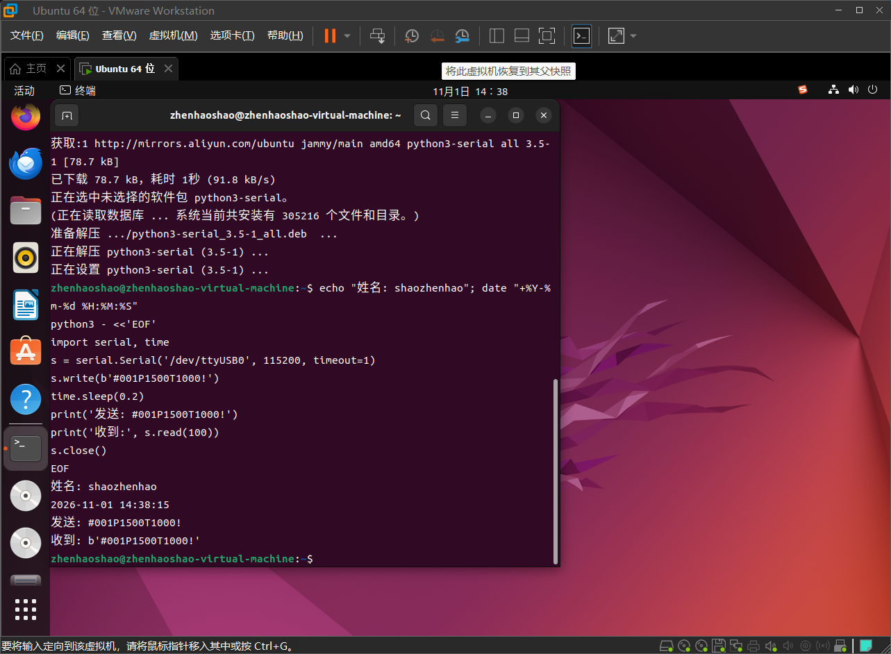

# 串口与总线舵机笔记

- 姓名：邵振豪（shaozhenhao）
- 日期：2026-11-01

## 1. 串口四参数

### 波特率
是在一次通信过程中每秒传多少位，单位是波特，Bd，也就是传输速度

### 数据位
8位就意味着在传输过程中一个字符就要占用8位进行传输

### 停止位
结束传输中的一帧

### 校验位
能查出单词传输中某一位的翻转，但是不能确定是哪一位，而且查不出多个位同时出错，更查不出比位的级别大的错误，比如帧级别的错误。常用N的原因：查错能力有限，不如上层的crc，还有一层因素是行业默认大多都是8-N-1.

### 8-N-1 怎么读
8个数据位，无校验位，1个停止位，这三者定义了一帧的形式

### 波特率不一致会出现什么现象
会收到一堆乱码

## 2. 回环测试

### 接线方式
用杜邦线将TXD与RXD两根线短接，然后用usb接在电脑上

### 实测记录
zhenhaoshao@zhenhaoshao-virtual-machine:~$ echo "姓名: shaozhenhao"; date "+%Y-%m-%d %H:%M:%S"
python3 - <<'EOF'
import serial, time
s = serial.Serial('/dev/ttyUSB0', 115200, timeout=1)
s.write(b'#001P1500T1000!')
time.sleep(0.2)
print('发送: #001P1500T1000!')
print('收到:', s.read(100))
s.close()
EOF
姓名: shaozhenhao
2026-11-01 14:38:15
发送: #001P1500T1000!
收到: b'#001P1500T1000!'

### 遇到的问题与解决
1. lsusb 能看到设备但没有 /dev/ttyUSB0，经过ai给的命令定位发现设备已经接入虚拟机，但是Ubuntu的brltty抢占了它，（这个其实我也并不太懂），然后把brltty卸载了又重插就解决了
2. 在我准备验证收发的时候发现pyserial没装，然后用指令sudo apt install -y python3-serial装上后就好了

## 3. 波特率不一致的原理
发送方按自己的波特率，一位一位往外发，每位占固定时长，接收方按自己的波特率采样每一位，两边速率不同导致采样点从帧头到帧尾逐渐偏移，后面几位采到错误电平，整个字节读错最终导致乱码

## 4. 总线舵机指令逐字拆解

### 逐段拆解 #001P1500T1000!

| 段 | 含义 |
| --- | --- |
| # |指令的开头|
| 001 |001号舵机，固定三位|
| P |PWM指令|
| 1500 |pwm的值，固定4位，500-2500，1500是中立位|
| T |时间指令|
| 1000 |用时1000毫秒|
| ! |结束指令|

### 我自己写的两条指令
- 让 1 号舵机转到中立位、用时 1.5 秒：`#001P1500T1500!`
- 让 3 号舵机卸力：`#003PULK!`

## 5. 我还没搞懂的问题
为什么 Ubuntu 的 brltty会去占用 CH340 这种串口设备？我能知道它是被别的程序占用了，但是不知道一个盲文设备为啥会去抢串口芯片。
