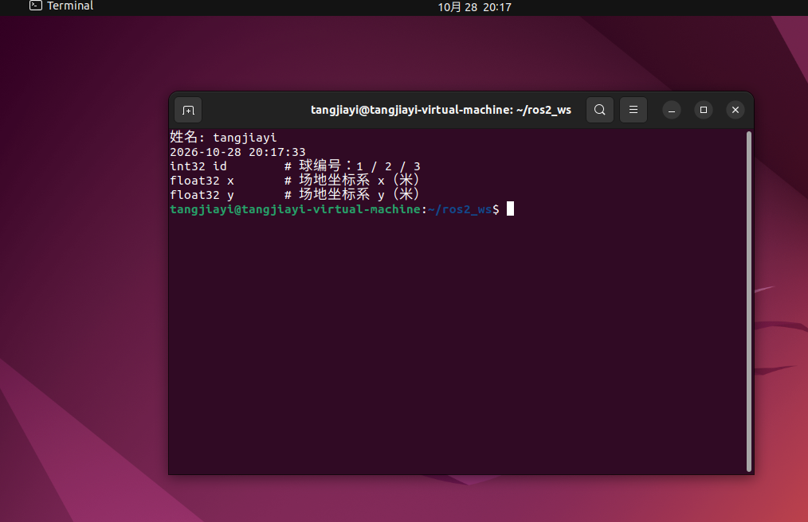
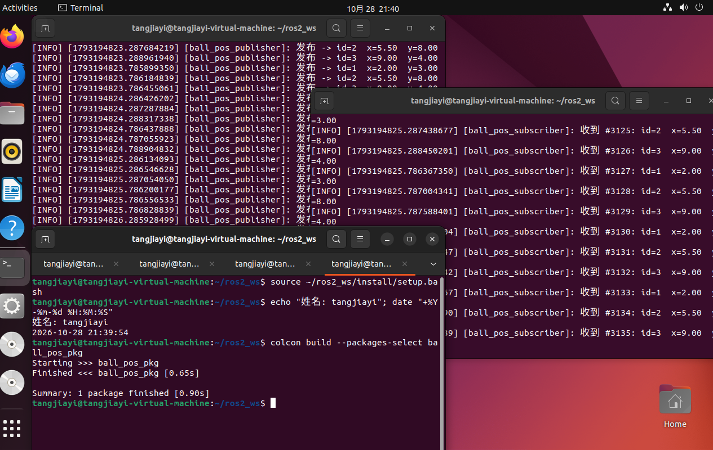
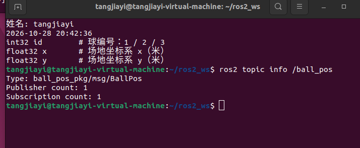
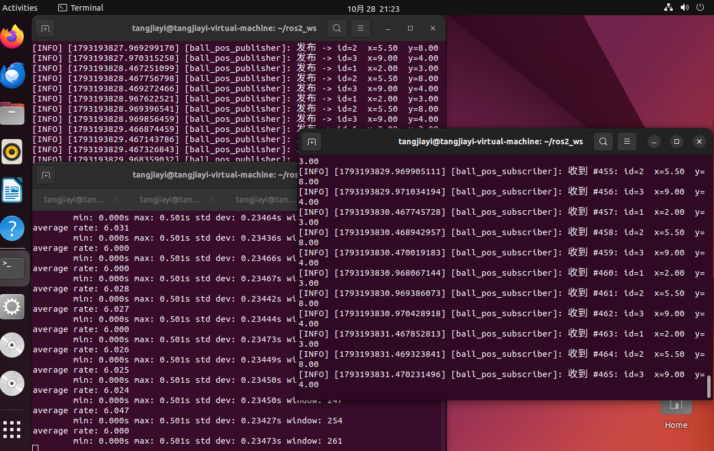
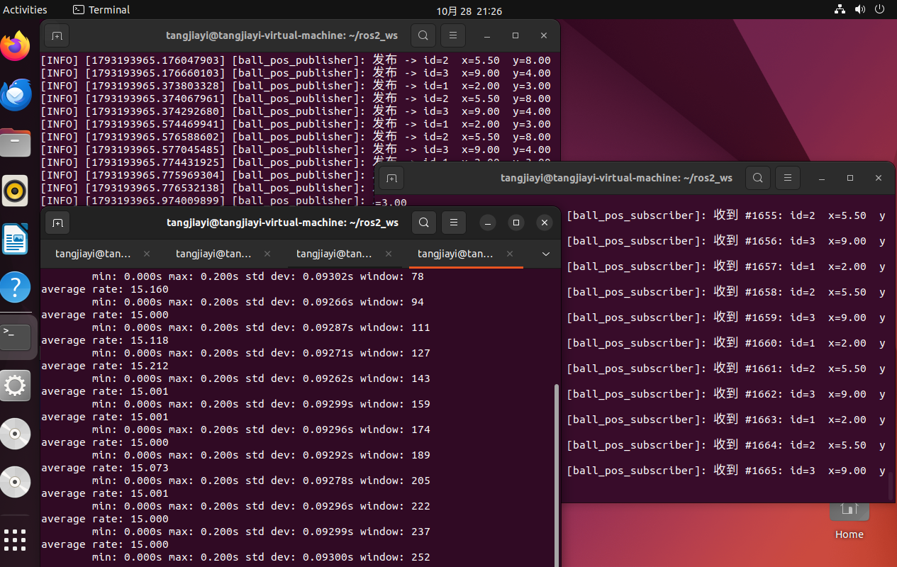
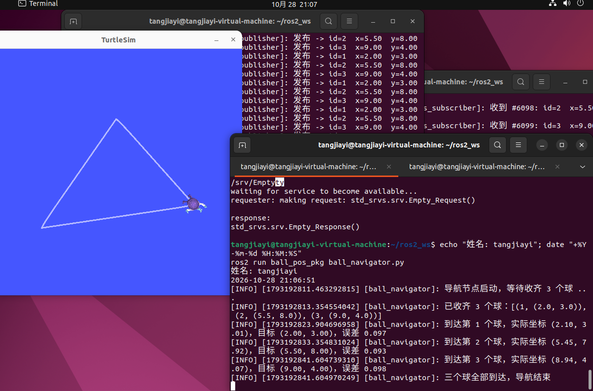
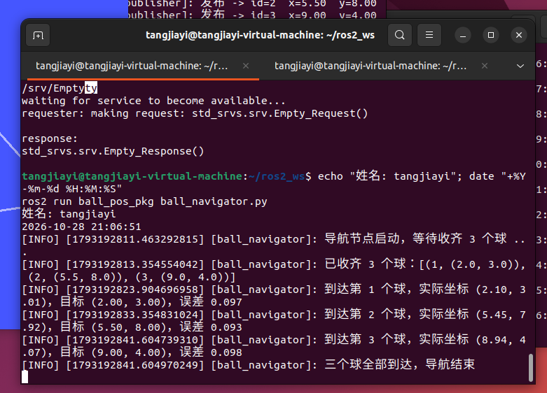
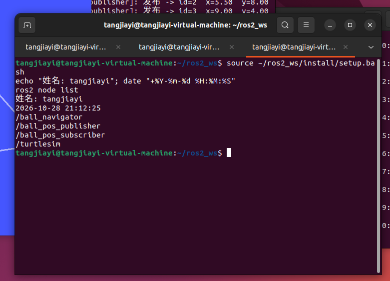

# 电控组招新考核 · 第 2 周

> 姓名拼音：tangjiayi　｜　环境：Ubuntu 22.04 + ROS 2 Humble
> 包名：`ball_pos_pkg`（`ament_cmake`，含自定义消息 `BallPos`）

**目录结构**

```
tangjiayi/
├── 01_interface_show.png / 01_发布订阅分屏.png / 01_话题信息.png
├── 01_频率对比_2Hz.png / 01_频率对比_5Hz.png     ← 改频率加分项
├── 02_三个球轨迹.png / 02_运行日志.png / 02_误差汇总.png / 02_节点列表.png
├── 03_串口与总线舵机笔记.md
├── README.md
└── src/
    ├── ball_navigator.py            ← 任务 2 导航节点（按目录规范放一份在这里）
    └── ball_pos_pkg/                ← 任务 1 的 ROS2 包
        ├── package.xml / CMakeLists.txt
        ├── msg/BallPos.msg
        └── scripts/                 ← 真正被 CMake 安装、ros2 run 调用的脚本
            ├── ball_pos_publisher.py
            ├── ball_pos_subscriber.py
            └── ball_navigator.py    ← 与 src/ball_navigator.py 是同一份
```

> 导航节点之所以在 `scripts/` 里也有一份：`CMakeLists.txt` 的 `install(PROGRAMS ...)` 只安装包内脚本，`ros2 run` 才找得到；`src/` 根目录那份是为了对上 `电控组/Week2/README.md` 的目录规范。两份内容完全一致。

---

## 一、三项任务各做了什么

### 任务 1 · 自定义 `BallPos` 消息 + 发布/订阅 3 个球的坐标（40 分）

新建 `ball_pos_pkg`，自定义消息 `BallPos`（`msg/BallPos.msg`）：

```
int32 id      # 球编号 1 / 2 / 3
float32 x     # 场地坐标系 x（米）
float32 y     # 场地坐标系 y（米）
```

- **发布端** `scripts/ball_pos_publisher.py`：定时器按 `frequency` 参数（默认 2.0 Hz）触发，**每个周期把 3 个球依次发一遍**（id 1→2→3），坐标严格用细则给的值，发的同时打印发出去的内容；
- **订阅端** `scripts/ball_pos_subscriber.py`：订阅 `/ball_pos`，回调里打印 `id / x / y`；
- 频率做成了 ROS 2 参数，改频**不用改代码**：`--ros-args -p frequency:=5.0`。

**消息定义编译成功**（`ros2 interface show ball_pos_pkg/msg/BallPos`）：



**两个节点同时运行，一端发、一端收**：



**话题连接状态**（`ros2 topic info /ball_pos`：Publisher 1 / Subscription 1）：



**改频率后的观察**：同一段代码，`frequency` 从 2.0 改成 5.0，订阅端刷屏明显变快。

| 参数 `frequency` | 每周期条数 | 话题实际速率 `ros2 topic hz` |
|---|---|---|
| 2.0 Hz | 3 | 约 **6** 条/秒 |
| 5.0 Hz | 3 | **15.0** 条/秒 |




因果关系：**话题频率 = 发布频率 × 每周期条数**。`ros2 topic hz` 里 `min: 0.000s` 是因为三条消息在同一个定时器回调里连着发出去，相邻两条里有一条间隔为 0；真正的周期是 `1 / frequency`。

### 任务 2 · 订阅 3 个球坐标，依次走过去（35 分）

`scripts/ball_navigator.py`，走的是**路线 A（闭环）**：同时订阅 `/ball_pos` 和 `/turtle1/pose`，每 50 ms（20 Hz）根据「目标点 − 当前点」算一次控制量，发布 `/turtle1/cmd_vel`。

控制：

1. 算出到目标点的**距离** `dist` 和**方位角误差** `err`；
2. `|err| > 0.15 rad` → `linear.x = 0`，只给 `angular.z`，**原地转先对准**；
3. 对准了 → `linear.x = min(0.8, 1.5 × dist)`，**越近越慢**（否则必冲过头）；`angular.z` 继续按 `2.5 × err` 微调；`dist < 0.1` 判定到达，切下一个点。

**三个球的轨迹**（1→2→3，一次跑完，全程无人工按键）：



**运行日志**（每到一个点打实际坐标和误差）：




| 球 | 目标坐标 | 实际到达 | 误差 |
|---|---|---|---|
| 1 | (2.0, 3.0) | (2.10, 3.01) | **0.097** |
| 2 | (5.5, 8.0) | (5.45, 7.92) | **0.093** |
| 3 | (9.0, 4.0) | (8.94, 4.07) | **0.098** |

全部 ≤ 0.5

**节点列表**（`ros2 node list`）：



> 小细节：算方位角差时必须把角度折到 `[-π, π]`（代码里的 `norm()`）。不折的话，`-179°` 和 `+179°` 会被算成差 `358°`，乌龟会朝反方向绕一大圈。

### 任务 3 · 串口基础 + 总线舵机指令（25 分，只交笔记）

本周未发舵机，只看懂了：串口四参数、单线半双工 / 共地 / 电平、`#001P1500T1000!` 逐字拆解。完整内容见 **`03_串口与总线舵机笔记.md`**。

我的收获：**串口没有时钟线，收发双方只靠他们自己的节奏；节奏不对不是收不到，而是收到错的东西。** 所以现场遇到乱码，先查波特率而不是先怀疑线断。

---

## 二、三种通信方式对比

| 通信方式 | 模型 | 特点 | 足球机器人典型场景 |
|---|---|---|---|
| **话题 Topic** | 发布/订阅，多对多 | 单向、持续流、不管对方在不在 | 视觉持续广播球位置；战术持续广播速度指令 |
| **服务 Service** | 请求/响应，一对一 | 同步、有返回值、调一次答一次 | 「现在比分多少」「切到防守模式」 |
| **动作 Action** | 目标/反馈/结果 | 长任务、报进度、可取消 | 「走到点 (1,1)」→ 过程报进度，可中途取消 |

**任务 1 用的是话题**：发布端 2 Hz 一直发，把订阅端关掉它照发不误，完全不知道有没有人听。

**任务 2 里我实际用到的服务调用**：

```bash
ros2 service call /clear std_srvs/srv/Empty
```

它清掉乌龟的轨迹。和服务的关系：发出去**必须等到回应**（屏幕打印 `response:`），**调一次就结束**，不会像话题那样持续。同一件事用话题做不了——话题没有「调用结束」这个概念。

同一个「走完三个点」的任务，如果换成动作（Action）来做，就是「发一个目标 → 过程中不断反馈走到哪了 → 可以中途取消」，比一次性的服务更合适。

---

## 三、踩过的坑（按踩到的顺序）

### 1. 编译报一堆 `rosidl` 错误

少的是 `package.xml` 里这一行：

```xml
<member_of_group>rosidl_interface_packages</member_of_group>
```

少了它，编译会报一大串 `rosidl` 相关的链接错误，看起来像编译器坏了，其实只是没声明「本包属于接口包分组」。

### 2. `ros2 run` 报 `No executable found`

第一反应以为 `chmod +x` 没做。执行 `ls ~/ros2_ws/install/ball_pos_pkg/lib/ball_pos_pkg/` 才明白：

```
ball_pos_publisher.py  ball_pos_subscriber.py
```

`install(PROGRAMS)` 是**按文件名原样安装**的，程序名带 `.py`。`ros2 run` 逐字符匹配，少写 `.py` 就找不到。正确写法：

```bash
ros2 run ball_pos_pkg ball_pos_publisher.py
```

### 3. 最坑的一个：零输出、`EXIT=0`、也不报错

现象：`ros2 run` 和 `python3 xxx.py` 都**一行输出没有、瞬间回到提示符**。但：

- `python3 -c "import rclpy; print('ok')"` → 正常
- `python3 -c "from ball_pos_pkg.msg import BallPos; print('ok')"` → 正常
- `ros2 run demo_nodes_cpp talker` → 正常刷日志

排除法排除完，只剩文件本身。`tail -9 scripts/ball_pos_publisher.py` 一看：

```python
if __name__ == "__&#8203;main__":
```

字符串里混进了一个 HTML 实体 `&#8203;`（零宽空格），肉眼几乎看不见，于是 `__name__ == "__main__"` **永远为假，`main()` 从来没被执行过** —— 所以导入正常、类定义正常、然后安安静静退出，`EXIT=0`。

清掉后立刻正常。

> 我的惨痛教训：代码不要直接从AI粘进终端，先过一遍文本编辑器；跑不起来时，**先看 `tail` 和退出码**

### 4. `Ctrl + C` 退出时刷一屏 `ExternalShutdownException`

信号路径下 rclpy 已经自己关闭过 context，`finally` 里又调了一次 `rclpy.shutdown()`，于是 `rclpy.shutdown() already called`。改成：

```python
except (KeyboardInterrupt, ExternalShutdownException):
    pass
finally:
    node.destroy_node()
    if rclpy.ok():
        rclpy.shutdown()
```

### 5. 每个新终端都要 `source`

`ros2 pkg prefix ball_pos_pkg` 报 `Package not found`，是因为新终端只有 `/opt/ros/humble` 的环境，不认识工作空间里的包。每个终端第一条固定 `source ~/ros2_ws/install/setup.bash`。

---

## 四、差速底盘三个公式

乌龟和真实机器人底盘都是**两轮差速**。设左右轮速 `vL`、`vR`，轮距 `L`：

| 公式 | 含义 |
|---|---|
| `v = (vL + vR) / 2` | 两个轮子速度取平均 = 车体中心往前走多快。两轮同速 → 直线 |
| `ω = (vR − vL) / L` | 两轮速度差除以轮距 = 车转得多快。右轮快 → 向左转（ω 为正） |
| `r = v / ω` | 转弯半径。ω 越小弯越大；`ω = 0` 时 `r → ∞`，就是走直线 |

映射到 `Twist`：

- 直行 → `linear.x = v`，`angular.z = 0`
- 原地转 → `linear.x = 0`，`angular.z ≠ 0`（此时 `v = 0`，`r = 0`）
- 边走边转（画弧）→ 两个都非 0

我的导航节点里这两种情况正好对应：对不准时用第二种（原地转），对准后用第三种（边走边微调）。

---

## 五、运行方法

```bash
cd ~/ros2_ws
colcon build --packages-select ball_pos_pkg
source install/setup.bash

# 终端 1：发布端
ros2 run ball_pos_pkg ball_pos_publisher.py

# 终端 2：订阅端
ros2 run ball_pos_pkg ball_pos_subscriber.py

# 终端 3：查看话题连接
ros2 topic info /ball_pos
```

改频率（不改代码）：

```bash
ros2 run ball_pos_pkg ball_pos_publisher.py --ros-args -p frequency:=5.0
```

跑任务 2：

```bash
ros2 run turtlesim turtlesim_node                 # 终端 A：乌龟
ros2 service call /clear std_srvs/srv/Empty       # 终端 B：清屏
ros2 run ball_pos_pkg ball_navigator.py           # 终端 B：导航（发布端要先跑着）
```

---

## 六、我的总结与提醒

这周感觉比上周顺利很多，也顺心很多，没有因为敲作业而冒痘了，我觉得一方面是换了个AI同时没有完全依赖他，只是让他告诉我该怎么做，这样的话还是比让AI直接做准确很多的，另一方面是我觉得相比于上一周，现在更加熟练了，能够看懂一些操作，而不是晕头转向的啥也不知道

后续我将继续学习相关知识，虽然是自己在摸索，但确实了解到了很多我之前从来没有接触过的东西，感觉很有意思，我会继续努力的。

感谢您的观看。
