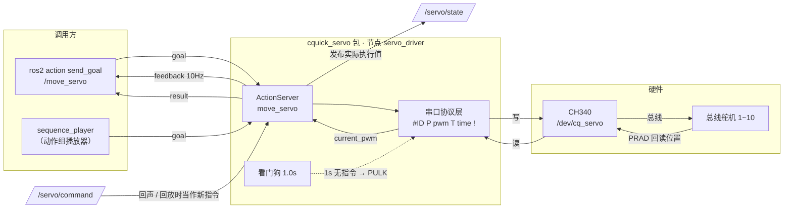

# 第 3、4 周提交说明 · 总线舵机驱动与动作组

## 一、基本信息

| 项 | 内容                                                                |
|---|-------------------------------------------------------------------|
| 姓名拼音 | WangZiai                                                          |
| 姓名 | 王子艾                                                               |
| 学号 | 20254624                                                          |
| 完成时间 | 2026-11-20                                                        |
| 硬件 | 地瓜派 RDK X5 + USB-TTL(CH340, 1a86:7523) + 总线舵机 × 10 + 独立电源 + 众灵24路舵机控制板 |
| 运行环境 | Ubuntu 22.04 + ROS2 Humble（板端 ARM64）                              |
| 工作空间 | 电脑端：`~/WangZiai/ros2_ws` 板端：`~/WangZiai/ros2_ws`               |

---

## 二、架构图

### 2.1 图形版



### 2.2 文字版

```
        键盘 / 终端
             │  ros2 action send_goal
             ▼
   ┌──────────────────────────┐
   │  servo_driver（节点）     │
   │  Action: /move_servo     │
   │  包: cquick_servo        │
   └───────┬──────────────────┘
           │  #001P1800T1000!   
           ▼
      CH340 /dev/cq_servo  ──── 总线 ────►  舵机 1~10
           ▲                                    │
           └────────  #001P1800!  ◄────────────┘
                     （PRAD 回读，用于判断到位）
```

### 2.3 包 / 节点 / 接口清单

| 项 | 名称 | 说明                                                                 |
|---|---|--------------------------------------------------------------------|
| 接口包 | `cquick_servo_interfaces` | ament_cmake，只有 msg + action，没有可执行文件                                |
| 驱动包 | `cquick_servo` | ament_python，3 个可执行：`servo_driver` / `move_client` / `sequence_player` |
| 节点名 | `/servo_driver` | 固定命名，确保 yaml 参数能对上                                                 |
| Action | `/move_servo` | 类型 `cquick_servo_interfaces/action/MoveServo`                      |
| 话题 1 | `/servo/command` | 外部指令 + 驱动回声                                 |
| 话题 2 | `/servo/state` | 驱动**实际执行**的指令                                |

---

## 三、参数表

| 参数 | 默认值                      | 原因                                  |
|---|--------------------------|-------------------------------------|
| `port` | `/dev/cq_servo`          | 用 udev 规则建的固定软链接；`ttyUSB0` 的编号会随插拔顺序变化，写死会在换口后失效 |
| `baudrate` | `115200`                 | 手册默认值；其他值经测试都通讯失败                   |
| `pwm_min` | `900`                    | 手册默认值；防止整机出现大幅度动作损坏硬件               |
| `pwm_max` | `2100`                   | 手册默认值；防止整机出现大幅度动作损坏硬件               |
| `default_duration_ms` | `800`                    | 手册默认值；兜底未知时间，且适宜演示动作情况              |
| `servo_ids` | `[1,2,3,4,5,6,7,8,9,10]` | 整机腿部分共10个总线舵机，1到10方便yaml写入          |
| `startup_reset` | `true`                   | 手册默认值；上电先全部回 1500 中位，保证每次启动姿态一致，不用手动摆 |
| `watchdog_timeout` | `1.0`                    | 1 秒没有新指令就整组卸力；太短会被正常的动作组间隙误触发，太长又失去保护意义 |
| `resend_threshold` | `30`                     | PRAD 回读与目标差超过 30 就补发一次；小于 30 属于舵机正常回差 |
| `success_tolerance` | `30` | 判"到位"的误差阈值；PRAD 回读与目标差在此之内算成功 |
| `accept_wait_timeout` | `3.0` | goal 到达时该舵机正忙，最多等 3 秒再决定拒绝；多舵机并行时不至于立刻失败 |
| `send_wait_timeout` | `1.0` | 抢总线锁最多等 1 秒，避免一条卡住整组 |
| `stop_on_finish` | `true` | 动作结束发一条 `T=0` 把舵机钉在当前位置，避免残余插值继续走 |
| `release_on_finish` | `false` | 动作结束全部 PULK 卸力；台架测试可开，整机承重时建议关 |
| `echo_ttl` | `1.0` | 回声去重窗口；太小会把回放指令误当成自己的回声而吞掉 |

> 参数都在 `cquick_servo/config/servo_params.yaml`，由 `servo.launch.py` 的 `PathJoinSubstitution` 加载。
> **注意**：yaml 顶层键必须是 `servo_driver`，写错的话参数全不生效。

---

## 四、接口契约：`MoveServo`

### 4.1 goal（可并行发出）

| 字段 | 类型 | 含义 | 约束                 |
|---|---|---|--------------------|
| `id` | `uint8` | 舵机 ID | 1~10|
| `pwm` | `uint16` | 目标位置 | 会被夹取到 `[pwm_min, pwm_max]`，即 900~2100 |
| `duration_ms` | `uint16` | 从当前位置走到目标位置的时长 | 1~9999，超过 4 位会破坏协议帧|

### 4.2 feedback（运动中持续发，10 Hz）

| 字段 | 类型 | 含义 | 什么时候发 |
|---|---|---|---|
| `current_pwm` | `uint16` | 当前插值到的位置 | 每 100 ms 一次 |
| `progress` | `float32` | 进度 0.0~1.0 | 同上，`progress = 已走步数 / 总步数` |

为什么不用 `ros2 topic echo` 看进度：**Action 的 feedback 不走话题**，必须 `--feedback` 才看得到。

### 4.3 result（结束时发一次）

| 字段 | 类型 | 含义 |
|---|---|---|
| `success` | `bool` | PRAD 回读与目标的误差是否 ≤ `resend_threshold` |
| `final_pwm` | `uint16` | 最终回读到的真实位置 |
| `message` | `string` | 成功时为空；失败时写清原因，例如 `读不到位置（PRAD 无应答）` |

### 4.4 什么时候发什么

```
调用方                ActionServer
  │  send_goal          │
  ├────────────────────►│  校验 id / pwm 范围，不合法直接 reject
  │                     │  合法则 accept，开始插值
  │◄──── feedback ──────┤  每 100ms
  │◄──── feedback ──────┤
  │◄──── result ────────┤  PRAD 回读比对后返回
  │                     │
  │  cancel_goal        │
  ├────────────────────►│  当前步做完后中止，回原位
  │◄──── result(取消) ──┤
```

---

## 五、一条启动命令

```bash
ros2 launch cquick_servo servo.launch.py
```

输出：

```text
[INFO] [launch]: All log files can be found below /home/ubuntu/.ros/log/2026-11-20-20-11-26-077244-ubuntu-2204-52466
[INFO] [launch]: Default logging verbosity is set to INFO
[INFO] [servo_driver-1]: process started with pid [52467]
[servo_driver-1] [INFO] [1795175664.831467487] [servo_driver]: ✓ 启动复位：全部舵机回 1500
[servo_driver-1] [INFO] [1795175664.831697635] [servo_driver]: 
[servo_driver-1] ┌── servo_driver 就绪 ──────────────────────────
[servo_driver-1] │   端口    /dev/cq_servo @ 115200
[servo_driver-1] │   舵机    [1, 2, 3, 4, 5, 6, 7, 8, 9, 10]
[servo_driver-1] │   限位    900 ~ 2100 · 默认 800 ms
[servo_driver-1] │   监控    看门狗 3 s · 重发阈值 ±30
[servo_driver-1] └───────────────────────────────────────────────
[servo_driver-1] [WARN] [1795175669.494304358] [servo_driver]: ⚠ 看门狗：3.0 s 无新指令 → 全部 PULR 关闭，已 PULK
```

> 只需要这一条命令，不需要另开终端 source 或手动设参数。

---

## 六、安全区间

| 层 | 范围 | 来源                       |
|---|---|--------------------------|
| 协议绝对极限 | 500 ~ 2500 | 手册写死的 PWM 可写范围，超过了会被舵机忽略 |
| 本工程安全区间 | 900 ~ 2100 | 经测试，超过区间整机会出现大幅度动作导致损坏硬件 |
| 机械中位 | 1500 | 舵臂安装前全部标定到 1500，使整机装机后对称 |
| 到位判据 | ±30 | 舵机回差，小于这个数属于正常           |

### 测试过程

1. 每次只选择一个位置的舵机开始测试；
2. 从 1500 开始，每次加减 100，发一次停 2 秒，听有没有异响、摸外壳温度；
3. 分别找到舵机无异常的边界，最终取所有舵机最保守值并往里各留一档（100）作为 `pwm_min` / `pwm_max`。

---

## 七、运行时改参数的演示记录

### 步 1：启动驱动

```bash
ros2 launch cquick_servo servo.launch.py
```
```text
**驱动端**
[INFO] [launch]: All log files can be found below /home/ubuntu/.ros/log/2026-11-20-20-11-26-077244-ubuntu-2204-52466
[INFO] [launch]: Default logging verbosity is set to INFO
[INFO] [servo_driver-1]: process started with pid [52467]
[servo_driver-1] [INFO] [1795175664.831467487] [servo_driver]: ✓ 启动复位：全部舵机回 1500
[servo_driver-1] [INFO] [1795175664.831697635] [servo_driver]: 
[servo_driver-1] ┌── servo_driver 就绪 ──────────────────────────
[servo_driver-1] │   端口    /dev/cq_servo @ 115200
[servo_driver-1] │   舵机    [1, 2, 3, 4, 5, 6, 7, 8, 9, 10]
[servo_driver-1] │   限位    900 ~ 2100 · 默认 800 ms
[servo_driver-1] │   监控    看门狗 3 s · 重发阈值 ±30
[servo_driver-1] └───────────────────────────────────────────────
[servo_driver-1] [WARN] [1795175669.494304358] [servo_driver]: ⚠ 看门狗：3.0 s 无新指令 → 全部 PULR 关闭，已 PULK
```

### 步 2：发一个带 feedback 的目标

```bash
ros2 action send_goal /move_servo cquick_servo_interfaces/action/MoveServo \
  "{id: 1, pwm: 1000, duration_ms: 1200}" --feedback
```
```text
**驱动端**
[servo_driver-1] [WARN] [1795176849.122961552] [servo_driver]: ⚠ 串口应答偏慢：12 段中有 1 段超时，实际时长拉长
[servo_driver-1] [INFO] [1795176849.394825227] [servo_driver]: ✓ [舵机 1] 到位 1004 · 误差 4
[servo_driver-1] [INFO] [1795176849.396312401] [servo_driver]: ✓ [舵机 1] 完成 · actual=1004, target=1000, error=4
[servo_driver-1] [WARN] [1795176852.428996228] [servo_driver]: ⚠ 看门狗：3.0 s 无新指令 → 全部 PULR 关闭，已 PULK

**命令端**
Waiting for an action server to become available...
Sending goal:
     id: 1
     pwm: 1000
duration_ms: 1200

Goal accepted with ID: 93685dfdd94c4766a57d475ac834c618

Feedback:
    current_pwm: 1004
progress: 0.0833333358168602

Feedback:
    current_pwm: 1003
progress: 0.1666666716337204

Feedback:
    current_pwm: 1003
progress: 0.25

Feedback:
    current_pwm: 1003
progress: 0.3333333432674408

Feedback:
    current_pwm: 1002
progress: 0.4166666567325592

Feedback:
    current_pwm: 1002
progress: 0.5

Feedback:
    current_pwm: 1002
progress: 0.5833333134651184

Feedback:
    current_pwm: 1001
progress: 0.6666666865348816

Feedback:
    current_pwm: 1001
progress: 0.75

Feedback:
    current_pwm: 1001
progress: 0.8333333134651184

Feedback:
    current_pwm: 1000
progress: 0.9166666865348816

Feedback:
    current_pwm: 1000
progress: 1.0

Result:
    success: true
final_pwm: 1004
message: actual=1004, target=1000, error=4

Goal finished with status: SUCCEEDED
```

### 步 3：发一个长动作，中途 Ctrl+C 取消

```bash
ros2 action send_goal /move_servo cquick_servo_interfaces/action/MoveServo \
  "{id: 1, pwm: 1200, duration_ms: 5000}" --feedback
```
```text
**驱动端**
[servo_driver-1] [INFO] [1795177401.620761348] [servo_driver]: ▸ [舵机 1] 1004 → 1500 · 5000 ms · 50 段
[servo_driver-1] [INFO] [1795177401.621044593] [servo_driver]: ▸ [舵机 1] 已卸力 → 自动 PULR
[servo_driver-1] [INFO] [1795177402.739075787] [servo_driver]: ▸ 收到取消请求
[servo_driver-1] [WARN] [1795177402.765300722] [servo_driver]: ⚠ [舵机 1] 取消（第 12/50 段）
[servo_driver-1] [WARN] [1795177406.864241798] [servo_driver]: ⚠ 看门狗：3.0 s 无新指令 → 全部 PULR 关闭，已 PULK

**命令端**
Waiting for an action server to become available...
Sending goal:
     id: 1
pwm: 1500
duration_ms: 5000

Goal accepted with ID: d5a64824bb134b3586fc5c793d3b7448

Feedback:
    current_pwm: 1014
progress: 0.019999999552965164

Feedback:
    current_pwm: 1024
progress: 0.03999999910593033

Feedback:
    current_pwm: 1034
progress: 0.05999999865889549

Feedback:
    current_pwm: 1044
progress: 0.07999999821186066

Feedback:
    current_pwm: 1054
progress: 0.10000000149011612

Feedback:
    current_pwm: 1064
progress: 0.11999999731779099

Feedback:
    current_pwm: 1073
progress: 0.14000000059604645

Feedback:
    current_pwm: 1083
progress: 0.1599999964237213

Feedback:
    current_pwm: 1093
progress: 0.18000000715255737

Feedback:
    current_pwm: 1103
progress: 0.20000000298023224

^CCanceling goal...
Feedback:
    current_pwm: 1113
progress: 0.2199999988079071

Goal canceled.
Result:
    success: false
final_pwm: 1004
message: canceled

Goal finished with status: CANCELED
```

### 步 4：把 `pwm_max` 改小，验证越界被拒

```bash
ros2 param set /servo_driver pwm_max 1600
```
```text
**命令端**
Set parameter successful
```

```bash
ros2 action send_goal /move_servo cquick_servo_interfaces/action/MoveServo \
  "{id: 1, pwm: 1700, duration_ms: 1000}"
```
```text
**驱动端**
[servo_driver-1] [WARN] [1795177502.579971346] [servo_driver]: ✗ 拒绝 [舵机 1] · pwm 1700 超出 900~1600

**命令端**
Waiting for an action server to become available...
Sending goal:
     id: 1
pwm: 1700
duration_ms: 1000

Goal was rejected.
```

### 步 5：把 `pwm_max` 改回去，同一个目标就能发

```bash
ros2 param set /servo_driver pwm_max 2100
```
```text
**命令端*
Set parameter successful
```

```bash
ros2 action send_goal /move_servo cquick_servo_interfaces/action/MoveServo \
  "{id: 1, pwm: 1700, duration_ms: 1000}"
```
```text
**驱动端**
[servo_driver-1] [WARN] [1795177978.260013350] [servo_driver]: ⚠ 串口应答偏慢：10 段中有 3 段超时，实际时长拉长
[servo_driver-1] [INFO] [1795177978.532456972] [servo_driver]: ✓ [舵机 1] 到位 1691 · 误差 9
[servo_driver-1] [INFO] [1795177978.532797100] [servo_driver]: ✓ [舵机 1] 完成 · actual=1691, target=1700, error=9
[servo_driver-1] [WARN] [1795177981.566312125] [servo_driver]: ⚠ 看门狗：3.0 s 无新指令 → 全部 PULR 关闭，已 PULK

**命令端**
Waiting for an action server to become available...
Sending goal:
     id: 1
pwm: 1700
duration_ms: 1000

Goal accepted with ID: 2dcc08ce33d2487bbad8d8ecf9cb6f80

Result:
    success: true
final_pwm: 1691
message: actual=1691, target=1700, error=9

Goal finished with status: SUCCEEDED
```


### 步 6：回放 bag

```bash
source install/setup.bash          # 见下方警告
ros2 bag play bag/run1
```

>  只 source `/opt/ros/humble`、不 source 工作空间的话，`ros2 bag play` 会打两行
> `Ignoring a topic '/servo/command', reason: package 'cquick_servo_interfaces' not found`，


```text
**驱动端**
[servo_driver-1] [WARN] [1795178907.947063683] [servo_driver]: ⚠ 看门狗：3.0 s 无新指令 → 全部 PULR 关闭，已 PULK
[servo_driver-1] [INFO] [1795178910.782139802] [servo_driver]: ▸ [舵机 1] 已卸力 → 自动 PULR
[servo_driver-1] [WARN] [1795178916.810161083] [servo_driver]: ⚠ 看门狗：3.0 s 无新指令 → 全部 PULR 关闭，已 PULK

**命令端**
[INFO] [1795178936.536396375] [rosbag2_storage]: Opened database '/home/ubuntu/ros2_ws/bag/run1/run1_0.db3' for READ_ONLY.
[INFO] [1795178936.536450780] [rosbag2_player]: Set rate to 1
[INFO] [1795178936.538528880] [rosbag2_player]: Adding keyboard callbacks.
[INFO] [1795178936.538552448] [rosbag2_player]: Press SPACE for Pause/Resume
[INFO] [1795178936.538560274] [rosbag2_player]: Press CURSOR_RIGHT for Play Next Message
[INFO] [1795178936.538566428] [rosbag2_player]: Press CURSOR_UP for Increase Rate 10%
[INFO] [1795178936.538572044] [rosbag2_player]: Press CURSOR_DOWN for Decrease Rate 10%
[INFO] [1795178936.538797690] [rosbag2_storage]: Opened database '/home/ubuntu/ros2_ws/bag/run1/run1_0.db3' for READ_ONLY.
```


---

## 八、bag 录制与内容说明

### 8.1 录的内容

只录两个话题：

```bash
ros2 bag record -o bag/run1 /servo/command /servo/state
```

| 话题 | 原因                  |
|---|---------------------|
| `/servo/command` | 外部请求 + 驱动回声，能看出发出命令 |
| `/servo/state` | 驱动实际执行的值，能看出实际执行命令  |

### 8.2 info

```bash
ros2 bag info bag/run1
```
```text
Files:             run1_0.db3
Bag size:          25.5 KiB
Storage id:        sqlite3
Duration:          11.384019431s
Messages:          42
Topic information: Topic: /servo/command | Type: cquick_servo_interfaces/msg/ServoCommand | Count: 21 | Serialization Format: cdr
                   Topic: /servo/state   | Type: cquick_servo_interfaces/msg/ServoCommand | Count: 21 | Serialization Format: cdr
```

> 回放命令、实际输出和"动作是否复现"的判断见 **第七节 · 步 6**。

---

## 九、接线与供电

### 9.1 线序

| 线色 | 含义 | 接到 |
|---|---|---|
| 红 | V+ 电源正 | 独立电源 **5~8.4V** 正极 |
| 黑 | GND 电源负 | 电源负极 **且必须和 CH340 的 GND 共地** |
| 橙 / 白 | 信号（单总线） | CH340 的 TXD（RXD 可不接） |


### 9.2 实测电压

| 项 | 实测     |
|---|--------|
| 电池空载电压 | 7.99 V（万用表 UT33D+，DC 档） |


### 9.3 上电与验证顺序

```
接好线（先地线，后电源，最后信号）
  → 上舵机电源
  → 插 CH340
  → ls -l /dev/cq_servo
  → 跑驱动，看有没有 “启动复位：全部舵机回 1500”
```

---

## 十、动作组 yaml

### 10.1 存放位置

`cquick_servo/config/actions/*.yaml`，通过 `setup.py` 的 `data_files` 装到 `share/cquick_servo/config/actions/`，运行时用 `get_package_share_directory()` 拼路径读。
### 10.2 长什么样

```yaml
name: squat_down
description: 膝关节蹲下
steps:
  - name: 蹲下
    servos:
      - {id: 3, pwm: 1800, duration_ms: 800}
      - {id: 4, pwm: 1800, duration_ms: 800}
      - {id: 5, pwm: 1350, duration_ms: 800}
      - {id: 6, pwm: 1350, duration_ms: 800}
      - {id: 7, pwm: 1800, duration_ms: 800}
      - {id: 8, pwm: 1800, duration_ms: 800}
```

> 上面这份就是仓库里 `config/actions/squat_down.yaml` 的原样内容。现场演示时只用了 3、4、5、6 号（结构上 7、8 号不在位），改动作只改 yaml，代码一行没动。


### 10.3 字段说明

| 字段 | 含义            |
|---|---------------|
| `name` | 动作组名字，只用于日志   |
| `steps` | 步骤列表，可同时多舵机并行动|
| `id` / `pwm` / `duration_ms` | 与 Action 的 goal 字段一一对应 |

### 10.4 关键设计

- **一步内并发**：把要同时动的关节写在同一个 step 里，不要拆成多个 step 串起来，否则会一个接一个地动。
- **步间同步用 result，不用 sleep**：`sequence_player` 对每步 `get_result_async()`，等所有 goal 都返回 `success` 才进下一步。`time.sleep(1)` 这种写法在换慢舵机后必然错位。
- **`duration_ms` 怎么定**：按"这一步要走的角度差 ÷ 舵机的可用速度"估，再留 20% 余量；太短会追不上（result 判失败），太长整套动作拖沓。
- **现场换 yaml**：直接把新文件丢进 `config/actions/`，`sequence_player` 用参数指定文件名即可，不用改一行代码。

---

## 十一、踩坑记录

### 踩坑 1：发PID都返回“读不到位置（PRAD 无应答）”

- **现象**：`send_goal` 全部 `success: false`，message 是 `读不到位置（PRAD 无应答）`，但 `/servo/command` 和 `/servo/state` 里都能看到插值在正常推进。
- **怀疑**：1： 线接错；2： 串口掉了；3： 舵机 ID 和 `servo_ids` 对不上。
- **怎么验证**：停掉驱动，绕过 ROS 直接用 pyserial 发命令：
```text
▸ 端口 /dev/cq_servo @ 115200 · 共 1 条
ID  指令                   应答                   结果
--------------------------------------------------------------
2  #001PRAD!            (无应答)                ✗
--------------------------------------------------------------
✗ 1 条无应答 （0/1）
  ```
- **结论**：舵机出场 id 是 000，所以 001~006 都扫描不上。后来用 `#000PID001!` 把 0 号改成 001（回 `#001P!#OK!`）才扫得到；再接第 2 只舵机时又发现它也是 000，两只撞 ID 只能一次接一只改。

### 踩坑 2：设备重插后串口变成 ttyUSB1，驱动再也读不到舵机

- **现象**：ros2 launch ... port:=/dev/ttyUSB0 能起来，但每个 goal 都返回 读不到位置（PRAD 无应答）；ls -l /dev/ttyUSB* 里只有 /dev/ttyUSB1，ttyUSB0 根本不存在。
- **怀疑**：1：串口线松了；2：舵机没供电；3：串口号变了。
- **怎么验证**：用终端查看串口设备号，再用裸串口工具试新号：
```text
$ ls -l /dev/ttyUSB*
crw-rw---- 1 root dialout 188, 1 11月20 18:23 /dev/ttyUSB1     
                                           
$ python3 ~/ros2_ws/tools/servo_cli.py --port /dev/ttyUSB1 --cmd '#003PRAD!'
▸ 端口 /dev/ttyUSB1 @ 115200 · 共 1 条
ID  指令                   应答                   结果
--------------------------------------------------------------
3  #003PRAD!            #003P1504!           ✓
--------------------------------------------------------------
✓ 全部应答 （1/1）
```
- **结论**：USB 转串口的编号不固定，重插或重新枚举就会从 ttyUSB0 漂到 ttyUSB1、ttyUSB2，代码和 launch 里写死 ttyUSB0 必然失联。用 udev 规则给它固定名：
```text
# /etc/udev/rules.d/99-cq-servo.rules
SUBSYSTEM=="tty", ATTRS{idVendor}=="1a86", ATTRS{idProduct}=="7523", \
  SYMLINK+="cq_servo", MODE="0666"

sudo udevadm control --reload-rules && sudo udevadm trigger --subsystem-match=tty
ls -l /dev/cq_servo
```

之后 `servo_params.yaml` 的 `port` 默认值就写 `/dev/cq_servo`，启动不用再带参数；拔插多少次、编号怎么变都不影响。

### 踩坑 3：地瓜派连同一个 Wi-Fi，IP 变了导致 SSH 连不上

- **现象**：20号 ssh sunrise@10.109.133.99 ssh连接一切正常；21号 Connection timed out，ping 也不通，但电脑和板子都还连着同一个 SSID（CMCC - yumu）。
- **怀疑**：1：板子没上电或死机；2：板子掉线没连上 Wi-Fi；3：DHCP 重新分配，IP 变了。
- **怎么验证**：先看电脑自己在哪个网段，再扫这个网段，最后用主机名验明正身：
```text
$ ping 10.109.133.99
请求超时。                                

$ ipconfig | findstr IPv4
IPv4 地址 . . . . . . . . . . . . : 172.28.198.96  

$ nmap -p22 172.28.198.0/24 --open
Nmap scan report for 172.28.198.99
22/tcp open  ssh                              

$ ssh sunrise@172.28.198.99 hostname
rdkx5                                         
```
- **结论**：同一个 SSID 背后有两个地址池（10.109.133.x 和 172.28.198.x），路由器把电脑和板子一起迁到了新池，板子 IP 从 10.109.133.99 变成 172.28.198.99，因此不是板子坏了，是地址变了。

---

## 十二、下电三步

| 顺序 | 动作 | 命令 / 操作                                                | 为什么必须这样 |
|---|---|--------------------------------------------------------|---|
| 1 | 卸力 | `ros2 service call /servo_shutdown std_srvs/srv/Trigger` | 保持扭矩时齿轮一直顶着力，手掰、拆装都会伤齿轮；卸力后整个机构是松的 |
| 2 | 断电池 | 拔舵机电源                                                  | 带电插拔信号线会产生浪涌，可能烧舵机板；先断动力电，信号线才是安全的 |
| 3 | 关机 | `sudo shutdown now`                                    | 直接断电可能正在写 eMMC，文件系统损坏后下次开不了机 |

---

## 十三、录屏

完整演示：[BV1ZqyLzMEfA](https://www.bilibili.com/video/BV1ZqyLzMEfA)

- 覆盖内容：启动 → 发目标看 feedback → 中途取消 → 改参数被拒 / 恢复 → bag 回放 → 动作组连跑 → 换一套 yaml 再跑 → 安全下电
- 录制方式：OBS 录屏，终端和舵机同框；每段开头有 `echo 姓名 + date` 的时间戳

---

## 十四、附件清单

| 文件 | 内容 |
|---|---|
| `README.md` | 本文件 |
| `调试记录.md` | 每天干了什么、卡在哪、怎么过的 |
| `03_装配问题记录.md` | 装配过程中遇到的 5 个问题与处理 |
| `01_串口设备.png` | `ls -l /dev/ttyUSB*` / `/dev/cq_servo` |
| `01_PID回显.png` | `#001PID!` 回显 |
| `01_中立位标定.png` | `#001PRAD!` 回读 1500 附近 |
| `01_电池电压.jpg` | 万用表读数（7.99 V） |
| `01_物料登记表.md` | 物料清单（6 项） |
| `02_接口编译.png` | `colcon build` 接口包 |
| `02_接口_move_servo.png` | `ros2 interface show` 的 action 定义 |
| `02_launch一键启动.png` | 一条 launch 起驱动 + 参数从 yaml 加载 |
| `02_action_反馈.png` | feedback 滚动 + result |
| `02_取消生效.png` | Ctrl+C 后 `CANCELED` |
| `02_限位保护.png` | `pwm_max` 调小后 goal 被拒 |
| `02_param_set现场.png` | `ros2 param set` 现场改限位、再恢复 |
| `02_bag_info.png` | `ros2 bag info` 输出 |
| `02_参数自检.png` | grep 证明参数没有硬编码在逻辑里 |
| `03_整机照片.jpg` | 整机正面 |
| `03_接线特写.jpg` | 舵机与供电接线特写 |
| `03_ID扫描.png` | 逐个 ID 扫描结果 |
| `03_多舵机动作_关键帧_1.png` `/ _2.png` | 动作执行关键帧 |
| `bag/run1/` | 录制的 bag（`/servo/command` + `/servo/state`） |
| `src/` | 两个包：`cquick_servo_interfaces` + `cquick_servo` |

---
