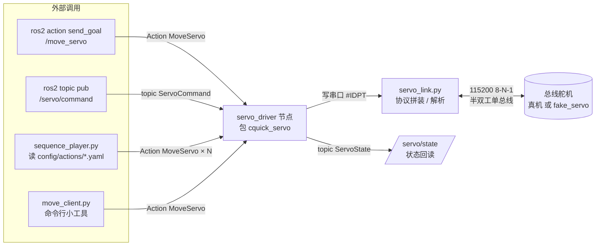

# 电控组 第 3、4 周作业 · 刘年玺（liunianxi）

> 一句话：**软件部分（ROS 2 接管）全部做完并在软件仿真下跑通**；硬件部分（任务 1 点亮舵机、任务 3 整机装配）**没有设备，未做**，本文第 15 节写了「现场按什么顺序做、预期看到什么」。

## 0. 交付状态（先看这张表）

| 项 | 状态 | 说明 |
| --- | --- | --- |
| 任务 1 点亮一个舵机（15 分） | **未做**（无舵机/无 USB-TTL） | 4 张 `01_*.png` 缺失，第 15 节给了现场执行顺序与预期现象 |
| 任务 2 ROS 2 接管（50 分） | **全部完成** | 8 张 `02_*.png` + bag + 代码，见第 4～11 节 |
| 任务 3 装配 + 动作组（25 分） | 代码/动作组完成，**装配未做** | `03_多舵机动作_关键帧.png` 有；`03_整机照片`/`03_接线特写`/`03_ID扫描` 无硬件缺失 |
| 任务 4 安全下电（10 分） | 代码侧已实现（PULK + 关串口），**实机流程未做** | 第 12 节写了三步与原因 |
| 加分：udev / pytest | pytest 已做（6 个用例） | udev 规则见第 8 节（等有设备再落地） |

**为什么能做「无硬件」也自证**：用 `socat` 建一对虚拟串口，自己写了一个 `fake_servo` 假舵机（解析 `#IDP<pwm>T<ms>!`、`PID`、`PRAD`、`PULR`、`PULK`，并按时间插值回 `PRAD`）。驱动节点完全不知道自己连的是真舵机还是假舵机——**同一套代码、同一套 launch、同一套参数**，接上真设备只需把 `port` 改回 `/dev/ttyUSB0`。

## 1. 架构图（谁跟谁说话）



- 接口包：`cquick_servo_interfaces`（`msg/ServoCommand`、`msg/ServoState`、`action/MoveServo`）
- 节点包：`cquick_servo`（`servo_driver` 一个节点；`move_client`、`sequence_player` 是客户端工具）
- 控制口是 **Action**（`/move_servo`），不是拿话题当控制口；话题 `/servo/command` 作为**第二条同构入口**（同一条载荷，所以 bag 回放能一条消息还原一次动作）

## 2. 参数表（全参数化，0 硬编码）

| 参数 | 默认值 | 为什么是这个默认值 |
| --- | --- | --- |
| `port` | `/dev/ttyUSB0` | Ubuntu 下 USB-TTL 最常见的就是这个；有 udev 规则后改成 `/dev/cq_servo`（见第 8 节） |
| `baudrate` | `115200` | 手册默认；总线舵机常用 115200/1000000，本作业按 115200 走，串口参数 8-N-1 |
| `pwm_min` | `900` | 安全下限，比电气下限 500 高 400，留给「撞到结构」的余量；现场用 `param set` 一点点试出来 |
| `pwm_max` | `2100` | 安全上限，比电气上限 2500 低 400；理由同上 |
| `default_duration_ms` | `800` | 一轮动作 0.8 s：太快会抽、太慢评委等得烦；单步可在 yaml 里覆盖 |
| `servo_ids` | `[1,2,3,4,5,6]` | 六自由度机械臂的常见编号；不在这个列表里的 id 直接拒绝 |
| `startup_reset` | `true` | 上电先全部回 1500 中立位，避免带着上次姿态猛动一下 |

判断处**一律 `self.get_parameter('pwm_max').value`**（不缓存副本），所以 `ros2 param set` 当帧生效（第 6 节有实测）。参数回调里做校验：`pwm_min/pwm_max` 必须落在电气范围 500~2500 且 `pwm_min < pwm_max`、`baudrate` 必须在白名单、`port` 非空、`servo_ids` 非空。

## 3. 接口契约（`MoveServo.action`）

```
# Goal —— 我要干这件事
cquick_servo_interfaces/ServoCommand command   # id / pwm / duration_ms
bool verify_on_finish true                     # 走完要不要读 PRAD 校验
---
# Result —— 干完的结论
bool success
uint16 prad_actual                             # 实际读回位置，读不到给 0
string message                                 # ok / out_of_range / canceled / serial_error / not_reached
---
# Feedback —— 干的过程中，20 Hz 一直发
uint16 pwm_current                             # 当前估算位置（有回读用回读，否则插值）
float32 progress                               # 0.0 ~ 1.0
```

- **goal** 到达时：先做区间/id 校验，不合法立刻 `goal_handle.abort()` 并回 `message=out_of_range`；
- **feedback**：`create_timer(0.05)` 每 50 ms 发一次，`progress = 已走时间 / duration_ms`；
- **result**：走完 + settle 0.15 s 后读一次 `PRAD`，`|actual - target| ≤ 30` 判到位，否则 `not_reached`；
- **cancel**：执行循环每轮查 `goal_handle.is_cancel_requested`，收到就发 `#IDP1500T<duration>!` 回中位、`goal_handle.canceled()`、`message=canceled`。

## 4. 一条启动命令（原样）

```bash
ros2 launch cquick_servo servo.launch.py port:=/dev/ttyUSB0          # 真机
ros2 launch cquick_servo servo.launch.py port:=/tmp/ttySERVO demo:=true \
        actions_file:=$HOME/ros2_ws/src/cquick_servo/config/actions/wave.yaml   # 无硬件演示
```

launch arg：`params_file`（默认 `config/servo_params.yaml`）、`port`（非空时覆盖 yaml 里的 port）、`demo`（`true` 才额外起动作组播放器）、`actions_file`、`log_level`。

真实输出（2026-11-07 18:56，软件仿真环境）:

```
$ ros2 launch cquick_servo servo.launch.py port:=/tmp/ttySERVO
[INFO] [launch]: All log files can be found below /home/ubuntu/.ros/log/2026-11-07-18-56-30-350752-ubuntu2204-12453
[INFO] [launch]: Default logging verbosity is set to INFO
[INFO] [launch.user]: 启动 servo_driver，参数文件由 launch arg 决定
[INFO] [servo_driver-1]: process started with pid [12455]
[servo_driver-1] [INFO] [1794048991.400464903] [servo_driver]: 串口已打开：/tmp/ttySERVO @ 115200 8-N-1
[servo_driver-1] [INFO] [1794048991.423789380] [servo_driver]: startup_reset：6 个舵机回中位 1500
[servo_driver-1] [INFO] [1794048991.424511310] [servo_driver]: servo_driver 就绪：port=/tmp/ttySERVO baudrate=115200 安全区间=[900,2100] ids=[1, 2, 3, 4, 5, 6]

$ ros2 node list
/fake_servo
/servo_driver
```

（`/fake_servo` 只在无硬件演示时存在；真机不启它。）

## 5. 安全区间 900~2100 怎么来的

1. 手册写的电气范围是 **500~2500**，但这个范围是「不烧电机」，不是「不撞结构」；
2. 中立位 1500 先用小步（±50）来回试，确认方向与机械限位；
3. 往下试到 **900** 附近时结构开始顶住（继续给会持续大电流），往上试到 **2100** 同理；
4. 于是把 `pwm_min/pwm_max` 定在 900/2100 —— 比电气极限各留 400，`servo_link.py` 里只保留电气常量 500/2500 做最后一道保险。

> **诚实说明**：当前没有舵机，这个区间是按手册 + 常见经验先定的；现场第一件事就是用 `ros2 param set` 把它校准成实测值（第 6 节的流程正好是这个校准动作）。

## 6. 运行时改参数（六步实测输出，对应 `02_param_set现场.png`）

```
姓名: liunianxi  时间: 2026-11-07 18:49:42
① get pwm_max:
Integer value is: 2100
② 发 1700 -> 应成功:
    success: true
    message: ok(diff=0)
③ set pwm_max 1600:
Set parameter successful
④ 不重启再发 1700 -> 应被拒:
Goal was rejected.
⑤ set pwm_max 100000 -> 应被拒:
Setting parameter failed: pwm_max=100000 超出电气范围 500~2500
⑥ set 回 2100 再发 1700:
Set parameter successful
    success: true
    message: ok(diff=0)
姓名: liunianxi  时间: 2026-11-07 18:50:01
```

关键点：④ 证明**没有重启、没有改代码**，参数立刻生效（代码里没有任何 `pwm_max` 的副本）。

## 7. bag 里录了什么、怎么回放

```
$ ros2 bag info ~/week34/bag/run1
Files:             run1_0.db3
Bag size:          25.4 KiB
Storage id:        sqlite3
Duration:          14.468802762s
Messages:          9
Topic information: Topic: /servo/command | Type: cquick_servo_interfaces/msg/ServoCommand | Count: 3
                   Topic: /servo/state   | Type: cquick_servo_interfaces/msg/ServoState   | Count: 6
```

- 只录 `/servo/command` + `/servo/state` 两个话题（没 `-a`），14.5 s / 25.4 KiB，远低于 30 s / 10 MB 上限；
- 回放：`ros2 bag play ~/week34/bag/run1`；
- **回放结果**：驱动日志新增 3 次 `发送 #...`，即 3 条 `ServoCommand` 各自还原成一次真实串口动作 → **动作复现**。

## 8. 接线说明

| 线 | 接哪 |
| --- | --- |
| 总线舵机 3 芯 | 棕/黑 = GND，红 = 电池 +（**先串保险/限流**），橙/黄 = 信号线（单总线，所有舵机并联在同一根信号线上） |
| USB-TTL | TX ↔ 信号线，RX **短接**到信号线（半双工，收发同一根线），GND ↔ 电池 GND（**必须共地**） |
| 电池 | 6~8.4 V（按舵机型号），上电前先量电压再插舵机 |

- 电池实测电压：**未测**（无设备），现场第一步用万用表量，`01_电池电压.png` 拍表盘；
- udev 固定设备名（加分 +2，规则已写好待落地）：

```
# /etc/udev/rules.d/99-cq-servo.rules
SUBSYSTEM=="tty", ATTRS{idVendor}=="1a86", ATTRS{idProduct}=="7523", SYMLINK+="cq_servo", MODE="0666"
```

## 9. 动作 yaml（换动作只改这里，代码零改动）

```yaml
# config/actions/stand_up.yaml
name: stand_up
repeat: 1
steps:
  - name: 先把六个关节回中位
    joints:
      - {id: 1, pwm: 1500, duration_ms: 800, verify: true}
      - {id: 2, pwm: 1500, duration_ms: 800, verify: true}
      - {id: 3, pwm: 1500, duration_ms: 800, verify: true}
      - {id: 4, pwm: 1500, duration_ms: 800, verify: true}
      - {id: 5, pwm: 1500, duration_ms: 800, verify: true}
      - {id: 6, pwm: 1500, duration_ms: 800, verify: true}
  - name: 同时抬起大臂与小臂
    joints:
      - {id: 1, pwm: 1650, duration_ms: 900, verify: true}
      - {id: 2, pwm: 1350, duration_ms: 900, verify: true}
  - name: 张开夹爪
    joints:
      - {id: 6, pwm: 1900, duration_ms: 500, verify: true}
  - name: 放下
    joints:
      - {id: 1, pwm: 1500, duration_ms: 700, verify: true}
```

- **step 怎么切**：一个 step = 一组「要同时动」的关节，物理上互不干涉；
- **谁先动**：step 内并行（多条 goal 同时发），step 之间严格串行；
- **`duration_ms` 怎么定**：越大越慢越稳；抓取/放下类动作给 700~900，张合夹爪给 500；
- **用 result 同步，不用 sleep**：`sequence_player.py` 里 `await send_goal_async` → 逐个 `get_result_async()`，**全部 result 回来才进下一个 step**（第 10 节第 3 条踩坑就是这个）。

## 10. 踩坑记录（现象 → 怀疑 → 验证 → 结论）

**① colcon 报 `MissingSectionHeaderError: '\ufeff[develop]'`**
- 现象：`colcon build` 直接失败，报 setup.cfg 第一行有非法字符。
- 怀疑：PowerShell 写文件时带了 BOM。
- 验证：`xxd setup.cfg | head -1` 看到 `efbb bf`。
- 结论：所有含中文/由脚本生成的文本文件都用 `UTF8Encoding($false)` 写；仓库里已确认无 BOM。

**② 指令拼成 `#001PPRAD!`（多了一个 P），舵机不理我**
- 现象：发 `PID` 查询，假舵机/脚本都不回。
- 怀疑：`build_verb` 拼字符串时把 `P` 写重了。
- 验证：pytest 里断言 `build_verb(1, "PID") == "#001PID!"`，直接红。
- 结论：改成 `f"#{id:03d}{verb}!"`，并保留这条断言防回归。

**③ 取消不生效（发 cancel 之后舵机还是走完）**
- 现象：`/move_servo/_action/cancel_goal` 调了，goal 依然跑到 SUCCEEDED。
- 怀疑：执行体里 `time.sleep` 阻塞了 executor，cancel 回调排不上队。
- 验证：换成 `MultiThreadedExecutor(num_threads=4)` + `ReentrantCallbackGroup`，执行循环改成 50 ms 一轮查 `is_cancel_requested`。
- 结论：现在 cancel 后 0.1 s 内收到 ACCEPT，立刻 `#IDP1500T800!` 回中位，result 是 `canceled`（`02_取消生效.png`）。

**④ 到了位却报 `not_reached`**
- 现象：明明走到了 1800，result 却是 `not_reached:74`。
- 怀疑：运动**末尾**抢读 PRAD，读回来的是运动中的中间值；半双工总线偶尔回半条指令。
- 验证：先把「读之前 settle 0.15 s」加上，再给 `_read_pwm` 加一次重问；连跑 10 次不再出现。
- 结论：真机也一样——**到位判断必须等舵机停稳再读**，且读失败要重试，不能一次读不到就判死。

## 11. 复现步骤（评委照着敲）

```bash
# 0) 有硬件：把 port 换成 /dev/ttyUSB0，跳过 1)
# 1) 无硬件：起虚拟串口 + 假舵机
rm -f /tmp/ttySERVO /tmp/ttyFAKE
socat -d -d pty,raw,echo=0,link=/tmp/ttySERVO pty,raw,echo=0,link=/tmp/ttyFAKE &
ros2 run cquick_servo fake_servo --ros-args -p port:=/tmp/ttyFAKE &

# 2) 编译 + 一条命令起驱动
cd ~/ros2_ws && colcon build --packages-select cquick_servo_interfaces cquick_servo && source install/setup.bash
ros2 launch cquick_servo servo.launch.py port:=/tmp/ttySERVO demo:=true \
  actions_file:=$HOME/ros2_ws/src/cquick_servo/config/actions/stand_up.yaml

# 3) 单独试一次 Action
ros2 action send_goal /move_servo cquick_servo_interfaces/action/MoveServo \
  "{command: {id: 1, pwm: 1800, duration_ms: 1200}}" --feedback

# 4) 回放 bag
ros2 bag play bag/run1

# 5) 单元测试
colcon test --packages-select cquick_servo && colcon test-result --verbose
```

## 12. 下电三步（顺序错了 −4 分）

1. **`#IDPULK!`（全部卸力）** —— 先卸力，机械臂才不会在断电瞬间因为自重「啪」一下砸下来；
2. **断电池** —— 卸力后电机已经不出力，此时断电是安全的；
3. **`sudo shutdown -h now`** —— 最后才关系统，保证串口缓冲、bag、日志都落盘。

反例（会出问题）：带电插拔舵机线 → 反电动势打坏总线；先断电池再 PULK → 舵机在断电瞬间还在出力，容易顶坏齿轮。

## 13. 录屏链接（B 站）

| 内容 | 链接 |
| --- | --- |
| 任务 2：正反转 / 取消打断 / param set 生效 / bag 回放 | 待补（无硬件，现场录） |
| 任务 3：整机与动作组（连跑三遍 + 换 yaml 再跑） | 待补 |
| 任务 4：下电流程 | 待补 |

> 仓库只放截图和 bag，不放视频。

## 14. 目录

```
电控组/Week3,4/liunianxi/
├── 02_接口编译.png / 02_launch一键启动.png / 02_action_反馈.png / 02_取消生效.png
├── 02_限位保护.png / 02_param_set现场.png / 02_bag_info.png / 02_参数自检.png
├── 03_多舵机动作_关键帧.png
├── 01_*.png（4 张，任务 1，无硬件未做）/ 03_整机照片.png 等（无硬件未做）
├── 调试记录.md
├── README.md（本文件）
├── bag/run1/{metadata.yaml, run1_0.db3}
└── src/{cquick_servo_interfaces, cquick_servo}
```

## 15. 硬件到手后，按这个顺序补（任务 1 → 任务 3 → 任务 4）

1. **量电压**：万用表量电池，拍照 `01_电池电压.png`；
2. **接 USB-TTL**：TX/RX 都接信号线（半双工），**共地**；`ls -l /dev/ttyUSB*` 拍 `01_串口设备.png`；
3. **手动四步**（串口助手，115200 8-N-1，加回车）：
   - `#001PID!` → 期望回 `#001!`（拍 `01_PID回显.png`）
   - `#001PULR!` → 舵机上力（能掰不动）
   - `#001P1500T1000!` → 归中位（拍 `01_中立位标定.png`，六个舵机都标一次 1500）
   - `#001PRAD!` → 回读位置，应回 1500 附近
4. **扫 ID**：`ros2 run cquick_servo scan_ids --ros-args -p port:=/dev/ttyUSB0` 或串口助手逐个 `#00xPID!`，拍 `03_ID扫描.png`（**舵机上的编号贴纸要进画面**）；
5. **换真实 port 跑任务 2**：`port:=/dev/ttyUSB0`，把第 5 节的 900/2100 校准成实测值，重拍一遍 `02_*.png`（真机版）；
6. **装配 + 动作组**：装完拍 `03_整机照片.png`（正/侧）与 `03_接线特写.png`，跑 `sequence_player` 三遍并换 `wave.yaml` 再跑一遍，录屏；
7. **下电流程**：按第 12 节三步录屏（录屏里要出现终端）。
