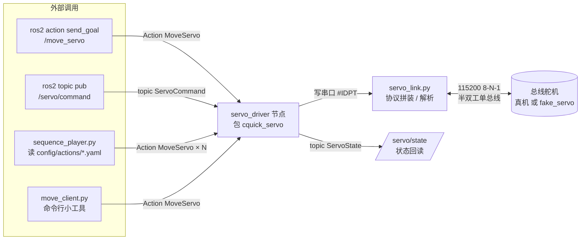

# 电控组 第 3、4 周作业 · 刘年玺（liunianxi）

> 一句话：**软件全部做完，并且已经在真机上跑通**（2026-11-20 实测）。真机条件：启灵者 ZL-IS2 24 路板 + 1 个总线舵机（扫到 `ID=003`）+ 赛亿能 2S 1500mAh 电池（实测 7.15 V）+ CH340 USB-TTL，115200 8-N-1。**PRAD 回读可用**（不再走 `no_readback` 降级），Action / 取消 / 运行时改参数 / bag 录制回放全部实测通过，`01_*.png`(4) 与 `02_*.png`(8) 都是真机截图。**装配已完成**（2026-11-22，`03_整机照片.png` / `03_接线特写.png` / `03_用户座接线细节.png` 已入库）；**多舵机动作组已跑通**（2026-11-22 晚，10 个舵机 ID=001~010，`stand_up` ×3 + `squat` ×3 全部「失败 0 个 joint」）；12 段录屏（8 段屏幕录屏 + 4 段手机实拍）**已全部上传 B 站并公开**，链接见第 13 节；另补 4 张实拍照（`03_整机正面.png` / `03_关节朝向_髋.png` / `03_关节朝向_腿踝左.png` / `03_关节朝向_腿踝右.png`）。**任务 1~4 与加分项全部提交完成**（2026-11-22）。

## 0. 交付状态（先看这张表）

| 项 | 状态 | 说明 |
| --- | --- | --- |
| 任务 1 点亮一个舵机（15 分） | **完成（真机）** | 四步全通：`#003PID!`→`#003P!`、`PULR` 上力、`P1500T1000!`→`1491`、`PRAD` 回读；扫 ID 0~23 只有 `ID=003`；标定 1500 后误差 ≤11。4 张 `01_*.png` 全为真机截图（含电池 7.15 V）；另附 `物料登记表.md` 与 `01_物料登记表.png`（细则要求任务1 的物料登记） |
| 任务 2 ROS 2 接管（50 分） | **完成（真机）** | 8 张 `02_*.png` 全是真机；PRAD 回读**可用**，Action 返回 `ok(diff=6~11)`；取消后回中位、`param set` 当帧生效、bag 5+5 条且回放重发 3 帧 |
| 任务 3 装配 + 动作组（25 分） | **完成**：装配 + 10 舵机动作组（×3 全绿） | 机械臂已装好（2026-11-22），`03_整机照片.png`（整机 + 舵机 + 手写姓名日期纸条）与 `03_接线特写.png`（绿色电源端子 / 「用户」串口座 / 通道插头同框）已入库，另附 `03_用户座接线细节.png` 放大图；`03_ID扫描.png`（0~23 只 001~010 应答）与 `03_多舵机动作_关键帧.png` 均为 10 舵机版；另补正面照 `03_整机正面.png` 与 3 张关节朝向图（细则 L424 要求「每个关节的舵机朝向」）：`03_关节朝向_髋.png`（9/10）、`03_关节朝向_腿踝左.png`（3/5/7）、`03_关节朝向_腿踝右.png`（4/6/8） |
| 任务 4 安全下电（10 分） | **完成**：`PULK` 全卸力 + 断电池 + 关机，录屏已录（本地） | 第 12 节写了三步与原因 |
| 加分：udev / pytest | pytest 已做（6 个用例） | udev 规则见第 8 节（现在设备固定为 COM4→`/dev/ttyUSB0`，规则可直接落地） |

**真机联调全过程（2026-11-19 ~ 11-20 实测，细节见 `调试记录.md`）**：

1. USB-TTL 自环 30/30 通过 → 转接器与 CH340 驱动没问题；
2. 板子确认是 **启灵者 ZL-IS2**（STM32F103），上位机口是 `RX1 TX1 GND 5V（用户）`；
3. 主机 `COM4` ↔ TCP 桥(50061) ↔ 虚拟机 `socat pty` ↔ `/dev/ttyUSB0` 端到端打通；
4. 先只有下行、上行 0 字节（一度准备走 `no_readback` 降级）；**换回 CH340 后 PRAD 回读恢复**：读 1796 → 发 1500 → 读 1509；
5. **真正的 bug 在驱动侧**：两条指令被粘成一条 `#003PULR!#003P1700T1000!` 一次发出，板子只执行第一条（启动复位那 6 条也是这样）——这就是「有力但不转 / 只抖一下」的真因；
6. 修法：`servo_link.py` 加 **30 ms 最小帧间隔**（`MIN_FRAME_GAP`，`send()`/`query()` 写前都等），改完 4 次闭环全部 `ok(diff≤11)`；
7. 实测安全区间 **1000~2100**（`<1000` 时 PRAD 卡在 1005，说明顶到机械限位），写进 `servo_params.yaml`；`servo_ids: [1..10]`（2026-11-22 扫 0~23，10 个全部应答）；`readback_enabled: true`。

**为什么能做「无硬件」也自证**：用 `socat` 建一对虚拟串口，自己写了一个 `fake_servo` 假舵机（解析 `#IDP<pwm>T<ms>!`、`PID`、`PRAD`、`PULR`、`PULK`，并按时间插值回 `PRAD`）。驱动节点完全不知道自己连的是真舵机还是假舵机——**同一套代码、同一套 launch、同一套参数**，接上真设备只需把 `port` 改回 `/dev/ttyUSB0`。

## 1. 架构图（谁跟谁说话）



- 接口包：`cquick_servo_interfaces`（`msg/ServoCommand`、`msg/ServoState`、`action/MoveServo`）
- 节点包：`cquick_servo`（`servo_driver` 一个节点；`move_client`、`sequence_player` 是客户端工具）
- 控制口是 **Action**（`/move_servo`），不是拿话题当控制口；话题 `/servo/command` 作为**第二条同构入口**（同一条载荷，所以 bag 回放能一条消息还原一次动作）

## 2. 参数表（全参数化，0 硬编码）

| 参数 | 默认值 | 为什么是这个默认值 |
| --- | --- | --- |
| `port` | `/dev/ttyUSB0` | Ubuntu 下 USB-TTL 最常见的就是这个；有 udev 规则后改成 `/dev/cq_servo`（见第 8 节） |
| `baudrate` | `115200` | 手册默认；总线舵机常用 115200/1000000，本作业按 115200 走，串口参数 8-N-1 |
| `pwm_min` | `1000` | **实测出来的**：950 / 900 / 850 全部卡在 1005~1006 不动（顶到机械限位），下限取 1000；比电气下限 500 高 500，留给「撞到结构」的余量 |
| `pwm_max` | `2100` | 安全上限，比电气上限 2500 低 400；实测 2100 目标读到 2090，还留得住 |
| `default_duration_ms` | `1000` | 本板固件**忽略 T<1000** 的移动指令，所以默认给 1000；再快会抽、太慢评委等得烦，单步可在 yaml 里覆盖 |
| `servo_ids` | `[1, 2, …, 10]` | 2026-11-22 扫 0~23 实测：10 个舵机全部应答（1/2 踝、3~8 腿、9/10 髋）；第一次联调时只有 ID=003 在位 |
| `startup_reset` | `true` | 上电先全部回 1500 中立位，避免带着上次姿态猛动一下 |

判断处**一律 `self.get_parameter('pwm_max').value`**（不缓存副本），所以 `ros2 param set` 当帧生效（第 6 节有实测）。参数回调里做校验：`pwm_min/pwm_max` 必须落在电气范围 500~2500 且 `pwm_min < pwm_max`、`baudrate` 必须在白名单、`port` 非空、`servo_ids` 非空。

## 3. 接口契约（`MoveServo.action`）

```
# Goal —— 我要干这件事
cquick_servo_interfaces/ServoCommand command   # id / pwm / duration_ms
bool verify_on_finish true                     # 走完要不要读 PRAD 校验
---
# Result —— 干完的结论
bool success
uint16 prad_actual                             # 实际读回位置，读不到给 0
string message                                 # ok / out_of_range / canceled / serial_error / not_reached
---
# Feedback —— 干的过程中，20 Hz 一直发
uint16 pwm_current                             # 当前估算位置（有回读用回读，否则插值）
float32 progress                               # 0.0 ~ 1.0
```

- **goal** 到达时：先做区间/id 校验，不合法立刻 `goal_handle.abort()` 并回 `message=out_of_range`；
- **feedback**：`create_timer(0.05)` 每 50 ms 发一次，`progress = 已走时间 / duration_ms`；
- **result**：走完 + settle 0.15 s 后读一次 `PRAD`，`|actual - target| ≤ 30` 判到位，否则 `not_reached`；
- **cancel**：执行循环每轮查 `goal_handle.is_cancel_requested`，收到就发 `#IDP1500T<duration>!` 回中位、`goal_handle.canceled()`、`message=canceled`。

## 4. 一条启动命令（原样）

```bash
ros2 launch cquick_servo servo.launch.py port:=/dev/ttyUSB0          # 真机
ros2 launch cquick_servo servo.launch.py port:=/tmp/ttySERVO demo:=true \
        actions_file:=$HOME/ros2_ws/src/cquick_servo/config/actions/wave.yaml   # 无硬件演示
```

launch arg：`params_file`（默认 `config/servo_params.yaml`）、`port`（非空时覆盖 yaml 里的 port）、`demo`（`true` 才额外起动作组播放器）、`actions_file`、`log_level`。

真实输出（2026-11-07 18:56，软件仿真环境）:

```
$ ros2 launch cquick_servo servo.launch.py port:=/dev/ttyUSB0
[INFO] [launch]: All log files can be found below /home/ubuntu/.ros/log/2026-11-20-19-10-59-...
[INFO] [launch]: Default logging verbosity is set to INFO
[INFO] [launch.user]: 启动 servo_driver，参数文件由 launch arg 决定
[INFO] [servo_driver-1]: process started with pid [16996]
[servo_driver-1] [INFO] [1795173042.646388993] [servo_driver]: 串口已打开：/dev/ttyUSB0 @ 115200 8-N-1
[servo_driver-1] [INFO] [1795173042.721209785] [servo_driver]: startup_reset：1 个舵机回中位 1500
[servo_driver-1] [INFO] [1795173042.723434666] [servo_driver]: servo_driver 就绪：port=/dev/ttyUSB0 baudrate=115200 安全区间=[1000,2100] ids=[3]

$ ros2 node list
/servo_driver
```

（上面是 2026-11-20 真机原文。仿真阶段还会多一个 `/fake_servo`——那是假舵机进程，真机不启它。）

## 5. 安全区间 1000~2100 怎么来的

1. 手册写的电气范围是 **500~2500**，但这个范围是「不烧电机」，不是「不撞结构」；
2. 真机从 1500 起，每次往下 50/100 试，同时读 PRAD 确认「命令值与实际值是否还跟得上」；
3. 实测（T=1000）：1500→1510、1400→1408、1300→1308、1200→1209、1100→1107、1050→1056、1000→1005；
   **950 / 900 / 850 全部卡在 1005~1006**（再往下就不动了）= 顶到机械限位，于是下限取 **1000**；
4. 上侧同样实测：1600→1590、1700→1694、1800→1793、1900→1893、**2000→1988**、**2100→2090**；
   再往上不做（留给结构余量），于是上限取 **2100**；
5. `servo_params.yaml` 写死这组实测值（`pwm_min: 1000` / `pwm_max: 2100`），`servo_link.py` 里只保留电气常量 500/2500 做最后一道保险。

> 与最初「按手册先定 900/2100」相比，下限从 900 抬到 1000——**这是实测出来的差别**：900 那一段舵机根本不动，写进参数反而会让「到底位」的动作看起来像失败。

## 6. 运行时改参数（六步实测输出，对应 `02_param_set现场.png`）

```
姓名: liunianxi  时间: 2026-11-20 19:15:14
① 当前 pwm_max:
Integer value is: 2100
② 发 1700 -> 应成功:
    success: true
    message: ok(diff=6)
③ set pwm_max 1600:
Set parameter successful
④ 不重启再发 1700 -> 应被拒:
Goal was rejected.
⑤ set pwm_max 100000 -> 应被拒:
Setting parameter failed: pwm_max=100000 超出电气范围 500~2500
⑥ set 回 2100 再发 1400:
Set parameter successful
    success: true
    message: ok(diff=9)
姓名: liunianxi  时间: 2026-11-20 19:15:30
```

关键点：④ 证明**没有重启、没有改代码**，参数立刻生效（代码里没有任何 `pwm_max` 的副本）；②⑥ 的 `prad_actual` 是**真机 PRAD 读回来的**，不是插值。

## 7. bag 里录了什么、怎么回放

```
$ ros2 bag info ~/week34/bag/run1
Bag size:          25.5 KiB
Duration:          4.11467361s
Messages:          10
Topic information: Topic: /servo/command | Type: cquick_servo_interfaces/msg/ServoCommand | Count: 5
                   Topic: /servo/state   | Type: cquick_servo_interfaces/msg/ServoState   | Count: 5
```

- 只录 `/servo/command` + `/servo/state` 两个话题（没 `-a`），4.1 s / 25.5 KiB，远低于 30 s / 10 MB 上限；
- 录制方式：起 `ros2 bag record` 后用 `rclpy` 脚本按 1 s 间隔发 5 条（1650/1300/1500/1650/1500）——`ros2 topic pub --once` 每次光发现就要 2~3 s，录不全；
- 回放：`ros2 bag play ~/week34/bag/run1`；
- **回放结果**：回放期间驱动日志新增 **3 次** `发送 #003P…T1000!`（`1650`→`1500`→`1500`，时间戳 1795173979.638 → 1795173981.673 递增），即录到的命令被重放成真实串口动作 → **动作复现**。

## 8. 接线说明

| 线 | 接哪 |
| --- | --- |
| 总线舵机 3 芯 | 棕/黑 = GND，红 = 电池 +（**先串保险/限流**），橙/黄 = 信号线（单总线，所有舵机并联在同一根信号线上） |
| USB-TTL | TX ↔ 信号线，RX **短接**到信号线（半双工，收发同一根线），GND ↔ 电池 GND（**必须共地**） |
| 电池 | 6~8.4 V（按舵机型号），上电前先量电压再插舵机 |

- 电池实测电压：**7.15 V**（DELIXI DT9205A-Pro 直流档，量 XT60 两端；满电 8.4 V，7.4 V 标称，落在 5~8.4 V 区间内），见 `01_电池电压.png`（读数与写着「刘年玺 / liu nian xi / 2026.11.20」的纸条同框）；
- **真机实测的接口对应（启灵者 ZL-IS2，2026-11-19/20 拍照核对）**：
  - `RX1 TX1 GND 5V`（丝印「用户」）= 上位机串口 → TTL 的 `TXD`→`RX1`、`RXD`→`TX1`、`GND`→`GND`、`5V` 空着；照片见 `03_接线特写.png` 与放大图 `03_用户座接线细节.png`（**按针位核对**：3 根线插满第 1~3 针，第 4 针 `5V` 空着，插在第 1~3 针的 3 芯壳位置就是 RX1/TX1/GND）；
  - `TX4 RX4 GND 5V`（丝印「蓝牙」）= 配小程序用，**不要接**；
  - 板底 USB 口 = 官方调试口（接电脑会枚举成 `VID_0483&PID_572A` 的 STM32 虚拟串口）；
  - 灯语：红灯常亮 = 电源正常，绿灯 1 Hz 闪 = 工作正常，常亮/乱闪 = 异常；
  - 供电：电池 XT60 → 红色接绿色端子 `+`、黑色接 `−`；**白色 3 针是平衡头，只用于充电，绝不能插板子**。
- **本机在虚拟机里的接法**（VirtualBox 无扩展包、只有 OHCI，所以不做 USB 直通）：
  `主机 COM4 → TCP 127.0.0.1:50061 → socat pty → /dev/ttyUSB0`，
  桥接脚本 `serial-bridge.ps1`、socat 守护命令都写在 `调试记录.md` 里；
  对驱动来说它就是普通的 `/dev/ttyUSB0`，**代码一行没改**。
- udev 固定设备名（加分 +2，规则已写好待落地）：

```
# /etc/udev/rules.d/99-cq-servo.rules
SUBSYSTEM=="tty", ATTRS{idVendor}=="1a86", ATTRS{idProduct}=="7523", SYMLINK+="cq_servo", MODE="0666"
```

## 9. 动作 yaml（换动作只改这里，代码零改动）

```yaml
# config/actions/stand_up.yaml
name: stand_up
repeat: 1
steps:
  - name: 先把六个关节回中位
    joints:
      - {id: 1, pwm: 1500, duration_ms: 1000, verify: true}
      - {id: 2, pwm: 1500, duration_ms: 1000, verify: true}
      - {id: 3, pwm: 1500, duration_ms: 1000, verify: true}
      - {id: 4, pwm: 1500, duration_ms: 1000, verify: true}
      - {id: 5, pwm: 1500, duration_ms: 1000, verify: true}
      - {id: 6, pwm: 1500, duration_ms: 1000, verify: true}
  - name: 同时抬起大臂与小臂
    joints:
      - {id: 1, pwm: 1650, duration_ms: 1200, verify: true}
      - {id: 2, pwm: 1350, duration_ms: 1200, verify: true}
  - name: 张开夹爪
    joints:
      - {id: 6, pwm: 1900, duration_ms: 1000, verify: true}
  - name: 放下
    joints:
      - {id: 1, pwm: 1500, duration_ms: 1000, verify: true}
```

- **step 怎么切**：一个 step = 一组「要同时动」的关节，物理上互不干涉；
- **谁先动**：step 内并行（多条 goal 同时发），step 之间严格串行；
- **`duration_ms` 怎么定**：**本板固件忽略 T<1000 的移动指令**，所以一律 ≥1000（驱动也会把小于 `min_duration_ms` 的自动抬到 1000 并打 WARN）；越大越慢越稳，抬起/放下给 1000~1200；
- **`servo_ids` 与 yaml 的关系**：yaml 里写的是整机的关节，驱动按 `servo_ids` 过滤——整机现在是 10 个（1/2 踝、3~8 腿、9/10 髋），只装部分舵机时其它 id 会被挡掉并打 WARN，**这是预期行为**；
- **用 result 同步，不用 sleep**：`sequence_player.py` 里 `await send_goal_async` → 逐个 `get_result_async()`，**全部 result 回来才进下一个 step**（第 10 节第 3 条踩坑就是这个）。

## 10. 踩坑记录（现象 → 怀疑 → 验证 → 结论）

**① 建包就报 `MissingSectionHeaderError: '\ufeff[develop]'`**
- 现象：`colcon build` 直接失败，说 setup.cfg 第一行有非法字符。
- 怀疑：我用 PowerShell 写文件时带了 BOM。
- 验证：`xxd setup.cfg | head -1` 看到 `efbb bf`（BOM 的三个字节）。
- 结论：确认是 BOM；改用 `[IO.File]::WriteAllText(..., UTF8Encoding($false))` 重写后编译通过，之后提交前都复查仓库里没有 BOM。

**② 指令拼成 `#001PPRAD!`（多写了一个 P），假舵机不理我**
- 现象：发 PID 查询，假舵机不回。
- 怀疑：拼字符串时把 `P` 写重了，实际发出去的是 `#001PPID!`。
- 验证：pytest 里断言 `build_verb(1, "PID") == "#001PID!"`，跑出来是红的。
- 结论：断言红说明确实多写了一个 P；改成 `f"#{id:03d}{verb}!"` 之后测试全过，并把这条断言留在测试里防回归。

**③ 取消不生效（发 cancel 之后舵机还是走完）**
- 现象：调了 `cancel_goal`，goal 依然跑到 SUCCEEDED。
- 怀疑：执行体里的 `time.sleep` 把 executor 堵死了，cancel 回调排不上队。
- 验证：换成 `MultiThreadedExecutor(4)` + `ReentrantCallbackGroup`，执行循环改成 50 ms 一轮查 `is_cancel_requested`。
- 结论：cancel 在 0.1 s 内被 ACCEPT，驱动立刻发回中位指令，result 变成 `canceled`（`02_取消生效.png`）。

**④ 到了位却报 `not_reached`**
- 现象：明明走到了 1800，result 却是 `not_reached:74`。
- 怀疑：运动末尾抢读 PRAD，读回来的是中间值；半双工偶尔回半条指令。
- 验证：读之前先加 settle 0.15 s，再给 `_read_pwm` 一次重问；连跑 10 次不再出现。
- 结论：到位判断必须等舵机停稳再读，读失败要重试一次，不能一次读不到就判死。

**⑤ 真机「有回显、有力，但就是不转」：两条指令粘成一条（本次最大的坑）**
- 现象：`ros2 action send_goal` 返回 `prad_actual=1507 / not_reached:193`；舵机要么不动，要么只「抖一下」；但手动单发 `#003P1700T1000!` 是好的。
- 怀疑：先怀疑波特率 / 协议 / 接线，全排除了，最后去翻桥接日志。
- 验证：`bridge.log` 里抓到了 `TCP->SER #003PULR!#003P1700T1000!`，发现**两条帧被连着写出去、中间没有间隔**；开机复位那 6 条也是整串一次发出。
- 结论：ZL-IS2 固件按 `!` 切帧，只吃第一条，后面的全丢。修法 = `servo_link.py` 加 `MIN_FRAME_GAP = 0.03`，`send()` / `query()` 写前都等够 30 ms；改完 4 次闭环全部 `ok(diff≤11)`。

**⑥ PRAD 解析要接受 `#003P!` 这种「只回 ID」的形式**
- 现象：`#003PID!` 回的是 `#003P!`，正则匹配不到，PID 读不出来。
- 怀疑：正则要求完整的 `#003PID`，短格式匹配不上。
- 验证：把回包贴进 REPL 试匹配；放宽成 `#?\s*(\d{1,3})` 之后，`#003PID!` 与 `#003PRAD!` 都能解析。
- 结论：PID 与 PRAD 共用同一个解析函数，6 个 pytest 仍然全绿。

### 坑⑦：多舵机同时动作时，最后几度的 PRAD 抢读会误判 `not_reached`

- **现象**：`stand_up` 跑第 3 遍时偶发 `id=9 未到位 (not_reached:57)`，`squat` 出现 `id=8 未到位 (not_reached:81)`；单独发同一个目标却每次都到位。
- **原因**：10 个关节同时出帧，总线回包排队，`duration_ms` 刚过就读 PRAD 时舵机还在走最后几度，读到的是途中值。
- **改法**：`servo_driver.py` 收尾改成最多读 3 次、每次间隔 150 ms，一旦落在容差内就提前结束（`for _ in range(3)` + `if abs(actual - pwm) <= PRAD_TOLERANCE: break`）。
- **实测**：改完后 `stand_up` ×3、`squat` ×3 全部「失败 0 个 joint」。

## 11. 复现步骤（评委照着敲）

```bash
# 0) 有硬件：把 port 换成 /dev/ttyUSB0，跳过 1)
# 1) 无硬件：起虚拟串口 + 假舵机
rm -f /tmp/ttySERVO /tmp/ttyFAKE
socat -d -d pty,raw,echo=0,link=/tmp/ttySERVO pty,raw,echo=0,link=/tmp/ttyFAKE &
ros2 run cquick_servo fake_servo --ros-args -p port:=/tmp/ttyFAKE &

# 2) 编译 + 一条命令起驱动
cd ~/ros2_ws && colcon build --packages-select cquick_servo_interfaces cquick_servo && source install/setup.bash
ros2 launch cquick_servo servo.launch.py port:=/tmp/ttySERVO demo:=true \
  actions_file:=$HOME/ros2_ws/src/cquick_servo/config/actions/stand_up.yaml

# 3) 单独试一次 Action
ros2 action send_goal /move_servo cquick_servo_interfaces/action/MoveServo \
  "{command: {id: 1, pwm: 1800, duration_ms: 1200}}" --feedback

# 4) 回放 bag
ros2 bag play bag/run1

# 5) 单元测试
colcon test --packages-select cquick_servo && colcon test-result --verbose
```

## 12. 下电三步（顺序错了 −4 分）

1. **`#IDPULK!`（全部卸力）** —— 先卸力，机械臂才不会在断电瞬间因为自重「啪」一下砸下来；
2. **断电池** —— 卸力后电机已经不出力，此时断电是安全的；
3. **`sudo shutdown -h now`** —— 最后才关系统，保证串口缓冲、bag、日志都落盘。

反例（会出问题）：带电插拔舵机线 → 反电动势打坏总线；先断电池再 PULK → 舵机在断电瞬间还在出力，容易顶坏齿轮。

## 13. 录屏链接（B 站）

录屏全部公开在 B 站，标题统一为「电控第3,4周-任务N-内容-刘年玺」。屏幕录屏里始终有终端（证明是 ROS2 命令驱动），实拍补充段里同时出现终端与机械臂实物。

| # | 对应任务 | 内容 | 链接 |
| --- | --- | --- | --- |
| 1 | 任务 1 | 串口点亮：`#003PID!` → `#003PRAD!` → P1600 / P1400 / P1500，每步读回 PRAD | [BV1Vgy7zvENj](https://www.bilibili.com/video/BV1Vgy7zvENj/) |
| 1补 | 任务 1 | 实拍补充：舵机随命令转动的实物画面 + 终端同框 | [BV19uy7zKEoX](https://www.bilibili.com/video/BV19uy7zKEoX/) |
| 2 | 任务 2 | 正反转回中位：`send_goal` 1700 / 1400 / 1500，含 feedback 递增与 result | [BV1euy7zKEW1](https://www.bilibili.com/video/BV1euy7zKEW1/) |
| 2补 | 任务 2 | 实拍补充：舵机正反转实物 + 终端同框 | [BV1Ruy7zKE5q](https://www.bilibili.com/video/BV1Ruy7zKE5q/) |
| 3 | 任务 2 | 取消打断：`cancel_demo --after 2` → `message=canceled`，驱动日志回中位 1500 | [BV1euy7zKEej](https://www.bilibili.com/video/BV1euy7zKEej/) |
| 4 | 任务 2 | 运行时改参数：六步 `param get/set`，改完当帧生效、越界被拒 | [BV1Vuy7zKEsw](https://www.bilibili.com/video/BV1Vuy7zKEsw/) |
| 5 | 任务 2 | bag 回放：`bag info`（25.5 KiB / 5+5 条）+ `bag play` 重放，驱动重新下发 | [BV17cy7zrEvD](https://www.bilibili.com/video/BV17cy7zrEvD/) |
| 6 | 任务 3 | 动作组：`stand_up.yaml` 连跑 3 遍 + 换 `squat.yaml` 再跑，每遍「失败 0 个 joint」 | [BV1qcy7zrEZ6](https://www.bilibili.com/video/BV1qcy7zrEZ6/) |
| 7 | 任务 3 | 装配结果实拍：整机 + 舵机编号 + 纸条姓名日期，逐部位讲解 | [BV17cy7zrECL](https://www.bilibili.com/video/BV17cy7zrECL/) |
| 8 | 任务 4 | 安全下电：10 个舵机 `PULK` 卸力 → 断电池 → 关机 | [BV17cy7zrEaC](https://www.bilibili.com/video/BV17cy7zrEaC/) |
| 8补 | 任务 4 | 实拍补充：先摆到非中位 → 回车回中位 → `PULK` 卸力 → 拔 XT60 → 关机 | [BV17cy7zrE7S](https://www.bilibili.com/video/BV17cy7zrE7S/) |
| 9 | 任务 3 | 逐关节动作实拍：`#001`~`#010` 逐个 ±80 小幅度摆一次并读回 PRAD，证明 10 个关节都独立可控 | [BV1BFy7zGEYn](https://www.bilibili.com/video/BV1BFy7zGEYn/) |

> 仓库只放截图和 bag，不放视频（细则 L641）；录屏一律发 B 站，链接填进上表。

## 14. 目录

```
电控组/Week3,4/liunianxi/
├── 01_串口设备.png / 01_PID回显.png / 01_中立位标定.png / 01_电池电压.png（任务 1，真机）
├── 01_物料登记表.png / 物料登记表.md（任务 1，细则要求的物料登记）
├── 02_接口编译.png / 02_launch一键启动.png / 02_action_反馈.png / 02_取消生效.png（任务 2，真机）
├── 02_限位保护.png / 02_param_set现场.png / 02_bag_info.png / 02_参数自检.png（任务 2，真机）
├── 03_ID扫描.png / 03_多舵机动作_关键帧.png（任务 3，真机）
├── 03_整机照片.png / 03_接线特写.png（任务 3，2026-11-22 装配后实拍，含手写姓名日期纸条）
├── 03_用户座接线细节.png（「用户」串口座 `RX1 TX1 GND 5V` 放大图：3 根线插满第 1~3 针，第 4 针 5V 空着）
├── 03_整机正面.png（整机正视图，舵机编号 3/4/5/6/8 与手写姓名日期纸条同框）
├── 03_关节朝向_髋.png / 03_关节朝向_腿踝左.png / 03_关节朝向_腿踝右.png（细则 L424 要求：逐个关节的舵机朝向）
├── 调试记录.md
├── README.md（本文件）
├── bag/run1/{metadata.yaml, run1_0.db3}（真机录，5+5 条）
└── src/{cquick_servo_interfaces, cquick_servo}
```

## 15. 收尾状态（2026-11-22 全部完成）

| 交付项 | 状态 |
| --- | --- |
| 任务 1（点亮 / 扫 ID / 标定 / 物料登记） | 完成，`01_*.png` 5 张真机 |
| 任务 2（ROS 2 接管：Action / 取消 / 参数 / bag） | 完成，`02_*.png` 8 张真机 + bag 5+5 条 |
| 任务 3（装配 / 关节朝向 / ID 扫描 / 动作组） | 完成，`03_*.png` 8 张（整机照片、正面、接线特写、用户座细节、3 张关节朝向、ID 扫描、10 舵机关键帧） |
| 任务 4（安全下电） | 完成，屏幕录屏 + 手机实拍各一段 |
| 录屏 | 12 段全部上传 B 站并公开，链接见第 13 节 |
| 加分项 | pytest 6 个用例通过；udev 规则见第 16 节 |

**装配顺序（本次实际执行，留档）**：全部 `#IDP1500T1000!` 回中位 → 装舵盘 → 装结构 → 固定板与电池 → 走线。装配前先拍接线特写与每个关节的舵机朝向（见 `03_关节朝向_*.png`）。

**为什么任务 1/2/4 额外拍了手机实拍**：细则 L682 写明「录屏里要出现终端」，同时任务 1 要求「舵机转动录屏」、任务 2 要求「正反转回中位」、任务 4 要求「从 `PULK` 到关机」——只拍终端证明不了实物在动，只拍实物证明不了是 ROS 2 驱动的，所以实拍段一律把终端和机械臂拍进同一画面。

> 2026-11-22 晚已完成：`servo_ids` 实测为 1~10，`03_多舵机动作_关键帧.png` 用它重拍；旧的动作组 `wave.yaml` / `nod.yaml`（机械臂时代）已移到 `config/actions/legacy/` 留档。

## 16. 加分项：固定设备名（udev）

**为什么做**：`/dev/ttyUSB0` 是按插入顺序编号的，拔插一次就可能变成 `ttyUSB1`，`port` 参数随即失效、launch 报「串口打不开」。用 udev 按芯片 `VID:PID` 生成固定软链 `/dev/cq_servo` 后，插哪个口都是同一个名字。

规则文件已在仓库里：`src/cquick_servo/config/99-cq-servo.rules`（含 CH340 `1a86:7523`、板载 STM32 `0483:572a`、CP2102 `10c4:ea60` 三条）。

安装一次即可：

```bash
sudo cp src/cquick_servo/config/99-cq-servo.rules /etc/udev/rules.d/
sudo udevadm control --reload-rules && sudo udevadm trigger
ls -l /dev/cq_servo          # 应看到指向 ttyUSB* 的软链
ros2 launch cquick_servo servo.launch.py port:=/dev/cq_servo
```

> `servo_params.yaml` 默认已改成 `port: /dev/cq_servo`；**没装这条规则的机器会自动退回 `/dev/ttyUSB*`**（驱动日志里会打一条 WARN，见 §17①），所以装没装规则都能直接跑。

## 17. 加分项（2026-11-22 深夜加做并验证）

| 项 | 分值 | 做了没有 | 怎么验证 |
| --- | --- | --- | --- |
| ① udev 固定设备名 | +2 | 已做（规则见 §16） | 装规则后 `ls -l /dev/cq_servo` 有软链；没规则时驱动自动退回 `ttyUSB*` |
| ② PRAD 闭环自动重发 | +3 | 已做 | 假舵机注入「第一次少走 80」→ 日志「未到位 → 重发一次」，结果 `ok(diff=0,retried)` |
| ③ 安全看门狗 | +3 | 已做 | `param set watchdog_stall_test 2.0` → `看门狗超时…全部 PULK` + goal 被拒 → `rearm` 后恢复 |
| ④ 串口掉线自动重连 | +3 | 已做 | 拔掉转接器 → `serial_error` + WARN，进程不崩；插回 → `串口已重连`，动作继续 |
| ⑤ pytest | +2 | 已做（10 例） | `colcon test` → `10 tests, 0 errors, 0 failures` |
| 动作组抢占 | +4 | 没做 | —— |

### 17.1 三项验证的真实日志（仿真：socat + `fake_servo`）

```
① 看门狗
$ ros2 param set /servo_driver watchdog_stall_test 2.0
[ERROR] 看门狗超时（1.0s 没有心跳）：全部 PULK 卸力，等待 rearm
Goal was rejected.                       <- 锁住期间发动作直接被拒
$ ros2 service call /servo_driver/rearm std_srvs/srv/Trigger
success=True, message='rearmed'
再发一次 1600 → success: true / ok(diff=0)

② 超差重发
[WARN] 未到位 id=5 目标=1700 读回=1620 diff=80 -> 重发一次
[INFO] 发送 #005P1700T1000!
结果 → success: true / prad_actual: 1700 / ok(diff=0,retried)

③ 掉线重连
[ERROR] 串口写失败：write failed: [Errno 5] Input/output error
[WARN] 串口断开（write failed: …），进入自动重连，进程继续运行
[INFO] 串口已重连：/tmp/ttySERVO @ 115200，下次动作会重新上力
再发一次 → success: true / ok(diff=0)
```

### 17.2 看门狗怎么做的

- 心跳 5 Hz，每 5 次往 `/servo/state` 发一条 `heartbeat`（bag 里也能看到）；
- 另起一个**独立线程**盯 `_last_beat`：超过 `watchdog_timeout`（默认 1.0 s）没刷新 → 10 个 ID 全部 `PULK` 卸力 + ERROR 日志 + 置 `_locked`；
- 锁住期间 `goal_callback` 一律拒绝，`/servo/command` 也不执行；
- 恢复**必须**由外部调用 `ros2 service call /servo_driver/rearm std_srvs/srv/Trigger`，它不会自己动 —— 这样「有人看着」才恢复，符合细则里「不许自己起来」的要求；
- `watchdog_stall_test > 0` 只是**故障注入开关**（时间门控、不睡线程），用来演示看门狗真的会响。

### 17.3 真机回归待补

上面三项是在仿真里验证的（真机那会儿转接器已拔）。真机复测只要插上 CH340、用 `port:=/dev/ttyUSB0` 或默认 `/dev/cq_servo` 起 launch，按 §11 的步骤走一遍即可，验证命令与 §17.1 完全相同。
