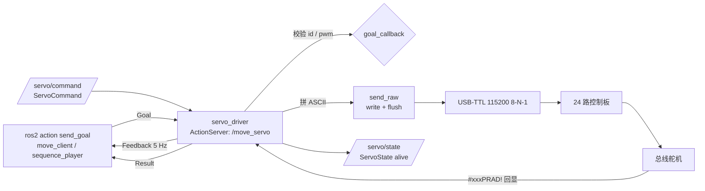
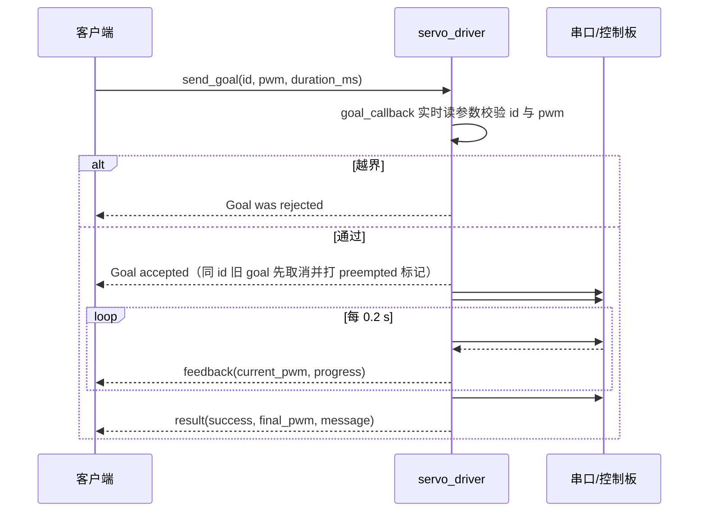

# CQuick 电控组 · 第 3、4 周考核 · 王煊赫（wangxuanhe）

任务 1 点亮舵机 → 任务 2 ROS2 接管（自定义 msg + Action + 全参数化 + bag）→ 任务 3 动作组（yaml 驱动）→ 任务 4 安全下电。

## 0. 交付清单

| 内容 | 位置 | 状态 |
|---|---|---|
| 任务 1 截图 4 张 | `01_串口设备.png` / `01_电池电压.png` / `01_PID回显.png` / `01_中立位标定.png` | 已交 |
| 任务 2 截图 8 张 | `02_*.png` | 已交 |
| bag 数据 | `bag/run1/`（`metadata.yaml` + `run1_0.db3`，25.4 KiB） | 已交 |
| 两个 ROS2 包 | `src/cquick_servo_interfaces/`、`src/cquick_servo/` | 已交 |
| 动作用 yaml | `src/cquick_servo/config/actions/`（`home.yaml` / `stand_up.yaml` / `wave.yaml` / `desk_test.yaml`） | 已交 |
| 演示/取证脚本 | `src/cquick_servo/`：`demo_joints.sh`（逐关节 ±300 演示）、`demo_poweroff.sh`（下电三步，输出带时间戳）、`demo_cancel.py`（取消取证客户端） | 已交 |
| 加分项材料 | `加分项/`（udev 规则 + 验证脚本 + `04_pytest.png` / `04_udev固定设备名.png`） | 部分交 |
| 调试记录 | `调试记录.md` | 已交 |
| 录屏（B 站，仓库不放视频） | 见第 16 节 | 任务 1–4 全部已传 |
| 任务 3 截图 | `03_整机照片.png` / `03_整机照片_侧面.png` / `03_接线特写.png` / `03_ID扫描.png` / `03_多舵机动作_关键帧.png` | 已交 |

`build/`、`install/`、`log/` 已进 `.gitignore`，仓库里只有源码和截图。所有文本文件行尾统一 LF（`.gitattributes` 里 `* text=auto eol=lf`），否则在 Windows 上编辑过的 `.sh` 拿到 Linux 会满屏 `$'\r': 未找到命令`（踩过，见调试记录 11-21）。

## 1. 架构



| 项 | 值 |
|---|---|
| 接口包（ament_cmake） | `cquick_servo_interfaces`：`msg/ServoCommand`、`msg/ServoState`、`action/MoveServo` |
| 节点包（ament_python） | `cquick_servo`：`servo_driver` / `move_client` / `sequence_player` / `scan_ids` / `joint_probe` / `pose_tool` |
| Action | `/move_servo` |
| 调试话题 | `/servo/command`（bag 回放用，与 Action 共用同一个 `send_raw`） |
| 心跳话题 | `/servo/state`（0.2 s 一条，看门狗依据） |
| 服务 | `/servo_driver/torque_off`、`/servo_driver/watchdog_reset`、`/servo_driver/watchdog_trip`、`/servo_driver/read_all`（均 `std_srvs/Trigger`；`read_all` 回 `"1:1502 2:1491 …"`，读不到记 -1） |

一次 goal 的时序：



## 2. 参数表

| 参数 | 默认值 | 为什么是这个默认值 |
|---|---|---|
| `port` | `/dev/cq_servo` | udev 规则绑定的固定名，换 USB 口、换机器都不用改代码 |
| `baudrate` | `115200` | 控制板固定 115200，改错只会收到乱码 |
| `pwm_min` | `900` | 结构实测下限，实测 500 直接被越界拒收 |
| `pwm_max` | `2100` | 结构实测上限，实测 2200 会被拒收，2100 时舵臂到位不憋劲 |
| `default_duration_ms` | `800` | 客户端没给 duration 时的兜底，0.8 s 走完全程不猛跳 |
| `servo_ids` | `[1,2,3,4,5,6,7,8,9,10]` | 实测清单：`scan_ids` 扫 1–24，只有 1–10 有回显，故以此拒绝不存在的 ID |
| `startup_reset` | `true` | 上电把全体压到 1500 中立位并**一直保持**，这就是初始站姿（一次性 4000 ms，不做二次修正） |
| `speed_pwm_per_s` | `600` | 抢占接续时按此限速，新 goal 不猛冲 |
| `watchdog_timeout_s` | `1.0` | 心跳或执行停摆超过 1 s 就卸力锁死 |
| `prad_retry` | `1` | 未到位自动重发一次，够用且不会反复撞结构 |

代码里不出现上述任何字面量：`servo_driver.py` 全部走 `declare_parameter`，判断处全部实时 `get_parameter().value`。

## 3. 接口契约（MoveServo）

| 段 | 字段 | 含义 |
|---|---|---|
| Goal | `uint8 id` / `uint16 pwm` / `uint16 duration_ms` | 哪颗舵机、走到哪个 PWM、计划耗时（=0 时用 `default_duration_ms`） |
| Result | `bool success` / `uint16 final_pwm` / `string message` | 是否到位（PRAD 与目标差 ≤30）、最后一次读回值、原因 |
| Feedback | `uint16 current_pwm` / `float32 progress` | PRAD 实测位置、进度 0~1，动作期间 5 Hz 发布 |

message 取值：`success`（到位）/ `already in place`（已在目标位）/ `canceled`（被取消）/ `preempted`（被新 goal 抢占）/ `Not in place, target:…, actual:…, diff:…`（未到位并写出差多少）/ `serial read fail`（串口读不到）。

发送时机：Feedback 在 `_run_motion` 循环每 0.2 s 一次；Result 在动作走完、被判取消、被抢占后各返回一次。

## 4. 启动

一条命令：

```bash
ros2 launch cquick_servo servo.launch.py
```

真实输出（2026-11-21 05:01，整机 10 颗上机实测，时间与 PID 随机器变化）：

```text
[INFO] [servo_driver-1]: Serial open /dev/cq_servo @115200
[INFO] [servo_driver-1]: TX: #001PULR!      ← 先上扭力，只恢复输出、不产生位移
…（001~010 各一条 PULR，共 10 条）
[INFO] [servo_driver-1]: Startup reset: all servos go to 1500 in 4000 ms
[INFO] [servo_driver-1]: TX: #001P1500T4000!
…（001~010 各一条，整机 4 s 走到中立位后静止）
[INFO] [servo_driver-1]: servo_driver 就绪，等待 /move_servo goal
```

两条设计要点：**PULR 与回中位分开**（关掉 `startup_reset` 时仍有扭力，不会整机瘫软）；**回中位给足 4000 ms**（带载实测 T=4000 时约 31 PWM/s，给 800 ms 只走 30 PWM 就判「未到位」再重发，肉眼就是上电先顿一下、过一秒又补一下）。

launch 参数：`port:=/dev/ttyUSB1` 覆盖端口（用 `ParameterValue(..., value_type=str)`，避免 `/dev/ttyUSB1` 被当数字解析）；`demo:=true` 顺带起 `move_client`；`play:=true actions:=xxx.yaml repeat:=N` 起动作组播放器（此时自动跳过 home，并等 4.5 s 让上电回中位先走完，避免两个节点抢同一批关节）。

驱动节点必须跑在 `MultiThreadedExecutor` 里，`ActionServer` 挂 `ReentrantCallbackGroup`；否则 `execute_cb` 里的 sleep 会把 `cancel_callback` 挡住（见第 11 节踩坑 2）。

## 5. 安全区间与怎么试出来的

电气范围是 500–2500，装结构后不能直接用。做法：从 1500 起每次 ±50 递进，听到「嗡嗡」或结构开始顶住就退回 30–50，取到的值写进参数。

实测 `pwm_min = 900`、`pwm_max = 2100`。发 `pwm=500` / `2500` / `2200` 都被 `goal_callback` 判越界拒收（`02_限位保护.png`）；发 1000 / 2000 正常动作，到位误差 ≤30。

## 6. 运行时改参数（当帧生效）

```text
① ros2 param get /servo_driver pwm_max            → 2100
② send_goal pwm=1700                              → success
③ ros2 param set /servo_driver pwm_max 1600       → successful
④ send_goal pwm=1700（不重启）                     → 被拒，日志写 out of range 900~1600
⑤ ros2 param set /servo_driver pwm_max 100000     → 被拒：pwm range limit 500~2500
⑥ 改回 2100 → 再发 1700                            → success
```

真实终端输出（`02_param_set现场.png`，同一终端连跑，未重启节点）：

```text
$ ros2 param get /servo_driver pwm_max
Integer value is: 2100

$ ros2 action send_goal /move_servo ... "{id: 1, pwm: 1700, duration_ms: 1000}"
Result:
  success: true
  final_pwm: 1705
  message: success
Goal finished with status: SUCCEEDED

$ ros2 param set /servo_driver pwm_max 1600
Set parameter successful

$ ros2 action send_goal /move_servo ... "{id: 1, pwm: 1700, duration_ms: 1000}"
Goal was rejected.

$ ros2 param set /servo_driver pwm_max 100000
Setting parameter failed: pwm range limit 500~2500

$ ros2 param set /servo_driver pwm_max 2100
Set parameter successful
```

实现要点：`add_on_set_parameters_callback` 拒绝非法值；`goal_cb` 与话题回调每次都实时读参数，不缓存副本，所以第 ④ 步立刻生效。

## 7. bag

录制（只录两个话题，不用 `-a`）：

```bash
ros2 bag record /servo/command /servo/state -o run1
```

必须等日志出现 `All requested topics are subscribed. Stopping discovery...` 再发指令，否则 `/servo/command` 一条都录不进去。

`ros2 bag info run1`：

```text
Files:             run1_0.db3
Bag size:          25.4 KiB
Storage id:        sqlite3
Duration:          14.001964105s
Messages:          73
Topic information: Topic: /servo/command | Type: cquick_servo_interfaces/msg/ServoCommand | Count: 2
                   Topic: /servo/state   | Type: cquick_servo_interfaces/msg/ServoState   | Count: 71
```

回放：

```bash
cd ~/servo_ws && source install/setup.bash
ros2 bag play run1
```

结果：驱动订阅 `/servo/command`，与 Action 共用同一个 `send_raw`，回放后舵机按包里的 `pwm=1200 → 1800` 复现两次动作，`/servo/state` 同步刷新。时长 14 s、体积 25.4 KiB，均在 30 s / 10 MB 限制内。

## 8. 接线

| 线 | 含义 | 接到 |
|---|---|---|
| 橙 / 白 | 信号 | 控制板通道信号脚 |
| 红 | 正极 5–8.4 V | 电池正（禁止 12 V） |
| 棕 / 黑 | GND | 电池负 |

板卡、控制板、电池负极必须共地。电池实测 8.0 V（`01_电池电压.png`，SAYINENG 1500 mAh 4S，万用表 UT33D+）。

## 9. 动作 yaml 与动作组

关节实测映射（整机 10 颗，左腿 1–5、右腿 6–10，自上而下）：

| ID | 关节 | ID | 关节 |
|---|---|---|---|
| 1 | 左 · 胯外摆（左右开合） | 6 | 右 · 胯外摆（左右开合） |
| 2 | 左 · 髋俯仰（前后） | 7 | 右 · 髋俯仰（前后） |
| 3 | 左 · 膝 | 8 | 右 · 膝 |
| 4 | 左 · 踝俯仰 | 9 | 右 · 踝俯仰 |
| 5 | 左 · 踝外摆 | 10 | 右 · 踝外摆 |

`stand_up.yaml`（全文，基准即 1500 中立位站姿）：

```yaml
name: stand_up
description: 屈膝下蹲 → 起立回中立位 → 重心前压 → 全机归位站稳
default_duration_ms: 3000
steps:
  - name: 屈膝下蹲
    joints:
      - {id: 3, pwm: 1330, duration_ms: 3000}
      - {id: 8, pwm: 1330, duration_ms: 3000}
      - {id: 4, pwm: 1430, duration_ms: 2500}
      - {id: 9, pwm: 1430, duration_ms: 2500}
  - name: 起立回中立位
    joints:
      - {id: 3, pwm: 1500, duration_ms: 3000}
      - {id: 8, pwm: 1500, duration_ms: 3000}
      - {id: 4, pwm: 1500, duration_ms: 2500}
      - {id: 9, pwm: 1500, duration_ms: 2500}
  - name: 重心前压（髋前倾）
    joints:
      - {id: 2, pwm: 1400, duration_ms: 2500}
      - {id: 7, pwm: 1400, duration_ms: 2500}
  - name: 全机归位站稳
    joints:
      - {id: 1, pwm: 1500, duration_ms: 2000}
      …（2~10 各一条，全部回 1500）
```

- 同一 step 内多个关节 = 同时下发（并行）；
- step 与 step 之间 = 等上一步所有 result 回齐才发下一步，`sequence_player` 只用 result 当同步信号，不用 `sleep` 猜时间；
- **幅度**：这款 20KG 舵机约 1 PWM ≈ 0.09°，±120 只有 ±11°，镜头里几乎看不出；演练用 ±300（≈±27°），动作组用 170 PWM（≈15°）。低于 30 PWM 会被驱动的到位容差判成「already in place」，根本不动作；
- **时长**：舵机是按命令里的 T 匀速走的，实测 T=4000 时约 31 PWM/s（126 PWM 正好 4 s 到位）。所以 `duration_ms` ≈ 幅度 ÷ 31 起步，给短了就是「Not in place → 重发」，三遍耗时立刻不一致。

```bash
ros2 launch cquick_servo servo.launch.py play:=true actions:=stand_up.yaml repeat:=3
# 现场换一套没见过的动作：不重编译，直接指到别的目录
ros2 run cquick_servo sequence_player --ros-args -p actions:=demo.yaml -p actions_dir:=/tmp
```

`home.yaml` 与动作组共用同一套 schema 和同一个播放器：上电初始站姿（1500 中立位）也是数据，改站姿只改 yaml。

## 10. 取消打断（考核 2.3）

取消走 Action 的 `CancelGoal`，不是 Ctrl+C 关客户端。

```bash
ros2 launch cquick_servo servo.launch.py            # 终端 A
python3 src/cquick_servo/demo_cancel.py             # 终端 B，自带取消
```

服务端在 `_run_motion` 每轮循环第一句查 `goal_handle.is_cancel_requested`，命中后：

| 步 | 动作 | 指令 |
|---|---|---|
| ① | 停原动作，回中位 | `#xxxP1500T300!` |
| ② | 等 0.35 s 停稳后卸力 | `#xxxPULK!` |
| ③ | 收尾标记 | `goal_handle.canceled()`，`success=False`，`message=canceled` |

合格输出：

```text
取消响应: return_code=0 goals_canceling=1
==============================================
result.success   = False
result.message   = canceled
result.final_pwm = 1502
==============================================
```

`CancelGoal` 返回码：0 接受 / 1 已在取消中 / 2 目标不存在 / 3 目标已结束 / 4 不支持取消。

## 11. 踩坑记录（详细版见 `调试记录.md`）

1. **`ros2 param set` 返回成功但行为没变** —— 现象：改 `pwm_max` 后同一个 goal 仍通过；怀疑：`__init__` 缓存了副本；验证：在 `goal_cb` 打印 `get_parameter().value`；结论：改成每帧实时读。
2. **取消一直返回 `return_code=3`、message 为空** —— 现象：客户端 0.4 s 就发取消，服务端仍跑到 progress 0.99，取消请求排队到动作结束才回 3；怀疑：单线程 executor 被 `execute_cb` 里的 sleep 占死；验证：客户端确实卡在 `spin_until_future_complete(cancel_future)` 直到动作跑完；结论：换 `MultiThreadedExecutor` + `ReentrantCallbackGroup`，并把取消判断挪到循环第一句，取消立即生效（停 → 回中位 → 卸力 → `canceled`）。
3. **feedback 只有 2~3 Hz** —— 现象：1 s 的动作只出 2~3 条；怀疑：`read_prad` 固定 `sleep(0.15)` 加串口 `timeout=0.5`；验证：打印相邻 feedback 时间差 ≈0.35 s；结论：串口 `timeout=0.02`、`read_prad` 轮询到 `!` 即返回，按 0.2 s 节拍扣掉读取耗时补齐，稳定 5 Hz。
4. **bag 里只有 `/servo/state`，没有 `/servo/command`** —— 现象：`bag info` 显示 command 0 条；怀疑：发指令时订阅还没建好；验证：等到 `All requested topics are subscribed` 再发；结论：录包必须等订阅完成。
5. **`ros2 bag play` 报 `No storage id specified`** —— 现象：info 与 play 都失败；怀疑：缺存储插件；验证：`ros2 bag info` 同样报错；结论：`sudo apt install ros-humble-rosbag2-storage-default-plugins`（不是 sqlite3 那个包名）。
6. **舵机发指令不动** —— 现象：TX 正常但舵机不动；怀疑：忘了 `PULR` 或 PWM 越界；验证：补 `#001PULR!` 后动；发 500/2500 日志直接 `out of range`；结论：上电默认卸力，动作前必须 `PULR`；安全区间按 900~2100 判。

## 12. 安全下电三步

顺序固定：**先卸力 → 再断动力电 → 最后关板卡**。

| 步骤 | 命令 / 动作 | 为什么是这个顺序 |
|---|---|---|
| ① 卸力 | `ros2 service call /servo_driver/torque_off std_srvs/srv/Trigger "{}"`（等价于对所有 ID 发 `#xxxPULK!`） | 断电前舵机还在顶着力矩，直接断电极易堵转发热、烧驱动 |
| ② 断动力电 | 拔电池插头 | 先断动力，避免控制板在电压跌落时乱发指令 |
| ③ 关板卡 | `sudo shutdown now` | 直接拔板卡电源会损坏文件系统，下次开不了机 |

**演示脚本（录屏按这个顺序，每步停 1–2 秒让人看清）**

```text
① ros2 service call /servo_driver/torque_off std_srvs/srv/Trigger "{}"
   → success=True, message='all servos torque off'，日志 10 条 TX: #xxxPULK!
   → 用手转关节确认已经变软（这是「力矩真的卸掉了」的直观证据）
② 拔电池插头（画面里拍到插头脱离）
③ sudo shutdown now
```

四条红线：禁止带电插拔舵机线（浪涌烧驱动或通道）；禁止反接电源（上电前量电压、看极性）；电池鼓包立即停用并交给队长，充电必须有人看管；禁止让舵机硬顶结构，持续「嗡嗡」就是堵转，立刻回中位再查。

加分做法（考核原文提示、本周不要求）：`torque_off` 已经做成服务，一条命令就是「卸力」这一步，不用逐颗手打 `PULK`。

## 13. 加分项实现（按考核细则逐条对）

| 细则条目 | 分值 | 实现位置 | 现场怎么验 | 证据截图 |
|---|---|---|---|---|
| udev 固定设备名 | +2 | `加分项/99-cquick-servo.rules`（CH340/CP2102/FT232 三种芯片都写），`port` 默认 `/dev/cq_servo` | `lsusb` 看芯片 → `ls -l /dev/cq_servo` → 拔插后名字不变 | `04_udev固定设备名.png` ✅ |
| PRAD 闭环校验 | +3 | `_run_motion` 末段读 PRAD，`|actual-target|>30` 且 `prad_retry>0` 时按 `RETRY_EXTRA_MS` 重发一次 | 日志三行连读：`未到位 target=… actual=…，重发一次` → `TX: #xxxP…!` → `重发后到位 actual=…` | `04_PRAD重发.png` ⬜ |
| 安全看门狗 | +3 | `watchdog_cb` 每 0.2 s 检查心跳与执行循环，超 `watchdog_timeout_s`(1 s) → `trip_watchdog`：全体 `PULK` + ERROR + `servo_lock`；只有 `watchdog_reset` 能解 | `watchdog_trip` 注入 → 日志 `看门狗触发…` + 10 条 `PULK` → 再发 goal 被拒 → `watchdog_reset` 后恢复 | `04_看门狗卸力.png` ✅ |
| 动作组抢占 | +4 | `goal_cb` 同 id 新 goal 先 `cancel` 旧 goal 并打 `_preempt_flags`，旧 goal **不 PULK**；新 goal 用 `smooth_duration_ms` 从 PRAD 当前位置接上 | 跑 `play:=true` 时另开终端发一个同 id goal：旧 goal 打 `被新 goal 抢占，保持扭力，从当前位置交棒`，新 goal `success`，无回中位、无跳变 | `04_动作组抢占.png` ⬜ |
| 串口掉线自动重连 | +3 | `link_check_cb` 2 s 巡检 + `send_raw` 异常捕获 → `mark_offline` 只 WARN，节点不退；`connect_serial` 重连成功后打 `串口恢复可用` | 动作执行中拔 USB → 日志 `串口掉线，节点继续运行，等待自动重连`（WARN）→ 插回 → `串口恢复可用`（WARN），节点 PID 不变 | `04_串口重连.png` ⬜ |
| pytest 单测 | +2 | `src/cquick_servo/test/test_servo_protocol.py`（23 条，含 `(1,1700,1000) → #001P1700T1000!`） | `colcon test --packages-select cquick_servo` → `100% tests passed` | `04_pytest.png` ✅ |

合计 +17，按细则上限 **+10** 计。已收 4 张（udev / PRAD / 看门狗 / pytest），剩抢占、串口重连两张；`加分项/README.md` 里给了逐条取证顺序（`bash 加分项/verify_bonus.sh 5`、`6`，脚本会在该拍的瞬间停住并提示截图）。

## 14. 竞态与限位补充

- 同一颗舵机收到新 goal：旧 goal 被 `cancel` 并置 `_preempt_flags`，旧 goal 返回 `message=preempted`（不卸力、不回中位），新 goal 按 `speed_pwm_per_s` 从当前位置接着走。
- 看门狗锁死后 `send_raw` 全部拒发，`/servo/state` 的 `alive` 变 `false`，恢复必须走 `watchdog_reset`。
- PRAD 读不到时 `current_pwm=0` 只影响反馈显示，判定以最终一次读回为准；读不到则返回 `serial read fail`。

## 15. 截图与内容对应

| 截图 | 对应内容 |
|---|---|
| `01_串口设备.png` | `ls -l /dev/ttyUSB*`，设备枚举 |
| `01_电池电压.png` | 万用表 8.0 V + 电池实物 |
| `01_PID回显.png` | `#001PID!` 回显（该板只回 `#001P!`，无数字，属硬件限制） |
| `01_中立位标定.png` | 发 1500 后 PRAD 回读 1505 |
| `02_接口编译.png` | `ros2 interface show` 两条接口 |
| `02_launch一键启动.png` | launch 日志 + `ros2 node list` |
| `02_action_反馈.png` | `send_goal --feedback` 与 result |
| `02_取消生效.png` | `return_code=0` + `message=canceled` |
| `02_限位保护.png` | `pwm=2200` 被拒 |
| `02_param_set现场.png` | 六步参数演示 |
| `02_bag_info.png` | 录包 + pub + `bag info` 三窗口 |
| `02_参数自检.png` | 非法参数被拒 |
| `03_整机照片.png` | 整机正面，10 颗舵机 + 白色膝支架 + 电池 |
| `03_整机照片_侧面.png` | 侧面补充，检查腿段对齐与重心 |
| `03_接线特写.png` | 控制板通道接线特写，舵机线颜色对照 |
| `03_ID扫描.png` | `scan_ids` 扫 1–24，1–10 在线、11 起 no response |
| `03_多舵机动作_关键帧.png` | 动作组三遍的 `全部 result 已回` + 三遍总耗时 |

演示脚本与截图是配套的：`demo_joints.sh` 拍逐关节 ±300 演示，`demo_poweroff.sh` 拍下电三步（每行带 `[时:分:秒]`），`demo_cancel.py` 拍取消取证。

## 16. 录屏（B 站）

视频只放 B 站，仓库里**不放** mp4/录屏文件（体积大、评审下载慢），README 只留链接。

| 内容 | 链接 |
|---|---|
| 任务 1 · 点亮一个舵机（PID / PULR / PRAD / 标定 1500） | https://b23.tv/EkFvWXR |
| 任务 2 · 正反转、取消打断、改参数生效、bag 回放 | https://b23.tv/hW2J0CK |
| 任务 3 · 整机逐个动作 + 动作组连跑三遍 | https://b23.tv/kopmGZY |
| 任务 4 · 安全下电流程（PULK → 拔电池 → 关机） | https://b23.tv/vXUVYxO |

任务 4 那段是怎么录的：跑 `bash src/cquick_servo/demo_poweroff.sh`，脚本把三步串起来，每行输出都带 `[时:分:秒]` 时间戳，开头第一行打姓名+日期，中间两次 `read` 停住等实物操作（转关节验证卸力、拔电池插头），最后一步真的执行 `sudo shutdown now`。`DRY=1 bash demo_poweroff.sh` 用于预演，不会关机。


## 17. 缺口与如实说明

- **三遍耗时不是完全一致**：`03_多舵机动作_关键帧.png` 里三遍为 6.45 s / 9.08 s / 6.53 s，第 2 遍多出约 2.5 s。原因是那一遍中途出现过一次 PRAD 未到位重发（动作路径一致，只是多等了一次闭环确认），不是 `sleep` 硬等导致。要压成几乎相同，把 `duration_ms` 再放大一档（例如屈膝 3500、髋前压 3000）即可，代价是整段变慢。
- 该控制板不支持 `#001PID!` 回读 ID 数值，只能以 `#001PRAD!` 位置回显间接证明，已在 `01_PID回显.png` 与 `03_ID扫描.png`（扫 1–24、仅 1–10 有回显）标注。
- 加分项证据已收 4 张（`04_udev固定设备名.png`、`04_PRAD重发.png`、`04_看门狗卸力.png`、`04_pytest.png`），仍缺动作组抢占与串口重连两张；这两项的行为在代码和运行日志里都能看到，`加分项/verify_bonus.sh 5` / `6` 是该拍哪一刻的脚本化入口。
- 任务 1–4 的截图时间戳都在虚拟机内用 `sign` 别名当场打印（姓名 + 本地时间），未做后期处理。
