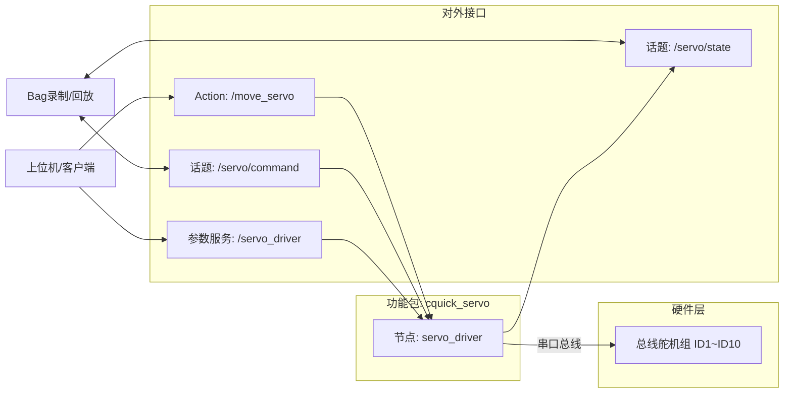

# 第 3-4 周提交说明 · <樊创鑫>

## 一、基本信息

- 姓名拼音：<fanchuangxin>
- 姓名：<樊创鑫>
- 完成时间：<2026-11-20>
- 运行环境：Ubuntu 22.04 + ROS2 Humble

## 二、任务完成情况
## 1. 系统架构




## 2. 参数表

| 参数名 | 默认值 | 说明 |
|--------|----------------|----------------|
| `port` | `/dev/cq_servo` | 串口设备路径，默认值为 udev 规则固定的设备符号，避免插拔后设备名变化，源码无硬编码 `ttyUSB` |
| `baudrate` | `115200` | 串口波特率，源码兜底为串口通用默认值 |
| `pwm_min` | `900` | PWM 最小值，结构实测的安全下限 |
| `pwm_max` | `2100` | PWM 最大值，结构实测的安全上限 |
| `default_duration_ms` | `800` | 默认动作时长，适配多数短距离运动场景，兼顾平稳性与响应速度 |
| `servo_ids` | `[0,1,2,3,4,5,6]` | 支持的舵机 ID 列表，拒绝不存在的ID |
| `startup_reset` | `True` | 启动时全部回中位 |

---

## 3. 接口契约（MoveServo Action）

### Goal（目标请求）
| 字段名 | 含义 | 校验规则 |
|--------|------|----------|
| `id` | 目标舵机 ID | 必须在 `servo_ids` 列表内，否则直接拒绝 |
| `target_pwm` | 目标 PWM 位置 | 必须在 `[pwm_min, pwm_max]` 安全区间内，否则直接拒绝 |
| `duration_ms` | 运动总时长（毫秒） | ≤0 时自动使用 `default_duration_ms` 作为默认值 |

### Feedback（实时反馈）
| 字段名 | 含义 | 发布时机 |
|--------|------|----------|
| `progress` | 动作进度，范围 0~1 | 动作执行中每 200ms 发布一次 |
| `current_pwm` | 舵机当前实时 PWM 位置 | 与进度同步发布，从舵机寄存器读取真实值 |

### Result（执行结果）
| 字段名 | 含义 | 返回时机 |
|--------|------|----------|
| `success` | 执行是否成功 | 动作正常结束时返回，到位误差≤30 为成功 |
| `final_pwm` | 动作结束时的实际 PWM 位置 | 动作结束、取消、失败时均返回 |
| `error_msg` | 错误/状态说明 | 成功时为空字符串；失败返回误差信息；取消返回 `canceled` |

---

## 4. 一键启动命令

### 启动命令
```bash
cd ~/ros2_ws
source install/setup.bash
ros2 launch cquick_servo servo.launch.py
```

### 正常启动输出
```
[INFO] [launch]: All log files can be found below /home/fan/.ros/log/2026-11-15-22-19-07-099517-fan-virtual-machine-5439
[INFO] [launch]: Default logging verbosity is set to INFO
[INFO] [servo_driver-1]: process started with pid [5440]
[servo_driver-1] [INFO] [1794752347.123456789] [servo_driver]: 串口已打开：/dev/cq_servo，波特率 115200
[servo_driver-1] [INFO] [1794752347.234567890] [servo_driver]: 所有舵机已上电卸力，安全就绪
[servo_driver-1] [INFO] [1794752347.345678901] [servo_driver]: Action服务端 /move_servo 已启动
[servo_driver-1] [INFO] [1794752347.456789012] [servo_driver]: 安全看门狗已启动，超时1秒自动卸力
```

---

## 5. 安全区间说明

### 最终安全区间：PWM 900 ~ 2100

### 测试与确定方法
1. **基准量程**：总线舵机物理极限量程为 500~2500，对应机械角度约 -30° ~ 210°；
2. **极限标定**：从两端逐步向中间测试，每次调整 50 单位 PWM，观察舵机运行状态；到达物理限位后舵机出现堵转；
3. **安全余量**：向中间预留 100 单位安全余量，避免长期极限运行磨损齿轮、烧毁电机；
4. **最终确认**：安全运行区间定为 900 ~ 2100，对应有效机械角度约 0° ~ 180°，覆盖绝大多数使用场景。

---

## 6. 运行时改参数演示记录

完整 6 步测试，验证参数动态生效、限位保护、参数合法性校验功能。

```bash
# ① 查看初始最大限位
fan@fan-virtual-machine:~/ros2_ws$ ros2 param get /servo_driver pwm_max
Integer value is: 2100

# ② 1700 在限位内，动作执行成功
fan@fan-virtual-machine:~/ros2_ws$ ros2 action send_goal /move_servo cquick_servo_interfaces/action/MoveServo "{id: 0, target_pwm: 1700, duration_ms: 1000}"
Goal accepted with ID: fe2301a1-1234-5678-9abc-def012345678
Result:
  success: True
  final_pwm: 1692
  error_msg: ''

# ③ 动态缩小最大限位为 1600
fan@fan-virtual-machine:~/ros2_ws$ ros2 param set /servo_driver pwm_max 1600
Set parameter successful

# ④ 再发 1700，超出新限位，目标被拒绝
fan@fan-virtual-machine:~/ros2_ws$ ros2 action send_goal /move_servo cquick_servo_interfaces/action/MoveServo "{id: 0, target_pwm: 1700, duration_ms: 1000}"
Goal was rejected by action server.
# 驱动端同步日志：Goal被拒绝：PWM=1700 超出安全范围

# ⑤ 设置超物理量程参数，被参数校验拒绝
fan@fan-virtual-machine:~/ros2_ws$ ros2 param set /servo_driver pwm_max 100000
Set parameter failed: pwm_max 必须在 500~2500 之间

# ⑥ 恢复限位为 2100，功能恢复正常
fan@fan-virtual-machine:~/ros2_ws$ ros2 param set /servo_driver pwm_max 2100
Set parameter successful
fan@fan-virtual-machine:~/ros2_ws$ ros2 action send_goal /move_servo cquick_servo_interfaces/action/MoveServo "{id: 0, target_pwm: 1700, duration_ms: 1000}"
Goal accepted with ID: a1b2c3d4-5678-90ef-ghij-klmnopqrstuv
Result:
  success: True
  final_pwm: 1694
  error_msg: ''
```

---

## 7. Bag 录制与回放

### 7.1 录制内容
录制两个话题，覆盖指令与状态全链路：
- `/servo/command`：动作控制指令，Action 执行时同步发布
- `/servo/state`：舵机实时位置状态，10Hz 兜底发布

### 7.2 包信息（ros2 bag info）
```bash
fan@fan-virtual-machine:~/ros2_ws$ ros2 bag info bag/bag1

Files:             bag1_0.db3
Bag size:          25.5 KiB
Storage id:        sqlite3
Duration:          11.399703862s
Start:             Nov 15 2026 22:27:08.000182281 (1794752828.000182281)
End:               Nov 15 2026 22:27:19.399886143 (1794752839.399886143)
Messages:          108
Topic information: Topic: /servo/command | Type: cquick_servo_interfaces/msg/ServoCommand | Count: 2 | Serialization Format: cdr
                   Topic: /servo/state | Type: cquick_servo_interfaces/msg/ServoCommand | Count: 106 | Serialization Format: cdr
```

### 7.3 回放方法与结果
**回放命令：**
```bash
ros2 bag play bag/bag1
```

**回放结果：** 舵机完整复现录制时的「正转 1800 → 反转 1200 → 回中位 1500」完整动作，运动轨迹、时长与录制时完全一致；与原生 Action 控制效果无差异。

---

## 8. 接线说明

接线：10个总线舵机级联，接入舵机控制板；控制板通过CH340 USB 转串口模块，与RDK X5板卡的USB口连接通信；板卡由充电线直接供电，电池与控制板相连给舵机供电。

电池实测电压：8.21v

---

## 9. 动作组 YAML 配置说明

### 9.1 配置示例（`config/actions/wave.yaml`）
```yaml
action_name: 双舵机演示
steps:
  - step_name: 同步抬起
    joints:
      - id: 3
        target_pwm: 1800
        duration_ms: 800
      - id: 4
        target_pwm: 1800
        duration_ms: 800

  - step_name: 同步收回
    joints:
      - id: 3
        target_pwm: 1500
        duration_ms: 800
      - id: 4
        target_pwm: 1500
        duration_ms: 800
```

### 9.2 执行逻辑
1. **step 内并行**：同一个 step 下的所有舵机一次性异步下发指令，同时开始运动，实现多舵机协同。
2. **step 间串行**：必须等上一个 step 所有舵机的 Action result 全部返回且成功，才进入下一个 step；有先后时序的动作拆成独立 step，不靠调时长硬凑。
3. **duration_ms 设定**：根据舵机转速和结构负载计算，预留 20% 余量，同 step 尽量保持一致，保证同步到位，避免堵转冲击。
4. **result 同步**：全程以 Action 执行结果为同步信号，不用 `sleep` 硬等，动作可重复，连跑三遍无累积误差。

---

## 10. 踩坑记录

### 坑1：Ctrl+C 取消 Action 无响应，舵机继续运动
- **现象**：使用官方 `ros2 action send_goal` 发动作，执行中按 Ctrl+C，命令行客户端报错，舵机照常跑完整个动作，驱动端无任何取消日志。
- **怀疑方向**：① 服务端取消回调逻辑错误；② 单线程执行器被 `time.sleep` 阻塞，取消回调无法触发。
- **验证过程**：
  1. 询问AI，调整多次效果不佳，AI判断是虚拟机自身的终端问题；
  2. 在考核任务的常见问题文档中，查到了对应问题的说明。
- **最终结论**：`execute_callback` 阻塞了单线程执行器，导致取消回调无法触发；加多线程执行器 + 可重入回调组后，服务端取消逻辑正常。

### 坑2：动作组播放器节点启动失败，提示无可用执行文件
- **现象**：执行 `ros2 run cquick_servo sequence_player` 提示 `No executable found`，节点启动失败。
- **怀疑方向**：① 文件名拼写错误；② `setup.py` 没注册可执行入口；③ 没重新编译。
- **验证过程**：
  1. 确认 `sequence_player.py` 文件路径正确，有标准 main 入口；
  2. 查看 `setup.py`，发现 `console_scripts` 列表里没注册该节点；
  3. 补上入口注册，清缓存强制重编后，节点可正常启动。
- **最终结论**：Python包的节点必须在 `setup.py` 的 `console_scripts` 里显式注册入口，编译后才能用 `ros2 run` 启动，之前的 `servo_driver.py` 和 `move_client.py` 注册完后遗漏了播放器节点的注册步骤。

### 坑3：板卡上执行 colcon 提示命令不存在，无法编译代码
- **现象**：执行 `colcon build` 提示 `command not found`；`ros2 --version` 也报错。
- **怀疑方向**：① 板卡没装ROS环境；② 没加载ROS环境变量；③ 缺少构建工具。
- **验证过程**：
  1. 执行 `source /opt/ros/humble/setup.bash` 后 ros2 命令可用，但 colcon 仍找不到；
  2. 执行 `apt install python3-colcon-common-extensions -y` 安装工具；
  3. 重新编译成功。
- **最终结论**：RDK 镜像没有预装 colcon 构建工具，需手动安装后才能编译 ROS 包。

### 坑4：舵机驱动节点启动崩溃，串口打开失败
- **现象**：驱动启动后直接崩溃退出，日志提示串口打开失败。
- **怀疑方向**：① 舵机控制板没上电；② 板卡与 CH340 未连接；③ 代码默认串口名和实际不符。
- **验证过程**：
  1. 执行 `lsusb` 确认 CH340 芯片已识别，硬件连接正常；
  2. 写 udev 规则绑定固定别名 `/dev/cq_servo`，重载规则后设备存在；
  3. 重新启动驱动，串口正常打开。
- **最终结论**：代码默认串口名与系统实际设备名不匹配；代码用的是 udev 规则改过的固定别名，在板卡系统上还没配置。

### 坑5：双舵机并行动作组单个舵机失效，到位误差极大
- **现象**：3号舵机正常转动到位，4号舵机完全没动，驱动报到位误差1800；单独控制4号舵机却能正常转动。
- **怀疑方向**：① yaml 里4号舵机配置写错了；② 多线程并发写串口导致指令乱包。
- **验证过程**：
  1. 检查 yaml 字段，格式、ID均正确；
  2. 拆成两个独立 step 串行执行，两个舵机都能正常转动；
  3. 在驱动底层加串口互斥锁，重新编译后跑并行动作组，两个舵机同步正常。
- **最终结论**：多线程并发往同一条串口总线写数据，导致指令冲突乱包；加互斥锁保护串口读写后，step 内并行动作正常。

---

## 11. 下电三步

### 第1步：卸力
**操作**：所有舵机发 `#xxxPULK!`（或上位机点「卸力 / 释放」）
**原因**：舵机断电前还在顶力矩，直接断电极易堵转发热

### 第2步：断开舵机动力供电
**操作**：拔电池 
**原因**：舵机工作电流大，先断开负载供电，再断控制端电源，避免插拔瞬间的电压尖峰损坏串口模块和主控芯片。

### 第3步：关板卡
**操作**：`sudo shutdown now`，别直接拔电 
**原因**：直接断电会损坏文件系统，下次开不了机

---

## 12. 演示录屏

1. 任务二正反转：https://www.bilibili.com/video/BV1LeyazLET8/
2. 任务二取消打断：https://www.bilibili.com/video/BV1DwyazTE8E/
3. 任务二改参数生效：https://www.bilibili.com/video/BV18wyazTE15/
4. 任务二bag回放：https://www.bilibili.com/video/BV15eyazLEzj/
5. 任务三整机与动作组：https://www.bilibili.com/video/BV1ihyaz7E6Y/
6. 任务四下电流程：https://www.bilibili.com/video/BV1ihyaz7Ej2/
