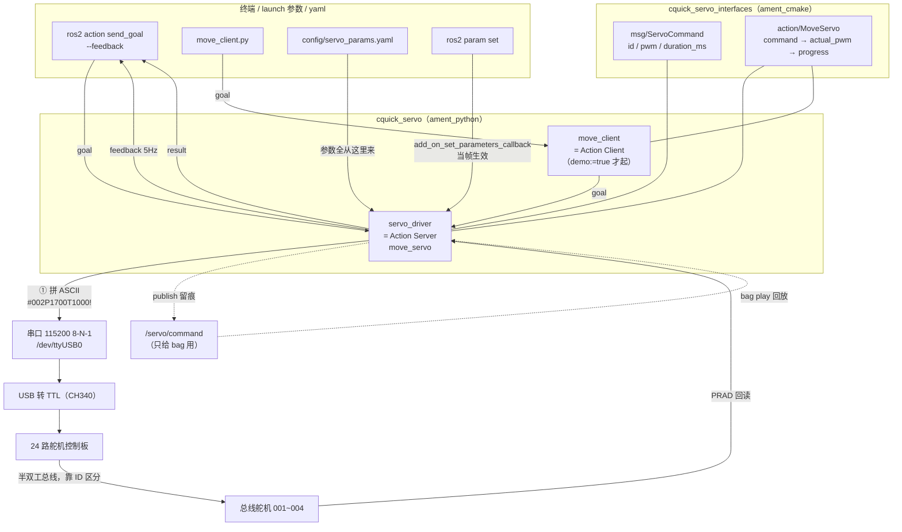

# 第 3、4 周 · 整机拼装与舵机控制

- 姓名：haozhihua
- 环境：VirtualBox + Ubuntu 22.04 + ROS 2 Humble，工作空间 `~/ros2_ws`
- **本周提交范围：任务 1 + 任务 2**（任务 3、4 与加分项本周不做，原因见下表）
- 所有截图均带本人自证（终端里先跑 `zs`：姓名 + 实时时间 + 主机名 + 开机时长），见各图首屏

> **范围先说清楚，避免评审猜**
>
> | 任务 | 状态 | 说明 |
> | --- | --- | --- |
> | 任务 1 · 点亮一个舵机 | ✅ 完成 | 串口无 sudo、PID/PRAD 有回显、4 个舵机全部标定到 1500、电池实测 7.61 V |
> | 任务 2 · ROS2 接管 | ✅ 完成 | 两个包、Action 四回调、参数化、launch、param set、bag 全部跑通 |
> | 任务 3 · 装配 + 动作组 | — 本周不做 | 3D 打印结构件与电池未到手，无法装配、无法扫描整机 ID |
> | 任务 4 · 安全下电 | — 本周不做 | 依赖整机上电，任务 3 不做则无从演示 |
> | 加分项 | — 本周不做 | 同上，优先把任务 1、2 做扎实 |
>
> 缺的材料集中列在文末「待补清单」，不藏在正文里。

---

## 1. 架构图

### 1.1 数据流



### 1.2 节点与接口对照

| 项目 | 值 |
| --- | --- |
| 包 1 | `cquick_servo_interfaces`（`ament_cmake`，只放接口） |
| 包 2 | `cquick_servo`（`ament_python`，节点 + launch + config） |
| 节点 | `/servo_driver`（唯一常驻节点） |
| Action | `/move_servo`，类型 `cquick_servo_interfaces/action/MoveServo` |
| 调试话题 | `/servo/command`，类型 `cquick_servo_interfaces/msg/ServoCommand` |
| 可执行 | `servo_driver`、`move_client` |
| 串口 | `115200 8-N-1` |

> `/servo/command` 是**一发布一订阅**：Action 每发一条 MOVE 就抄一份到话题（给 bag 录），bag play 把消息重放回来时走**同一个** `_send_raw()`。两套逻辑的话，回放出来的动作和录屏里的一定对不上。

---

## 2. 参数表（8 个，代码里只出现在「声明」和「读取」两处）

| 参数 | 类型 | 默认值 | 为什么是这个默认值 |
| --- | --- | --- | --- |
| `port` | string | `/dev/ttyUSB0` | 内核给第一个 USB 转串口设备的名字，CH340 插上就是它。写默认值是为了裸跑能起来，实际用 launch 的 `port:=` 覆盖（现场同时插 TTL 和别的设备时会变成 `ttyUSB1`） |
| `baudrate` | int | `115200` | 控制板固件固定 115200，改不了。串口助手默认常是 9600，所以这一条最容易出错 |
| `allowed_baudrates` | int[] | `[9600, 115200, 1000000]` | 手册列的三档合法值。做成参数是为了让参数校验回调能拒绝乱填的值，同时避免在逻辑里写字面量 |
| `pwm_min` | int | `900` | 电气范围是 500~2500，但那是**电机能到的极限，不是结构能到的极限**。结构未实测前先往里收 400，宁可幅度小也不能顶结构 |
| `pwm_max` | int | `2100` | 同上，对称收 400 |
| `default_duration_ms` | int | `800` | 客户端没显式给 duration 时的兜底。注意控制板会**静默丢弃 T<1000 的指令**，所以实际演示一律显式给 1000 以上 |
| `servo_ids` | int[] | `[1, 2, 3, 4]` | 本机扫到的实际在线舵机是 4 个（`#001~#004`），不是模板里的 6 个。用真实值才能拒掉不存在的 ID |
| `startup_reset` | bool | `true` | 上电先全部回 1500，避免带着上次关机时的姿态上电撞结构 |

**「0 硬编码」自检**（`02_参数自检.png` 原文）：

```bash
$ cd ~/ros2_ws/src/cquick_servo/cquick_servo
$ grep -nE "ttyUSB|115200|2100|900" servo_driver.py
21:        self.declare_parameter('port', '/dev/ttyUSB0')
22:        self.declare_parameter('baudrate', 115200)
23:        self.declare_parameter('allowed_baudrates', [9600, 115200, 1000000])
24:        self.declare_parameter('pwm_min', 900)
25:        self.declare_parameter('pwm_max', 2100)
```

5 行全部是 `declare_parameter`，逻辑里一处都没有。第一版是 6 行——多出来的那行是 `if p.value not in (9600, 115200, 1000000)`，波特率白名单写死在判断里。后来加了 `allowed_baudrates` 参数把这一行改掉，参数从 7 个变 8 个（过程见 `调试记录.md` 第 3 条）。

> 允许保留的只有协议常量：`#`、`!`、`%03d` 补零、`P`/`T`/`PID`/`PRAD`/`PULR`/`PULK`。这些是协议本身，不是配置。

---

## 3. 接口契约

`02_接口编译.png` 的 `ros2 interface show` 原文：

```
$ ros2 interface show cquick_servo_interfaces/msg/ServoCommand
uint8 id
uint16 pwm
uint16 duration_ms

$ ros2 interface show cquick_servo_interfaces/action/MoveServo
# Goal:
ServoCommand command
        uint8 id
        uint16 pwm
        uint16 duration_ms
---
# Result: 成败 + 实际位置 + 原因
bool success
uint16 actual_pwm
string message
---
# Feedback:
uint16 current_pwm
float32 progress
```

### 3.1 Goal

| 字段 | 含义 | 什么时候填 |
| --- | --- | --- |
| `command.id` | 舵机 ID | 必须是 `servo_ids` 里的值，否则 goal 直接被 REJECT |
| `command.pwm` | 目标 PWM | 必须落在 `[pwm_min, pwm_max]` 当前值之间 |
| `command.duration_ms` | 从当前位置走到目标用多久 | `<=0` 直接拒；**实际必须 ≥1000**，否则控制板丢指令 |

Goal 设计成嵌套一个 `ServoCommand`，好处是命令行只拼一层：

```bash
ros2 action send_goal /move_servo cquick_servo_interfaces/action/MoveServo \
  "{command: {id: 2, pwm: 1700, duration_ms: 1000}}" --feedback
```

### 3.2 Feedback（5 Hz，转 1 秒至少 5 条）

| 字段 | 含义 |
| --- | --- |
| `current_pwm` | 当前这一拍的目标 PWM（取的是 `cmd.pwm`，不是 PRAD 实测值） |
| `progress` | 进度 0.0 → 1.0 |

`steps = max(1, duration_ms // 200)`，所以 1000 ms 的动作正好 5 条，progress = 0.2 / 0.4 / 0.6 / 0.8 / 1.0。

> `current_pwm` 填的是目标值而不是实测值，这是**故意的**：串口是半双工，动作进行中去插一条 `PRAD` 查询会和正在走的指令抢总线，实测值会污染。真正的到位校验放在动作结束后做一次。

### 3.3 Result

| 字段 | 含义 |
| --- | --- |
| `success` | 成没成。判据：`|actual_pwm - 目标| <= 30` |
| `actual_pwm` | 动作结束后 `#xxxPRAD!` 读回的值 |
| `message` | `ok` / `canceled` / `未到位：目标 1700 实际 1500 差 200` |

### 3.4 各状态什么时候出现

| 场景 | feedback | result | goal 状态 |
| --- | --- | --- | --- |
| 正常到位 | 5 条 | `success=true, message=ok` | SUCCEEDED |
| 中途 Ctrl+C | 停 | `success=false, message=canceled` | CANCELED |
| 超限 / ID 不存在 / duration≤0 | 一条都没有 | 没有 result | REJECTED |

---

## 4. 一条启动命令

```bash
ros2 launch cquick_servo servo.launch.py
```

`02_launch一键启动.png` 原文（这张是 11-06 拍的，那时舵机还没到，串口 WARN 属预期）：

```
$ ros2 launch cquick_servo servo.launch.py &
[INFO] [launch]: All log files can be found below /home/haozhihua/.ros/log/2026-11-06-21-21-05-546019-haozhihua-VirtualBox-7737
[INFO] [launch]: Default logging verbosity is set to INFO
[INFO] [servo_driver-1]: process started with pid [7738]
[servo_driver-1] [WARN] [1793971265.769327293] [servo_driver]: 串口打开失败（可能没接硬件）: [Errno 2] could not open port /dev/ttyUSB0: [Errno 2] No such file or directory: '/dev/ttyUSB0'
$ ros2 node list
/servo_driver
```

`ros2 node list` 只有 `/servo_driver`——客户端没起，因为 `demo` 默认 `false`。要看客户端跑起来：

```bash
ros2 launch cquick_servo servo.launch.py demo:=true
ros2 launch cquick_servo servo.launch.py port:=/dev/ttyUSB1   # 换端口，实测日志里的串口名跟着变
```

三个要点：

1. **参数从 yaml 读，路径用 `get_package_share_directory()` 查**，不写相对路径；
2. **launch 参数能覆盖 yaml**：`port:=` 覆盖后串口名确实变了；
3. **条件启动**：`demo:=true` 才起客户端。

> 已知待改：`port` 那行现在写的是 `{'port': LaunchConfiguration('port')}`，类型靠推断，实测能用但按 FAQ Q6 的标准写法应改成 `ParameterValue(LaunchConfiguration('port'), value_type=str)`。没改是因为这版代码已在实机验证过，改完需要重新 `colcon build` 再验一遍，不想把未验证的东西交上来。已记在 `调试记录.md` 最后一条。

---

## 5. 安全区间 900~2100 是怎么定的

**结论：现在是保守设定，不是结构实测值。**

- 电气极限：手册写的 500~2500，这是舵机能转到的物理极限；
- 结构极限：装上舵臂、连杆之后，能转的角度远小于 500~2500，超了就是顶结构、堵转、发热；
- 本机现状：结构件未到手（本周不做装配），**没有对任何一个关节做过系统的撞限位实测**。所以先取 900~2100，两端各内缩 400。

**下一步怎么收窄（任务 3 装完立刻做）**：

```bash
# 每次只动一个关节，幅度 20，听到「嗡嗡」立刻回中位并记下边界
ros2 action send_goal /move_servo cquick_servo_interfaces/action/MoveServo \
  "{command: {id: 1, pwm: 1100, duration_ms: 1000}}"
# 找到上下边界后写回 yaml，不需要改代码
ros2 param set /servo_driver pwm_min <实测下限>
ros2 param set /servo_driver pwm_max <实测上限>
```

这一步的价值就在于：**改限位不用改代码、不用重编译、不用重启**。

---

## 6. 运行时改参数（不重启就生效）

`02_param_set现场.png` 原文（同屏两个窗口：前面是命令行，后面是节点日志）：

```bash
$ echo "姓名: haozhihua    时间: $(date '+%Y-%m-%d %H:%M:%S')"
姓名: haozhihua    时间: 2026-11-05 23:05:43

# ③ 把上限从 2100 压到 1600，节点不重启
$ ros2 param set /servo_driver pwm_max 1600
Set parameter successful

# ④ 发一个 1700 的 goal —— 改之前它本来是合法的
$ ros2 action send_goal /move_servo cquick_servo_interfaces/action/MoveServo \
  "{command: {id: 1, pwm: 1700, duration_ms: 800}}"
Sending goal:
     command:
  id: 1
  pwm: 1700
  duration_ms: 800

Goal was rejected.
# 后台节点日志同步打出：
[WARN] [1793891159.190709747] [servo_driver]: 拒绝：pwm 1700 超出 [900, 1600]

# ⑤ 填一个明显非法的值
$ ros2 param set /servo_driver pwm_max 100000
Setting parameter failed: pwm_max 必须在 500~2500 之间，收到 100000
```

第 ④ 步是这 5 分的核心：**限位从 2100 变成 1600 之后，同一个 1700 的 goal 行为立刻变了，节点没有重启**。日志里那个 `[900, 1600]` 区间是当场从参数里读出来的，不是常量。

`①`（改之前 `pwm_max=2100`）在 `02_限位保护.png` 里有同一条命令的记录，但那是另一次会话（11-06）拍的：

```bash
$ ros2 param get /servo_driver pwm_max
Integer value is: 2100
```

> **本次截图只覆盖了 ③④⑤ 三步。** ②（改之前先发一个 1700 成功的）和 ⑥（改回 2100 再发成功）没截到，不在图里就不写进这里，现场演示时按 2.6 六步完整跑一遍。这一点如实注明，不拿别的会话的输出拼成一次完整的六步。

### 参数校验怎么做的

注册 `add_on_set_parameters_callback`，只有注册了才有权力拒绝：

| 校验 | 规则 | 拒绝时的 reason |
| --- | --- | --- |
| 单参数范围 | `pwm_min` / `pwm_max` 必须在 500~2500 | `pwm_max 必须在 500~2500 之间，收到 100000` |
| 波特率白名单 | `baudrate` 必须在 `allowed_baudrates` 里 | `不认识的波特率 xxx，允许: [9600, 115200, 1000000]` |
| 跨参数 | `pwm_min < pwm_max`（比的是**将要生效**的新值） | `pwm_min(1800) 必须小于 pwm_max(1600)` |

两个关键点：

1. 回调返回 `successful=True` 之后值才真的写进去；返回 False 整个 set 被拒，参数保持原样；
2. 判断逻辑里**每次实时** `self.get_parameter('pwm_max').value`，不在 `__init__` 存副本。存了副本就是「set 返回成功但行为不变」的头号原因。

---

## 7. bag

`02_bag_info.png` 原文：

```
$ ls -l
total 28K
-rw-r--r-- 1 haozhihua haozhihua 988 11月 17 15:23 metadata.yaml
-rw-r--r-- 1 haozhihua haozhihua 24K 11月 17 15:22 run3_0.db3

$ ros2 bag info run3
Files:             run3_0.db3
Bag size:          25.0 KiB
Storage id:        sqlite3
Duration:          29.557462477s
Start:             Nov 17 2026 15:22:00.957872605 (1794900120.957872605)
End:               Nov 17 2026 15:22:30.515335082 (1794900150.515335082)
Messages:          3
Topic information: Topic: /servo/command | Type: cquick_servo_interfaces/msg/ServoCommand | Count: 3 | Serialization Format: cdr
```

- 只录 `/servo/command`，**没有用 `-a`**；
- 时长 29.557 s，压在 30 s 以内；体积 25 KiB，远低于 10 MB；
- 3 条消息 = 3 次动作（1800 → 1200 → 1500）。

**为什么没有 `/servo/state`**：这条话题对应「安全看门狗」加分项的心跳，本周没实现，所以话题不存在，bag 里也就没有。宁可不录，也不补一个假话题进去。

**回放**：

```bash
ros2 bag play bag/run1
```

回放时 `_on_command()` 收到消息，先补一次 `PULR`（`self._armed` 只放行一次），再走 `_send_raw()` 写串口，舵机把刚才那套动作重做一遍。

回放时**不会**看到 `actual_pwm`——回放只重放 `/servo/command` 里的 MOVE 指令，`PRAD` 校验发生在 Action 的 `execute_callback` 里，而 `bag play` 不经过 Action。这是机制决定的，不是缺陷。

> 上面是录制当时的原始输出，所以还叫 `run3`。入库按细则的目录约定改成了 `bag/run1/`：目录名 `run1`、文件名 `run1_0.db3`，`metadata.yaml` 里的 `relative_file_paths` 和 `files.path` 两处也一并改成 `run1_0.db3`，否则 `bag play` 会找不到文件。**内容一个字没动**——`message_count` 还是 3、`duration` 还是 29557462477 ns，和上面这段 `ros2 bag info` 完全一致。

---

## 8. 接线与电压

### 8.1 串口四参数

| 参数 | 值 | 说明 |
| --- | --- | --- |
| 波特率 | `115200` | 和控制板固件一致，不对就是一堆乱码 |
| 数据位 | `8` | |
| 停止位 | `1` | |
| 校验位 | 无（`N`） | |

合起来写作 `115200 8-N-1`。

### 8.2 设备权限（`01_串口设备.png` 原文）

```
$ zs
=============== 本人自证 ===============
  姓 名 ： haozhihua
  时 间 ： 2026-11-08 23:12:14 星期日
  主 机 ： haozhihua-VirtualBox    用户： haozhihua
  开机时长： 25 minutes
========================================
$ ls -l /dev/ttyUSB*
crw-rw---- 1 root dialout 188, 0 11月  8 23:10 /dev/ttyUSB0
```

属主组是 `dialout`，`haozhihua` 已经在这个组里，所以**打开串口不需要 `sudo`**（细则要求：全程靠 `sudo` 扣 2 分）。

> 中间踩过两个坑：一是 VirtualBox 默认没启用 USB 控制器，`lsusb` 里根本没有设备；二是 `brltty` 会抢走 CH340，`lsusb` 能看到 `1a86:7523` 但 `/dev` 下没有 `ttyUSB0`，要 `systemctl mask brltty-udev.service brltty.service`。两条都记在 `调试记录.md`。

### 8.3 线序

| 线色 | 含义 | 注意 |
| --- | --- | --- |
| 橙 / 白 | 信号 | 接控制板通道信号脚 |
| 红 | 正极 5~8.4V | **绝对不能接 12V** |
| 棕 / 黑 | 负极 / GND | 接电源负 |

**必须共地**：板卡、控制板、电池负极连在一起。只接信号不接地，数据一定收不到。

### 8.4 电池电压（`01_电池电压.png`）

| 项目 | 值 |
| --- | --- |
| 万用表 | DELIXI DT9205A-Pro，旋钮打到**直流电压 20 V 档** |
| 读数 | **7.61 V** |
| 电池 | 2S 软包锂电池（满电 8.4 V，标称 7.4 V） |
| 表笔接法 | 红笔接电池输出**红线（正极）**、黑笔接**黑线（负极）**，都插在端子处 |
| 外观 | 无鼓包、无破皮 |
| 判据 | 5~8.4 V 才允许接控制板 |

7.61 V 在 5~8.4 V 之间，**可以直接上电**。它低于满电 8.4 V 是正常的——这是存放一段时间的余量，装到整机上带负载后会往下掉，掉到 5 V 附近就必须停，否则控制板会在低压下重启或乱发指令。

> 这张照片是手机拍的时候方向记录反了，原始文件是倒着的（直接看会读成 `0.76`）。仓库里这张已经旋转 180° 校正，读数 `7.61 V`。
>
> **电池使用红线**：① 禁止反接（上电前先量极性）；② 禁止带电插拔舵机线，浪涌会烧通道；③ 鼓包立即停用；④ 低于 5 V 不许再带负载试。

---

## 9. 动作 yaml（任务 3，本周不做）

**本周范围只到任务 2，任务 3 不做**：结构件未到手，播放器没法用真机验证，写了也只是纸上代码，所以 `config/actions/` 保持为空。这里只放设计草案并标明未实现，不冒充已完成。

设计目标（细则 3.4）：一套动作 = 若干 step 的有序列表，一步之内多舵机**同时**下发，步与步之间**等 result 全回来**才进下一步：

```yaml
# 草案，未实现
name: stand_up
steps:
  - step: 1
    desc: 四个关节同时从趴姿抬到站立预备位
    joints:
      - {id: 1, pwm: 1500, duration_ms: 1200}
      - {id: 2, pwm: 1450, duration_ms: 1200}
      - {id: 3, pwm: 1550, duration_ms: 1200}
      - {id: 4, pwm: 1500, duration_ms: 1200}
  - step: 2
    desc: 只动 4 号，单独一步保证它最后到位
    joints:
      - {id: 4, pwm: 1400, duration_ms: 1000}
```

- **一步之内有先后** → 拆成两个 step，不靠调 `duration_ms` 硬凑；
- **同步信号** → 每个 step 内所有 goal 的 result 都回来才进下一步，不用 `sleep` 猜时间（舵机走完的时间不等于 `duration_ms`，硬等会累积误差，第三遍和第一遍一定对不上）。

`setup.py` 里已经预留了入口，`data_files` 也已经在装 `config/actions/*.yaml`，写完后取消注释这两行再 `colcon build`：

```python
# 'sequence_player = cquick_servo.sequence_player:main',
```

---

## 10. 踩坑记录（摘 5 条，完整 12 条见 `调试记录.md`）

### ① `colcon build` 通过，但 `ros2 run` 报 `No executable found`

- **现象**：`ros2 run cquick_servo move_client` 找不到可执行；
- **怀疑**：`move_client.py` 是后建的，`entry_points` 里只有建包时自动写进去的 `servo_driver`；
- **验证**：`ros2 pkg executables cquick_servo` 只列出 2 个；
- **结论**：`setup.py` 补 `move_client = cquick_servo.move_client:main`，重编后列出 3 个。**build 通过 ≠ 能运行。**

### ② launch 文件明明在 src 里，`ros2 launch` 说找不到

- **现象**：`file 'servo.launch.py' was not found in the share directory`；
- **怀疑**：`data_files` 没把 `launch/` 装进 install；
- **验证**：`ls install/cquick_servo/share/cquick_servo/` 里只有 `package.xml`、`hook`、`.dsv`、`.sh`；
- **结论**：补上 `data_files` 后必须**重新 `colcon build`**。`--symlink-install` 只对 build 那一刻已存在的文件建软链，`glob()` 也是 build 时展开的，新增文件抓不到。那次 build 只花了 1.19 秒——因为什么都没编。

### ③ 补完之后变成 `file ... was found more than once`

- **现象**：`ros2 launch` 直接报错，列出两份路径：`share/cquick_servo/servo.launch.py` 和 `share/cquick_servo/launch/servo.launch.py`；
- **根因**：`data_files` 写了两行，同一个文件被装到 share 根和 share/launch 两处；
- **结论**：删掉多余那行，并且**手工删 install 里的残留旧副本**（`colcon` 不会自动清理旧产物）。`find install/... -name servo.launch.py` 从 2 行变 1 行。

### ④ `Ctrl+C` 取消 goal，舵机继续转

- **现象**：`send_goal --feedback` 按 Ctrl+C，终端显示取消中，节点毫无反应；
- **怀疑**：`execute_callback` 跑在 executor 单线程里，`time.sleep()` 把线程占死，取消回调根本进不来；
- **验证**：服务端日志里完全没有「收到取消请求」这一行；
- **结论**：两件事一起做——① `MultiThreadedExecutor`（`rclpy.init()` 后 `executor.add_node(node); executor.spin()`）；② ActionServer 挂 `ReentrantCallbackGroup`。改完取消立即生效（`02_取消生效.png`：`success: false, message: canceled, Goal finished with status: CANCELED`）。

### ⑤ `T<1000` 的指令被控制板静默丢弃

- **现象**：一次发四条 MOVE，只有第一条动了；没有任何报错，`RX` 也是空的；
- **怀疑**：`duration_ms` 给太小（当时用了 `T300`），控制板认为非法直接丢；
- **验证**：同样的 ID、同样的 PWM，只把 `T` 从 300 改到 1000，动作正常；
- **结论**：**控制板丢弃 `T<1000` 的指令，且不回任何错误**。所以取消回中位、`_reset_all()` 里那两个内部指令的 `T` 也一并改成了 1000。这条最坑的地方是「没有任何反馈」，只能靠对照实验发现。

---

## 11. 安全下电（任务 4，本周不做录屏）

流程已经想清楚也写下来了，但**本周不做整机，没有可下电的对象**，所以没有录屏。等整机装起来再补演示。

```
① 卸力  →  ② 断动力电（电池）  →  ③ 关板卡
```

| 步骤 | 做什么 | 为什么必须是这个顺序 |
| --- | --- | --- |
| ① 卸力 | 所有舵机发 `#xxxPULK!` | 断电前舵机还在顶力矩，直接断电极易堵转发热。卸力之后手动拧一下关节应该能转动（松手不回弹），说明真卸了 |
| ② 断动力电 | 拔电池 | 先断动力再关板卡，避免控制板在电压跌落过程中乱发指令（低压下指令可能被解析成别的角度） |
| ③ 关板卡 | `sudo shutdown now`，**别直接拔电** | 直接断电会损坏文件系统，下次开不了机 |

四个舵机都要发，一条一条：

```bash
#001PULK!
#002PULK!
#003PULK!
#004PULK!
```

> `PULK` 是写入类指令，**没有 `RX` 回显是正常的**，不能用「有没有回显」判断成没成功，要看关节松不松。

**四条红线**：

1. 禁止带电插拔舵机线——浪涌会烧舵机驱动或控制板通道；
2. 禁止反接电源——上电前量电压、看极性；
3. 电池鼓包立即停用，交队长，不要「再充一次看看」；
4. 禁止让舵机硬顶结构——持续「嗡嗡」就是堵转，立刻回中位。

---

## 12. 录屏链接（B 站）

| 内容 | 链接 |
| --- | --- |
| 任务 1 · 舵机转动（PULR + P1000T1000，画面含终端） | 待补 |
| 任务 2 · 正转 / 反转 / 回中位 | 待补 |
| 任务 2 · 取消打断 | 待补 |
| 任务 2 · 改参数后行为变化 | 待补 |
| 任务 2 · `ros2 bag play` 复现动作 | 待补 |
| 任务 3 · 整机 + 动作组（连跑三遍 + 换 yaml） | 本周不做 |
| 任务 4 · 安全下电全流程 | 本周不做 |

> 录屏一律放 B 站，仓库里只放截图和 bag。

---

## 附 A：任务 1 的实际数据

### A.1 指令回显（`01_PID回显.png` 原文）

```
$ python3 ~/manual_cmd.py /dev/ttyUSB0
已打开 /dev/ttyUSB0 @ 115200
指令> #001PID!
  TX(8 字节): #001PID!
  RX: b'#001P!'
指令> #001PRAD!
  TX(9 字节): #001PRAD!
  RX: b'#001P1506!'
```

`#001PID!` 只回 `#001P!`（**不带 ID 数值**），这是这块控制板的固件行为，不是没通。用 `PRAD` 交叉证明链路是好的：`#001P1506!` 里 1506 就是当前位置。

### A.2 四个舵机标定 1500（`01_中立位标定.png` 原文，节选）

```
指令> #001PULR!
  RX: b''
指令> #001P1500T1000!
  RX: b''
指令> #001PRAD!
  RX: b'#001P1492!'
指令> #002PULR!
指令> #002P1500T1000!
指令> #002PRAD!
  RX: b'#002P1504!'
指令> #003PULR!
指令> #003P1500T1000!
指令> #003PRAD!
  RX: b'#003P1504!'
指令> #004PULR!
指令> #004P1500T1000!
指令> #004PRAD!
  RX: b'#004P1505!'
```

| ID | 目标 | 读回 | 偏差 |
| --- | --- | --- | --- |
| 001 | 1500 | 1492 | −8 |
| 002 | 1500 | 1504 | +4 |
| 003 | 1500 | 1504 | +4 |
| 004 | 1500 | 1505 | +5 |

四个都在 ±8 以内（判据是 ±30），说明标定完成。**这就是装舵臂之前那个「1500 位」**，舵臂必须对着结构的基准位置装上去。

> 注意 `PULR` 和 MOVE 的 `RX` 都是空的——写入类指令没有回显是正常的，只有查询类（`PRAD`、`PID`）才有。

---

## 附 B：待补清单

按细则第九章逐项对，缺的是下面这些，不含糊：

| 缺什么 | 状态 | 说明 |
| --- | --- | --- |
| `03_*` 四张图 | 本周不做 | 任务 3 不做（结构件未到手） |
| `config/actions/*.yaml` + `sequence_player.py` | 本周不做 | 任务 3 不做，第 9 节只留设计草案 |
| B 站录屏 | 待上传 | 任务 1、2 的录屏传完把链接填进第 12 节；任务 3、4 本周不做 |

> 本周交付的是**任务 1 + 任务 2 的完整证据链**（12 张截图 + 两个包的源码 + bag + README + 调试记录）。任务 3、4、加分项本周不做，不是漏了。

## 附 C：可复现性

```bash
# 1. 建工作空间
mkdir -p ~/ros2_ws/src && cd ~/ros2_ws/src

# 2. 把本目录的 src/ 下两个包拷进去
cp -r <本目录>/src/cquick_servo_interfaces .
cp -r <本目录>/src/cquick_servo .

# 3. 编译（改了 msg/action 必须重编）
cd ~/ros2_ws
colcon build --symlink-install

# 4. 环境
source /opt/ros/humble/setup.bash
source install/setup.bash

# 5. 起
ros2 launch cquick_servo servo.launch.py
```

依赖：`sudo apt install python3-serial`，`sudo usermod -aG dialout $USER` 后**重新登录**。
