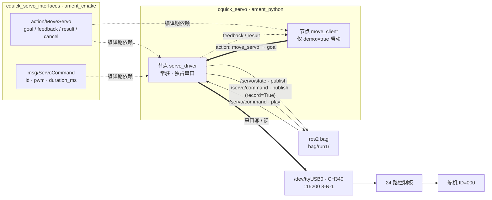

# 架构图 · cquick_servo（任务 2 · 让 ROS2 接管舵机）

> 一句话：**一个常驻节点独占串口、对外开一个 Action 接口和两个话题；客户端只发 goal，bag 只碰 `/servo/command`。**
> 图里的每个名字都能在代码里 grep 到，出处见表 4。

---

## 一、结构图：包与节点

```text
cquick_servo_interfaces   (ament_cmake · 只编译，不运行)
├── msg/ServoCommand          id: uint8 | pwm: uint16 | duration_ms: uint16
└── action/MoveServo          goal     : ServoCommand command
                              feedback : current_pwm, progress
                              result   : success, final_pwm, message
        │
        │  编译期依赖（rosidl 生成 Python / C++ 接口）
        ▼
cquick_servo              (ament_python · 功能包)
├── 节点 servo_driver        ← 常驻；独占串口；Action 服务端；启动回中位
│   ├── action 服务端   move_servo        MoveServo         控制入口：goal / feedback / result / cancel
│   ├── 发布 topic      /servo/command    ServoCommand  qos10   record=True 时才发（给 bag 录）
│   ├── 订阅 topic      /servo/command    ServoCommand  qos10   bag play 回放入口，record=False 防自激
│   └── 发布 topic      /servo/state      ServoCommand  qos10   每条指令的最终状态
├── 节点 move_client         ← 仅 demo:=true 时启动；Action 客户端；打印 feedback
│   └── action 客户端   move_servo        MoveServo         feedback 走 Action 通道，不占话题
├── launch/servo.launch.py   ← 参数 port（覆盖 yaml）、demo（bool）
└── config/servo_params.yaml ← servo_driver 的 7 个参数，最外层 key 必须是 servo_driver

外部消费者   ros2 bag record  ← /servo/command + /servo/state（只录这两条，禁 -a）
             ros2 bag play    → /servo/command（灌回 driver 的订阅口）
```

**一句话读法**：整个系统对外只有 **1 个 Action + 2 个话题**。Action 管控制（有结果、能取消），话题管存档（能录、能放）；两个话题的消息类型都是自定义的 `ServoCommand`，`/servo/command` 一进一出，`/servo/state` 只出不进。`move_client` 一个话题都不占，它的反馈全走 Action 内部通道，所以 `ros2 topic list` 里看不到。

**包分工的理由**：接口单独成包，客户端和驱动都只依赖接口，不互相依赖；改 msg 只需重编接口包，驱动一行不动。

---

## 二、三条链（实时控制 / 记录 / 回放）

```text
① 控制链（实时，Action 四件套）

  move_client ──── goal ────────────────────────────>  servo_driver
              <─── feedback（current_pwm, progress）──
              <─── result（success, final_pwm, message）
              ──── cancel（Ctrl-C / 显式 cancel）────>   回中位后返回 CANCELED(status=5)

      servo_driver ── 串口写 ──> /dev/ttyUSB0（CH340）── 115200 8-N-1 ──> 24 路控制板 ──> 舵机 #000
                    ── 串口读 ──  PRAD 轮询，落进 ±30 才算到位，最多等 1 s


② 记录链（交付物，只录两个话题）

  servo_driver ── /servo/command（record=True 才发）──┐
  servo_driver ── /servo/state ──────────────────────┴──> ros2 bag record ──> bag/run1/
                                                          禁止 -a；≤30 s；≤10 MB


③ 回放链（复现动作）

  ros2 bag play bag/run1 ── /servo/command ──> servo_driver（订阅口，record=False）
                                                 │
                                                 └──> 舵机把当时的动作重演一遍，/servo/state 同步刷出
```

**为什么 `/servo/command` 既发布又订阅**：发布是为了让 bag 录到"真正下发的指令"，订阅是为了让 bag play 能把指令灌回来。同一个节点两头都占，于是自己发的会被自己收到 —— 用 `_echo_pending` 把这条回环配对吃掉，否则串口上每条指令要发两遍；回放口再传 `record=False`，避免 record 与 play 同时开时自激。

### 话题清单（就两条，都是自定义 msg）

| 话题 | 类型 | 方向 | 谁在用 | 为什么存在 |
|---|---|---|---|---|
| `/servo/command` | `ServoCommand` | driver 发布 **且** 订阅 | `bag record` 录、`bag play` 灌 | 把"实际下发的指令"变成可存储、可重放的数据 |
| `/servo/state` | `ServoCommand` | driver **只发布** | `bag record`、终端 / rqt 观察 | 每条指令的最终状态，回放时能对上"到底动没动、动到哪" |

**节点之间为什么不走话题**：控制要回答三件事 —— 这条指令做完没有、做到多少、能不能中途取消。话题是单向流，没有 result、没有 feedback、没有 cancel，只能用"再开两个话题 + 自己维护状态机"硬凑。Action 天生带 goal / feedback / result / cancel，所以**控制走 Action，话题只做观测与存档**。

这也是 `ros2 topic list` 里只有这两条的原因：话题一多，通常说明在拿话题拼控制。反过来说，自定义 `msg` 并没有被浪费 —— 它既是 Action 的 goal 载荷（`ServoCommand command`），又是这两个话题的消息类型，一处定义、三处复用。

> 答辩一句话：**"控制走 Action，记录走话题；话题是存档口，不是控制通道。"**

---

## 三、mermaid 版



---

## 四、接口与通信（与代码逐字对照）

### 表 1 · 包

| 包名 | 构建类型 | 职责 | 关键文件 |
|---|---|---|---|
| `cquick_servo_interfaces` | `ament_cmake` + `rosidl_generate_interfaces` | 生成 `ServoCommand` 与 `MoveServo`，供客户端和驱动共用 | `CMakeLists.txt`、`msg/ServoCommand.msg`、`action/MoveServo.action` |
| `cquick_servo` | `ament_python` | 串口驱动节点、演示客户端、launch、参数 yaml | `servo_driver.py`、`move_client.py`、`launch/servo.launch.py`、`config/servo_params.yaml` |

### 表 2 · 节点

| 节点名 | 包 | 可执行文件 | 启动方式 | 职责 |
|---|---|---|---|---|
| `servo_driver` | `cquick_servo` | `servo_driver` | `ros2 launch cquick_servo servo.launch.py` | 打开串口、跑 Action 服务端、发布 `/servo/state`、启动回中位 |
| `move_client` | `cquick_servo` | `move_client` | 同上，加 `demo:=true` | 发 goal、打印 feedback 与 result、演示取消 |

### 表 3 · 接口

| 名字 | 类型 | 定义 | 字段 |
|---|---|---|---|
| `ServoCommand` | msg | `cquick_servo_interfaces/msg/ServoCommand` | `uint8 id`、`uint16 pwm`、`uint16 duration_ms` |
| `MoveServo` | action | `cquick_servo_interfaces/action/MoveServo` | goal：`ServoCommand command`；feedback：`uint16 current_pwm`、`float32 progress`；result：`bool success`、`uint16 final_pwm`、`string message` |

> 每个字段的含义、取值范围、什么时候发 → 见 [`接口契约.md`](./接口契约.md)。

### 表 4 · 通信与出处

| 方向 | 名字（代码原样） | 类别 | 类型 | QoS | 出处 |
|---|---|---|---|---|---|
| `move_client` → `servo_driver` | `move_servo`（相对名，默认命名空间下即 `/move_servo`） | action | `MoveServo` | 默认 | `servo_driver.py:147` 服务端 / `move_client.py:27` 客户端 |
| `servo_driver` 发布 | `/servo/command` | topic | `ServoCommand` | 10 | `servo_driver.py:140`（`record=True` 时才发） |
| `servo_driver` 订阅 | `/servo/command` | topic | `ServoCommand` | 10 | `servo_driver.py:157`（bag 回放入口，`record=False`） |
| `servo_driver` 发布 | `/servo/state` | topic | `ServoCommand` | 10 | `servo_driver.py:141` |
| `ros2 bag record` 订阅 | 上面两个话题 | topic | — | — | 只录这两条，禁 `-a` |

### 表 5 · 参数（7 个，全部由 `servo_driver` 读取，值只来自 yaml）

> 每个默认值的来历、改参数的验证步骤、踩过的坑 → 见 [`参数表.md`](./参数表.md)。

| 参数 | 类型 | 默认值 | 为什么是这个默认值 | 运行时可改 |
|---|---|---|---|---|
| `port` | string | `/dev/ttyUSB0` | CH340 在本机**实测枚举为 0**。插拔或重启会漂到 1，所以这个 0 只是"当前值"、不是契约；启动后必须看日志里有没有「串口已打开」 | 是（下次开串口生效） |
| `baudrate` | int | `115200` | 厂家协议固定 **115200 8-N-1**。9600 / 19200 / 38400 / 57600 实测全不转；白名单外的值直接拒 | 否（改要重启） |
| `pwm_min` | int | `900` | 结构行程的安全下限，留了余量。撞到限位还继续发力就是堵转，三分钟能烧穿舵机 | 是（当帧生效） |
| `pwm_max` | int | `2100` | 上限同理。1500 是中立位，900–2100 就是 **±600 的对称行程** | 是（当帧生效） |
| `default_duration_ms` | int | `800` | 当初填 800 是图快，但**实测偏短**：舵机还没走到位就被判超时（ABORTED）。建议改 **1500** | 是 |
| `servo_ids` | int[] | `[0,1,2,3,4,5,6]` | 实测本舵机 ID = **000**（考核文档写"从 1 开始"，实际不是），列 0 才能兼容；1–6 留给整机 6 个舵机 | 是 |
| `startup_reset` | bool | `true` | 上电先回中位，保证每次启动姿态一致。否则会带着上次停下的角度上电，结构可能已经顶住 | 是 |

> **7 个参数都不在代码里写死值**：`declare_parameter` 只声明类型，取不到 yaml 就 `RuntimeError`，不许静默降级。
> launch 另有两个参数：`port`（默认空 → 用 yaml；给值 → 覆盖 yaml）、`demo`（默认 `false`，`true` 才起客户端）。
>
> ⚠️ **交付前处理两处**：
> 1. `default_duration_ms = 800` 与实测冲突（800 会 ABORTED，1500 最稳）。改 yaml 时把上表那行理由一起改成"实测 1500 最稳"。
> 2. `pwm_min / pwm_max` 会被追问"怎么试出来的"。没做过逐格试探就别写成"结构实测" —— 标准做法：卸力后从 1500 每步 ±50 往外发，听到「嗡嗡」立刻退回 50，再留 30 余量。

---

## 五、图上没画但评委会问的 6 条约定

1. **action 名不带前导斜杠**：`ActionServer(..., 'move_servo', ...)` 声明的是相对名，默认命名空间下解析为 `/move_servo`。写死绝对名，以后加 namespace 就会撞。
2. **参数只声明类型、不给默认值**：`declare_parameter('port', Parameter.Type.STRING)`，值必须来自 yaml，取不到直接 `RuntimeError`。给默认值等于设备名还是硬编码。
3. **yaml 最外层 key 必须是 `servo_driver`**，等于节点名。写错一个参数都不加载，而且**不报错**。
4. **可重入回调组**：`ReentrantCallbackGroup` 让动作执行、取消、回放订阅能并发，否则取消要等 action 跑完才处理。
5. **启动回中位走 `record=False`**：它不算"用户指令"，所以 bag 里不会多出启动那几条，回放时才不会一上来就往回中位跑。
6. **PRAD 轮询判到位**：每 150 ms 读一次，落进 ±30 算到，最多等 1 s。读一次就判会把正常动作判成超时（ABORTED）。

---

## 六、现场画图顺序（白板上 60 秒讲完）

1. 先画两个包框 —— 接口包在上、功能包在下，标"编译期依赖"；
2. 功能包里画两个节点，标 `demo:=true` 才起客户端；
3. 客户端到服务端画一条粗箭头，写 `action: move_servo`，旁边补 feedback / result 两条虚线；
4. 服务端往下画串口，写设备名 + `115200 8-N-1`，落到控制板和舵机；
5. 最后补 bag：`/servo/command` 一进一出、`/servo/state` 只出不进。

第 5 步是分水岭 —— 只讲 Action 不讲 bag 的，等于没交任务 2 的交付物。
