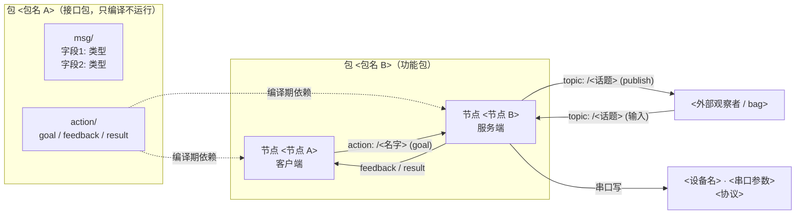

# 架构图模板 · ROS2 包 / 节点 / 接口

> 用法：**先填表，再画图**。表填完了，图只是把表换个画法；表没填就画图，一定漏东西。
> 把 `<尖括号>` 里的内容替换成你自己的，多余的表格行直接删。

---

## 第一步 · 填表（六张）

### 表 A · 包清单

| 包名 | 构建类型 | 职责 | 关键文件 |
|---|---|---|---|
| `<包名 A>` | `ament_cmake` / `ament_python` | `<这包负责什么，一句话>` | `<CMakeLists.txt / setup.py / 源码>` |
| `<包名 B>` | `ament_python` | `<...>` | `<...>` |

### 表 B · 节点清单

| 节点名 | 所属包 | 可执行文件 | 启动方式 | 职责 |
|---|---|---|---|---|
| `<节点名>` | `<包名>` | `<executable>` | `ros2 run` / `ros2 launch` / 仅 `demo:=true` | `<守住什么资源、暴露什么接口>` |

### 表 C · 接口清单（自定义 msg / action / srv）

| 接口名 | 类型 | 定义文件 | 字段 |
|---|---|---|---|
| `<XxxMsg>` | msg | `<包>/msg/<XxxMsg>.msg` | `<字段: 类型>` |
| `<XxxAction>` | action | `<包>/action/<XxxAction>.action` | goal: `<...>`<br>feedback: `<...>`<br>result: `<...>` |

### 表 D · 通信清单

| 方向 | 名字 | 类别 | 类型 | QoS | 备注 |
|---|---|---|---|---|---|
| `<A> → <B>` | `/<话题或 action 名>` | topic / action | `<接口类型>` | `<10>` | `<谁发、谁收、要不要进度>` |

### 表 E · 参数清单

| 参数 | 类型 | 默认值 | 谁读 | 运行时可改 |
|---|---|---|---|---|
| `<port>` | `string` | `<...>` | `<节点>` | `<是/否>` |

### 表 F · 硬件边界

| 项 | 值 |
|---|---|
| 设备 | `<设备名，如 /dev/ttyUSB0>` |
| 串口参数 | `<115200 8-N-1>` |
| 协议 | `<帧格式>` |
| 安全域 | `<上下限，以及值是哪来的>` |

---

## 第二步 · 文字图（ASCII）

先画这版，因为它逼你把「哪个包框住哪个节点」想清楚。

```text
┌─────────────────────────────┐
│  包 <包名 A>（接口包）        │
│  msg/<XxxMsg>               │
│  action/<XxxAction>         │
└──────────────┬──────────────┘
               │ 编译期依赖
┌──────────────┴──────────────────────────────┐
│  包 <包名 B>（功能包）                        │
│                                             │
│  ┌────────────┐   action /<名字>  ┌────────┐ │
│  │ <节点 A>   │ ────────────────> │<节点 B>│ │
│  │ 客户端     │ <── feedback ──── │ 服务端 │ │
│  └────────────┘      result       └───┬────┘ │
└───────────────────────────────────────┼──────┘
                                        │ 串口
                                        ▼
                              <设备名> → <下游硬件>
```

## 第三步 · mermaid 版本（贴进 Markdown 就能渲染）



---

## 第四步 · 画完自查

| # | 检查项 | 为什么 |
|---|---|---|
| 1 | 每个节点都画在**它所属的包**框里 | 漏包是答辩第一问 |
| 2 | 名字的前导 `/` 一致：接口名、话题名、参数 key 三处对齐 | `/move_servo` 和 `move_servo` 在相对命名空间下不是一回事 |
| 3 | action 的四个方向都画了：goal、feedback、result、cancel | 只画一条箭头等于不知道 Action 是什么 |
| 4 | 有没有画出「同一个话题既发布又订阅」的那条回环 | 回环是最容易自激的地方，画出来才看得见 |
| 5 | bag 的 record 和 play 画成两条腿，方向相反 | 一条进、一条出，混了就会回放时死循环 |
| 6 | 参数从哪个 yaml 来、最外层 key 是否等于节点名 | key 写错参数一个都不加载，且不报错 |
| 7 | 硬件边界有设备名 + 串口参数 + 安全域 | 这三样是"能不能上电"的判据 |
| 8 | 图里的名字和代码里 `create_publisher` / `ActionServer` 第三个参数逐字一致 | 图上写的和代码跑的不是一个东西，等于没画 |

> 自查第 8 条最狠：画完拿图去 grep 一遍代码，对不上就改图（或改代码）。
