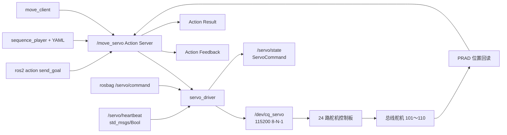

# Week 3-4 整机拼装与舵机控制

姓名：yanghuili  
考核项目：电控组第 3、4 周整机拼装与舵机控制

> 提交前待补：将本文件中所有“待补”替换为本人现场截图、终端原文和 B 站链接。

## 1. 架构



ROS 2 包：

- `cquick_servo_interfaces`：`MoveServo.action`、`ServoCommand.msg`。
- `cquick_servo`：驱动、单舵机客户端、YAML 动作播放器、launch 和配置。

节点和接口：

- `/servo_driver`：Action Server、串口驱动、PRAD 回读、看门狗。
- `/move_servo`：`cquick_servo_interfaces/action/MoveServo`。
- `/servo/command`：`ServoCommand`，供 rosbag 回放。
- `/servo/state`：`ServoCommand`，记录状态数据。
- `/servo/heartbeat`：`std_msgs/msg/Bool`，安全看门狗心跳。
- `/servo/recover`：`std_srvs/srv/Trigger`。
- `/servo/release_all`：`std_srvs/srv/Trigger`。

## 2. 参数表

当前配置位于：

```text
src/cquick_servo/config/servo_params.yaml
```

| 参数 | 当前值 | 原因 |
|---|---|---|
| `port` | `/dev/cq_servo` | udev 固定设备名，避免 `/dev/ttyUSB*` 插拔后编号变化 |
| `baudrate` | `115200` | 控制板要求 115200 8-N-1 |
| `pwm_min` | `900` | 驱动电气/保护下限；当前大幅动作实际只验证到 1480 |
| `pwm_max` | `2100` | 驱动电气/保护上限；当前大幅动作实际只验证到 1520 |
| `default_duration_ms` | `800` | Goal 的 `duration_ms=0` 时使用 |
| `servo_ids` | `[101,102,103,104,105,106,107,108,109,110]` | 总线实际在线 ID |
| `startup_reset` | `false` | 未完成全机限位确认前，避免节点启动即批量动作 |
| `neutral_pwm` | `1500` | 设计中立位 PWM |
| `position_tolerance` | `30` | 最终 PRAD 允许误差 ±30 |
| `feedback_period_sec` | `0.2` | 约 5 Hz Feedback |

安全说明：

- `900..2100` 是当前驱动保护范围，不等于整机机械安全范围。。

## 3. 接口契约

`MoveServo.Goal`：

| 字段 | 类型 | 含义 |
|---|---|---|
| `id` | `uint8` | 舵机 ID，必须在 `servo_ids` 中 |
| `pwm` | `uint16` | 目标 PWM |
| `duration_ms` | `uint16` | 预计运动时间；0 使用默认时长 |

`MoveServo.Feedback`：

| 字段 | 类型 | 含义 |
|---|---|---|
| `id` | `uint8` | 当前舵机 ID |
| `current_pwm` | `uint16` | PRAD 读回或运动过程估值 |
| `progress` | `float32` | 0.0～1.0 的进度 |

Feedback 在动作执行期间约每 200 ms 发布一次。

`MoveServo.Result`：

| 字段 | 类型 | 含义 |
|---|---|---|
| `success` | `bool` | 最终 PRAD 与目标误差不超过容差时为 true |
| `final_pwm` | `uint16` | 最终 PRAD；读取失败时为 0 |
| `message` | `string` | `ok`、未到位差值、取消或串口错误 |

Result 只在动作成功、失败、取消或异常结束时发布。

## 4. 一键启动

```bash
ros2 launch cquick_servo servo.launch.py
```

真实启动输出:
[1] 4310

启动后检查：

```bash
ros2 node list
ros2 topic info -v /servo/heartbeat
ros2 param get /servo_driver port
ros2 param get /servo_driver servo_ids
```

## 5. 安全区间及测试依据

当前已完成的动作验证：

| 范围 | 结果 |
|---|---|
| 101、102：1480～1520 | 连续动作成功 |
| 101、102：1530 方向 | 部分运行可成功，但与 1470 组合时曾出现偶发超差 |
| 110：1500 附近 | 可保持，但不能完成 1530 上方向大动作 |

1470 实测问题示例：

```text
id=102 目标1470，读回1504，差34
id=101 目标1470，读回1502，差32
```

因此没有把容差从30放大，而是把可靠动作目标调整到1480。

待补：

- 整机电池实测电压：`____ V`
- 每个关节机械限位对应 PWM：`____`
- 最多可安全使用的 `pwm_min / pwm_max`：`____`

## 6. 运行时修改参数

```bash
ros2 param get /servo_driver pwm_max
ros2 action send_goal /move_servo \
  cquick_servo_interfaces/action/MoveServo \
  "{id: 101, pwm: 1700, duration_ms: 1000}" --feedback
ros2 param set /servo_driver pwm_max 1600
ros2 action send_goal /move_servo \
  cquick_servo_interfaces/action/MoveServo \
  "{id: 101, pwm: 1700, duration_ms: 1000}" --feedback
ros2 param set /servo_driver pwm_max 100000
ros2 param set /servo_driver pwm_max 2100
```

- 第一次 `pwm_max=2100`，1700 可以进入目标校验；
- 修改为 1600 后，不重启节点，1700 立即被拒绝；
- 100000 被参数校验回调拒绝；
- 恢复 2100 后再次可用。

## 7. rosbag

录制内容：

```text
/servo/command
/servo/state
```

回放：

```bash
ros2 bag info bag/run1
ros2 bag play bag/run1
```

已有 bag 信息：

```text
Duration: 11.000134419s
Messages: 62
/servo/command: 3
/servo/state: 59
```

## 8. 接线说明

电源与通信：

- USB 转 TTL 接地瓜派 USB。
- USB 转 TTL 的 TX/RX/GND 接控制板通信端。
- 控制板电源正负极与电池正确连接，板卡、控制板和电池必须共地。
- 供电电压必须在 5～8.4V 范围内。

实测电压：

```text
待补：__7.58__ V
```

接线照片：03_接线特写.png

## 9. 动作 YAML

文件：

```text
config/actions/stand_up.yaml
config/actions/wave.yaml
```

示例：

```yaml
name: stand_up

steps:
  - name: prepare_center
    goals:
      - {id: 101, pwm: 1500, duration_ms: 2000}
      - {id: 102, pwm: 1500, duration_ms: 2000}

  - name: front_pair_out
    goals:
      - {id: 101, pwm: 1520, duration_ms: 2000}
      - {id: 102, pwm: 1480, duration_ms: 2000}
```

规则：

- 同一个 `step.goals` 内多个舵机同时下发。
- 当前 step 的全部 Result 返回后，才发送下一 step。
- 必须先后执行的动作拆成不同 step，不使用固定 `sleep`。
- 修改动作只需修改 YAML，不修改 Python。

运行：

```bash
ros2 run cquick_servo sequence_player \
  --ros-args \
  -p action_file:="$HOME/ros2_ws/src/cquick_servo/config/actions/stand_up.yaml"
```

## 10. 踩坑记录

### 问题 1：110 上方向无法到 1530

- 现象：目标1530，位置一直停在约1473，误差超过30。
- 怀疑：PULR 延时不足、供电不足或机械限位。
- 验证：纯串口 PULR 后等待0.5秒，再发送位置命令；向下能到1459，向上仍停在约1474。
- 结论：通信正常，110 上方向机械行程不足，不参与大幅动作。

### 问题 2：1400 区间的 1470 目标偶发超差

- 现象：目标1470，最终1502～1504，误差32～34。
- 怀疑：目标进入舵机死区或机械余量不足。
- 验证：1520/1480 动作可重复，1470 多次失败。
- 结论：保持容差30不变，将可靠动作目标调整到1480。

### 问题 3：单个 Step 失败导致后续 Step 不执行

- 现象：STEP 38 失败后进程立即退出，STEP 39、40 没有执行。
- 怀疑：`run()` 中失败分支直接 `return False`。
- 验证：修改为记录 `failed_steps`、执行 `continue`，所有 Step 结束后再返回失败。
- 结论：失败仍保留退出码1，但不会漏掉后续动作。

## 11. 安全下电

### 第 1 步：卸力

```bash
ros2 service call /servo/release_all \
  std_srvs/srv/Trigger "{}"
```

原因：先释放力矩，避免舵机断电前继续顶住结构而堵转发热。

### 第 2 步：断开动力电

确认舵机卸力后断开电池。

原因：避免控制板在异常供电状态下继续发送命令。

### 第 3 步：关闭板卡

```bash
sudo shutdown now
```

原因：直接拔电可能损坏文件系统。

禁止带电插拔舵机线、禁止反接电源；电池鼓包立即停用。

## 12. 录屏链接
【yaml-哔哩哔哩】 https://b23.tv/Hpqv8bf
【整机逐个动作录屏-哔哩哔哩】 https://b23.tv/I2b2UEe
【舵机转动录屏-哔哩哔哩】 https://b23.tv/2OIceON
【安全下电-哔哩哔哩】 https://b23.tv/qMXBRaz
【改参数后行为变化-哔哩哔哩】 https://b23.tv/pWxWvSN
【正反转回中位-哔哩哔哩】 https://b23.tv/I6dXYn2
【ros2 bag play 复现动作-哔哩哔哩】 https://b23.tv/gFoiIbi
【取消打断-哔哩哔哩】 https://b23.tv/DNDH722
【整机逐个动作录屏-哔哩哔哩】 https://b23.tv/cmx0zPA
