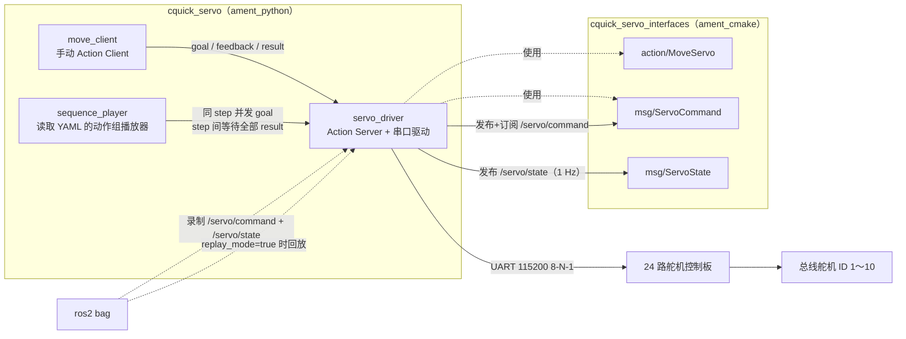

# 第 3、4 周提交说明 · 游梁思远

## 一、基本信息

- 姓名：游梁思远；姓名拼音：`youliangsiyuan`
- 上游提交目录：`电控组/Week3-4/youliangsiyuan/`（已按 `woailuyao/cquick-recruitment` 上游实际目录核对）
- 环境：Windows 11 + VirtualBox Ubuntu 22.04 + ROS2 Humble
- 控制板：众灵 24 路总线舵机控制板；板载 USB 为 HID，ROS2 使用 `RX1/TX1/GND` 排针
- 整机：20KG.CM 总线舵机 × 10，左腿 ID 1～5、右腿 ID 6～10，故障件已隔离替换
- 电池：SAI YANG 1500mAh 45C 7.4V 2S LiPo + XT30 转接线
- USB 转 TTL：CH340（`1a86:7523`），115200 8-N-1
- ROS2 包：`cquick_servo_interfaces`（ament_cmake）+ `cquick_servo`（ament_python）
- 任务 3 最终动作：`squat_in_place.yaml`（深蹲起）与 `forward_back_bend.yaml`（前后下摇）

---

## 二、架构图



| 项 | 名字 | 说明 |
|---|---|---|
| Action | `/move_servo`，类型 `cquick_servo_interfaces/action/MoveServo` | 舵机控制接口 |
| 话题 1 | `/servo/command`（`ServoCommand`） | 内部调试与 bag；驱动发布回显，同时在回放模式订阅执行 |
| 话题 2 | `/servo/state`（`ServoState`） | 1 Hz 串口和最近指令状态 |
| 节点 | `servo_driver` | 唯一串口拥有者；参数 YAML 顶层 key 必须同名 |
| 节点 | `move_client` | 手动调试用 Action Client |
| 节点 | `sequence_player` | 可独立 `ros2 run`；也可由 launch 的 `demo:=true` 条件启动 |

---

## 三、参数表

参数文件：`src/cquick_servo/config/servo_params.yaml`。

| 参数名 | 本机值 | 为什么是这个值 |
|---|---|---|
| `port` | `/dev/cq_servo` | udev 规则固定名（见第十五节加分项）。**没有该规则的机器**用 `port:=/dev/ttyUSB0` 覆盖；launch 的 `port` 默认值与此保持一致 |
| `baudrate` | `115200` | 控制板使用 115200 8-N-1 |
| `pwm_min` / `pwm_max` | `900` / `2100` | 驱动的保守软件边界，不是电气极限；详细实测边界见第六节 |
| `default_duration_ms` | `800` | 未传 duration 时使用的平滑默认值 |
| `servo_ids` | `[1,2,3,4,5,6,7,8,9,10]` | 当前整机实际安装的 10 台；拒绝不存在的 ID |
| `joint_offsets` | `[9,-119,-22,44,119,-51,-68,135,-20,10]` | 当前舵臂与连杆装配状态下的机械标准位偏差 |
| `startup_reset` | `true` | 启动时恢复扭力并回校准标准位，建立确定起点 |
| `pwm_hard_min` / `pwm_hard_max` | `500` / `2500` | 协议与电气范围，仅用于非法参数校验 |
| `feedback_period_ms` | `200` | 5 Hz feedback，满足接口要求 |
| `prad_tolerance` | `30` | PRAD 目标与读回误差不超过 30 判到位 |
| `prad_retries` | `1` | 默认没到位时重发 1 次；大幅调试时临时设为 0，结束恢复 |
| `watchdog_timeout_s` | `1.0` | 推进停滞超过 1 s 时全部卸力 |
| `serial_read_timeout_s` | `0.05` | 串口读超时 |
| `reconnect_interval_s` | `1.0` | 掉线重连周期 |
| `replay_mode` | `false` | `true` 时只执行 `/servo/command` 回放消息并拒绝 Action goal |
| `torque_enable` | `true` | 设为 `false` 立即向全部舵机发 `PULK` 卸力 |

**机械标准位计算**：

```text
实际发送 PWM = 动作 YAML PWM + joint_offsets[ID - 1]
例如 ID 2：1500 + (-119) = 1381
```

因此 YAML 的 1500 是当前机器的校准标准姿态，不是对所有关节直接发送原始 1500。

---

## 四、`MoveServo` 接口契约

```text
# Goal
uint8  id
uint16 pwm
uint16 duration_ms     # 0 表示使用 default_duration_ms
---
# Result
bool   success
uint16 final_pwm       # 结束时 PRAD 读回位置，读不到为 0
uint8  retry_count
string message
---
# Feedback
uint16  current_pwm    # 时序插值估算，不冒充实测
float32 progress       # 0.0～1.0
```

| 段 | 含义与发送时机 |
|---|---|
| Goal | `id` 必须在 `servo_ids`；`pwm` 必须在当前安全区间；duration 不得超过 9999。非法 goal 直接拒绝 |
| Feedback | 执行中每 200 ms 发一次；`current_pwm` 是估算进度，最终位置以 Result 的 PRAD 为准 |
| Result | 到位、未到位、取消或串口错误均返回；取消时 `success=false, message=canceled` |

手动发送示例：

```bash
ros2 action send_goal /move_servo cquick_servo_interfaces/action/MoveServo \
  "{id: 2, pwm: 1700, duration_ms: 1000}" --feedback
```

---

## 五、一条启动命令

```bash
cd ~/ros2_ws
source /opt/ros/humble/setup.bash
source install/setup.bash
ros2 launch cquick_servo servo.launch.py
```

任务 2 四台阶段保留的真实启动关键行如下；当前整机已按同一流程扩展为 ID 1～10，并使用各自的校准目标，而不是伪造一段未保存的十台启动日志：

```text
[servo_driver-1] [INFO] [servo_driver]: 驱动节点已启动：action=/move_servo topic=/servo/command state=/servo/state
[servo_driver-1] [INFO] [servo_driver]: 串口已打开：/dev/ttyUSB0 @ 115200 8-N-1
[servo_driver-1] [INFO] [servo_driver]: PULR id=1 恢复扭力
[servo_driver-1] [INFO] [servo_driver]: PULR id=2 恢复扭力
[servo_driver-1] [INFO] [servo_driver]: PULR id=3 恢复扭力
[servo_driver-1] [INFO] [servo_driver]: PULR id=4 恢复扭力
[servo_driver-1] [INFO] [servo_driver]: startup_reset 完成：所有舵机 -> 1500
```

加入 udev 规则后，当前整机（10 台）的真实启动行变为（见 `加分项/07_udev_默认端口生效.png`）：

```text
[servo_driver-1] [INFO] [servo_driver]: 串口已打开：/dev/cq_servo @ 115200 8-N-1
[servo_driver-1] [INFO] [servo_driver]: startup_reset 完成：所有舵机 -> 1500
[servo_driver-1] [INFO] [servo_driver]: MultiThreadedExecutor 线程数=12（servo_ids=10 + 2）
```

启动后的实际检查：

```text
$ ros2 node list
/servo_driver
$ ros2 action list -t
/move_servo [cquick_servo_interfaces/action/MoveServo]
$ ros2 topic list | grep servo
/servo/command
/servo/state
```

`port:=/dev/ttyUSB1` 已验证能覆盖 YAML：当时日志明确改为尝试打开 USB1 并报该设备不存在。`demo:=true` 的条件启动功能也已验证（验证阶段播放的是当时的 `stand_up.yaml`）；现在提交版本的 `action_file` 默认值已指向 `squat_in_place.yaml`，换动作时通过 `action_file` 参数选择 YAML。

---

## 六、安全区间与实测依据

- 协议/电气范围：`500～2500`，**不等于机械安全范围**。
- 驱动当前软件边界：`900～2100`，超界 goal 会拒绝；运行时改边界也经过非法参数测试。
- 不声称每台舵机都已在整机结构中到达 900 和 2100；未实际到达的边界不写成实测值。

| 阶段 | 实际操作与现象 | 得出的边界 |
|---|---|---|
| 任务 1 桌面标定 | 从 1500 附近小步慢速试动，使用 100 PWM 步进和 `T2000`，观察声音与运动，异常立即卸力 | 建立中位与初步保守边界，不把 500～2500 当结构安全行程 |
| 结构装配 | 未标定装舵臂曾发生堵转冒烟，故障件隔离；之后先标定再装配并记录 10 项 offset | 机械安全必须结合具体关节和装配状态，不能只给全局电气范围 |
| 最终动作真机回归 | 两个最终动作叠加 offset 后的实际目标覆盖约 **1178～1935**；单次日志均为 7/7 step、70/70 goal 到位 | 这是当前最终动作实际验证到的目标范围，不外推成所有方向的极限 |

任务 2 还现场验证过：把 `pwm_max` 从 2100 改为 1600 后，原可接受的 1700 goal 立即被拒绝；恢复 2100 后重新接受。把 `pwm_max` 设为 100000 则因超出 500～2500 电气范围而设置失败。

---

## 七、运行时改参数的六步实测

| 步 | 命令要点 | 实际输出或行为 |
|---|---|---|
| ① | `ros2 param get /servo_driver pwm_max` | `Integer value is: 2100` |
| ② | 发 `id=2, pwm=1700, duration_ms=1000` | goal 接受并返回 result |
| ③ | `ros2 param set /servo_driver pwm_max 1600` | `Set parameter successful` |
| ④ | 不重启再发同一 1700 goal | `Goal was rejected.` |
| ⑤ | `ros2 param set /servo_driver pwm_max 100000` | 设置失败，原因：超出电气范围 500～2500 |
| ⑥ | 恢复 `pwm_max 2100` | 设置成功，再发 1700 恢复接受 |

第④步驱动日志：

```text
[WARN] [servo_driver]: goal 被拒绝：pwm=1700 超出安全区间 [900, 1600]（现场可 ros2 param set 放宽 pwm_max）
```

限位判断每次通过 `self.get_parameter(...).value` 现读；非法参数由 `add_on_set_parameters_callback` 拒绝，并校验 `pwm_min < pwm_max` 的组合关系。

---

## 八、bag 内容与回放

只录 `/servo/command` 和 `/servo/state`，没有使用 `-a`：

```bash
ros2 bag record -o ~/ros2_ws/bag/run1 /servo/command /servo/state
# 发 3 条 goal：id=2，1600 → 2000 → 1500（各 1200 ms），然后 Ctrl+C 停录
```

`ros2 bag info` 实测：

```text
Files:             run1_0.db3
Bag size:          25.4 KiB
Storage id:        sqlite3
Duration:          11.003529171s
Messages:          39
Topic information: Topic: /servo/command | Type: cquick_servo_interfaces/msg/ServoCommand | Count: 6
                   Topic: /servo/state | Type: cquick_servo_interfaces/msg/ServoState | Count: 33
```

回放命令：

```bash
ros2 launch cquick_servo servo.launch.py
ros2 param set /servo_driver replay_mode true
ros2 bag play ~/ros2_ws/bag/run1
ros2 param set /servo_driver replay_mode false
```

实测回放复现了 1600 → 2000 → 1500。`replay_mode` 用来避免驱动自己发布回显后又立即订阅执行同一指令。仓库保留 `bag/run1/metadata.yaml` 和 `.db3`，远低于 10 MB。

---

## 九、接线与供电

```text
电池 ──XT30 转接线──> 绿色 2 位螺钉端子（红 +，黑 −）
电脑 ──USB──> USB-TTL(CH340) ──> RX1/TX1/GND 排针
舵机 ──3 针线──> 白色卡扣总线座
```

| 项 | 实际接法 / 实测 |
|---|---|
| USB-TTL → 控制板 | `TXD → RX1`、`RXD → TX1`、`GND → GND`；**5V 悬空不接** |
| 共地 | TTL GND、控制板 GND、电池负极共地 |
| 电池实测 | UNI-T UT33D+ 直流档实测 **7.62 V**，测量日期 2026-11-15，见 `01_电池电压.png` 与 `03_电池电压.png` |
| 串口权限 | udev 固定名 `/dev/cq_servo` → 实际 `ttyUSB0`，`root dialout`，普通用户在 `dialout` 组内，不使用 sudo |
| 当前 ID | 左腿 1～5、右腿 6～10；001～010 扫描全在线，见 `03_ID扫描.png` |

板载 USB-C 是 HID，不产生可供 pyserial 使用的 COM/`ttyUSB` 设备，因此 ROS2 必须走 USB-TTL 排针。2S LiPo 的 BB 响建议设为 3.6 V/节；报警后停止动作、卸力断电并检查静置电压，鼓包、发热、异味或明显单节压差时停用。

---

## 十、任务 3：YAML 动作组与 result 同步

最终提交两套动作：

| 文件 | 内容 | 单次真机回归证据 |
|---|---|---|
| `config/actions/squat_in_place.yaml` | 双脚对称，80→170→220→260→300→回标准位，共 7 步 | 2026-11-18 21:34，7/7 step、70/70 goal 成功，17.05 s |
| `config/actions/forward_back_bend.yaml` | 双脚支撑，前倾→回正→后仰下沉→回正，共 7 步 | 2026-11-18 21:44，7/7 step、70/70 goal 成功，18.64 s |

单次试跑日志分别保存在：

- `logs/task3/squat_in_place_trial_20261118_2134.log`
- `logs/task3/forward_back_bend_trial_20261118_2144.log`

2026-11-18 21:59～22:00 又按官方顺序完成最终回归：深蹲起连续三遍，然后不换代码、换前后下摇 YAML 一遍。逐份脚本检查结果如下，四份日志均没有 `FAIL`、`ERROR` 或超时：

| 最终日志 | 结果 | 最大 PRAD 误差 | 耗时 |
|---|---|---:|---:|
| `squat_in_place_final_run1.log` | 7/7 step，70/70 goal | 21 | 17.31 s |
| `squat_in_place_final_run2.log` | 7/7 step，70/70 goal | 18 | 17.24 s |
| `squat_in_place_final_run3.log` | 7/7 step，70/70 goal | 18 | 17.17 s |
| `forward_back_bend_final_run1.log` | 7/7 step，70/70 goal | 17 | 18.77 s |

这些最终日志均位于 `logs/task3/`，每个 goal 的 result 都带有时间戳。

`squat_in_place.yaml` 中深蹲 300 档的真实片段：

```yaml
- name: 06_对称深蹲300
  joints:
    - {id: 1, pwm: 1500, duration_ms: 2000}
    - {id: 2, pwm: 1620, duration_ms: 2000}
    - {id: 3, pwm: 1200, duration_ms: 2000}
    - {id: 4, pwm: 1800, duration_ms: 2000}
    - {id: 5, pwm: 1500, duration_ms: 2000}
    - {id: 6, pwm: 1500, duration_ms: 2000}
    - {id: 7, pwm: 1380, duration_ms: 2000}
    - {id: 8, pwm: 1800, duration_ms: 2000}
    - {id: 9, pwm: 1200, duration_ms: 2000}
    - {id: 10, pwm: 1500, duration_ms: 2000}
```

| 要求 | 实现 |
|---|---|
| 一步之内多舵机协同 | `sequence_player` 对同一 step 的 joints 连续调用 `send_goal_async`，不等待彼此 |
| 步与步之间串行 | 等该 step 的全部 result 返回并统计成功数后，才允许进入下一 step |
| 一步之内有先后 | 拆成不同 step，不靠 `sleep(duration)` 猜到位时间 |
| 失败停止 | 任一 goal 未到位就抛错，不继续发送后续更大幅度的 step |
| 数据驱动 | 动作全部在 YAML；播放器与驱动 Python 不包含某套动作的固定流程 |

换动作命令如下，不需要改 Python：

```bash
ros2 run cquick_servo sequence_player --ros-args -p action_file:=squat_in_place.yaml
ros2 run cquick_servo sequence_player --ros-args -p action_file:=forward_back_bend.yaml
```

日志中的 result 时序示例：最后一个 result 返回后，才打印本 step 的 10/10 完成并下发下一 step。

```text
[21:34:19.582] <- result id=10 [OK] final_pwm=1504 ...
[21:34:19.582] === step 6/7 "06_对称深蹲300" 完成：10/10 到位，可以进下一步 ===
[21:34:19.582] === step 7/7 "07_站起回标准位" 下发 10 个 goal ===
```

驱动侧删除 `_busy` 并发拒绝，保留串口 `_serial_lock`；10 台时使用 12 线程 `MultiThreadedExecutor`，串口写帧间隔 20 ms。`sync_check.yaml` 的 3 步、30 个 goal 也已全部成功。

---

## 十一、真实踩坑记录

完整记录见 `调试记录.md`，代表性问题如下：

| # | 现象 | 验证过程 | 结论与处理 |
|---|---|---|---|
| 1 | 舵机转动一顿一顿 | 同板、同电源、同指令换件对照，替换后平滑 | 舵机本体异常，故障件隔离 |
| 2 | 未标定先装舵臂后堵转冒烟 | 对照机械零位与装配顺序，换件并重新先标定再装 | 机械零位必须先确定；当前使用 10 项 offset |
| 3 | 多台出厂 ID 都为 `000`，接入后撞号乱动 | 断电后一次只接一台，逐台改号，再扫描 | 当前 001～010 唯一且全在线 |
| 4 | `PID` 与 `PRAD` 回包不同 | 增大 timeout 和读取长度仍不同，逐条对照命令 | `PID` 只确认 ID，`PRAD` 才返回位置，解析需兼容 |
| 5 | 同 step 第二个 goal 起被拒绝 | 日志显示 YAML 已展开，驱动 `_busy` 拒绝并发 | 删除 busy 拒绝，保留串口锁，并改多线程执行器 |
| 6 | `bag play` 完成但舵机不动 | 订阅计数正常，检查发现 `replay_mode=false` 只回显不执行 | 回放前显式设置 `replay_mode=true` |
| 7 | 前后下摇没有预期方向 | 真机逐步确认 2、7 号镜像方向；后仰观察身体未下沉 | 反转 2、7 号；后仰让 3、8 号屈膝下沉，最终单次 70/70 goal 到位 |

行走、侧向并步和单腿叶问蹲实验未达到可重复交付标准，没有写成“已走通”，也不纳入最终两套动作。

---

## 十二、安全下电三步

```text
全部 PULK 卸力 → 拔电池 → sudo shutdown now
```

| 步骤 | 原因 |
|---|---|
| ① 全部卸力 | 避免舵机在受力、堵转状态下直接断电 |
| ② 拔电池 | 先断动力电，避免欠压过程中出现非预期动作 |
| ③ 正常关机 | 避免直接断电损坏板卡文件系统 |

四条红线：不带电插拔舵机线；不反接电源；鼓包电池立即停用；听到持续嗡嗡或发现顶结构立即卸力断电。任务 4 视频应完整拍到姓名、实时时间及以上三步。

---

## 十三、B 站录屏链接

所有视频只发 B 站，仓库不放 MP4。任务 3 两段视频均须在开头清楚显示姓名与实时日期时间，并同时拍到终端和实物。

| # | 内容 | 链接 |
|---|---|---|
| 1 | 任务 1 · 舵机转动与回中 | [BV1pYsW6NEN3](https://www.bilibili.com/video/BV1pYsW6NEN3) |
| 2 | 任务 2 · 正转、反转、回中 | [BV1p5ss6TEFr](https://www.bilibili.com/video/BV1p5ss6TEFr) |
| 3 | 任务 2 · 取消打断与 canceled result | [BV1w5ss6TEwK](https://www.bilibili.com/video/BV1w5ss6TEwK) |
| 4 | 任务 2 · 运行时参数六步 | [BV1wGss6BEQC](https://www.bilibili.com/video/BV1wGss6BEQC) |
| 5 | 任务 2 · bag 回放 | [BV1WGss6BEwU](https://www.bilibili.com/video/BV1WGss6BEwU) |
| 6 | 任务 3 · ID 1～10 逐个 Action 小幅运动并回正（47 s） | [BV1HHsQ6jEKM](https://www.bilibili.com/video/BV1HHsQ6jEKM) |
| 7 | 任务 3 · 深蹲起连跑三遍 + 换前后下摇 YAML 一遍（86 s） | [BV1PjsQ6DEsu](https://www.bilibili.com/video/BV1PjsQ6DEsu) |
| 8 | 任务 4 · 安全下电完整流程（29 s） | [BV1rHsQ6jEr7](https://www.bilibili.com/video/BV1rHsQ6jEr7) |

> 三段视频均已上传 B 站（公开）。任务 3 动作组视频的每个关键姿态已按终端 goal 日志核对到对应 step，并据此生成 `03_多舵机动作_关键帧.png`。

---

## 十四、提交核对

### 任务 1、2

- [x] 两个包构建、接口、launch、Action feedback/result/cancel 均验证
- [x] 运行时参数当帧生效、非法参数拒绝、bag 回放均验证
- [x] 纯协议单测复跑：27 passed（不访问硬件）
- [x] 任务 1、2 截图与 B 站链接齐全

### 任务 3

- [x] 当前 10 台 ID 在线，整机正侧面、接线、电池和 ID 扫描图片齐全
- [x] 最终两套 YAML 与单次 70/70 goal result 日志齐全
- [x] 播放器按 step 并发、按 result 串行，换 YAML 不改 Python
- [x] 官方顺序的最终回归与四份日志：深蹲起三遍 + 前后下摇一遍，全部 70/70 goal 成功
- [x] `03_多舵机动作_关键帧.png` 已由最终动作组视频抽帧生成，六格姿态均按终端 goal 日志核对
- [x] 十个关节逐个 Action 视频已在本地录制并核对（47 s，ID 1～10 依次动作并回正）
- [x] 三段视频已上传 B 站，第十三节链接已填（BV1HHsQ6jEKM / BV1PjsQ6DEsu / BV1rHsQ6jEr7）

### 任务 4 与仓库

- [x] 安全下电视频已录制并核对（29 s，包含姓名时间、PULK 卸力、拔电池与关机）
- [x] 下电视频已上传 B 站并填入 README
- [ ] `build/`、`install/`、`log/`、`__pycache__/`、`.pyc`、视频文件均不进仓库（本地暂存目录已确认干净）
- [ ] 提交目录复制到 `电控组/Week3-4/youliangsiyuan/`，commit、push、PR 前复核 diff

---

## 十五、加分项（单独目录提交）

加分项材料放在 `加分项/` 子目录，详细说明见 `加分项/README.md`。

| # | 加分项 | 分值 | 状态 |
|---|---|---:|---|
| 1 | pytest 单测 | +2 | **已完成**，27 passed 真实输出见 `加分项/01_pytest单测_真实输出.log` |
| 2 | PRAD 闭环校验 | +3 | **已完成（真机实测）**：未到位→重发→到位，见 `加分项/03_Prad闭环_未到位重发到位.png` |
| 3 | 安全看门狗 | +3 | **已完成（真机实测）**：触发→10 台 PULK→锁死→外部确认恢复，见 `加分项/04_看门狗_触发卸力与外部恢复.png` |
| 4 | 串口掉线自动重连 | +3 | **已完成（真机实测）**：拔线→写入失败→每秒重试→插回自动恢复，见 `加分项/05_串口重连_拔插恢复.png` |
| 5 | udev 固定设备名 | +2 | **已完成（真机实测）**：规则 + `/dev/cq_servo` 符号链接 + 默认端口生效，见 `加分项/06_udev_固定设备名.png`、`加分项/07_udev_默认端口生效.png` |
| 6 | 动作组抢占 | +4 | **未实现** |

> 已完成项目对应分值合计 **+13**，最终加分按考核上限 **+10** 计；第 6 项未做，不申报。
> 加分项详细说明与逐项日志摘要见 `加分项/README.md`；代码位置与触发条件见 `加分项/02_代码证据与机制说明.md`。
> 看门狗的判据是“动作推进停滞”而不是直接监听 `/servo/state` 心跳，这一点已在加分项文档中写明，答辩时按实情说明。

### udev 固定设备名（+2）规则与兼容说明

规则文件 `/etc/udev/rules.d/99-cq-servo.rules`：

```text
# CQuick 总线舵机 USB-TTL（CH340）固定设备名
SUBSYSTEM=="tty", ATTRS{idVendor}=="1a86", ATTRS{idProduct}=="7523", SYMLINK+="cq_servo", MODE="0660", GROUP="dialout"
```

生效后 `ls -l /dev/cq_servo` 显示 `-> ttyUSB0`，且本机 `servo_params.yaml` 的 `port` 与 `servo.launch.py` 的 launch 默认值都已是 `/dev/cq_servo`，不带 `port:=` 直接启动会打印 `串口已打开：/dev/cq_servo @ 115200 8-N-1`。

**没有这条规则的机器** 请显式覆盖：

```bash
ros2 launch cquick_servo servo.launch.py port:=/dev/ttyUSB0
```

> 踩坑：只改 `servo_params.yaml` 不生效，因为 launch 的 `port` 默认值会覆盖 yaml——**launch 参数优先级高于 yaml**，两处都改才生效。
