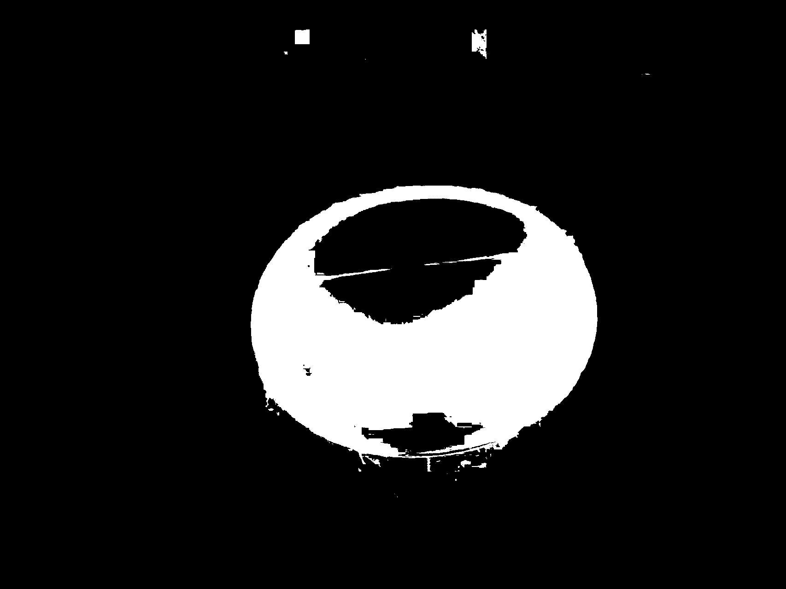
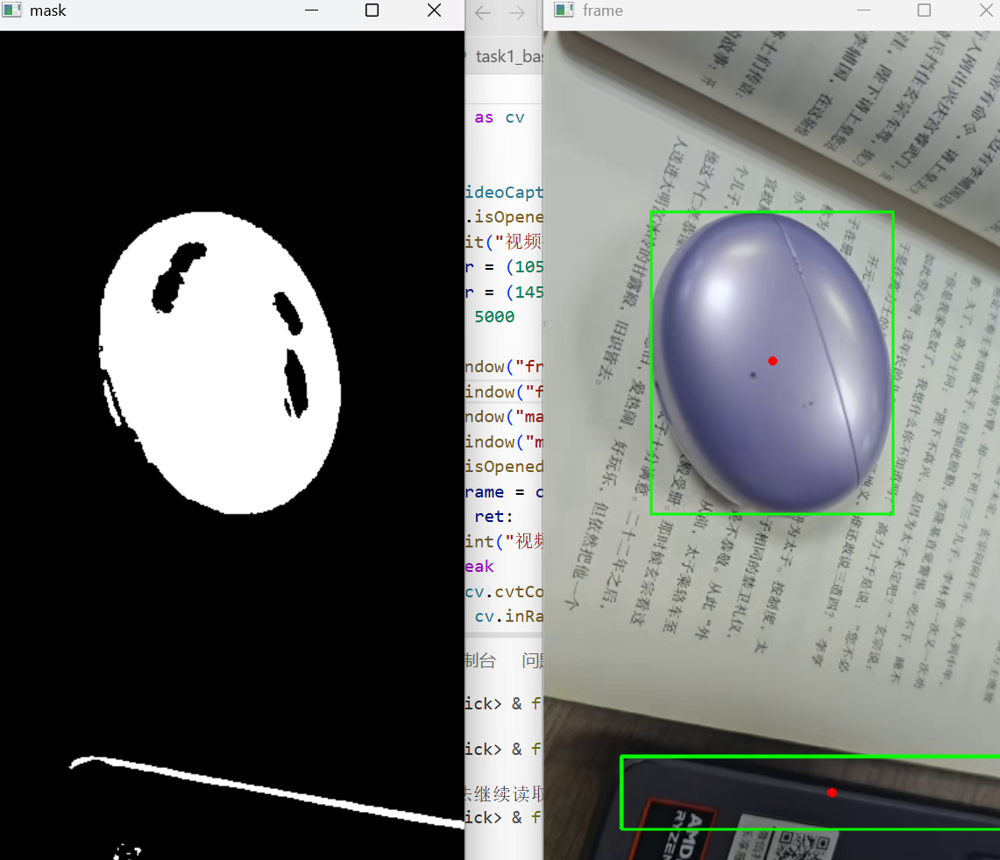

# 第一周视觉算法学习记录

姓名：胡钰涵　日期：2026年10月25日

## 环境与运行方式

本次使用 Python 3.10.11、OpenCV 5.0.0 和 VS Code。仓库不包含虚拟环境，首次运行时需要在个人作业目录创建并安装依赖；`sys` 是标准库，无需另行安装。

先在终端进入克隆得到的 `cquick-recruitment` 仓库根目录，再执行以下 PowerShell 命令。此处的相对路径不依赖仓库所在的盘符：

```powershell
Set-Location ".\算法组\Week1\huyuhan"
py -3.10 -m venv .venv
.\.venv\Scripts\python.exe -m pip install opencv-python numpy matplotlib
```

后文“项目根目录”均指这个包含 `README.md`、`src/`、`data/` 和 `outputs/` 的个人作业目录，不是整个仓库根目录。脚本按当前工作目录解析相对路径，运行时应停留在这里。

测试图片已放在 `data/images/`，任务一至三所需的输出目录也已随结果提交，保留这些目录即可运行。

| 任务 | 输入 | 脚本 | 结果目录 |
|---|---|---|---|
| 一 | test1.jpg、test2.jpg | src/task1_basics.py | outputs/task1/ |
| 二 | test2.jpg | src/task2_processing.py | outputs/task2/ |
| 三 | color1.jpg、color2.jpg、color3.jpg | src/task3_color_detect.py | outputs/task3/|
| 四 | test.mp4 | src/task4.py | outputs/task4/|

任务一至三均从项目根目录运行：

```powershell
.\.venv\Scripts\python.exe .\src\task1_basics.py
.\.venv\Scripts\python.exe .\src\task2_processing.py
.\.venv\Scripts\python.exe .\src\task3_color_detect.py
```

任务四为选做的视频实验。原测试视频未随仓库提交，因此克隆后不能直接复现该视频实验。需自行准备测试视频，在项目根目录创建 `data/video/` 并将视频命名为 `test.mp4`，再运行：

```powershell
.\.venv\Scripts\python.exe .\src\task4.py
```

使用其他视频时，检测结果可能与本文截图不同。任务四按 `q` 退出；没有视频时可以先运行任务一至三。

任务一至三直接保存结果，`cv.imwrite()` 返回 True 表示保存成功，无需按 S。任务三的标注图以 JPEG 质量90保存，保留原始图像尺寸以控制文件体积；掩膜和开闭运算结果仍保存为 PNG。任务四只显示画面，通过截图记录结果。本文中的图片链接均相对于项目根目录。

## 任务一：图像基础操作

### 操作与结果

读取两张彩色图，检查读取结果并打印宽、高、通道数。分别从原图生成三类结果：

- 缩放：`(width // 2, height // 2)`，使用 `INTER_AREA`，保存为 `test1_resize.png`、`test2_resize.png`。
- 中央裁剪：`image[h//4:3*h//4, w//4:3*w//4]`，保存为 `test1_crop.png`、`test2_crop.png`。
- 灰度转换：`COLOR_BGR2GRAY`，保存为 `test1_gray.png`、`test2_gray.png`。

六张结果均保存并重新读取成功，保存前后的 shape 一致，输出未覆盖原图。

| 原图 | 原图 shape | 缩放 shape | 裁剪 shape | 灰度 shape |
|---|---|---|---|---|
| test1 | (1706,1279,3) | (853,639,3) | (853,640,3) | (1706,1279) |
| test2 | (1279,1706,3) | (639,853,3) | (640,853,3) | (1279,1706) |

### 思考

1. **shape与索引：** 彩色图shape为 `(高,宽,通道数)`，`shape[:2]`只取高和宽；`img[100,100]`访问第100行、第100列，索引从0开始。
2. **BGR顺序：** OpenCV默认彩色读取采用BGR，`img[y,x,0]`取该像素的蓝色分量，不是筛选蓝色物体。
3. **缩放参数：** resize的目标尺寸按 `(宽,高)` 填写；None搭配fx、fy表示按比例缩放。预览窗口自动适配时，需查看实际像素尺寸才能确认变化。
4. **裁剪范围：** 切片按 `[行,列]` 填写，右端点不包含在结果内；`img[:, :width//2]`取左半图。尺寸含奇数时，中央裁剪和整数缩放可能相差1像素。

### 错误案例：重新读取时强制转为灰度

最初验证所有结果时使用了：

```python
check = cv.imread(path, cv.IMREAD_GRAYSCALE)
```

彩色缩放图和裁剪图原本是 `(高,宽,3)`，这样重新读取会变成 `(高,宽)`，导致 shape 比较失败。问题在读取模式，并非保存文件一定损坏。

改用 `cv.IMREAD_UNCHANGED` 保留保存文件的通道信息后，六张结果均通过验证。`IMREAD_COLOR` 也不适合统一验证，因为它会把灰度文件读成三通道。

## 任务二：基础图像处理对比

### 操作与关键参数

使用夜景建筑图 test2，直接以 `IMREAD_GRAYSCALE` 读取。高斯滤波、阈值处理均从同一张 gray 开始；Canny使用5×5高斯结果；开、闭运算分别使用阈值80的二值图。本任务共保存18张中间结果。

| 处理 | 参数 | 输出文件 |
|---|---|---|
| 灰度读取 | IMREAD_GRAYSCALE | [01_gray.png](outputs/task2/01_gray.png) |
| 高斯核大小对比 | 5×5、9×9，sigma=0 | [02_gaussian5.png](outputs/task2/02_gaussian5.png)、[03_gaussian9.png](outputs/task2/03_gaussian9.png) |
| 高斯标准差对比 | 固定9×9，sigma=1、2 | [gaussian9_sigma1.png](outputs/task2/gaussian9_sigma1.png)、[gaussian9_sigma2.png](outputs/task2/gaussian9_sigma2.png) |
| 五种固定阈值 | 阈值127、最大值255 | [threshold_binary.png](outputs/task2/threshold_binary.png)、[threshold_binary_inv.png](outputs/task2/threshold_binary_inv.png)、[threshold_trunc.png](outputs/task2/threshold_trunc.png)、[threshold_tozero.png](outputs/task2/threshold_tozero.png)、[threshold_tozero_inv.png](outputs/task2/threshold_tozero_inv.png) |
| 自适应阈值 | 均值法、高斯法；邻域11×11、C=2 | [threshold_adaptive_mean.png](outputs/task2/threshold_adaptive_mean.png)、[threshold_adaptive_gaussian.png](outputs/task2/threshold_adaptive_gaussian.png) |
| Otsu | THRESH_BINARY搭配THRESH_OTSU，自动阈值58 | [threshold_otsu.png](outputs/task2/threshold_otsu.png) |
| 固定阈值数值对比 | THRESH_BINARY，阈值80、140 | [threshold80.png](outputs/task2/threshold80.png)、[threshold140.png](outputs/task2/threshold140.png) |
| Canny | 低阈值50、高阈值150 | [06_canny.png](outputs/task2/06_canny.png) |
| 开运算、闭运算 | kernel=None，默认3×3矩形核，各一次 | [07_open.png](outputs/task2/07_open.png)、[08_close.png](outputs/task2/08_close.png) |

### 阈值选值依据

- **固定阈值127：** 接近8位灰度范围0～255的中点，作为五种固定阈值方法的统一对照，便于比较方法差异。它是实验初值，不是根据本图求得的最佳阈值；255是二值图的白色输出值，不是另一个分割阈值。
- **对照阈值80和140：** 用两个差距较大的数值观察低、高阈值对夜景结构的取舍。80保留较暗屋檐和较多建筑细节，140主要保留高亮灯点、灯带，便于看清提高阈值后丢失哪些区域。形态学选择binary80，是因为它包含更多细线和小亮区，便于观察开闭运算的影响；不是认为80一定最好。
- **自适应邻域11、C=2：** 以11×11局部区域比较均值法和高斯法；11是大于1的奇数，两种方法保持相同邻域与C，便于对照。C=2表示从局部统计值中减2，是本次初始设置，尚未通过多组实验确定最优；它不是整张图统一使用阈值2。
- **Otsu传入0、返回58：** 搭配THRESH_OTSU时，由算法根据本图灰度分布自动选择阈值，代码传入的0不作为最终分割阈值。本次返回58，因此58是计算结果，不是手动猜定的值。
- **Canny使用50、150：** 作为双阈值实验的起始组合，高阈值150确定强边缘，低阈值50用于保留与强边缘相连的弱边缘，以兼顾主要轮廓和部分较弱结构。当前结果能辨认主要屋檐，但暗部仍有断裂，因此这组值可用于本次观察，尚未证明最优。

### 参数对比与实际观察

| 比较内容 | 结果与认识 |
|---|---|
| 原灰度图与高斯滤波 | 原图看起来最清楚。整体预览时5×5与9×9差别不明显，查看屋檐、瓦片和灯点局部后，9×9的平滑更强、细节更模糊。滤波用于平滑，不是让图更锐利。 |
| 固定9×9，sigma从1变2 | sigma=1保留较多纹理，sigma=2使细线和亮点边界更柔和。这是固定输入和核大小、只改变标准差的一组对比。 |
| 二值化阈值从80提高到140 | 白色像素占比降低；较暗屋檐、横线和瓦片亮部变黑，主要保留高亮灯点及灯带。降低阈值能保留更多结构。|
| Canny边缘是否完整 | 主要屋檐、翘角和塔尖可辨认，暗部与细小结构仍有缺失、断裂；独立灯珠产生多个小轮廓，不全是边缘检测失败。 |
| 开运算解决什么问题 | 减少小片白色区域和细小突出部分，但部分有效灯珠、细线也被削弱。|
| 闭运算解决什么问题 | 填补部分小黑缝、连接邻近白色片段，但无法恢复阈值分割时已丢失的大段结构，也可能造成粘连。 |

本次明确比较了两个参数：固定9×9核改变sigma（1、2），固定普通二值化方法改变阈值（80、140）。另比较了5×5和9×9的自动标准差设置。

### 思考

1. **阈值函数的返回值：** `ret, result = cv.threshold(...)`分别是阈值和结果图；Otsu自动计算ret。TRUNC、TOZERO等方法仍可能保留灰度，不都是纯黑白图。
2. **Canny阈值的含义：** 50、150是梯度阈值，不是像素灰度阈值。先平滑有助于抑制噪声，但不能保证所有边缘完整。
3. **形态学的核与输入：** kernel规定邻域，anchor默认居中；None使用默认3×3矩形核。本任务开、闭运算分别使用binary80，不能误写成先开后闭；阈值80也不是已证明的最优值。

## 任务三：颜色目标提取与轮廓定位

### 处理流程与参数依据

对同一个蓝紫色耳机盒子，在木纹、深色石纹和书页三种背景下测试。流程为：BGR转HSV → inRange生成mask → 先开后闭 → 获取外轮廓 → 面积筛选 → 绘制矩形框、质心，打印坐标及面积。

HSV分别表示色调H、饱和度S、明度V。本次8位图像中H为0～179，S、V为0～255。目标取样得到 `(118,79,122)`、`(116,95,142)`、`(120,36,171)`，背景取样为 `(26,19,185)`。先参考取样设范围，再查看不同图片中的掩膜调整。

| HSV设置 | 观察 |
|---|---|
| 初始H=110～130，S≥25，V≥50 | 能选中主体，反光处存在黑色缺口，color2最明显 |
| H仍为110～130，S下限降为10 | 补回部分浅色区域，同时明显增加color2背景误选 |
| 最终H=105～145，S≥20，V≥50 | 在保留浅色目标与减少背景误选之间折中，强反光缺口仍存在 |

最终下限为 `(105,20,50)`，上限为 `(145,255,255)`。H覆盖蓝紫色变化，S下限排除部分灰白区域，V下限排除部分暗区域；三个分量需同时满足范围。该范围来自取样和比较，不是通用或最优参数。

形态学使用默认3×3矩形核，先开后闭各一次。轮廓使用 `RETR_EXTERNAL` 和 `CHAIN_APPROX_SIMPLE`，分别用于只取外轮廓、压缩冗余边界点。

面积下限设为5000：这三张清理图中，最大独立背景小轮廓约1327.5，最小目标轮廓为341118.0，5000能过滤前者并保留目标。它不是唯一选择。

### 输出结果

| 图片与背景 | 轮廓数：筛选前→后 | 质心 `(x,y)` | 轮廓面积 | 观察 |
|---|---|---|---:|---|
| color1：木纹 | 1→1 | (956,805) | 398996.5 | 框包住主体，红点位于内部，无额外目标框 |
| color2：深色石纹 | 20→1 | (919,686) | 341118.0 | 反光处漏选；下缘相连背景使框略向下延伸 |
| color3：书页 | 2→1 | (939,721) | 430084.5 | 能定位主体，书页小噪声被过滤 |

| 图片 | 原始掩膜 | 开闭运算后 | 标注结果 |
|---|---|---|---|
| color1 | [mask.png](outputs/task3/color1/mask.png) | [cleaned.png](outputs/task3/color1/cleaned.png) | [result.jpg](outputs/task3/color1/result.jpg) |
| color2 | [mask.png](outputs/task3/color2/mask.png) | [cleaned.png](outputs/task3/color2/cleaned.png) | [result.jpg](outputs/task3/color2/result.jpg) |
| color3 | [mask.png](outputs/task3/color3/mask.png) | [cleaned.png](outputs/task3/color3/cleaned.png) | [result.jpg](outputs/task3/color3/result.jpg) |

三张图均生成主体框，但color2的分割不完整。目标与背景颜色区别明显时效果较好，强反光和相近颜色背景容易造成漏选或误选。

### 思考

1. **cnt与面积筛选：** cnt是一条轮廓的边界点数组，形状可以任意。面积下限只能过滤较小区域，大背景轮廓或与目标相连的背景仍可能被保留。
2. **moments与质心：** m00对应面积，m10、m01分别按横、纵坐标累加面积；质心为 `m10/m00`、`m01/m00`。先检查m00不为0，不是直接平均边界点。
3. **矩形与坐标顺序：** boundingRect返回 `(x,y,w,h)`，绘图坐标是 `(x,y)`，数组访问是 `[y,x]`。本次按教程使用 `(x+w,y+h)` 绘制右下角，严格像素末端为x+w−1、y+h−1。
4. **红点与轮廓面积：** circle半径7只控制标记大小，厚度−1表示实心，不代表物体半径；contourArea计算多边形面积，外轮廓内部黑洞也包含在围成区域内，不能当作白色像素数。

### 失败案例：强反光导致黑洞

color2的强反光处在原图很亮，掩膜中却是黑色。取样位置 `[500,900]` 的RGB为 `(236,236,236)`，饱和度S为0，已缺乏明显蓝紫色特征，所以不满足HSV范围。掩膜黑色表示“未选中”，不代表原像素很暗。



已尝试降低S下限、扩大H范围及开闭运算，部分区域得到补回，但背景误选随之增加，大黑洞仍未消除。默认3×3核不能修复这么大的缺口；外围轮廓能生成框和质心，也不代表内部漏选已恢复。

改进思路：后续可先减少拍摄反光，再结合不同位置取样调整颜色范围；仍需同时检查背景误选。本次未采用强制填洞。

## 任务四：视频连续检测

### 操作与结果

使用约17.6秒、720×1280、30帧/秒的已有视频。通过VideoCapture逐帧读取，在每帧上执行任务三流程，沿用同一HSV范围、面积下限5000和先开后闭设置，显示绿色矩形框与红色质心。

| 截图 | 场景 | 观察 |
|---|---|---|
| [01.png](outputs/task4/01.png) | 木纹桌面 | 目标框较贴合主体，中心点在内部，掩膜有少量黑孔 |
| [02.png](outputs/task4/02.png) | 深色石纹桌面 | 目标被框出；反光孔洞与背景白色杂点仍存在，截图中无额外框 |
| [03.png](outputs/task4/03.png) | 书本背景 | 目标被框出，但底部长条物体也出现矩形框和中心点，发生误检 |

截图记录了不同背景下的代表帧，不能据此判断全程稳定；本次未单独进行光照、距离的控制变量实验。

### 思考

1. **视频读取的返回值：** `ret, frame = cap.read()`返回读取是否成功及当前帧；此处ret是布尔值，不是阈值。
2. **窗口过大导致框显示不全：** 使用WINDOW_NORMAL和resizeWindow设为360×640，再并排摆放。只改变显示尺寸，不改变原始帧上的面积、框和质心坐标。

### 失败案例：书本场景的背景误检



底部干扰区域通过了颜色和面积筛选，说明仅设置最小面积不能排除较大的相近颜色背景。后续可尝试加入宽高比或轮廓形状条件，并检查是否会误删旋转后的目标；本次保留误检结果，尚未加入这些改进。

