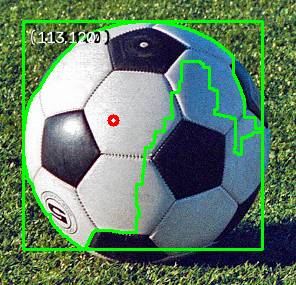
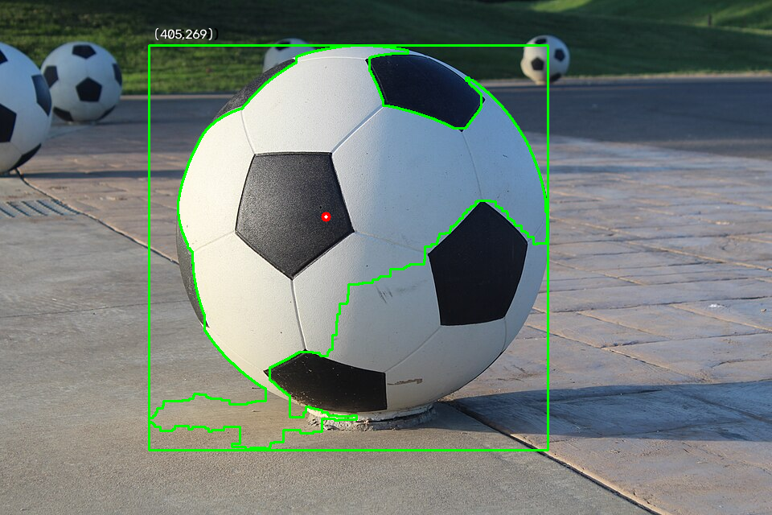
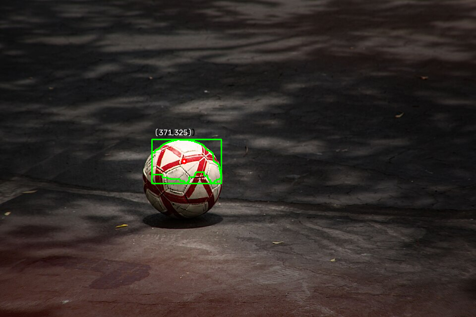
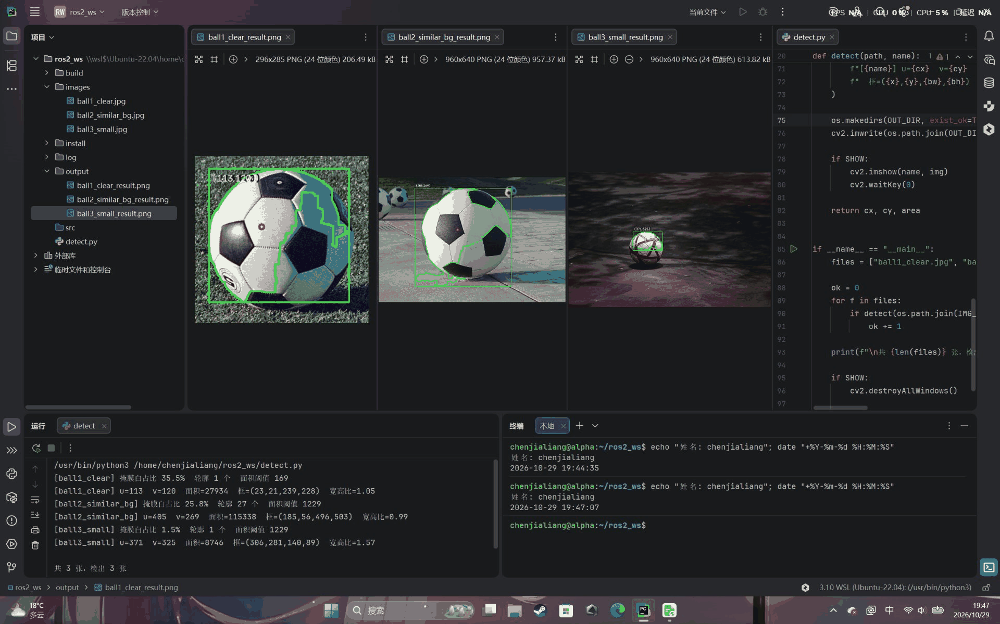
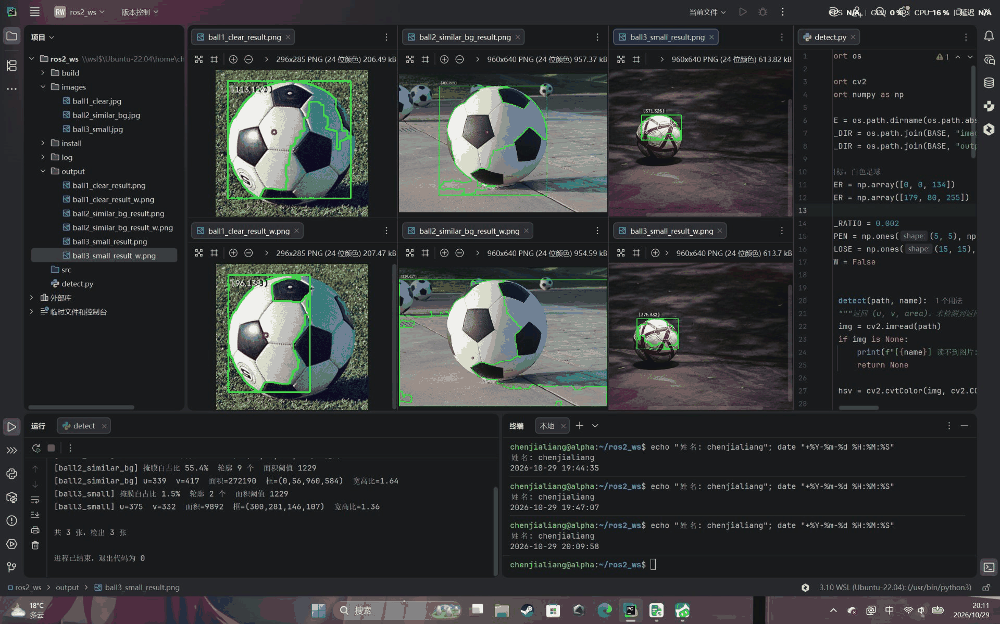
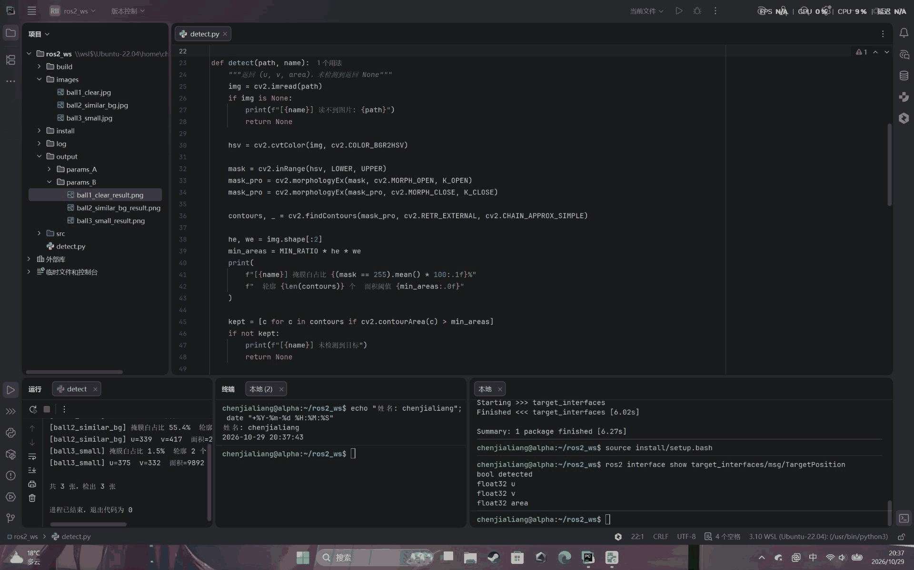
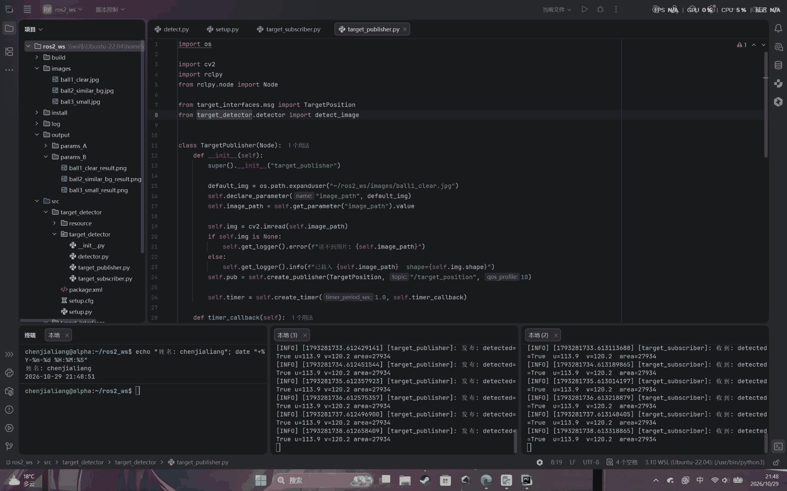
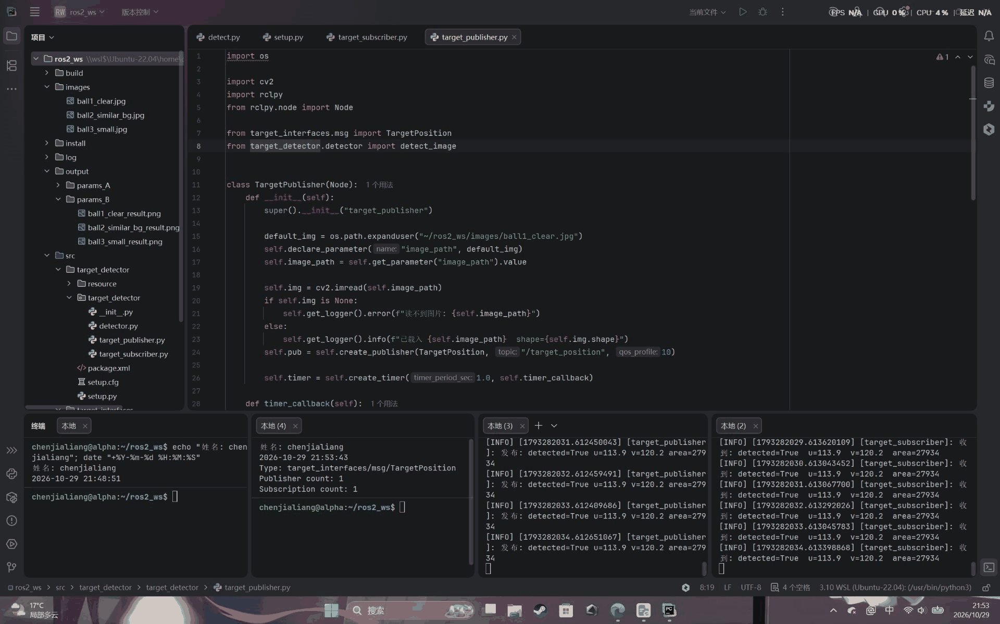
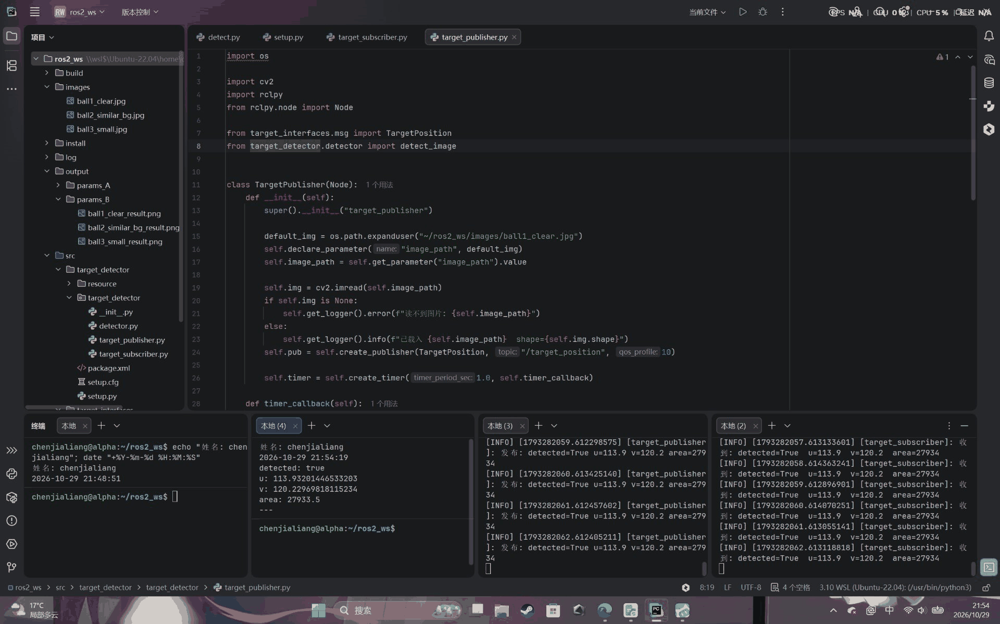

# 第 2 周考核 · 陈家亮

- 姓名：陈家亮（chenjialiang）
- 完成日期：2026-10-29
- 环境：Ubuntu 22.04 (WSL2) / ROS2 Humble / Python 3.10.12 / OpenCV 5.0.0 / NumPy 2.2.6
- 说明：为保证图片大小，输出截图均做了一定的颜色处理，但绝对真实QWQ

---

## 环境与依赖

```bash
# 系统
sudo apt update
sudo apt install -y python3-pip

# Python 依赖（走阿里云镜像）
pip3 install opencv-python numpy -i https://mirrors.aliyun.com/pypi/simple/

# ROS2 Humble（清华源，跳过 GPG 校验）
echo "deb [arch=$(dpkg --print-architecture) trusted=yes] https://mirrors.tuna.tsinghua.edu.cn/ros2/ubuntu $(. /etc/os-release && echo $UBUNTU_CODENAME) main" | sudo tee /etc/apt/sources.list.d/ros2.list
sudo apt update
sudo apt install -y ros-humble-desktop python3-colcon-common-extensions
echo "source /opt/ros/humble/setup.bash" >> ~/.bashrc
```

验证：

```bash
python3 -c "import cv2, numpy; print(cv2.__version__, numpy.__version__)"
printenv ROS_DISTRO     # 应输出 humble
```

---

## 目录结构

```
chenjialiang/
├── README.md
├── detect.py                    任务1/2 的独立检测脚本
├── 01_检测输出.png               任务1 截图：三张图的终端输出
├── 02_结果可视化.png             任务2 截图：三张结果图并排
├── 02_参数对比.png               任务2 截图：两组参数六图对比
├── 03_interface_show.png        任务3 截图：消息定义
├── 03_pub_sub分屏.png            任务3 截图：发布/订阅同时运行
├── 03_topic_info.png            任务3 截图：话题信息
├── 03_消息输出.png               任务3 截图：一条实际消息
├── data/                        三张测试图
├── outputs/
│   ├── params_A/                参数 A 的结果图
│   └── params_B/                参数 B 的结果图
└── src/
    ├── target_interfaces/       接口包（定义消息）
    └── target_detector/         节点包（发布 + 订阅）
```

---

## 运行方式

### 任务 1 / 2：独立检测脚本

`detect.py` 用的是相对路径，所以要在本目录下运行：

```bash
cd 算法组/Week2/chenjialiang
python3 detect.py
```

输出三张图的中心坐标、面积、外接矩形、宽高比，同时在 `outputs/` 下生成标注图。

### 任务 3：ROS2 发布订阅

把本目录 `src/` 下的两个包和一个 `data/` 拷进 ROS2 工作空间：

```bash
mkdir -p ~/ros2_ws/src
cp -r 算法组/Week2/chenjialiang/src/* ~/ros2_ws/src/
cp -r 算法组/Week2/chenjialiang/data ~/ros2_ws/

cd ~/ros2_ws
colcon build --packages-select target_interfaces target_detector
source install/setup.bash
```

**终端 1**（订阅者）：

```bash
ros2 run target_detector target_subscriber
```

**终端 2**（发布者）：

```bash
ros2 run target_detector target_publisher
```

换一张图测试：

```bash
ros2 run target_detector target_publisher --ros-args -p image_path:=$HOME/ros2_ws/data/ball2_similar_bg.jpg
```

---

## 任务 1：颜色目标检测

### 4.1 目标与参数

目标为**白色足球**，靠"低饱和 + 高亮度"识别。

```python
LOWER = np.array([0, 0, 160])       # H 全放开、S 不限、V >= 160
UPPER = np.array([179, 255, 255])
MIN_RATIO = 0.002                    # 最小轮廓面积 = 全图 × 0.2%
K_OPEN  = (5, 5)
K_CLOSE = (15, 15)
```

### 4.2 参数依据

**① H （0~179）**

白色没有色调，H 通道的取值是噪声。实测球体内部像素的 H 在 0~179 之间乱跳，限制 H 会漏掉大量球面像素。

**② S （0~255）**

一开始按"白色 = 低饱和"的思路，把 S 上限设成 80。结果是 **ball1 的框只包住球的左半边**（外接矩形宽高比只有 0.70，圆球应该接近 1.0）。

原因：球体右侧落在阴影里，白色表面反射了环境色（草地绿），饱和度从 35 升到 119，超过上限被排除了。

**白色物体在阴影中会带环境色，所以对白色目标不能限制 S 上限。** 改成不限制 S、只卡亮度之后，ball1 的宽高比恢复到 1.05。

**③ V 下限 160**

球体亮部的 V 大致在 190~255，背景草地和阴影的 V 在 60~140。取 160 能把两者分开。

**这个值也不能太低**：试过降到 134，ball2 的灰白地面就整片被选进来，最大轮廓的外接矩形直接覆盖整个画面（宽高比 1.64），完全失效。

**④ 闭运算核 15×15**

球面上的黑色五边形花纹会把白色区域切成好几块。用 5×5 的核填不上，最大连通块只能覆盖半个球；换 15×15 之后才连成整片。

**⑤ 最小面积取全图 0.2%**

三张图尺寸差三倍（296×285 / 960×640 / 960×640）。用"占全图比例"可以自适应，缩放处理也不影响。

### 4.3 多轮廓筛选

一张图里可能检出多个轮廓（`ball2` 有 27 个，面积过滤后剩 5 个）。规则是**取面积最大的那个**：

```python
cnt = max(kept, key=cv2.contourArea)
```

理由：目标和噪声的面积差距很大。`ball2` 里合格候选的面积排序是

```
115338   ← 目标（球）
 13512
  2996
  2678
  1332
```

最大的是次大的 **8.5 倍**，用面积就能干净地分开，不需要更复杂的判据。

### 4.4 检测结果

| 图片                     | 中心 (u, v)  | 面积（像素²） | 宽高比  | 结果            |
| ---------------------- | ---------- | ------- | ---- | ------------- |
| `ball1_clear.jpg`      | (113, 120) | 27934   | 1.05 | ✅ 完整框住整球      |
| `ball2_similar_bg.jpg` | (405, 269) | 115338  | 0.99 | ✅ 框住画面中央的大球   |
| `ball3_small.jpg`      | (371, 325) | 8746    | 1.57 | ❌ 只框到上半（见第七节） |

终端完整输出见 `01_检测输出.png`。三张结果图（从左到右依次是 ball1 / ball2 / ball3）：





### 4.5 未检测到目标时的处理

`detect.py` 的检测函数在以下情况返回 `None`，由调用方明确打印"未检测到目标"，**不会输出未初始化的坐标**：

- 图片读取失败
- 面积过滤后没有任何候选
- 轮廓面积为 0（`M["m00"] == 0`，退化轮廓无法求质心）

发布节点里对应 `msg.detected = False`，u/v/area 填 0，由 `detected` 字段区分"没检测到"和"目标在 (0,0)"这两种情况。

---

## 任务 2：可视化与参数对比

### 5.1 可视化内容

在原图副本上绘制四样东西：

| 元素   | 实现                                               |
| ---- | ------------------------------------------------ |
| 轮廓线  | `drawContours(img, [cnt], -1, (0,255,0), 2)` 绿色  |
| 外接矩形 | `rectangle(img, (x,y), (x+w,y+h), (0,255,0), 2)` |
| 中心点  | 半径 6 的红点 + 半径 2 的白心（深浅背景下都看得清）                   |
| 坐标文字 | `putText` 画两遍：先粗黑打底，再细白覆盖，形成黑边白字                 |

文字位置做了避让：框贴近顶部时（`y < 40`）文字画到框内，否则画在框上方，避免出界。

三张结果并排（`02_结果可视化.png`）：



### 5.2 两组参数对比

| 组     | HSV 范围                      | ball1 宽高比   | ball2 宽高比   |
| ----- | --------------------------- | ----------- | ----------- |
| **A** | `[0,0,160] ~ [179,255,255]` | **1.05** ✅  | **0.99** ✅  |
| **B** | `[0,0,134] ~ [179,80,255]`  | 0.70 ❌ 只框半边 | 1.64 ❌ 框住整屏 |

两组只差两个数：V 下限和 S 上限。结果差异很大，说明：

- **S 上限设 80 会切掉球体暗部**
- **V 下限设 134 会把背景地面放进来**

对应截图（上排是 A 组、下排是 B 组）：



### 5.3 像素坐标与世界坐标

输出的是**像素坐标**，(0,0) 在图像**左上角**，u 向右增大、v 向下增大，单位是像素。它不是机器人的物理位置：

- 同一物体在不同距离下 u/v 完全不同
- 目标前后移动时像素坐标不变，但实际位置变了

要换算成机器人能用的坐标，需要三样东西：

| 需要什么 | 作用 |
|---|---|
| 相机内参（fx, fy, cx, cy） | 才知道多少像素对应多少角度，由 `camera_calibration` 标定得到 |
| 深度信息 | 才知道这个方向上有多远（双目 / 结构光 / 已知地面平面） |
| TF2 坐标变换 | 才知道相机装在机器人哪个位置、朝哪个方向 |

这三步本周都没做，所以当前的 u/v 只能用于图像内的位置反馈，不能直接当运动指令。

---

## 任务 3：ROS2 通信

### 6.1 整体结构

```
target_interfaces 包        定义消息格式 TargetPosition
        ↓ 提供类型
target_detector 包
    ├─ target_publisher      读图 → 检测 → 发布到 /target_position
    └─ target_subscriber     订阅 /target_position → 打印
```

两个节点在同一个包里，运行起来是两个独立进程（两个终端）。

### 6.2 消息定义

`msg/TargetPosition.msg`：

```
bool detected
float32 u
float32 v
float32 area
```

**`detected` 字段不能省**：`u=0, v=0` 是左上角的合法坐标。如果没有这个字段，接收方无法区分"目标恰好在左上角"和"根本没检测到"。

u/v 用 `float32` 而不是整数，是为了保留亚像素精度（实际输出就是 `u=113.9` 而不是 `113`）。

`ros2 interface show target_interfaces/msg/TargetPosition` 的输出：



### 6.3 发布节点

```python
self.pub = self.create_publisher(TargetPosition, "/target_position", 10)
self.timer = self.create_timer(1.0, self.timer_callback)
```

定时器每秒触发一次，回调里：

```python
res = detect_image(self.img)          
if res is None:
    msg.detected = False              # 明确标记未检测到
else:
    msg.detected = True
    msg.u, msg.v, msg.area = res["u"], res["v"], res["area"]
self.pub.publish(msg)
```

图片路径通过 ROS 参数传入，默认是 `~/ros2_ws/data/ball1_clear.jpg`。

**检测逻辑直接复用任务 1 的代码**（`detector.py`），只是去掉了画图和存盘。

### 6.4 订阅节点

```python
self.sub = self.create_subscription(
    TargetPosition, "/target_position", self.callback, 10)
```

回调里按 `msg.detected` 分别打印。

### 6.5 运行结果

发布端和订阅端的输出完全一致：

```
[target_publisher]  发布: detected=True u=113.9 v=120.2 area=27934
[target_subscriber] 收到: detected=True u=113.9 v=120.2 area=27934
```

`ros2 topic info /target_position`：

```
Type: target_interfaces/msg/TargetPosition
Publisher count: 1
Subscription count: 1
```

这个数值和任务 1 里 `detect.py` 的输出（`u=113, v=120, area=27934`）能对上，说明数据确实是从检测函数流过去的，不是编的。

发布端与订阅端同时运行：



话题信息与一条实际消息：




---

## 失败案例与改进思路

### 案例 1：目标小且光照不均 —— `ball3_small.jpg`

**现象**：外接矩形只覆盖球的上半部分，宽高比 1.57（圆球应接近 1.0），中心点偏向球的顶部。


**原因**：这张图里球体本身的亮度跨度极大——亮部 V 约 240，下半部在阴影里 V 只有 60 左右。用全局阈值 V≥160 时：

- 阈值调高 → 球的暗部下不来，框不完整
- 阈值调低（试过 134）→ 背景地面（V 中位数约 96）大量涌入

**两个方向的取值不可能同时满足。** 另外这张图是红白相间的球，红色部分的饱和度很高，在"白色目标"的判据下也不理想。

试过但无效的办法：

- 加大闭运算核（15→21→27→35）：框的大小完全不变，说明缺的部分根本没有像素通过阈值，没有东西可连
- 先做 CLAHE 增强暗部再阈值：ball3 略好一点，但 ball2 的地面被一起提亮，整屏误检

**改进思路**（三条都还没实现，只是排查时想到的方向）：

1. **局部自适应阈值**（`cv2.adaptiveThreshold`）：现在的做法是全图共用 `V≥160` 一个阈值。自适应阈值是让每个像素看它周围一小块（比如 11×11），按这块的平均亮度定门槛——亮的区域门槛高、暗的区域门槛低。球的下半在阴影里，用它能被判为"相对周围够亮"从而保留。注意这个函数只吃单通道灰度图，所以要用 V 通道单独处理。
2. **Hough 圆检测**（`cv2.HoughCircles`）：不看颜色和亮度，只看边缘形状。球即使一半暗，圆形边缘还在，就能找到。缺点是参数比较敏感。
3. **分区域处理**：先用宽松参数粗筛出几块候选区域，再对每块内部单独统计亮度、单独定阈值。相当于把"全图一个标准"改成"每块一个标准"。前提是能先粗筛出候选，如果全局阈值连候选都找不到，这个方法也就无从下手。

### 案例 2：背景与目标颜色相近 —— `ball2_similar_bg.jpg` 的调试过程

这张图的地面是灰白色，和白球在 HSV 上高度重合。S 限制得紧（≤80）球会被切，S 放开地面又进来。

最终靠**抬高 V 下限到 160** 分开：地面 V 中位数约 96，球体亮部 190 以上。但如果某天拍摄场景里有一块很亮的白色地面，这个方法同样会失效。

**这说明纯 HSV 颜色分割的适用边界**：目标和背景必须在某个通道上有明显差距，否则任何参数组合都分不开。

---

## 问题与解决过程

记录几个实际卡住过的点，都是排查了才搞明白的。

**① `cv2.COLORMAP_HSV` 和 `cv2.COLOR_BGR2HSV` 差一个字母**

写成 `COLORMAP_HSV` 后报 `error: (-215:Bad argument) in function 'cvtColor'`。两个常量一个是伪彩色映射（值 9，输入要单通道灰度图），一个是色彩空间转换（值 40）。名字太像，很容易打错。

**② `max(kept, key=cv2.contourArea)` 漏了 `key=`**

漏掉之后 `max` 会直接比较轮廓数组本身，报 `operands could not be broadcast together with shapes (670,1,2) (236,1,2)`——因为两条轮廓的点数不同，numpy 无法广播比较。

**③ PyCharm 里 `import rclpy` 一直标红**

PyCharm 启动 Python 时不经过 `~/.bashrc`，拿不到 `source /opt/ros/humble/setup.bash` 设置的环境变量，所以找不到 rclpy。

解决办法是在 `~/.local/lib/python3.10/site-packages/` 下放一个 `.pth` 文件，把 ROS2 和工作空间的包路径写进去。Python 启动时会自动读取 `.pth` 并把路径加进 `sys.path`，对所有进程生效。

**④ PyCharm 每次运行都报 matplotlib 的 `_ARRAY_API not found`**

Ubuntu 自带的 matplotlib 是 3.5.1（用 NumPy 1.x 编译），而 pip 装的是 NumPy 2.2.6，ABI 不兼容。PyCharm 的运行辅助脚本会顺便 `import matplotlib`，于是每次点运行都刷一屏红字。

这不影响代码本身（`detect.py` 不用 matplotlib）。要么升级 matplotlib，要么直接用终端跑。

---

## 仍未解决的问题

1. **目标内部亮度跨度过大时会漏检**（`ball3_small.jpg`）。全局阈值无法同时覆盖亮部和阴影，需要局部自适应方法。
2. **同色背景无法区分**。如果背景亮度也落在目标范围内，纯颜色分割会整片误检，需要引入形状、深度或运动信息。
3. **阴影会让轮廓不完整**。当前靠大核闭运算缓解，但只能连通"有像素存在"的断裂区域，完全缺失的部分补不回来。
4. **像素坐标没有转换到机器人坐标**。缺相机内参标定和 TF2 变换，目前只能做图像内的位置反馈。
5. **只处理静态图片**。发布节点每秒发布同一张图的检测结果，没有接摄像头实时流。真实场景下需要在图像回调里逐帧检测。

---

## 素材来源（图片版权）

测试图片共 3 张，均为 Wikimedia Commons 上以 CC 协议发布的公开图片，**未做裁剪、调色等修改**（仅作为检测输入使用）。

| 文件名                    | 用途                      | 原作者                          | 许可证          | 原始页面                                                                                                                   |
| ---------------------- | ----------------------- | ---------------------------- | ------------ | ---------------------------------------------------------------------------------------------------------------------- |
| `ball1_clear.jpg`      | 目标清晰、背景对比明显             | Christopher Bru              | CC BY-SA 3.0 | [Football Pallo valmiina-cropped.jpg](https://commons.wikimedia.org/wiki/File:Football_Pallo_valmiina-cropped.jpg)     |
| `ball2_similar_bg.jpg` | 背景颜色相近（灰白地面）且画面中有多个同色目标 | A. Scott Fulkerson           | CC BY-SA 4.0 | [Giant Soccer Ball.jpg](https://commons.wikimedia.org/wiki/File:Giant_Soccer_Ball.jpg)                                 |
| `ball3_small.jpg`      | 目标较小（球占画面比例很低）          | bluesbby（Mountain View, USA） | CC BY 2.0    | [Just a soccer ball (34782492153).jpg](https://commons.wikimedia.org/wiki/File:Just_a_soccer_ball_\(34782492153\).jpg) |

许可证全文：

- CC BY-SA 3.0：<https://creativecommons.org/licenses/by-sa/3.0/>
- CC BY-SA 4.0：<https://creativecommons.org/licenses/by-sa/4.0/>
- CC BY 2.0：<https://creativecommons.org/licenses/by/2.0/>

各图尺寸：`ball1_clear.jpg` 296×285，`ball2_similar_bg.jpg` 960×640，`ball3_small.jpg` 960×640。
