# 第 2 周考核 · chensiyou29

- **姓名**：chensiyou29
- **完成日期**：2026-10-28
- **Ubuntu / ROS2 / Python / OpenCV 版本**：Ubuntu 22.04 (WSL2) / ROS2 Humble / Python 3.10 / OpenCV 4.5.4

## 任务 1 & 任务 2：颜色目标检测与结果可视化分析

**目标颜色**：绿色（背景草地）反选，寻找非绿色的足球目标。
**HSV 阈值**：通过调整 `lower_green` 和 `upper_green` 进行目标提取。
**最小面积**：在代码中通过 `if area > 5000:` 进行初步噪声过滤。
**中心点计算方法**：通过 `cv2.moments` 计算轮廓矩，利用 `m10/m00` 和 `m01/m00` 得到中心点像素坐标 (u, v)。

### 1. 多图测试结果数据记录
在不同分辨率、不同距离的测试图，以及调整了不同参数的情况下，得到了以下数据：

*   **测试图 1**（高分辨率、大目标）：
    *   检测结果：成功检测
    *   中心点：`u=1532.8, v=1023.1`
    *   面积：`area=6272283.5`
*   **测试图 2**（中景、倾斜）：
    *   检测结果：成功检测
    *   中心点：`u=2901.7, v=1677.3`
    *   面积：`area=593173.0`
*   **测试图 3**（远景、目标较小）：
    *   检测结果：成功检测
    *   中心点：`u=2219.9, v=123.8`
    *   面积：`area=331677.5`
*   **测试图 3（调整参数后对比）**：
    *   检测结果：成功检测
    *   中心点：`u=1524.3, v=214.1`
    *   面积：`area=1205306.5`

### 2. 统一验收规则说明 (核心参数与计算)
*   **目标颜色**：绿色（背景草地），通过反选提取非绿色的足球目标。
*   **HSV 阈值上下界**：`lower_green = np.array([35, 40, 40])`，`upper_green = np.array([85, 255, 255])`。
*   **最小轮廓面积**：`5000` 像素（通过 `if area > 5000:` 过滤草地上的微小噪点）。
*   **多个候选目标的选择规则**：算法通过 `cv2.findContours` 找到所有轮廓后，使用 `max(contours, key=cv2.contourArea)` **直接选取面积最大的轮廓**作为最终目标。这样能有效排除背景中的小反光斑或杂物。
*   **中心点计算方法**：使用图像矩（`cv2.moments`）计算。利用 `m10/m00` 和 `m01/m00` 得到中心点坐标 (u, v)。**异常处理**：代码中加入了 `if M["m00"] != 0:` 的判断，防止因目标面积过小导致 `m00` 为 0 时出现除以零的报错。
*   **图片尺寸与大致位置**：测试图片均为高分辨率原图。从运行数据看，目标（足球）在图片中的像素中心点大约在 `u=1500~2900`, `v=100~1600` 的范围内浮动，位于画面的中下部或中右部。

### 3. 算法作用与原理解析
*   **HSV 阈值的作用**：将 BGR 图像转换为 HSV 色彩空间，利用 H（色调）精准区分绿色草地和足球，避免 RGB 空间中光照亮度对颜色识别的干扰。
*   **轮廓面积筛选的作用**：过滤掉画面中面积过小的干扰项（如小树叶、反光点等），只保留符合“球”体量的目标。
*   **中心点计算的作用**：将识别到的物体抽象为一个二维坐标点，方便后续提供给 ROS 2 节点进行追踪或导航控制。

###4实验对比 
**对比实验一：调整 HSV 上下界**
*   **对照组 A（默认参数）**：`lower_green = [35, 40, 40]`，`upper_green = [85, 255, 255]`。
    *   **现象**：能够完整覆盖草地并准确过滤，成功识别到足球主体，中心点稳定在球心，未发生误检。
*   **对照组 B（收紧参数）**：`lower_green = [35, 100, 100]`，`upper_green = [85, 255, 255]`。
    *   **现象**：发生了严重的**误检**。提高 S/V 的下限后，算法只识别极亮的纯绿色。导致图片左下角较暗的草地未被过滤，被系统误认为是一个巨大的“非绿色目标”。最终，外接矩形和中心点（u=253.5, v=2553.9）严重偏移至画面左下角，完全丢失了真实的足球目标。
    *   **分析结论**：HSV 的 S 和 V 阈值对光照非常敏感。设置过高会导致阴影或暗部区域被误判为背景，造成严重的中心点偏移。在实际应用中，必须根据光照条件动态调整阈值或使用形态学处理辅助。


对比实验2调整了最小轮廓面积
将area改成了100，但因为图片的背景为纯绿，导致只要真实图像面积大于阈值，就能输出，但这个我觉得实战中肯定有白色的边线，和球门，所以现实中应该很难实现
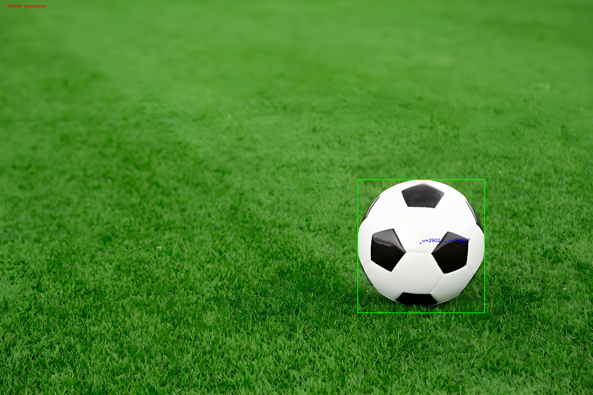
因为实验二，我又换了test2做检验
算法在右上角画出了一个极小的绿色矩形框，并将中心点标记在了这里，终端输出 `area=120.0`。而画面中央巨大的真实足球并未被检测到
1.  **面积阈值过低**：由于将 `area` 阈值设置过低（小于120），导致画面中的微小噪点（如白线边缘、草地反光斑）满足了被选为目标的条件。
    2.  **光照与HSV失效**：画面存在强烈的高光和阴影。光照导致真足球表面颜色发生畸变，其轮廓在 HSV 掩膜中被切碎，导致真实足球的连通域面积变小，甚至丢失。


## 任务 3：ROS 2 发布与订阅验证

### 1. 消息设计 (TargetPosition.msg)
自定义了 `TargetPosition` 消息，包含 4 个字段：
```text
bool detected
float32 u
float32 v
float32 area
### 2. 节点运行情况
*   **发布节点 (`vision_publisher`)**：以固定频率读取图片并进行视觉检测，将真实检测结果（u, v, area）发布到 `/target_position` 话题。
*   **订阅节点 (`vision_subscriber`)**：成功订阅该话题，并连续接收了 10 条以上的消息，打印出的数据与发布端完全一致，验证了通信正常。

u、v 只是图像画面上的二维像素位置，它没有真实世界的物理单位（如米、厘米）。真实世界的目标距离相机的远近（Z轴深度），在二维像素坐标里是完全丢失的，所以机器人应该只能看到球，但不知道离球有多远。如果直接把像素坐标当作距离去控制机器人，会导致距离判断完全错误。


## 附录：防抄袭截图
预览的时候可能打不开，但保存在这个主文件里了
### 1. 任务 1 & 任务 2：视觉检测与参数对比
*   测试图 1 运行结果：
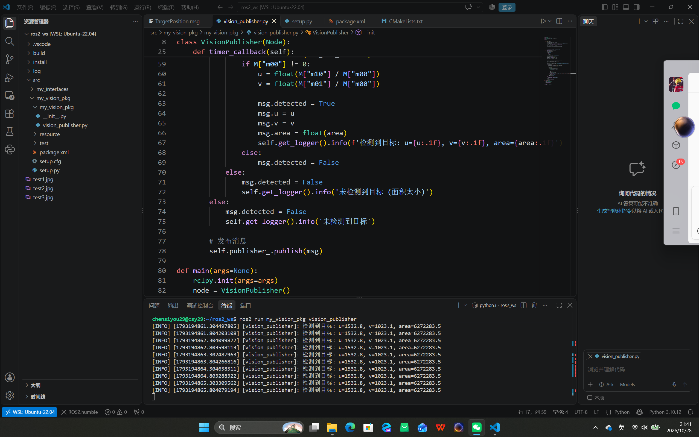

*   测试图 2 运行结果：
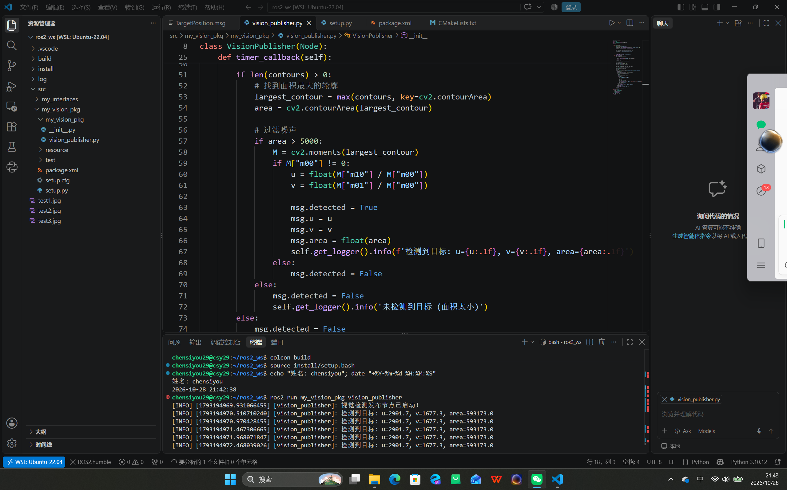

*   测试图 3 及参数对比运行结果：
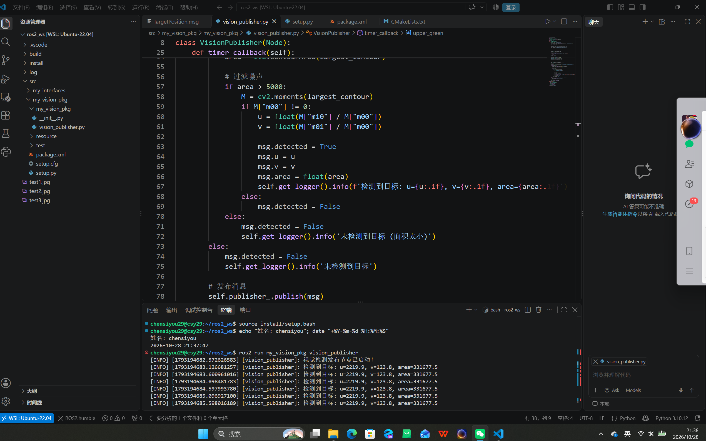
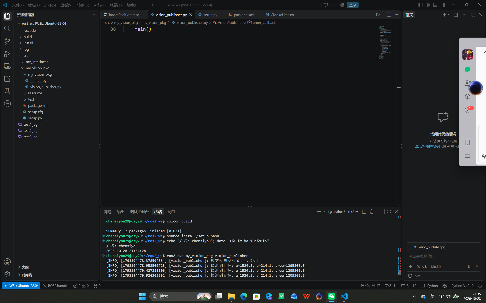

*   可视化结果（画框、中心点及坐标标注）：

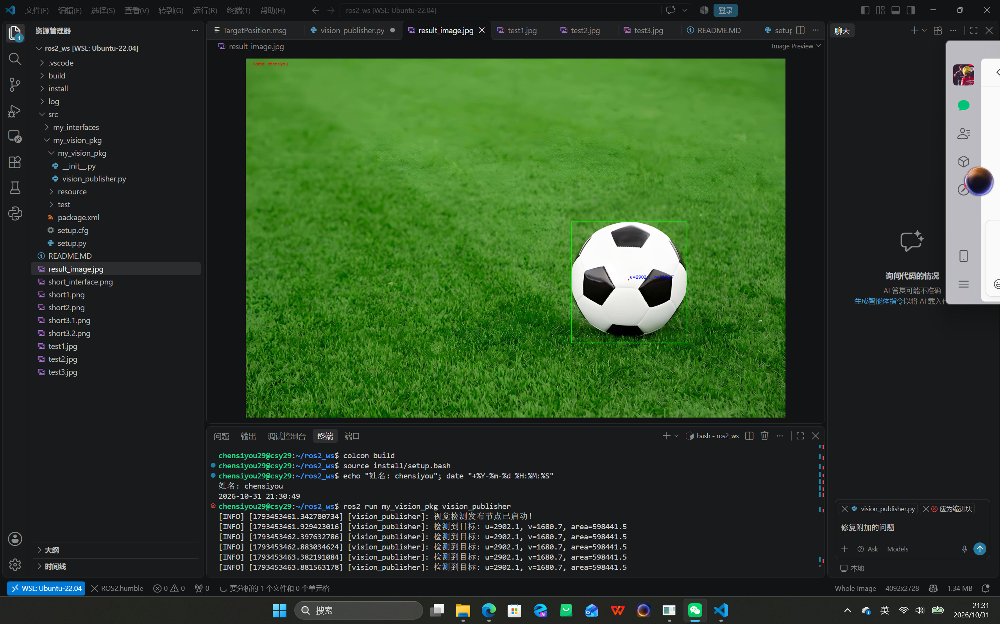
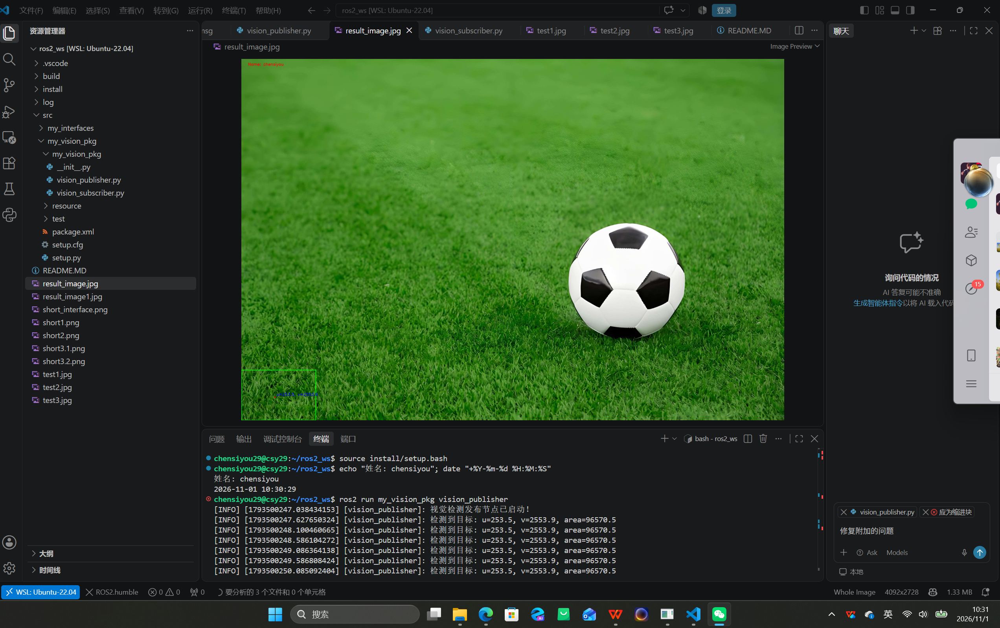
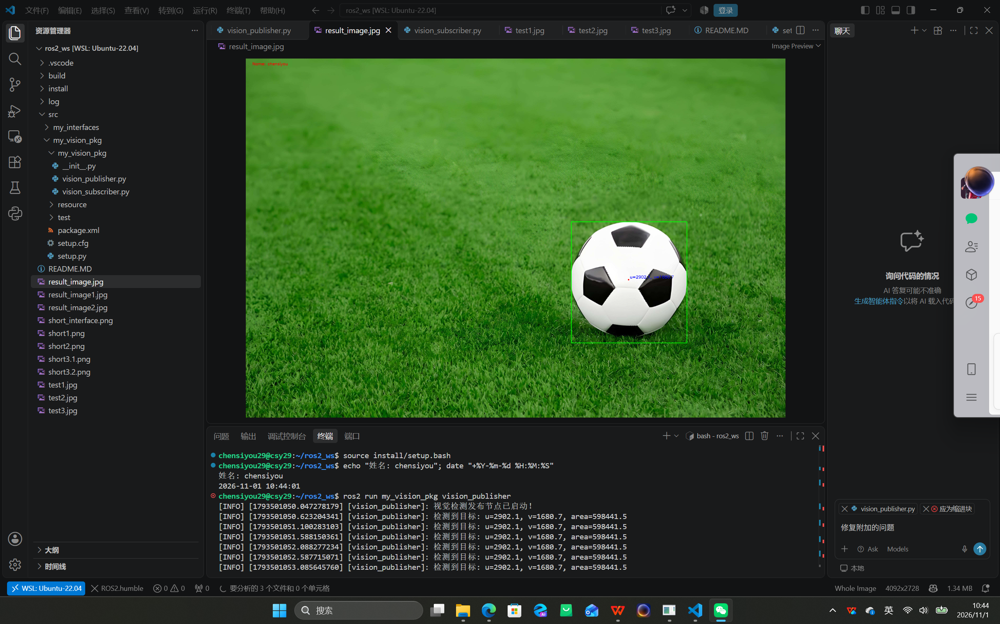
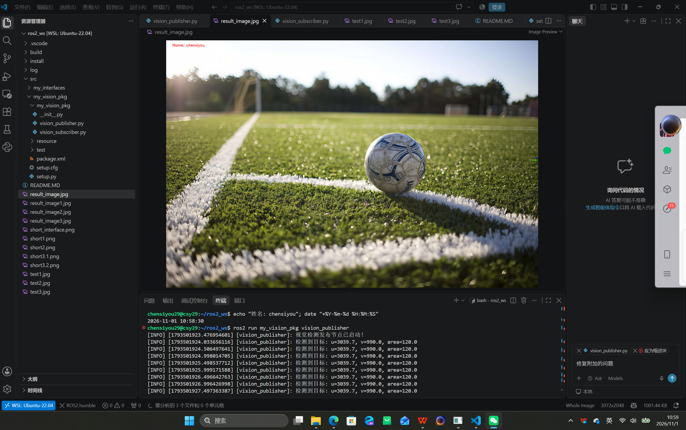

### 2. 任务 3：ROS 2 通信验证
*   自定义接口 `ros2 interface show` 输出：


*   话题信息 `ros2 topic info` 输出：
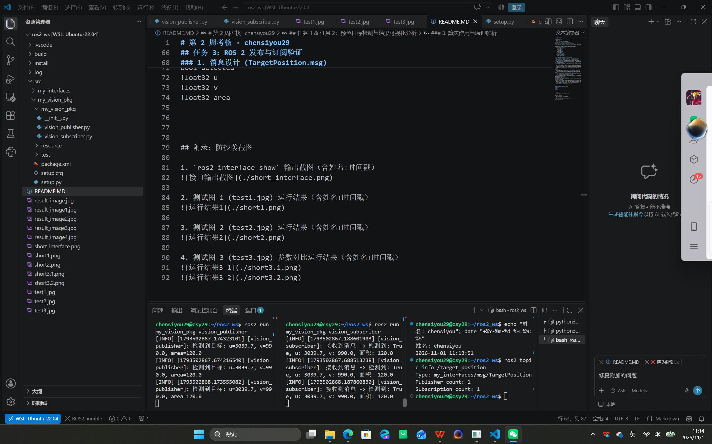

*   实际数据流 `ros2 topic echo` 输出：
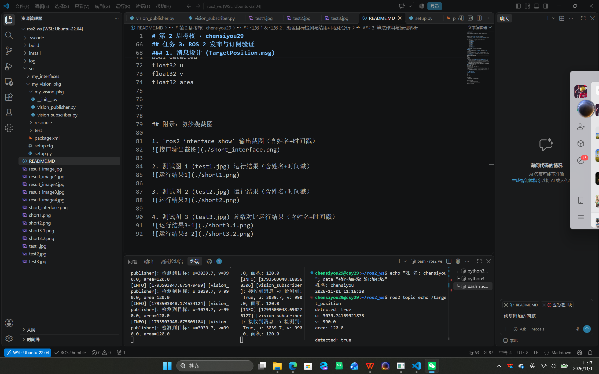

*   发布端与订阅端同时运行的分屏截图：
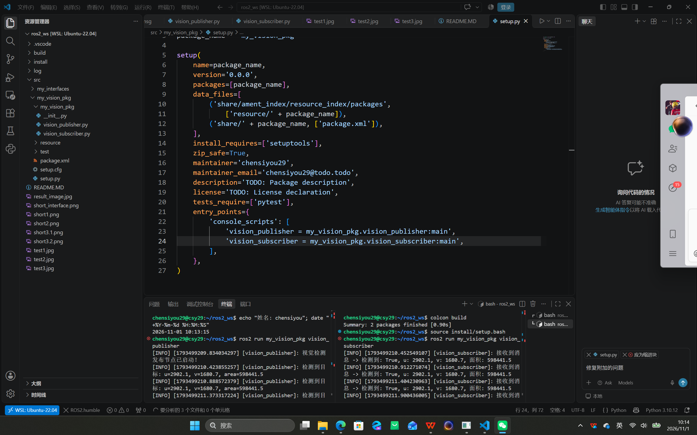


图片均来源于百度，下面是三张图片的链接
test1 【足球的图片 - 百度】https://m.baidu.com/sf/vsearch?pd=image_content&word=%E8%B6%B3%E7%90%83%E7%9A%84%E5%9B%BE%E7%89%87&tn=vsearch&atn=mediacy&fr=alawise_4&sa=vs_ala_img&imgtype=0&imgcontent=%7B%22subjectJson%22%3A%7B%7D%7D&imgpn=308&imgspn=0&mediacyKey=undefined&tt=1&di=1&pi=0&cs=1432710551%2C2817294497&adpicid=undefined&bdtype=0&objurl=https%3A%2F%2Fx0.ifengimg.com%2Fres%2F2020%2F494EE7BD6516E9445BBD77C15D3E22C2D6A62BF0_size1589_w1700_h1133.jpeg&imgos=1023638591%2C84636506&imgis=0%2C0&svc_id=undefined&detailfr=undefined&isRecFrClick=0&overMediacyLimit=undefined
test2【足球的图片 - 百度】https://m.baidu.com/sf/vsearch?pd=image_content&word=%E8%B6%B3%E7%90%83%E7%9A%84%E5%9B%BE%E7%89%87&tn=vsearch&atn=mediacy&fr=alawise_4&sa=vs_ala_img&imgtype=0&imgcontent=%7B%22subjectJson%22%3A%7B%7D%7D&imgpn=81&imgspn=0&mediacyKey=undefined&tt=1&di=1&pi=0&cs=1509461672%2C3817421246&adpicid=undefined&bdtype=0&objurl=https%3A%2F%2Fd00.paixin.com%2Fthumbs%2F1036708%2F42218023%2Fstaff_1024.jpg&imgos=1362887635%2C3811538686&imgis=0%2C0&svc_id=undefined&detailfr=undefined&isRecFrClick=0&overMediacyLimit=undefined
test3【足球图片100张 - 百度】https://m.baidu.com/sf/vsearch?pd=image_content&word=%E8%B6%B3%E7%90%83%E5%9B%BE%E7%89%87100%E5%BC%A0&tn=vsearch&atn=mediacy&fr=alawise_4&sa=vs_ala_img&imgtype=0&imgcontent=%7B%22materialQuery%22%3A%22%22%2C%22subjectJson%22%3A%7B%7D%7D&imgpn=2&imgspn=undefined&mediacyKey=undefined&tt=1&di=1&pi=0&cs=887562144%2C2637382656&adpicid=undefined&bdtype=0&objurl=https%3A%2F%2Fq2.itc.cn%2Fimages01%2F20251023%2Fe6165c98ae494328a026dd724ca20821.jpeg&imgos=4013701737%2C33139209&imgis=0%2C0&svc_id=undefined&detailfr=undefined&isRecFrClick=0&overMediacyLimit=undefined