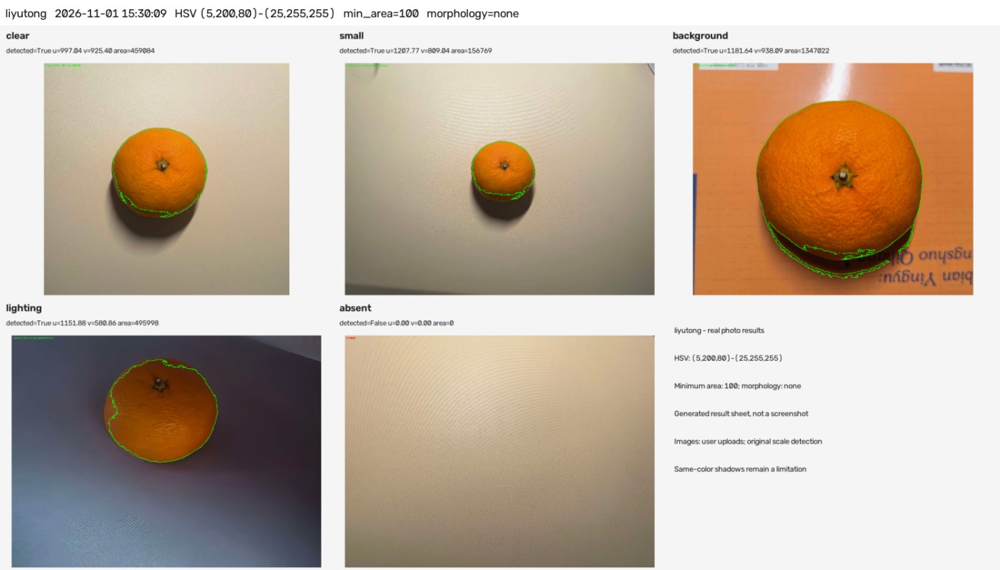
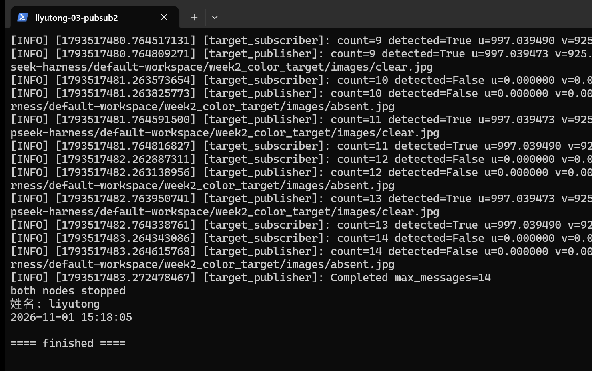
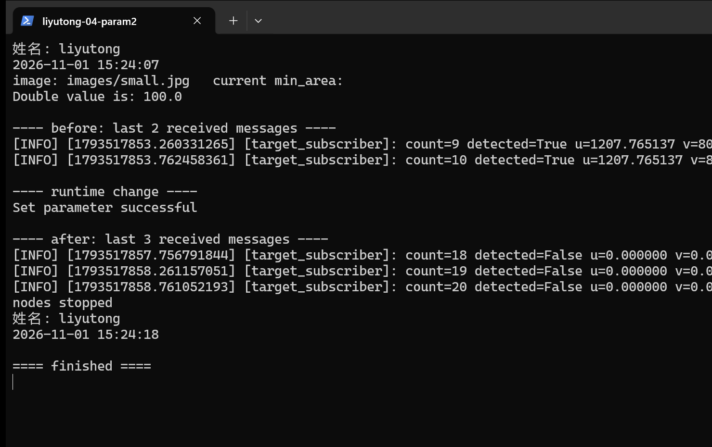

# 第 2 周考核 · liyutong

- 姓名：liyutong
- 完成日期：2026-11-01
- 环境：Ubuntu 22.04（WSL2）/ ROS2 Humble / Python 3.10.12 / OpenCV 4.5.4 / NumPy 1.21.5
- 目标颜色：橙色（橘子）
- 输入：自己拍摄的 5 张照片，保存在 data/images/，尺寸 2104×1992 至 2364×1773 不等

整个流程是：图片进 → HSV 分割 → 轮廓筛选 → 得到中心点 → 画图保存 → 通过 ROS2 发出去 → 另一个节点打印。下面按任务分开写，每一步的输出去哪了都说清楚。

## 任务 1：颜色目标检测

### 目标和参数

找橙色橘子，输出它在图像里的中心像素坐标。

| 参数 | 选定值 | 说明 |
|---|---|---|
| HSV 下界 | [5, 200, 80] | H/S/V 下界 |
| HSV 上界 | [25, 255, 255] | H/S/V 上界 |
| 最小轮廓面积 | 100 像素² | 只过滤很小的噪点 |
| 形态学 | none | 本次没开，实测对结果影响不大 |
| 多候选选择 | 面积最大且 m00 非零 | 见下面说明 |

源码里的默认 S 下界是 100，这个值我留着当对比基线，正式跑的时候显式传 200。这样参数实验的前后差别是真实存在的，不是改完默认值再假装对比。

### 处理步骤

1. 读图，用 `imdecode` 读字节，避免中文路径出问题；读不出来直接报错退出，不往下走。
2. `cvtColor` 转 HSV。
3. `inRange` 生成二值 mask，白色是符合颜色范围的像素。
4. `findContours` 取外轮廓，`contourArea` 算面积。
5. 面积小于 100 的丢掉，剩下的按面积从大到小排，取第一个 `m00` 不为零的。
6. 用 `u = m10/m00`、`v = m01/m00` 算轮廓质心。

### 中心点怎么来的

用的是轮廓矩。`m00` 是轮廓的面积量，`m10`、`m01` 是横向和纵向的一阶矩，两者相除得到质心。`m00` 为零的退化轮廓（比如一条细线）会跳过，否则会除零。

这个质心是"当前分割出来的区域的中心"，不是橘子球心，也不是果蒂位置。分割缺一块，质心就会往反方向偏。

### 找不到目标怎么办

返回 `detected=False`，`u`、`v`、`area` 都填 0，同时把 mask 存下来方便查。ROS2 那边也是发这四个值，判断有没有检测到只看 `detected`，不看坐标是不是 0，因为 (0,0) 本身也是图像的合法位置。

图片读不进来是另一回事，属于输入错误，程序报错返回非零，不能伪装成"没检测到"。

### 五张图的结果

| 图片 | 尺寸 W×H | detected | u | v | area 像素² | 现象 |
|---|---|---|---|---|---|---|
| clear | 2104×1992 | True | 997.04 | 925.40 | 459084 | 找到橘子，底部暗部漏一点 |
| small | 2364×1773 | True | 1207.77 | 809.04 | 156769 | 小目标也能找到，底部偏暗 |
| background | 2249×1864 | True | 1181.64 | 938.09 | 1347022 | 橘子找到了，但下方阴影被算进轮廓 |
| lighting | 2364×1773 | True | 1151.88 | 580.86 | 495998.5 | 暗光下图到，左侧和顶部边缘不完整 |
| absent | 2364×1773 | False | 0 | 0 | 0 | 没有目标，正确报未检测到 |

5 张里 4 张成功，1 张正确失败，满足"至少 3 张、至少 2 张成功"的要求。



### 会失效的情况

- 光照变化：暗光图里边缘的像素饱和度掉下去，被阈值挡掉，轮廓不完整。
- 同色背景：橙色书本和橘子颜色接近，会被一起选进来，形成大面积误检。
- 反光：橘子上面的高光接近白色，S 很低，会被排除，导致轮廓缺口。
- 遮挡：挡住一部分后，剩下的那块面积和形状都变了，质心跟着偏。

## 任务 2：可视化与参数对比

### 标注内容

保存的图上画了轮廓（绿色）、中心点（红点），左上角写 `Target u=… v=… area=…`；没检测到就写 `No target`。结果保存成 PNG，同时存一份 mask，另外把每张图的参数、尺寸、坐标、错误信息写进 results.json。不依赖弹窗，文件能直接打开。

### 参数对比

两项都是单变量，各自和同一个基线比：基线 HSV [5,100,80]～[25,255,255]、min_area=100、morphology=none。

**对比一：只把 S 下界从 100 提到 200**

同色背景这张，基线面积 4017290.5、中心 (1130.12, 960.93)；改完面积 1347022、中心 (1181.64, 938.09)。基线把橙色书本连成一大块，提高饱和度门槛后书本大部分被排掉，面积降到三分之一左右。

代价是别的图也变紧：clear 479642.5→459084，small 166920.5→156769，lighting 531009→495998.5。暗光那张中心从 (1135.11, 578.75) 挪到 (1151.88, 580.86)，横向偏了约 16.77 像素。阈值更严不等于更准。

**对比二：只把 min_area 从 100 提到 200000**

HSV 保持基线。small 的候选面积 166920.5，比 100 大但比 200000 小，直接被滤掉，从检测成功变成未检测到。clear 和暗光图面积都超过 200000，还留着。

结论：面积阈值只能去小噪点，去不掉大面积同色背景误检；饱和度高一点能压同色背景，但会伤到暗处目标。

### 误检、漏检、定位偏差

- 误检：同色背景那张，默认阈值下把书本大部分纳入，面积从 45 万直接跳到 401 万，明显不对。
- 漏检：最小面积提到 200000 后，小目标被整体过滤掉。
- 定位偏差：暗光图提高 S 下界后中心横移约 16.77 像素，原因是左侧边缘像素被排除，质心往右挪。

### 像素坐标不等于真实坐标

图像原点在左上角，u 向右增大，v 向下增大，单位是像素。它只说明目标在画面里的位置，不知道目标离相机多远，也不知道机器人在场地哪里。要换成米或场地坐标，需要相机标定、内外参、几何关系，甚至深度信息，这部分本周没做，也不能把 u、v 直接当地盘控制指令发出去。

## 任务 3：ROS2 通信

### 消息和话题

接口包 `target_interfaces`，ament_cmake 类型，消息 `TargetPosition.msg`：

```text
bool detected
float32 u
float32 v
float32 area
```

发布话题 `/target_position`，`detected=false` 时后三个字段都是 0。

### 两个节点

- `target_publisher`：启动时把传入的图片全部读进内存并检查能不能解码，图片有问题直接退出；之后按频率循环取图，每个周期调用一次真正的 `detect()`，把返回值填进消息发出去。不是发写死的坐标。
- `target_subscriber`：订阅同一个话题，打印 detected / u / v / area 和累计条数，还会检查数值合不合法（比如 detected 为 False 但坐标不为 0 会标成 invalid）。

### 实际跑的结果

2026-11-01 在 Ubuntu 里实测：按 clear→small→background→lighting→absent 循环，5Hz，订阅端收到 30 条，invalid_count=0；另开一个验证节点核对了 20 条，和原图直接调 `detect()` 的结果逐条对得上（允许 float32 舍入）。interface show、topic info、topic echo 都正常返回，测试进程全部正常退出。

截图演示里用的是 clear 和 absent 两张交替，count 到 14，发布端和订阅端的 u、v、area 能一一对应。



### 检测结果怎么接进去

`target_publisher` 里每周期执行：

```python
result = detect(self._images[self._count % len(self._images)][1], self._config)
message.detected = result.detected
message.u, message.v, message.area = result.u, result.v, result.area
```

阈值、最小面积这些是 ROS2 参数，可以运行时改，改完下一周期就用新参数重算。

## 加分项

- **阈值做成 ROS2 参数（+3）**：`hsv_lower`、`hsv_upper`、`min_area`、`morphology`、`kernel_size` 都可在运行时改，改之前会校验整组参数，非法值拒绝并保留原来的配置。实测把 `min_area` 改成 200000 后，检测结果从 True 变成 False，并且传的是真实变化不是假的打印。
- **5 张图片测试并总结误检漏检（+3）**：见任务 1 的表格和任务 2 的失败分析。
- 摄像头实时输入：没有做。这台机器的摄像头没有直通到 WSL，本周用静态图片按约定逐张循环发布，符合"没有摄像头可以用静态图片"的说明。



## 问题与解决过程

**1. WSL 装不上。** 直接 `wsl --install -d Ubuntu-22.04` 报 `WININET_E_CONNECTION_RESET`，拉不到发行版列表。改成从微软官方链接下载 `Ubuntu2204-221101.AppxBundle`，先核对文件长度和 MD5 与服务端 `Content-MD5` 一致再装。

**2. 装完应用却启动不了。** 运行后报 `WslRegisterDistribution failed with error: 0x80071772`，系统解释是文件加密无法解密。查了半天没定位到具体原因，最后换路子：从同一个官方包里取出 `install.tar.gz`，用 `wsl --import Ubuntu-22.04 ... --version 2` 导入，成功注册并进入系统。

**3. 设密码时以为卡住了。** `passwd` 输入密码屏幕上什么都不显示，一度以为键盘没反应。后来知道 Linux 输密码就是不回显，直接输完回车即可。

**4. ROS2 装完不知道怎么算装好。** 一开始只看到 `ros2` 命令能用，没验证 Python 那边。后来明确检查 `printenv ROS_DISTRO` 是 humble，并且 `python3 -c "import cv2, numpy, rclpy"` 能导入，才开始写节点。这里有个坑：Windows 上的 Python 环境和 Ubuntu 里的不是一套，不能混着用。

**5. 一开始用 RGB 直接卡阈值效果很差。** 亮的地方和暗的地方同一种颜色，RGB 三个通道数值差得多，阈值照顾不过来。换成 HSV 之后，把色相和亮度、饱和度分开，调起来清楚多了。

**6. 同色背景把书本也选进来了。** 看 mask 才发现橙色桌面和书本都在白色区域里，不是轮廓筛选的问题，是颜色范围太宽。把 S 下界从 100 提到 200，书本大部分被排掉，面积从 401 万降到 134 万，但下方阴影还连着，没彻底解决。

**7. 面积阈值提太高导致小目标没了。** 想把书本那种大块误检压掉，把 min_area 提到 200000，结果小目标 166920 也被滤掉。这说明面积只能筛大小，不能区分"是不是目标"。

**8. `ros2 topic info` 显示 Unknown topic。** 因为发布节点还没启动，话题不存在。改成先起发布端，等两秒再查，就能看到类型和 publisher count。

**9. 截图里中文变成乱码。** 终端里 `姓名` 显示成"濮撳悕"，查下来是编码问题：脚本按 GBK 解释 UTF-8 的中文。后来把终端切到 UTF-8，输出端用字节转义，才显示正常。

## 仍未解决的问题

同色背景和目标连在一起的时候，怎么进一步区分？

现在能想到的办法是加形状约束（比如圆度、长宽比）或者看颜色统计，但这次没做，因为橘子是圆的、书本是方的，理论上能用圆度分开，可一旦目标被遮挡，形状也会变，判断依据就不可靠了。这块还没想清楚怎么处理更稳。

## 复现方式

Windows 上跑检测（也可以直接在 Ubuntu 里跑，参数一样）：

```powershell
$env:PYTHONPATH = "$PWD\src\color_target_detector"
.\.venv\Scripts\python.exe -m color_target_detector.detect_images data/images/clear.jpg data/images/small.jpg data/images/background.jpg data/images/lighting.jpg data/images/absent.jpg --output outputs/reproduce_selected --hsv-lower 5 200 80 --min-area 100
```

Ubuntu 上跑 ROS2：

```bash
source /opt/ros/humble/setup.bash
source ~/ros2_ws/install/setup.bash
ros2 run color_target_detector target_subscriber
ros2 run color_target_detector target_publisher --ros-args -p 'images:=[/绝对路径/clear.jpg,/绝对路径/absent.jpg]' -p 'hsv_lower:=[5,200,80]'
```

编译和截图的具体步骤见 SCREENSHOTS.md，环境安装步骤见 INSTALL_UBUNTU.md，更细的数值记录在 STATUS.md。

## 文件说明

```text
README.md          本文件
学习记录.md         这周的实际过程和踩过的坑
SCREENSHOTS.md     截图清单和复现命令
STATUS.md          开发阶段的验证记录
INSTALL_UBUNTU.md  Ubuntu 与 ROS2 安装步骤
src/target_interfaces/        消息定义（ament_cmake）
src/color_target_detector/    检测与节点（ament_python）
data/images/      5 张测试照片
tools/            参数对比、自检、截图脚本
outputs/           标注结果、mask、results.json、日志、截图
```
