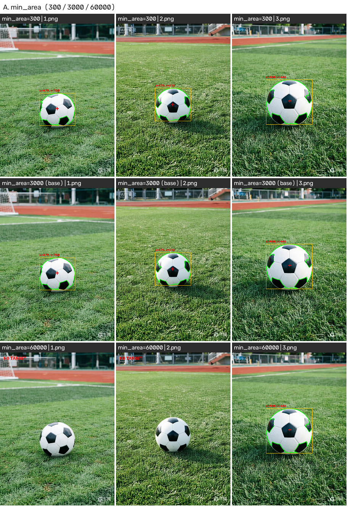
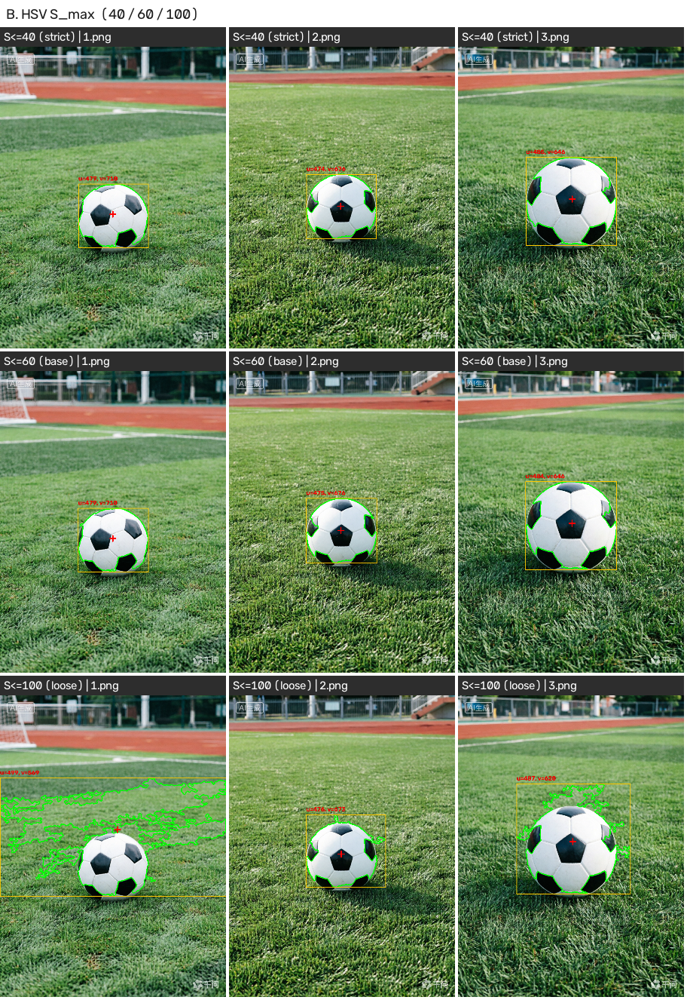
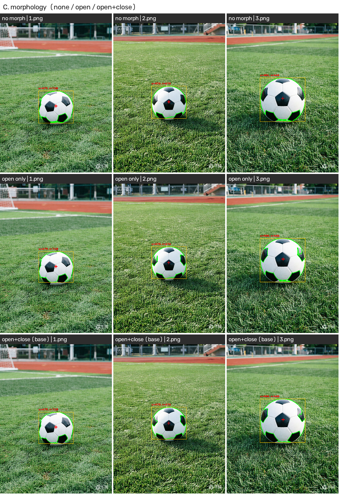

# 任务 2 参数对比记录

- 基准参数：min_area=3000，HSV [0,0,150]~[180,60,255]，开+闭运算 椭圆核 7x7
- 控制变量：每次只改一个参数，其它保持基准值。

## A. 最小轮廓面积 min_area

| 参数 | 图片 | detected | u (px) | v (px) | area (px²) | 候选数 | Δ中心 (px) | 现象 |
| --- | --- | :---: | ---: | ---: | ---: | ---: | ---: | --- |
| min_area=300 | `1.png` | True | 479.3 | 710.5 | 57529 | 11 | 0.0 | 正常 |
| min_area=300 | `2.png` | True | 475.1 | 676.2 | 56549 | 12 | 0.0 | 正常 |
| min_area=300 | `3.png` | True | 484.5 | 646.6 | 96375 | 10 | 0.0 | 正常 |
| min_area=3000 (基准) | `1.png` | True | 479.3 | 710.5 | 57529 | 3 | 0.0 | 正常 |
| min_area=3000 (基准) | `2.png` | True | 475.1 | 676.2 | 56549 | 3 | 0.0 | 正常 |
| min_area=3000 (基准) | `3.png` | True | 484.5 | 646.6 | 96375 | 3 | 0.0 | 正常 |
| min_area=60000 | `1.png` | False | 0.0 | 0.0 | 0 | 0 | - | 漏检：没有面积达标的轮廓 |
| min_area=60000 | `2.png` | False | 0.0 | 0.0 | 0 | 0 | - | 漏检：没有面积达标的轮廓 |
| min_area=60000 | `3.png` | True | 484.5 | 646.6 | 96375 | 1 | 0.0 | 正常 |

## B. HSV 饱和度上界 S_max（V>=150 不变）

| 参数 | 图片 | detected | u (px) | v (px) | area (px²) | 候选数 | Δ中心 (px) | 现象 |
| --- | --- | :---: | ---: | ---: | ---: | ---: | ---: | --- |
| S<=40 (偏紧) | `1.png` | True | 479.4 | 710.7 | 57164 | 4 | 0.3 | 正常 |
| S<=40 (偏紧) | `2.png` | True | 474.8 | 676.3 | 56139 | 1 | 0.3 | 正常 |
| S<=40 (偏紧) | `3.png` | True | 485.2 | 646.4 | 95477 | 4 | 0.7 | 正常 |
| S<=60 (基准) | `1.png` | True | 479.3 | 710.5 | 57529 | 3 | 0.0 | 正常 |
| S<=60 (基准) | `2.png` | True | 475.1 | 676.2 | 56549 | 3 | 0.0 | 正常 |
| S<=60 (基准) | `3.png` | True | 484.5 | 646.6 | 96375 | 3 | 0.0 | 正常 |
| S<=100 (偏松) | `1.png` | True | 499.2 | 569.1 | 198390 | 6 | 142.8 | 中心偏移 142.8 px |
| S<=100 (偏松) | `2.png` | True | 476.9 | 674.0 | 58054 | 7 | 2.8 | 正常 |
| S<=100 (偏松) | `3.png` | True | 487.9 | 620.5 | 113766 | 7 | 26.4 | 中心偏移 26.4 px |

## C. 形态学处理

| 参数 | 图片 | detected | u (px) | v (px) | area (px²) | 候选数 | Δ中心 (px) | 现象 |
| --- | --- | :---: | ---: | ---: | ---: | ---: | ---: | --- |
| 不做形态学 | `1.png` | True | 479.0 | 710.8 | 58058 | 2 | 0.4 | 正常 |
| 不做形态学 | `2.png` | True | 477.0 | 674.8 | 61777 | 2 | 2.3 | 正常 |
| 不做形态学 | `3.png` | True | 481.8 | 644.4 | 103808 | 3 | 3.6 | 正常 |
| 只做开运算 | `1.png` | True | 479.3 | 710.0 | 57320 | 3 | 0.4 | 正常 |
| 只做开运算 | `2.png` | True | 475.2 | 676.2 | 56322 | 1 | 0.1 | 正常 |
| 只做开运算 | `3.png` | True | 484.2 | 646.2 | 95646 | 3 | 0.6 | 正常 |
| 开+闭 (基准) | `1.png` | True | 479.3 | 710.5 | 57529 | 3 | 0.0 | 正常 |
| 开+闭 (基准) | `2.png` | True | 475.1 | 676.2 | 56549 | 3 | 0.0 | 正常 |
| 开+闭 (基准) | `3.png` | True | 484.5 | 646.6 | 96375 | 3 | 0.0 | 正常 |

