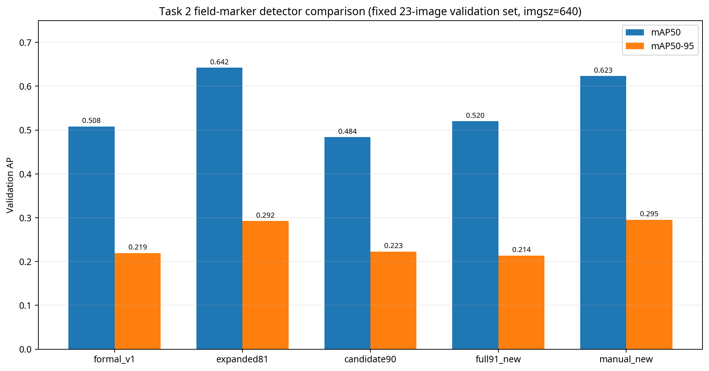
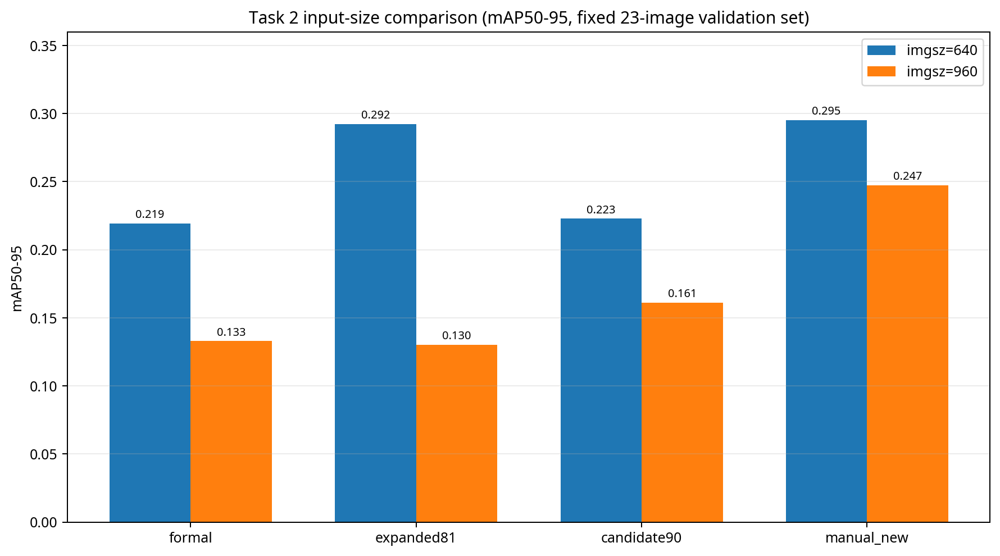
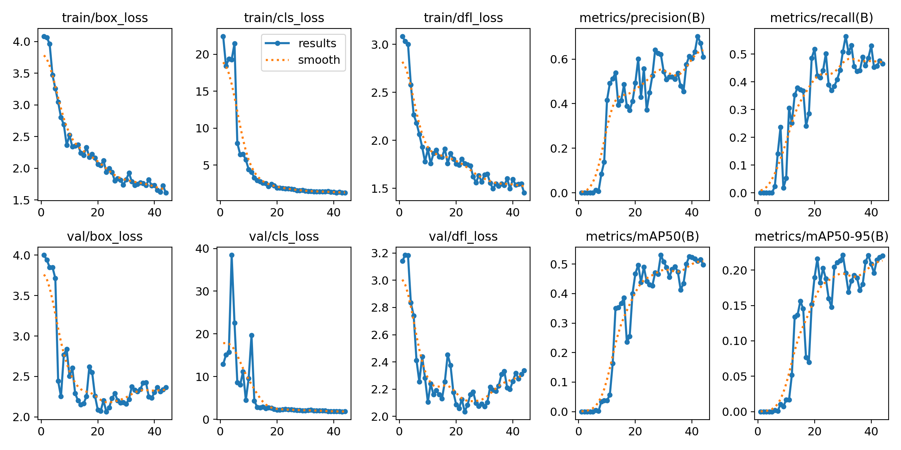
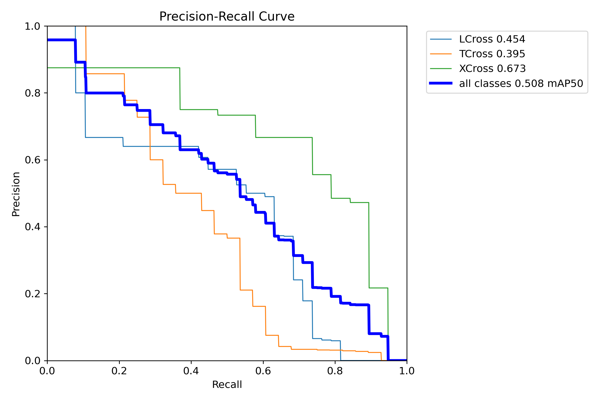
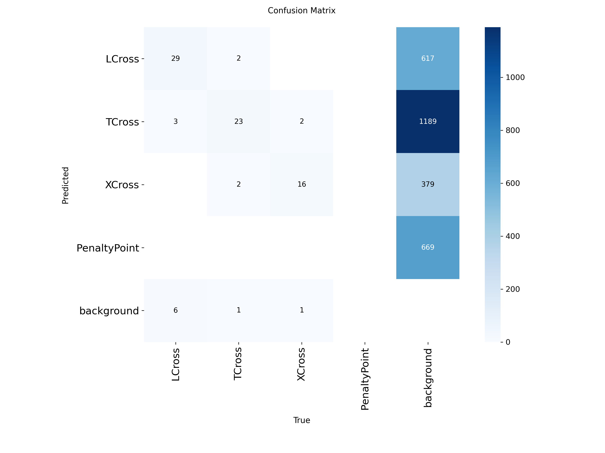

# CQuick 战队算法组 · 第 3–4 周任务二

**2026-11-23 交付状态修订：** 两个 B 站视频已经上传，真实链接见下方及根目录 README；较早章节中的“B站链接待补”属于过期记录。当前 PR 的独立复现入口及源码归档见 [补交复现说明](reproducibility_source_20261123/REPRODUCE.md)。历史近似外参未复核，不代表 C0 定位精度验收通过。

## 单目场地标志检测与场地自定位

- 姓名：胡钰涵（huyuhan）
- 项目：任务二——基于 L/T/X 场地标志匹配的单目二维自定位
- 本文档更新基准：2026-11-22
- 工作环境：WSL2 `Ubuntu-22.04-F`，用户 `hu_yuhan`
- 项目根目录：`/home/hu_yuhan/Cquick/Week3-4`
- **范围声明：本文只记录任务二，不合并任务一足球检测的训练指标或交付物。**

> **当前结论**
>
> 已完成场地标志数据集整理、YOLOv8n
> 正式候选训练与验证、相机内参标定、已测半场地图、自动几何细化、地面投影与自动地图匹配代码；2026-11-22
> 的 Windows v2 实时相机桥接运行中，自动定位链路记录到 2230 帧，其中 631
> 帧输出 `valid=true`。
>
> 但该次运行使用的是 **2026-11-16 历史外参近似值**，运行记录明确标记
> `current_installation_verified=false`。因此，631
> 帧只能证明程序在该近似外参下通过了自身数值门槛，**不能证明当前安装的米制定位精度**。P1/P2/P3
> 现场测量已经完成，另有人工初始化＋光流＋PnP
> 的三点固定窗和连续失效恢复证据；但半场符号、朝向参考及自动定位链路的独立误差仍需严格区分和核验。本地正式录屏文件已存在并完成文件元数据核验，但内容是否完整覆盖全部考核点仍需逐段审片。B
> 站链接、GitHub
> 可访问链接和部分加分项仍待闭环。当前不能宣称任务二已全部验收通过。

------------------------------------------------------------------------

## 1. 任务目标与处理链路

任务二目标是使用本人用于考核的单目 RGB 摄像头，检测场地 L/T/X
标志，提取真实几何特征点，结合相机内参、畸变和相机安装外参，将像素特征投影到地面米制坐标，再与场地地图特征匹配，输出相机光心在地图坐标系下的二维位姿：

- `x_camera_map`：m
- `y_camera_map`：m
- `yaw_camera_map`：deg
- `marker_count`、`residual`、`valid`、`status`

当前自动入口的计算链：

``` text
Windows DirectShow 单目相机
    ↓
CQuickCameraBridge v2（Windows → WSL）
    ↓
1280×720 RGB 帧
    ├── 场地 YOLOv8n：LCross / TCross / XCross
    │       ↓
    │   refine_v3：框内几何细化，输出 landmark_pixel=(u,v)
    │       ↓
    │   去畸变 + 相机射线与载体地面 Z=0 求交
    │       ↓
    │   载体地面米制观测点
    │       ↓
    │   同类地图候选、一对一分配、SE(2) 位姿拟合
    │       ↓
    │   半场边界、残差、歧义和有效性检查
    │
    └── 足球检测模型：只作为同屏展示，不参与场地位姿求解

    ↓
x_carrier_map / y_carrier_map / yaw_carrier_map
x_camera_map / y_camera_map / yaw_camera_map
marker_count / residual / valid / status
```

当前自动定位入口：

``` text
site_review_20261119/automatic_demo/run_auto.py
site_review_20261119/automatic_demo/localize.py
```

实际加载的 `refine_v3`：

``` text
task2_lab_night_v1_20261116/src/refine_v3.py
SHA256:
d4775a2d123cf492b59248ebe85590e1c35ff29a9adbc8a7e1218677e2ccb68b
```

`refine_v3` 先尝试 `refine_current`，失败后调用
`refine_v2`，再对多窗口/多模式候选的一致性进行严格筛选。2026-11-22
运行记录还表明，`refine_v2`
的向量化加速处于启用状态；其几何条件和阈值保持原值。不要把该加速补丁描述为提高了检测
AP 或定位精度。

------------------------------------------------------------------------

## 2. 数据集与场地标志模型

### 2.1 数据集

正式候选数据集记录：

| Split    | 图片数 | 独立视频源数 | 空标签图片 | LCross 实例 | TCross 实例 | XCross 实例 | PenaltyPoint |
|:---------|:------:|:------------:|:----------:|:-----------:|:-----------:|:-----------:|-------------:|
| Train    |   73   |      10      |     8      |     96      |     102     |     24      |            0 |
| Val      |   23   |      3       |     1      |     38      |     28      |     19      |            0 |
| **合计** | **96** |    **13**    |   **9**    |   **134**   |   **130**   |   **43**    |        **0** |

- 共 96 张图片、307 个 L/T/X 标注实例。
- 按独立视频来源划分，避免将同一视频的相邻帧随机分散到训练集和验证集。
- 已超过任务书”至少 5 段独立视频”的数量要求。
- 任务书建议至少 300 张有效标注图片；当前 96
  张，**图片数量未达到建议规模**。307 是目标实例数，不等于 307 张图片。
- 现场没有可见的点球点标记，因此没有 PenaltyPoint 的有效检测
  GT；不能为了凑类别而人为生成标签。
- 数据冻结检查记录了标签配对、框范围、类别、图像 SHA 重复和来源跨 split
  检查。近重复排除包含候选抽样与人工视觉复核，不应夸大为完全自动的近重复证明。

证据位置：

``` text
site_review_20261119/formal_dataset/
site_review_20261119/freeze_pass.log
site_review_20261119/labels_reviewed.json
site_review_20261119/queue.json
site_review_20261119/inventory.json
site_review_20261119/README.md
```

### 2.2 正式候选模型

当前自动定位实机运行使用：

``` text
site_review_20261119/training/formal_v1/weights/best.pt
SHA256:
2603112118bcaf24b050f3870292dd8f23ba491bd407f7eae83f516ff6c82418
```

训练信息：

- 模型：YOLOv8n，COCO 预训练初始化
- 设备：NVIDIA RTX 4050 Laptop GPU
- `imgsz=640`、`batch=4`、`seed=42`
- 最多 55 轮，`patience=14`
- 44 轮早停，最佳第 30 轮

同一 23 张验证图上的正式候选指标：

| 类别             | Precision | Recall |      AP50 |
|:-----------------|----------:|-------:|----------:|
| LCross           |     0.533 |  0.450 |     0.455 |
| TCross           |     0.357 |  0.516 |     0.396 |
| XCross           |     0.726 |  0.579 |     0.673 |
| PenaltyPoint     |       N/A |    N/A |       N/A |
| Overall mAP50    |           |        | **0.508** |
| Overall mAP50–95 |           |        | **0.219** |

说明：

- PenaltyPoint 为 N/A：现场没有可见点球点
  GT，不代表模型在该类上检测成功或失败。
- 正式候选不是所有对照模型中每个指标都最优；该权重是 2026-11-22
  实时自动运行所实际使用的冻结版本。不要仅因存在 81/90/99
  图候选就自动替换正式权重。
- 当前没有可确认的独立最终测试集指标；上述为固定验证集结果，不得称为独立测试集成绩。
- TCross 仍有漏检，远暗 T、门柱附近背景和小目标需要继续补充独立验证。

证据位置：

``` text
site_review_20261119/training/formal_v1/
site_review_20261119/training/request.json
site_review_20261119/training_console.log
site_review_20261119/comparison/formal_metrics.json
site_review_20261119/comparison/metrics.json
site_review_20261119/comparison/predictions.json
site_review_20261119/comparison/examples/
```

### 2.3 训练迭代、候选权重与同验证集对比

本节只比较**任务二场地标志检测模型**，不包含任务一足球检测模型。正式在线自动定位入口仍使用
`formal_v1`；后续
`expanded81`、`candidate90`、`full91_new`、`manual_new`
均作为训练数据/权重版本候选保留，不因单一 AP
指标较高而自动替换实机模型。

#### 统一验证口径

- 固定验证集：23 张图像；候选训练过程未读取封存测试集进行选型。
- 主要对照：`imgsz=640`、NMS IoU=0.70；原生 AP 计算 `conf=0.001`。
- 固定阈值错误统计另用 `conf=0.25`、同类匹配 IoU≥0.50；它与原生 PR
  曲线工作点不是同一个口径。
- 各轮实验的训练图数量、增量标注、初始化权重和训练超参数并非完全相同；因此这是**工程候选版本比较，不是严格单因素消融实验**。
- `candidate90` 在其独立报告中为 0.4838 / 0.2227；另一份 640/960
  复核报告为 0.4840 / 0.2228。这里保留各报告原值，不取平均；差异约为
  0.0001。
- 这些名称表示不同数据版本/权重候选，不应误读成 YOLOv8n、YOLOv8s
  等不同模型规模的横向架构比较。正式 `formal_v1` 与 `candidate90`
  的训练记录明确使用 YOLOv8n；其他候选的完整配置以各自 `args.yaml` /
  `request.json` 为准。

#### 640 输入尺寸下的模型版本比较

| 候选版本      |     训练集规模      | 固定验证图 |      mAP50 |   mAP50-95 | 当前用途/结论                                                      |
|:--------------|:-------------------:|:----------:|-----------:|-----------:|:-------------------------------------------------------------------|
| `formal_v1`   |         73          |     23     |     0.5080 |     0.2192 | 正式基线；当前自动定位实际加载                                     |
| `expanded81`  |         81          |     23     | **0.6423** |     0.2923 | mAP50 最优的早期扩充候选；T 类仍有误报，未自动部署                 |
| `candidate90` |         90          |     23     |     0.4838 |     0.2227 | 90 张训练图候选；L/T 漏检较多，不建议替换正式模型                  |
| `full91_new`  |         91          |     23     |     0.5201 |     0.2136 | 91 张训练图候选；mAP50-95 低于正式基线，未部署                     |
| `manual_new`  | 见对应实验 manifest |     23     |     0.6231 | **0.2952** | 单独的人工复核候选；该报告中 mAP50-95 略高，但没有自动替换正式权重 |

<figure>

<figcaption aria-hidden="true">
任务二不同训练版本在固定验证集上的 mAP 对比
</figcaption>
</figure>

解释：

- `expanded81` 的总体 AP 明显高于 `formal_v1`，但类别层面并不均衡：其
  TCross 曲线 Recall 约 0.321，且固定阈值下 TCross 误报较多。
- `candidate90` 的固定阈值误报数有所下降，但同时漏掉大量 LCross，T
  的召回也下降；不能只看 FP 减少就判断它更适合定位。
- `full91_new` 的 mAP50 略高于正式基线，但 mAP50-95 低于正式基线。
- `manual_new` 的 mAP50-95 为
  0.2952，是该轮对照表中最高值；但它仍是候选权重，尚不能仅凭 23
  张验证图的 AP 认定其在实时几何定位中更好。
- 正式部署选择还必须看几何交点质量、类别误检/漏检、定位有效率和错误接受风险；因此实机入口继续保留
  `formal_v1`，其他候选不自动覆盖。

#### 类别级指标（formal_v1 / expanded81 / candidate90）

下表中的 P/R 是报告中的原生曲线 P/R；AP50、AP50-95 是各类别
AP。它们不是固定 `conf=0.25` 下的 P/R。

| 模型/类别            | 曲线 P | 曲线 R |  AP50 | AP50-95 |
|:---------------------|:------:|:------:|------:|--------:|
| formal_v1 / LCross   | 0.533  | 0.450  | 0.455 |   0.123 |
| formal_v1 / TCross   | 0.357  | 0.516  | 0.396 |   0.171 |
| formal_v1 / XCross   | 0.726  | 0.579  | 0.673 |   0.364 |
| expanded81 / LCross  | 0.726  | 0.684  | 0.717 |   0.249 |
| expanded81 / TCross  | 0.549  | 0.321  | 0.416 |   0.200 |
| expanded81 / XCross  | 0.986  | 0.474  | 0.794 |   0.427 |
| candidate90 / LCross | 0.672  | 0.485  | 0.510 |   0.232 |
| candidate90 / TCross | 0.351  | 0.429  | 0.356 |   0.156 |
| candidate90 / XCross | 0.540  | 0.474  | 0.585 |   0.280 |

PenaltyPoint 在当前现场没有可见 GT，因此所有相关 P/R/AP 均为
N/A，不能将其写成检测成功或失败。

#### 输入尺寸 640 / 960 对照

同一批候选权重在固定 23 张验证图上分别以 640 和 960
输入尺寸评估。总体上，960 没有带来 AP 提升，尤其 `formal` 与
`expanded81` 下降明显，因此当前实机仍以 640 为默认输入。

| 候选版本    | mAP50-95 @640 | mAP50-95 @960 |
|:------------|--------------:|--------------:|
| formal      |        0.2192 |        0.1329 |
| expanded81  |        0.2923 |        0.1301 |
| candidate90 |        0.2228 |        0.1611 |
| manual_new  |        0.2952 |        0.2474 |

<figure>

<figcaption aria-hidden="true">
任务二输入尺寸 640 与 960 的 mAP50-95 对照
</figcaption>
</figure>

#### 训练轮数、参数与训练曲线证据

| 训练版本      | 已核实的训练信息                                                                                                                                                                              | 原始记录                                                                            |
|:--------------|:----------------------------------------------------------------------------------------------------------------------------------------------------------------------------------------------|:------------------------------------------------------------------------------------|
| `formal_v1`   | YOLOv8n、COCO 预训练；RTX 4050；imgsz=640、batch=4、seed=42；最多 55 轮、patience=14；实际 44 轮早停，最佳第 30 轮                                                                            | `training/formal_v1/args.yaml`、`results.csv`、`results.png`                        |
| `expanded81`  | 81 张训练图、固定 23 张验证图；候选权重独立保留                                                                                                                                               | `dataset_expansion_20261119/training/expanded_candidate/args.yaml`、`results.csv`   |
| `candidate90` | 从 `formal_v1` 初始化；90 train / 23 val；最多 12 轮、patience=5、batch=4、imgsz=640、seed=42、AdamW、lr0=0.001、mosaic=0.20、close_mosaic=3、AMP 关闭、workers=0；实际 6 轮早停，最佳第 1 轮 | `candidate90_20261120/training/candidate90/args.yaml`、`results.csv`、`RESULT.md`   |
| `full91_new`  | 91 train / 原 23 val；按框架 validation fitness 选 checkpoint；不是未触碰测试集成绩                                                                                                           | `full91_20261122/full91_v1/train/args.yaml`、`results.csv`、`RESULT.md`             |
| `manual_new`  | 作为独立人工复核候选参与同一 23 图对照；训练参数和训练图数量以该候选自身 manifest/args 为准                                                                                                   | `manual_improve_20261120/candidate_from81_960/comparison/metrics.json`、`RESULT.md` |

`formal_v1` 的 Ultralytics 训练图与验证图可从下列文件复现：

- 训练总览：`training/formal_v1/results.png`（box/cls/dfl loss
  与验证指标随 epoch 变化）
- PR 曲线：`training/formal_v1/BoxPR_curve.png`
- F1 曲线：`training/formal_v1/BoxF1_curve.png`
- Precision / Recall
  曲线：`training/formal_v1/BoxP_curve.png`、`BoxR_curve.png`
- 混淆矩阵：`training/formal_v1/confusion_matrix.png`、`confusion_matrix_normalized.png`
- 数据标签分布：`training/formal_v1/labels.jpg`
- 训练批次与验证预测：`train_batch0.jpg` 至
  `train_batch2.jpg`、`val_batch0_labels.jpg` / `val_batch0_pred.jpg`
  等。

<figure>

<figcaption aria-hidden="true">
formal_v1 训练损失与验证指标曲线
</figcaption>
</figure>
<figure>

<figcaption aria-hidden="true">
formal_v1 PR 曲线
</figcaption>
</figure>
<figure>

<figcaption aria-hidden="true">
formal_v1 混淆矩阵
</figcaption>
</figure>

候选 `candidate90`、`full91_new` 的原始 `results.csv`
已保留；证据包清单未列出它们各自的 `results.png`，因此本 README
不伪造其训练曲线。需要复绘时应直接读取各自
CSV。所有这些图和指标均为**任务二 L/T/X
场地标志检测**，与任务一足球检测的 `results.png`、`best.pt`
和指标完全分开。

------------------------------------------------------------------------

## 3. 相机标定

### 3.1 内参与畸变

- 标定分辨率：1280×720
- 棋盘格有效标定图：24 张
- 标定 RMS：约 0.641 px
- 图像分辨率与当前实时推理分辨率一致

相机矩阵：

\[\displaystyle K=\begin{bmatrix}1608.0973&0&633.3734\\0&1601.0836&402.0199\\0&0&1\end{bmatrix}\]

畸变系数（OpenCV 顺序 `[k1,k2,p1,p2,k3]`）：

``` text
[0.22083832379263663,
 -1.6370419288610905,
  0.008907589056676164,
  0.005465091600586419,
  1.891825632923824]
```

正式内参文件：

``` text
site_review_20261119/formal_map/camera_intrinsics.yaml
SHA256:
7a6afef54528f4b218654c3c7af05e25cbe0ee0cd2e5a3395c4b956cd555007d
```

原始标定证据：

``` text
results/task2_intrinsics_20261116_142337_558263/
```

### 3.2 外参与当前安装资格

2026-11-16 曾完成一组地面外参拟合：

- 6 个拟合点，拟合 RMS：1.996586 px
- 2 个独立检查点误差：0.024047 m、0.032137 m
- 当时估计相机光心高度：0.575182 m
- 历史外参文件 SHA256：

``` text
41a131faade8a5f6d6bf59ab38629a8aeccca2b65ca05410f3a0ec537d9ba55f
```

历史文件：

``` text
task2_lab_night_v1_20261116/config/camera_extrinsics.yaml
```

**关键限制：** 2026-11-22 自动实时运行明确标记：

``` text
mount_qualification = approximate_mount_20261116
current_installation_verified = false
```

因此：

- 2026-11-16 外参只能作为历史安装的近似参数。
- 当前相机安装高度、俯仰、滚转和光心垂足尚未通过独立复测确认。
- 不能把历史拟合的 2–3 cm 检查误差直接当作 2026-11-22
  当前安装的定位误差。
- 不能仅凭 `valid=true` 声称满足 0.5 m / 10° 的现场精度目标。

当前安装外参是任务二最重要的未闭环项目之一。必须固定当前相机、镜头、支架和分辨率，重新测量当前光心垂足及独立地面检查点，再决定正式外参文件。

------------------------------------------------------------------------

## 4. 场地地图与坐标定义

当前自动运行加载：

``` text
site_review_20261119/formal_map/field.yaml
map_version:
huyuhan_formal_center_geometry_20261119

SHA256:
d4999b23efee9782819f84fb9c65e5c6491c07d010916f0c21045793a0ab2c0f
```

场地几何文件：

``` text
site_review_20261119/formal_map/field_geometry.yaml
SHA256:
136122ddbc4507c7e8f5b546c9b65d7064198f844ca391c5c075ee49639a4b37
```

当前地图特征：

- 14 个已测半场 L/T/X 特征点：6 个 L、6 个 T、2 个 X。
- 只覆盖已测的一端半场；不镜像推断另一半场。
- 地图原点：中圈中心。
- `+X`：朝已测球门方向。
- `+Y`：面向 `+X` 时向左。
- `+Z`：向上。
- `yaw`：从地图 `+X` 轴起算，俯视逆时针为正，单位 degree。
- 已测半场边界：`X=[0,3.91] m`，`Y=[-2.9475,3.0025] m`。
- 圆心只作为地图几何原点；现场没有可见圆心标记，不能把它当作
  PenaltyPoint 检测目标。

**地图版本风险：** 当前 `formal_map/field.yaml`
是按本人实测半场几何整理的本地地图。提交前仍需与组织方统一发放的
`field.yaml` / `field_geometry.yaml` 核对版本、坐标和
SHA256，并确认组长认可当前地图。未经确认，不得把本地测量版称为组织方官方地图，也不得擅自修改组织方地图坐标。

------------------------------------------------------------------------

## 5. 自动定位实现与 2026-11-22 实时结果

### 5.1 实际运行配置

运行目录：

``` text
site_review_20261119/automatic_demo/runs/
live_2603112118_20261122_105055_241733/
```

该次运行的关键配置：

- 模式：`automatic_yolo_ground_map`
- 输入：`windows_v2_live`
- Windows DirectShow camera 0，经 `CQuickCameraBridge v2` 传入 WSL
- 分辨率：1280×720
- 场地模型：`formal_v1`，SHA256 为 `260311...c82418`
- 置信度：0.25
- NMS IoU：0.70
- 图像推理尺寸：640
- 设备：RTX 4050 CUDA:0
- 地面假设：载体坐标 `Z=0`
- 外参资格：`approximate_mount_20261116`，当前安装未验证

### 5.2 逐帧状态统计

本次记录共 2230 帧：

| 状态                           |   帧数   |   占比   |
|:-------------------------------|:--------:|:--------:|
| `ok`                           |   631    |  28.30%  |
| `insufficient_markers`         |   1435   |  64.35%  |
| `no_consistent_match`          |   150    |  6.73%   |
| `ambiguous`                    |    13    |  0.58%   |
| `camera_outside_measured_half` |    1     |  0.04%   |
| **总计**                       | **2230** | **100%** |

有效连续段：

- 有效帧：631
- 有效段数：46
- 最长连续有效段：153 帧，约 42.401 s
- 其他较长有效段：109 帧、78 帧、45 帧、42 帧等

性能统计：

| 指标             |   中位数   | 最大值 / 说明   |
|:-----------------|:----------:|:----------------|
| 全部帧 FPS       |   5.861    | 最大 10.222     |
| 有效帧 FPS       |   3.768    | 最大 7.443      |
| 有效位姿更新频率 |  3.734 Hz  | 最大 6.506 Hz   |
| 读帧耗时         | 29.470 ms  |                 |
| 场地 YOLO        | 27.079 ms  |                 |
| 足球 YOLO        | 41.327 ms  |                 |
| 几何细化         | 49.140 ms  |                 |
| 地面投影         |  0.280 ms  |                 |
| 地图匹配         |  0.016 ms  |                 |
| 总处理至发布     | 152.425 ms | 最大 608.456 ms |

自动定位结果的 `residual_unit` 为
`m`，是匹配残差，不是独立测量得到的真实位置误差。该次运行没有当前安装独立外参，也没有对应的
P1/P2/P3 独立真值，因此不能从这组残差计算或宣称真实定位误差。

### 5.3 几何细化诊断

该次运行按类别记录：

| 类别   | 检测框数 | 已匹配 | 投影后未匹配 | 重复地面点 | 几何细化拒绝 | 射线拒绝 |
|:-------|:--------:|:------:|:------------:|:----------:|:------------:|:--------:|
| LCross |   2202   |  770   |     736      |    652     |      33      |    11    |
| TCross |   2729   |  1222  |     746      |    697     |      24      |    40    |
| XCross |   452    |   73   |     101      |     73     |     230      |    48    |

类别统计反映的是逐检测/交点处理记录，不应简单把各状态数量相加后当作互斥图片数量。

已确认的典型问题：

- XCross 在部分画面中有 YOLO 检测框，但 `refine_v3`
  无法给出满足一致性条件的交点，出现 `refinement_rejected`。
- 同一物理交点可能被多个类别或多个检测框重复描述，地面投影后会被标记为
  `duplicate_ground_point`。
- 有候选观测但无法形成一致地图对应时输出 `no_consistent_match`。
- 有多个接近的地图候选时输出 `ambiguous`，不强行选择。

这些拒绝状态是有效的安全保护，不应为了提高 `ok` 比例直接放宽阈值。

主要证据：

``` text
site_review_20261119/automatic_demo/runs/
live_2603112118_20261122_105055_241733/run.json
site_review_20261119/automatic_demo/runs/
live_2603112118_20261122_105055_241733/summary.json
site_review_20261119/automatic_demo/runs/
live_2603112118_20261122_105055_241733/frames.jsonl
task2_live_audit_20261122.txt
task2_xcross_diagnostic_20261122.txt
```

### 5.4 与人工初始化 PnP 流程的区别

项目还保留人工初始化＋光流＋PnP 的联演流程：人工点击真实交点并指定地图
ID，后续由光流追踪，再通过 PnP 更新相机位姿。已有三段静止录屏和约
140.300 s 连续流程原片，包含失效清空和人工重新初始化恢复。

该流程不是纯 YOLO 自动地图匹配，不能与 `automatic_yolo_ground_map`
混为一谈。人工初始化证据可用于解释几何、PnP
和失效恢复，但不能替代自动定位三位置验收。

补充核验记录：P1/P2/P3 的人工初始化固定窗各有约 18 s
连续有效片段；四段原片已完整解码并与日志核对。连续流程包含关键点掉失后位姿清空，以及人工重新初始化后的恢复。该证据证明人工初始化＋LK＋PnP
流程的连续性与失效恢复，不代表全自动 YOLO
地图匹配在相同点位完成了同等测试。P1 曾额外点击 15
号点，但该点在成功初始化时因 35.02 px
重投影残差被剔除；移除该点击后位姿和残差一致，三个位置的有效位姿均未使用
15 号点。

------------------------------------------------------------------------

## 6. ROS2 接口与加分项

### 6.1 ROS2

已有工程文件：

``` text
lab_launch_20261119/ros/cquick.launch.py
lab_launch_20261119/ros/log_node.py
lab_launch_20261119/ros/check_topics.py
lab_launch_20261119/ros/README.md
```

已有验证：

- launch 日志显示 `cquick_ball` 与 `cquick_pose` 两个进程成功启动。
- DDS 离线话题检查结果为 `PASS offline ROS2 DDS`。
- 球检测和位姿消息包含时间戳、frame、单位、坐标、`valid/status` 等字段。
- 离线消息覆盖有效位姿和 `insufficient_points` 无效位姿。

**未完成：** 当前证据的消息来源为 `offline_log_replay`，不是 2026-11-22
Windows v2 实时相机帧。尚无证据证明 ROS2
节点已从当前实时自动定位入口持续接收并发布真实相机数据。因此，ROS2
工程骨架和离线 DDS 验证已具备，但”实时相机 ROS2
集成”仍需现场验证。加分项是否认可由考核方确认。

### 6.2 加分项状态

| 加分项                                      | 任务书分值 | 当前证据                                                                                             | 当前结论                                     |
|:--------------------------------------------|:----------:|:-----------------------------------------------------------------------------------------------------|:---------------------------------------------|
| ONNX 导出及同一测试片段 PyTorch/ONNX 对比   |     +3     | 已有 ONNX 对照针对任务一足球模型，不是本任务二场地标志模型                                           | **任务二尚未完成，不计入本任务二加分**       |
| TensorRT 推理及延迟/FPS 对比                |     +3     | 2026-11-22 环境盘点：无 `trtexec`，Python 环境无 `tensorrt`                                          | **当前环境未具备，未完成**                   |
| RANSAC / 粒子采样 / 稳健位姿优化并提供对比 | +2 | 新增 Huber IRLS 与普通 SVD 的独立合成数据对照：单异常点、偏移扫描、12 组多异常点实验；未接入实时定位链路 | **稳健优化对照实验已完成；实时部署未完成，计分由考核方认定** |
| 两个任务封装为 ROS2 节点并提供可复用 launch | +2 | 两节点及 launch 已具备；历史 JSONL 双话题离线回放 2230 条，原始数据与订阅端统计一致、JSON 解析错误 0；实时相机未接入 | **离线验证已完成；实时集成未完成，按部分完成披露** |

建议后续顺序：

1.  为任务二 `formal_v1` 场地模型单独导出
    ONNX，在同一段冻结验证视频上比较 PyTorch/ONNX
    的类别、框、置信度和延迟；不能用任务一足球模型的 ONNX 报告替代。
2.  TensorRT 当前环境没有运行时和
    `trtexec`，不应将其写成已完成；只有安装与当前 CUDA/驱动匹配的
    TensorRT 环境后才进行对照。
3.  在独立分支实现 RANSAC 或稳健 SE(2) 位姿优化，保留当前算法作为
    baseline；使用固定验证片段和错误匹配/遮挡样例对照成功率、错误接受率、位置残差和耗时。不得通过放宽边界、匹配数或帧新鲜度门槛制造成功。
4.  将实时自动定位输出接入 ROS2 节点，提供可复用
    launch，并用真实相机桥接帧验证话题连续发布及 invalid 清空。

------------------------------------------------------------------------


### 6.3 Huber IRLS 稳健位姿优化对照实验

#### 6.3.1 实验目的

针对二维场地定位中错误匹配和异常对应点造成的位姿估计偏差，
独立实现 Huber 损失与迭代重加权最小二乘（Huber IRLS），
并与普通最小二乘 SVD 进行对照。

两种算法均估计二维刚体变换的旋转矩阵 R 和平移向量 t。

核心代码：

`bonus/robust_pose/scripts/robust_fit_irls.py`

主要参数：

| 参数 | 设置 |
|---|---:|
| Huber delta | 0.02 m |
| 最大迭代次数 | 500 |
| 收敛阈值 | 1e-9 |

#### 6.3.2 算法流程

1. 使用等权 SVD 计算初始位姿。
2. 根据对应点残差计算 Huber 权重。
3. 使用加权 SVD 更新旋转矩阵和平移向量。
4. 根据相邻迭代的位姿变化判断收敛。
5. 输出位姿、残差、权重、迭代次数及收敛状态。

#### 6.3.3 单异常点实验

正常噪声条件下 RMS 为 3.613 mm，所有对应点权重均为 1。

加入一个人为构造的异常匹配点后：

| 指标 | 普通 SVD | Huber IRLS |
|---|---:|---:|
| 航向误差 | 7.8169° | **0.5482°** |
| 位置误差 | 17.209 mm | **1.867 mm** |

IRLS 将异常点权重降低至 0.0362，经过 11 次迭代收敛。

#### 6.3.4 单异常点偏移扫描

每种偏移使用 30 个随机噪声种子，共 150 次实验。

| 偏移(m) | SVD航向(°) | IRLS航向(°) | SVD位置(mm) | IRLS位置(mm) | IRLS异常点权重 |
|---:|---:|---:|---:|---:|---:|
| 0.05 | 0.7720 | 0.6140 | 3.007 | 2.932 | 0.6093 |
| 0.10 | 1.5119 | 0.6949 | 4.727 | 3.726 | 0.2509 |
| 0.15 | 2.2382 | 0.7183 | 6.679 | 3.824 | 0.1550 |
| 0.18 | 2.6674 | 0.7222 | 7.809 | 3.839 | 0.1259 |
| 0.21 | 3.0919 | 0.7250 | 8.880 | 3.925 | 0.1061 |

五组条件下，两种方法均达到实验脚本定义的 30/30 门限通过条件。
随着异常点偏移增大，IRLS 对异常点赋予的权重持续下降。

#### 6.3.5 多异常点鲁棒性实验

设置三种对应点规模、两种异常点数量及两种偏移幅度。
每种条件使用 30 个随机种子，共 12 组、360 次实验。

| N | 异常点数 | 偏移(m) | SVD航向(°) | IRLS航向(°) | SVD位置(mm) | IRLS位置(mm) | IRLS收敛 | 中位/最大迭代 |
|---:|---:|---:|---:|---:|---:|---:|---:|---:|
| 5 | 1 | 0.10 | 0.7142 | 0.2278 | 20.226 | 6.447 | 30/30 | 8.5/16 |
| 5 | 1 | 0.18 | 1.0227 | 0.2226 | 37.122 | 5.876 | 30/30 | 8/14 |
| 5 | 2 | 0.10 | 0.9745 | 0.3954 | 32.512 | 11.141 | 30/30 | 14/102 |
| 5 | 2 | 0.18 | 1.8017 | 0.4271 | 59.127 | 12.460 | 30/30 | 14/313 |
| 8 | 1 | 0.10 | 0.3680 | 0.1331 | 12.989 | 3.884 | 30/30 | 7/10 |
| 8 | 1 | 0.18 | 0.6784 | 0.1165 | 24.039 | 4.013 | 30/30 | 6/9 |
| 8 | 2 | 0.10 | 0.3874 | 0.1498 | 17.599 | 5.680 | 30/30 | 8/16 |
| 8 | 2 | 0.18 | 0.7380 | 0.1283 | 30.327 | 5.744 | 30/30 | 8/15 |
| 10 | 1 | 0.10 | 0.2146 | 0.0708 | 9.863 | 2.762 | 30/30 | 6/8 |
| 10 | 1 | 0.18 | 0.4108 | 0.0635 | 17.616 | 2.761 | 30/30 | 6/8 |
| 10 | 2 | 0.10 | 0.4063 | 0.1214 | 15.375 | 4.152 | 30/30 | 8/10 |
| 10 | 2 | 0.18 | 0.7409 | 0.1480 | 28.285 | 3.703 | 30/30 | 7/9 |

本次 12 组条件下，IRLS 的航向误差和位置误差均低于对应 SVD 结果。

#### 6.3.6 收敛性专项诊断

针对原先 50 次迭代上限下未收敛的 9 个案例进行复测：

| 最大迭代次数 | 收敛案例 |
|---:|---:|
| 50 | 0/9 |
| 200 | 8/9 |
| 500 | 9/9 |

最大实际迭代次数为 313。因此最终实现将最大迭代次数调整为 500。
重新运行完整多异常点实验后，12 组条件均达到 30/30 收敛。

#### 6.3.7 结果图与复现

五张结果图：

- `bonus/robust_pose/figures/01_single_yaw.png`
- `bonus/robust_pose/figures/02_single_position.png`
- `bonus/robust_pose/figures/03_outlier_weights.png`
- `bonus/robust_pose/figures/04_multi_yaw.png`
- `bonus/robust_pose/figures/05_multi_position.png`

复现入口：

```bash
cd bonus/robust_pose/scripts
python3 test_robust_fit.py
python3 test_robust_sweep.py
python3 test_multi_outliers.py
python3 diagnose_irls_convergence.py
MPLBACKEND=Agg python3 plot_robust_results.py
```

**实验边界：**

本实验采用人工构造的二维对应点、随机噪声和异常偏移，
属于独立合成数据验证。尚未接入正式实时定位的
`geometry.match()` 位姿估计链路。正式定位程序仍使用原有 SVD 方法。

因此，本实验不能直接等同于真实足球场定位精度提升，
也不能宣称 Huber IRLS 已经部署到实时系统。

### 6.4 ROS2 双话题离线回放验证

#### 6.4.1 实验目的与环境

验证 CQuick 算法系统的足球检测和场地定位结果能否通过
ROS2 双话题进行传输，并正确处理有效、无效及空检测结果。

- Ubuntu 22.04.5 LTS
- ROS2 Humble
- Python 3.10
- 消息类型：`std_msgs/msg/String`

#### 6.4.2 话题设计

| Topic | 内容 |
|---|---|
| `/soccer/ball` | 足球检测结果 |
| `/localization/field_pose` | 场地定位结果 |

两个发布节点读取同一份历史 JSONL 数据，分别完成消息转换和发布。

#### 6.4.3 实验结果

历史数据总计 2230 帧。

**足球检测话题：**

| 指标 | 结果 |
|---|---:|
| 接收消息 | 2230 |
| 有球检测帧 | 658 |
| 检测实例 | 659 |
| 空检测消息 | 1572 |
| JSON 解析错误 | 0 |

**场地定位话题：**

| 指标 | 结果 |
|---|---:|
| 接收消息 | 2230 |
| 有效定位 | 631 |
| 无效定位 | 1599 |

定位状态分布：

| 状态 | 数量 |
|---|---:|
| ok | 631 |
| insufficient_markers | 1435 |
| no_consistent_match | 150 |
| ambiguous | 13 |
| camera_outside_measured_half | 1 |

有效定位中的匹配点数量：

- 3 个标志点：532 帧
- 4 个标志点：99 帧

原始 JSONL 统计与 ROS2 订阅端的消息总量和状态分布一致，
JSON 解析错误为 0。

**审计边界：** 本次验证为历史 JSONL 离线回放，
完成的是消息数量及统计分布一致性检查，
没有完成逐条消息序号 exactly-once 核验。

#### 6.4.4 复现方法

终端一：先启动订阅审计程序。

```bash
source /opt/ros/humble/setup.bash

STAGE="$HOME/Week3-4_delivery_staging_20261122/huyuhan"

python3 "$STAGE/task2/bonus/ros2_offline/scripts/cquick_ros_replay_audit_v2.py"
```

终端二：启动双话题发布节点。

```bash
source /opt/ros/humble/setup.bash

CQ="$HOME/Cquick/Week3-4"
LIVE="$CQ/site_review_20261119/automatic_demo/runs/live_2603112118_20261122_105055_241733/frames.jsonl"

ros2 launch "$CQ/lab_launch_20261119/ros/cquick.launch.py" \
  mode:=both \
  ball_log:="$LIVE" \
  pose_log:="$LIVE" \
  follow:=false
```

审计程序必须先启动，再启动发布节点。

**实验边界：**

本次使用历史 JSONL，不使用实时摄像头。
因此不能宣称已经完成实时相机 ROS2 集成、
硬件实时闭环或端到端实时延迟验收。


## 7. C0 现场测试、录屏与提交状态

### 7.1 P1/P2/P3 现场实测记录与验收状态

P1、P2、P3
三个位置均已完成现场测量并留下读数。当前缺口不是没有测量，而是尚需把实测读数与统一坐标系、半场符号和可靠的朝向参考对应起来，因此暂不能据此直接报告正式位置/航向误差：

| 点位 | 相机垂足读数（cm） | 伞尖 A 读数（cm） | 半场/朝向参考状态                             |
|:-----|:-------------------|:------------------|:----------------------------------------------|
| P1   | 153 / 15           | 296 / 139         | 相机垂足与 A 的半场符号待本人确认             |
| P2   | 245 / 5            | 190 / 187         | 相机垂足与 A 的半场符号待本人确认             |
| P3   | 372 / 15           | 433 / 176         | 相机垂足与 A 同半场已确认，共同半场符号待确认 |

测量基准为门口边线外沿/中线白带附近，白色带宽 5 cm。三点测量时相机高度约
56 cm；后续记录的 55.2 cm
是另一条独立记录，不能与这组三点测量混写。朝向参考来自相机垂足指向伞尖 A
的伞杆方向，存在垂直直度、横向对齐和卷尺标识不确定性。

**状态说明：** P1/P2/P3
的现场测量已经完成，不应标记为”未测量”或要求重新测量。目前尚未完成的是：核对
P1/P2 的半场符号、P3
共同半场符号及朝向参考，再将已有实测值与在线定位输出统一到同一坐标定义下，计算三个位置/朝向的独立误差。这些实测参考用于离线验收，不作为在线定位输入。

### 7.2 视频与 B 站

已记录的本地视频文件：

``` text
/mnt/c/Users/13991/Downloads/
huyuhan_Week3-4_Task2_final_20261122.mp4
```

文件已存在，元数据核验结果：

- 文件大小：453,445,348 bytes（约 433 MiB）
- 时长：531.566633 s（约 8 min 51.6 s）
- SHA256：`256fc5daeabad425f5d610ea3338a3b079cae9bee803b941b17ae8346385ec4a`

`ffprobe` 已确认文件可读取并取得时长/大小，证据包
`task2_site_evidence_20261122_final.tar.gz` 的 tar 完整性检查为
PASS。**但文件元数据和压缩包完整性不等于视频内容已逐段验收**；仍需检查姓名/时间、真实相机启动、L/T/X
几何点、地图匹配、三位置/朝向、无效状态与恢复、FPS/耗时是否均清楚可见。
- B站任务二演示视频：[YOLO足球场地自动定位](https://www.bilibili.com/video/BV14zyGzgEcH/)
- GitHub 个人目录链接：本次 PR 创建后由仓库生成
- C0 多位置现场实时复测：待正式核验
- 评审记录：待补
- 任务二证据归档：`/mnt/c/Users/13991/Downloads/task2_site_evidence_20261122_final.tar.gz`；已执行
  `tar -tzf` 完整性检查并通过。归档中包含
  `task2_configs/current_run_extrinsics/camera_extrinsics.yaml`
  和正式地图文件。注意：2026-11-22 自动 YOLO 运行的 `run.json` 仍记录
  `approximate_mount_20261116`；不能仅凭归档中存在
  `current_run_extrinsics` 文件，就宣称该次自动运行已经使用当前外参。

历史三段静止片和 140.300 s 连续人工 PnP
流程片应作为历史证据标注，不能冒充新版全自动三位置演示。

------------------------------------------------------------------------

## 8. 必做项完成状态总表

| 任务书要求                                         | 当前状态                   | 证据/缺口                                                                                |
|:---------------------------------------------------|:---------------------------|:-----------------------------------------------------------------------------------------|
| 同一单目相机实拍 L/T/X 数据                        | 已有                       | 数据集按视频源整理；混合桥接采集方式需向考核方说明                                       |
| 至少 5 段独立视频                                  | 已达到                     | Train 10 个、Val 3 个独立视频源                                                          |
| 建议至少 300 张标注图片                            | 未达到建议量               | 当前 96 张；307 个实例不能替代图片数                                                     |
| 场地标志 YOLO 训练和类别指标                       | 已完成多轮候选比较         | formal_v1 / expanded81 / candidate90 / full91_new / manual_new；详见 2.3；无封存测试成绩 |
| YOLO 框内几何细化                                  | 已接入自动链路             | refine_v3；XCross 仍有较多 refinement_rejected                                           |
| 相机内参与畸变                                     | 已完成                     | 24 张、RMS 0.641 px、1280×720                                                            |
| 当前安装外参                                       | 未完成最终核验             | 运行使用历史近似外参，`current_installation_verified=false`                              |
| 像素到地面米制投影                                 | 代码已实现，精度未验收     | 当前投影依赖历史近似外参                                                                 |
| 加载地图并进行多候选匹配                           | 已实现并有实时记录         | 14 点、单半场；631 帧通过数值门槛，但地图版本权威性和当前外参需确认                      |
| 输出 X/Y/Yaw、marker_count、residual、valid/status | 已实现                     | `frames.jsonl` 有逐帧字段；无效时应清空位姿                                              |
| 至少 3 个不同位置/朝向独立误差                     | 实测已完成，误差验收待闭环 | P1/P2/P3 已有现场读数；半场符号与 yaw 参考仍需核对后才能计算正式误差                     |
| 遮挡/歧义/标志不足失效测试                         | 部分完成                   | 代码和历史流程有失效清空/恢复证据；需新版自动入口现场连续展示                            |
| 实时 FPS/更新频率/耗时                             | 已有真实日志               | 2026-11-22 自动运行统计如第 5 节                                                         |
| 左 RGB / 右地图连续实时录屏                        | 有本地录屏文件，内容待审   | 433 MB 文件需抽查；B 站链接待补                                                          |
| ROS2 实时节点/话题                                 | 部分完成                   | launch 和离线 DDS 通过；实时相机源尚未验证                                               |

------------------------------------------------------------------------

## 9. 当前主要不足与风险

1.  **当前安装外参没有独立复核。**
    这是影响地面米制坐标和定位精度的首要风险。
2.  **地图只覆盖本人实测的一端半场。**
    未测另一端不能镜像推断；还需确认本地地图与组织方统一地图版本一致。
3.  **实时有效率仍偏低。** 2026-11-22 的 2230 帧中只有 631 帧
    `valid=true`，即 28.30%；64.35% 为 `insufficient_markers`。
4.  **场地模型数据量偏少。** 当前 96 张图片，未达到任务书建议的 300
    张；T/X 的小目标、暗线和遮挡表现仍需补强。
5.  **XCross 几何细化仍有较多拒绝。**
    不能为了增加有效点数而降低几何一致性条件。
6.  **当前相机输入为 Windows DirectShow → Windows v2 bridge → WSL。**
    WSL 直接 UVC
    曾出现黑屏、条纹和绿屏；该混合采集方案能产生真实相机帧，但 Linux
    原生相机接入能力及其考核认可度仍需确认。
7.  **C0 三位置独立误差尚未闭环，但 P1/P2/P3 现场测量已经完成。**
    当前待核对的是 P1/P2 半场符号、P3 共同半场符号以及伞杆 yaw
    参考；完成坐标对应后，应直接使用已有三点实测值计算误差，不应将其列为待测点。
8.  **正式录屏和发布未闭环。** 本地视频文件存在，但内容需抽查；B
    站链接和 GitHub 可访问链接待补。
9.  **不同训练版本不能只按单一 AP 选型。**
    expanded81、candidate90、full91_new、manual_new 在固定 23
    张验证图上的表现不同；部分候选的类别漏检/误报与正式模型不同，且训练集和训练参数并非单因素变化。当前自动定位仍使用
    formal_v1，候选权重未自动部署，不能把验证 AP
    提升直接等同于定位精度提升。
10. **加分项不能混报。** 任务一足球模型的 ONNX benchmark
    不能作为任务二场地模型 ONNX 对照；离线 ROS2 DDS 不能写成真实相机实时
    ROS2；没有 TensorRT 环境就不能声称完成 TensorRT；没有
    RANSAC/粒子/稳健优化对比报告就不能申报该项。

------------------------------------------------------------------------

## 10. 建议的最终收尾顺序

1.  固定当前相机、镜头、支架和 1280×720
    设置，完成当前安装外参与独立地面点检查。
2.  与组长核对 `field.yaml` 版本、坐标轴、半场范围和地图授权口径。
3.  核对已有 P1/P2/P3
    实测记录中的半场符号与朝向参考，统一坐标定义后直接计算三位置/朝向误差；如发现原始读数缺项或矛盾，再只针对具体缺项补测。
4.  对 XCross、暗 T、小目标和重复候选做定向复核；保留原模型和阈值作为
    baseline。
5.  完成任务二场地模型 ONNX 对照；评估是否有匹配 TensorRT 环境。
6.  在独立分支实现并比较 RANSAC/稳健 SE(2) 位姿优化。
7.  将实时自动定位接入 ROS2 节点并验证真实话题，或在 README
    中保留”仅离线验证”的准确表述。
8.  抽查 2026-11-22 原始录屏，补拍缺失内容；上传 B 站并把链接写入
    README。
9.  仅提交轻量代码、配置、摘要、指标和链接。原始视频、整套图片/标签、训练目录和大权重按考核要求放在指定存储，不直接塞入
    GitHub。

------------------------------------------------------------------------

## 11. 复现入口

### Windows PowerShell：启动真实相机发送端

``` powershell
$b = Join-Path $env:USERPROFILE 'CquickCameraBridge'
py -3.10 (Join-Path $b 'windows_camera.py') --backend dshow --camera 0 --width 1280 --height 720 --shared (Join-Path $b 'shared')
```

在相机窗口按 `S`，确认 `SENDING v2` 且序列持续递增。

### Ubuntu-22.04-F：启动自动定位

``` bash
wsl -d Ubuntu-22.04-F -u hu_yuhan
```

进入 WSL 后：

``` bash
CQ=/home/hu_yuhan/Cquick/Week3-4
source "$CQ/.venv/bin/activate"
bash "$CQ/site_review_20261119/start_automatic_demo.sh" live --approximate-mount
```

**注意：** `--approximate-mount` 仅用于复现 2026-11-22
已记录的近似外参试跑。正式验收前必须完成当前安装外参核验，并使用对应的正式安装配置；不得将近似试跑结果表述为当前安装精度通过。

------------------------------------------------------------------------

## 12. 交付范围与文件策略

建议 GitHub 个人目录仅包含：

``` text
task2/
├── README.md
├── assets/
│   ├── task2_model_validation_comparison_640.png
│   ├── task2_imgsz_640_960_comparison.png
│   ├── formal_v1_results.png
│   ├── formal_v1_BoxPR_curve.png
│   └── formal_v1_confusion_matrix.png
├── src/
│   ├── automatic_demo/
│   └── ros/
├── config/
│   ├── field.yaml
│   ├── field_geometry.yaml
│   └── camera_intrinsics.yaml
├── calibration/
│   └── camera_extrinsics_legacy_approx.yaml
├── reports/
│   ├── task2_live_audit_20261122.txt
│   └── task2_xcross_diagnostic_20261122.txt
└── links/
    └── video_links.md
```

- `camera_extrinsics_legacy_approx.yaml`
  必须明确标为历史近似文件，不得命名为当前已验证外参。
- 组织方公共地图如要求统一引用，应记录版本和
  SHA256，不要未经许可修改坐标。
- 不上传原始采集视频、整套标注图片、`.venv`、缓存、完整训练目录或大型权重。
- 权重在指定共享存储提供下载方式，并在 README 记录 SHA256。
- B 站链接只填写真实可访问地址；尚未上传时保留”待补”，不要编造链接。

------------------------------------------------------------------------

## 13. README 图表与训练证据文件整理

本 README 引用的 `assets/` 图片需要与 README
一起放入交付目录。两张模型比较图由本报告根据固定验证集指标绘制；formal_v1
原始训练图应从真实训练输出复制，不能用任务一的训练图替代。

``` bash
CQ="$HOME/Cquick/Week3-4"
DST="$HOME/Week3-4_delivery_staging_20261122/huyuhan/task2"
SRC="$CQ/site_review_20261119/training/formal_v1"

mkdir -p "$DST/assets"

# 解压 README + 两张模型比较图的交付包
ls -lh /mnt/c/Users/13991/Downloads/task2_readme_update_with_comparison_charts_20261122.zip
unzip -o /mnt/c/Users/13991/Downloads/task2_readme_update_with_comparison_charts_20261122.zip -d "$DST"

# 复制任务二 formal_v1 的真实训练曲线和验证图
cp "$SRC/results.png" "$DST/assets/formal_v1_results.png"
cp "$SRC/BoxPR_curve.png" "$DST/assets/formal_v1_BoxPR_curve.png"
cp "$SRC/BoxF1_curve.png" "$DST/assets/formal_v1_BoxF1_curve.png"
cp "$SRC/BoxP_curve.png" "$DST/assets/formal_v1_BoxP_curve.png"
cp "$SRC/BoxR_curve.png" "$DST/assets/formal_v1_BoxR_curve.png"
cp "$SRC/confusion_matrix.png" "$DST/assets/formal_v1_confusion_matrix.png"
cp "$SRC/confusion_matrix_normalized.png" "$DST/assets/formal_v1_confusion_matrix_normalized.png"
cp "$SRC/labels.jpg" "$DST/assets/formal_v1_labels.jpg"
cp "$SRC/train_batch0.jpg" "$DST/assets/formal_v1_train_batch0.jpg"
cp "$SRC/val_batch0_labels.jpg" "$DST/assets/formal_v1_val_batch0_labels.jpg"
cp "$SRC/val_batch0_pred.jpg" "$DST/assets/formal_v1_val_batch0_pred.jpg"

test -f "$DST/README.md"
test -f "$DST/assets/task2_model_validation_comparison_640.png"
test -f "$DST/assets/task2_imgsz_640_960_comparison.png"

echo "========== assets 文件核验 =========="
find "$DST/assets" -maxdepth 1 -type f -printf '%f (%s bytes)\n' | sort
```

候选模型的原始 CSV、参数与对照结果仍以各自目录为准：

- `site_review_20261119/training/formal_v1/`
- `site_review_20261119/dataset_expansion_20261119/training/expanded_candidate/`
- `site_review_20261119/candidate90_20261120/training/candidate90/`
- `site_review_20261119/full91_20261122/full91_v1/`
- `site_review_20261119/manual_improve_20261120/candidate_from81_960/`

GitHub 轻量提交时，建议提交 README、`assets/`
中必要的图表、配置和摘要；原始视频、完整数据集、`.venv`
和大型权重仍按考核要求存放在指定共享存储。

## Final Model and Calibration Notes

See MODEL_AND_CALIBRATION_NOTES.md for checkpoint
comparison, model selection limitations and calibration
provenance. Candidate weights and their training records
are retained under training/model_candidates/.
Calibration files are retained under calibration/.

## 2026-11-23 最终提交状态补充

本节为最终提交时的状态说明；此前按实验日期形成的审计记录予以保留，不覆盖历史实验事实。

### 1. 场地数据与地图

- 正式场地数据：96 张图片，307 个 L/T/X 标注实例。
- Train：73 张，来自 10 个独立视频源。
- Val：23 张，来自 3 个独立视频源。
- 已满足至少 5 段独立视频的数量要求；尚未达到建议的 300 张图片。
- 当前没有独立封存测试集成绩，模型指标按验证集结果解释。
- 现场没有可见点球点，不训练虚构的 PenaltyPoint 视觉类别。

按照组长后续关于成员自行测量场地的要求，本地图由本人现场测量、建立坐标系并计算生成，不冒充组织方公共地图。

地图文件校验：
- field.yaml SHA256：`d4999b23efee9782819f84fb9c65e5c6491c07d010916f0c21045793a0ab2c0f`
- field_geometry.yaml SHA256：`136122ddbc4507c7e8f5b546c9b65d7064198f844ca391c5c075ee49639a4b37`

### 2. 相机标定

相机内参：
- 分辨率：1280×720。
- 棋盘格标定图：24 张。
- 重投影 RMS：0.6412 px。
- SHA256：`7a6afef54528f4b218654c3c7af05e25cbe0ee0cd2e5a3395c4b956cd555007d`

相机外参：
- 测量高度：0.58 m。
- 6 个拟合点、2 个独立检查点。
- 拟合 RMS：1.9966 px。
- 独立检查最大误差：0.03214 m。
- SHA256：`41a131faade8a5f6d6bf59ab38629a8aeccca2b65ca05410f3a0ec537d9ba55f`

注意：上述标定文件具有对应的历史标定证据，但当前物理安装状态未完成最终独立复核。2026-11-22 自动定位运行仍使用历史近似外参，不能将其描述为当前安装下已通过精度验收。

### 3. 自动定位链路

已实现：
- YOLO 场地标志检测。
- L/T/X 检测框内部几何细化。
- 相机内参去畸变。
- 像素射线与地面平面求交。
- 地图多候选匹配和歧义处理。
- X/Y/Yaw、marker_count、residual、valid/status 输出。
- 定位无效状态清空机制。

2026-11-22 自动运行记录：
- 总计 2230 帧。
- valid 帧 631。
- 有效率 28.30%。
- insufficient_markers 占 64.35%。

该运行使用历史近似外参，因此仅用于说明自动链路运行和数值筛选情况，不作为当前安装米制定位精度的通过证明。

### 4. C0 独立位置测量

P1/P2/P3 均已完成现场测量：

| 点位 | 相机垂足读数（cm） | 伞尖 A 读数（cm） |
|---|---|---|
| P1 | 153 / 15 | 296 / 139 |
| P2 | 245 / 5 | 190 / 187 |
| P3 | 372 / 15 | 433 / 176 |

三点测量时相机高度约 56 cm。后续记录的 55.2 cm 属于另一条独立记录，不与本组数据混用。

当前半场正负方向和伞杆朝向参考尚未完全核对，故不虚构位置、航向误差或验收通过结论。现场测量已经完成，剩余工作是坐标对应和误差计算。

### 5. 加分工程成果

**Huber IRLS 稳健位姿优化：**
已整理单点、多点、异常值扰动和收敛诊断实验，包含实现脚本、测试脚本、实验日志和结果图。作为稳健位姿优化候选加分成果提交，最终认定以考核方评审为准。

**ROS2：**
已提供两个任务的 ROS2 工程接口、launch 文件及离线 DDS/replay 审计材料，离线验证通过。当前没有证据证明实时相机数据已经进入 ROS2 节点并完成端到端闭环，因此不作此项夸大声明。

本次不申报未经任务二同一测试片段验证的 ONNX 对照或 TensorRT 成果。

### 6. 权重与视频

任务二正式模型：formal_v1。

原始权重本机源路径：
`/home/hu_yuhan/Cquick/Week3-4/site_review_20261119/training/formal_v1/weights/best.pt`

文件大小：6,484,586 bytes。

SHA256：
`2603112118bcaf24b050f3870292dd8f23ba491bd407f7eae83f516ff6c82418`

权重不纳入 Git 二进制提交；共享存储下载地址尚未配置。

B站任务二演示：
https://www.bilibili.com/video/BV14zyGzgEcH/

B站任务一演示：
https://www.bilibili.com/video/BV1yesU6rEMp/

### 7. 最终局限

1. 当前相机安装外参尚未完成最终独立核验。
2. 场地模型数据量为 96 张，低于建议的 300 张。
3. 实时定位有效率仍需提升。
4. P1/P2/P3 尚未完成统一坐标系下的位置和航向误差计算。
5. ROS2 实时相机链路尚未完成验证。

以上边界均按实际证据披露，不将验证集指标、历史近似外参运行或离线测试误写为现场精度验收通过。
