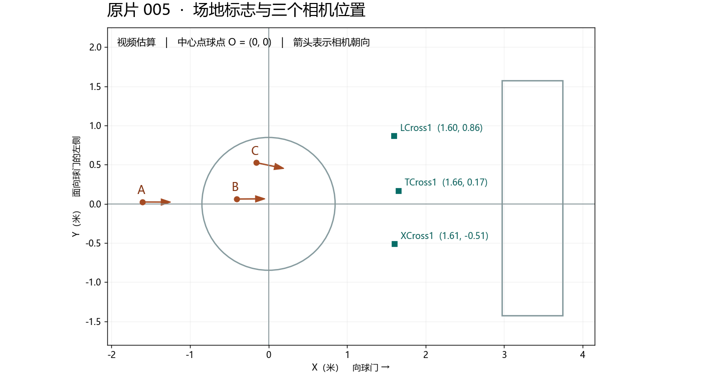

# 第 3–4 周合并考核 · 蒯振华

完成了已有实拍素材的标注、足球与 L/T/X 模型训练、视频回放、相对地面投影/地图匹配、ROS2 消息传输检查。地图和示例位姿采用**视频估算**：相对地图约按 3.0 米/单位换算，方法与条件见下文。随附视频展示本人原片的离线检测与定位运行结果。

- 姓名：蒯振华（kuaizhenhua）；采集 2026-11-16，本轮工程整理 2026-11-21。
- 相机：本人外接单目 RGB USB 摄像头，Windows DirectShow 编号 0；Linux 设备节点尚未实测。
- 镜头：用户确认同一设备、固定对焦、未改变焦距；焦距毫米值未知。
- 图像：1280×720 MJPG；主机接收实际帧率约 29.943–30.009 FPS。
- 检测/训练：Windows，Python 3.10.22，PyTorch 2.7.1+cu128，Ultralytics 8.3.228，OpenCV 4.12.0，NumPy 2.2.6。
- 通信检查：WSL Ubuntu 22.04、Python 3.10、ROS2 Humble。
- GPU：NVIDIA GeForce RTX 5070 Ti Laptop GPU。

## 文件与启动

`src/` 为采集、标定、数据重建、训练、检测、地图匹配和 ROS2 代码；`dataset/` 为轻量清单；`calibration/` 为内参与外参状态；`config/` 为相机和地图；`results/` 为实际指标、样例消息和 SHA256。

取得本人权重后放到 `weights/ball_best.pt` 与 `weights/marker_best.pt`。原片、模型和训练环境不放 GitHub。先按自己的 CPU/CUDA 环境安装 PyTorch 2.7.1 与 torchvision 0.22.1，再 `pip install -r requirements.txt`。

在个人目录执行：

```bash
# 真实摄像头；更换为系统识别到的外接相机编号
python src/run_vision.py --source 0 --ball-weights weights/ball_best.pt --marker-weights weights/marker_best.pt --output outputs/live_01
# 明确标记为 OFFLINE REPLAY 的原片回放
python src/run_vision.py --source local_data/clip_005.avi --ball-weights weights/ball_best.pt --marker-weights weights/marker_best.pt --output outputs/replay_01
# 数值几何测试，不代表米制实测精度
python src/test_geometry.py
```

输出目录需使用新名字，避免覆盖旧记录。按 Q/Esc 退出。程序保存 annotated.mp4、逐帧 records.jsonl 和 summary.json。输入文件始终显示 OFFLINE REPLAY；姓名、当前处理时间与原采集时间分开记录。原始文件回放可传 `--receipt-csv frames.csv` 查回原片采集时刻。CPU 使用 `--device cpu`。

## 任务 1：足球检测

4 段足球原片，240 候选，经复核使用 **217 张 / 185 个球实例 / 32 张负样本**。train=001/002（107 张），val=003（55 张），test=004（55 张）。按独立原片分组，详见 [数据集说明](dataset/dataset_summary.md)。

YOLOv8n 官方权重初始化，60 epochs、640 输入、batch 8、seed 42、AMP 关闭，GPU 0，workers 0；中断后从第 36 轮检查点恢复，实际完成 60 轮。关闭 AMP 便于此环境稳定复现。

| 独立原片 004 测试 | Precision | Recall | mAP50 | mAP50–95 |
|---|---:|---:|---:|---:|
| 55 张 / 35 个球 | 0.9936 | 0.7429 | 0.9171 | 0.6007 |

P/R 使用 Ultralytics 验证器汇总口径；运行时默认 conf=0.25。验证批量单图推理约 1.41 ms，不能等同实时摄像头 FPS。连续 300 帧离线回放端到端 10.60 FPS（含初始化与写盘）；去掉首帧后单帧处理平均 28.25 ms。现场摄像头性能尚未测定。

链路：BGR 帧 → YOLO → 框、置信度与像素中心 u/v → 左侧显示和 JSON/ROS2。没有检测时 detected=false、列表为空。存在运动模糊/小球漏检；标志片段也观察到将背景误判为球的帧。像素坐标不直接表示机器人可移动的米数。

## 任务 2：标志检测与相对定位

组长后续允许参考官方 field.yaml 自定义地图。因此使用旧视频实际胶带布局，而非套用 Booster 14 点坐标。地图版本 `clip005-relative-v1`，field.yaml SHA256：`53847255b4c6bcbde5b3c62a05949033adf8a0975d0667ce7606256b30f73869`。

- 原点：平面校正后拟合的中圈近似中心；+X 指向球门，+Y 为面向 +X 的左侧，+Z 向上，yaw 绕 +Z 逆时针为正。
- 计算单位：所选白线矩形的宽度=1；展示尺度约为 3.0 米/单位，属于视频估算。相对计算地图为 field.yaml，换算后的坐标另存 estimated_field_m.yaml。
- LCross1=(0.532283,0.288105)，TCross1=(0.552838,0.055098)，XCross1=(0.535515,-0.170866)。保留多位小数仅供复现，不代表测量精度。
- 地图与原片 005 中的胶带布局对应。后续不同布局需更换地图。
- 原标志视频的五段切分仍只有一个采集来源。最终 82 张训练图、110 个实例：L36/T39/X35/P0。
- 标志模型先以 640、batch8 训练 60 轮；从该权重继续以 960、batch6 训练 40 轮，增加远景标注，degrees=12、seed42、AMP关闭。运行采用标志输入 960。

| 标志训练集拟合诊断（非独立测试） | Precision | Recall | mAP50 | mAP50–95 |
|---|---:|---:|---:|---:|
| 全部 82 张训练图片 | 0.9957 | 0.9987 | 0.9950 | 0.8359 |

### 标定与几何

33 张同机屏幕棋盘照片，9×6 内角点，用户量得单格 20 mm。暂定内参 fx=1624.282123、fy=1621.226212、cx=709.172159、cy=362.754196；畸变 k1/k2/p1/p2/k3 = 0.223223939 / -0.625310582 / 0.000542109 / 0.011118283 / -1.359511661。重投影 RMS=0.662304 px；角点未覆盖最右侧约 34.2% 宽度，局部高残差与敏感性分析保留在 calibration_report.json。

白线矩形四角和中圈弧从原片 005 第 0 帧选取，用本机内参估计平面。矩形内部 PnP 重投影 RMSE≈1.474 px，只表示内部拟合，不是定位真值误差。估计相机高度≈0.301158 相对单位，按估算尺度折合高度约 0.90 米。完整旋转矩阵在 field_geometry.yaml；不冒用官方示例相机参数。

链路：YOLO 标志框 → 黄色/高亮胶带掩膜 → 骨架分支或两条中心线交点（不直接使用框中心）→ 去畸变射线与地面求交 → 同类候选一对一匹配 → 两点位姿假设与 SE(2) 迭代拟合 → 残差、基线、竞争位姿检查。提取失败的点不参与匹配。

地图匹配至少 3 个点；门限采用相对单位：匹配距离 0.055、最大 RMS 残差 0.025、最小基线 0.08、竞争残差差 0.005。多种同等可信位姿、点不足或残差过大时返回无效，清空坐标，不沿用上一帧。三个点近共线，远处短臂和遮挡使交点不稳，必须结合状态判断。

输出对象为**相机光心**。`relative_valid` 仅表示在“相机高度/倾角不变”假设下通过内部匹配；`valid/metric_valid` 始终 false，米制 x_camera_map/y_camera_map 为 null。相对值另存 x_camera_map_units/y_camera_map_units/yaw_camera_map_deg，避免把估算当实测。已知尺度后仍须校验地图与当前相机安装，不能只把 valid 改成 true。

275 帧抽样回放中，相对匹配通过 15 帧，米制有效 0 帧。各帧状态保留在本地 records.jsonl；多数画面只显示单个标志或几何点不足。该结果是旧视频回放诊断，不是三个 C0 参考点误差。

## ROS2 接口

- 节点：kuaizhenhua_soccer_vision。
- `/soccer/ball`：std_msgs/String 内嵌 JSON，含处理时间、来源采集时间、LIVE/REPLAY、detected、检测列表（框、u/v 像素、confidence）。
- `/localization/field_pose`：std_msgs/String 内嵌 JSON，含米制无效状态、相对坐标及单位、yaw 度、marker_count、residual_units、matched_ids、status。当前版本不用无单位的 Pose2D 传递相对坐标。
- 2026-11-18 已在 WSL Humble 用独立发布/订阅进程检查，每个话题收到 10 条，时间戳与无效状态保持正确。见 results/ros2_transport.json。此项验证传输，不代表 WSL 相机已接通。

```bash
source /opt/ros/humble/setup.bash
python3 src/ros2_replay.py outputs/replay_01/records.jsonl --limit 10
# 另开 ROS2 终端查看
ros2 topic echo /localization/field_pose
```

同一 Python 环境能导入 rclpy 和 YOLO 时，检测命令添加 --ros2 可直接发布。Windows 训练环境与 WSL 系统 Python 分开，不能直接混用依赖。

## 权重获取与校验

解压共享存储中的 模型权重.zip 到个人目录即可得到两份权重，获取链接见下方“视频与提交链接”。

- ball_best.pt：`abad431653a5c98c66c92af510791cdef50e17c999091a1696933b5614b4e829`
- marker_best.pt：`f3242f3dad6e1f3c21afa443174af7e0dc2c7e8ff7706eac6c1bf421d112afc0`

## 复现训练与地图

```bash
python src/prepare_dataset.py --raw 本人原片目录 --output local_data
python src/train.py --kind ball --data local_data/ball/data.yaml --initial yolov8n.pt --epochs 60 --imgsz 640 --batch 8 --name ball
python src/train.py --kind marker --data local_data/marker/data.yaml --initial yolov8n.pt --epochs 60 --imgsz 640 --batch 8 --name marker_base
python src/train.py --kind marker --data local_data/marker/data.yaml --initial runs/marker_base/weights/best.pt --epochs 40 --imgsz 960 --batch 6 --name marker_refined
python src/estimate_field.py --image local_data/marker/images/train/m005_f000000.png --output outputs/reestimated_map
```

当前最终标志训练使用先前 78 图基础模型后增加 4 图的路线。重建的最终清单为 82 图；若从头用最终清单训练，结果可能不同，实际已交付权重以 SHA256 为准。GPU/库版本差异也可能改变训练结果。

## 视频与提交链接

- B 站演示视频：[CQuick 第 3–4 周｜足球检测与单目场地定位｜蒯振华](https://b23.tv/5tw2U4F)。
- 模型权重：[从百度网盘下载 模型权重.zip](https://pan.baidu.com/s/1ltI9I2vObKr14ZxfbN5luw?pwd=9wu5)，提取码 `9wu5`。
- 演示内容：原片 004 足球检测、原片 005 标志识别与地图匹配、三个视频估算位姿样例。
- 视频含姓名、原始采集时间、此次处理时间；章节内按原片时间顺序展示，分析每 3 帧取 1 帧，导出 30 FPS。
- 本文件记录已完成的离线成果；C0 现场实时验收及独立参考误差不包含在本次结果中。

视频标题为《CQuick 第 3–4 周｜足球检测与单目场地定位｜蒯振华》。时长 6 分 45 秒。足球片段处理 1,074 帧，468 帧检出球。标志片段处理 2,745 帧，156 帧通过相对位姿匹配。视频发布后请设置评审可访问。

## 视频估算尺度与三个位置

采用球直径约 0.22 米、球接触地面、两段原片相机高度和俯仰保持不变的假设，由去畸变视线的角半径估计球心距离，再结合地面关系估计高度。17 个合适的球框得到尺度中位数约 3.04 米/单位，展示取 3.0 米/单位。重复/相邻观测相关，样本范围不代表精度区间。

0.22 米的尺寸假设参考 [IFAB 足球周长规定](https://www.theifab.com/laws/latest/the-ball/)；实际这只球的直径、场地尺度及独立参考位姿没有量具验证。原片间的俯仰或高度变化、遮挡球框和相机内参偏差都会影响估计。

地图近似坐标：LCross1=(1.60,0.86)、TCross1=(1.66,0.17)、XCross1=(1.61,-0.51)，单位米。以中圈近似中心为原点，+X 朝球门、+Y 为左侧。



| 样例 | 原片帧 | X（米） | Y（米） | Yaw（度） |
|---|---:|---:|---:|---:|
| A | 0 | -1.61 | +0.02 | -0.2 |
| B | 1020 | -0.41 | +0.06 | +0.4 |
| C | 7980 | -0.16 | +0.53 | -11.8 |

三个示例取自原片 005 的第 0、1020、7980 帧，完整数值与采集时间在 results/estimated_pose_examples.json。它们是算法输出样例，不作为独立真值计算误差。运行时添加 `--estimated-scale config/estimated_scale.yaml` 可显示近似米制结果；JSON 增加 estimated_x_camera_map_m、estimated_y_camera_map_m、estimated_yaw_camera_map_deg，原有 metric_valid 状态保持不变。

```bash
python src/run_vision.py --source local_data/clip_005.avi --ball-weights weights/ball_best.pt --marker-weights weights/marker_best.pt --estimated-scale config/estimated_scale.yaml --output outputs/estimated_replay
```

## 问题与解决过程

1. 相机偏色、发暗、约 1 FPS：恢复驱动参数与曝光，并重新应用 MJPG；后续原片主机取帧恢复约 30 FPS。
2. 通用模型漏检近处蓝白球：复核候选并在本人数据上微调；最终独立测试指标如上，仍保留漏检。
3. 远景标志混淆：从已有视频补取 4 张全景、12 个标志，继续训练并将标志输入提高到 960。
4. 大标志 ROI 的骨架计算卡顿：限制计算分辨率最长边 160，同时保留坐标缩放；几何失败明确报无效。
5. 旧胶带移动、无法测原坐标：用白线平面恢复相对图，利用足球尺寸假设进一步估算尺度，坐标以估算值呈现。

参考：[Booster field.yaml](https://github.com/BoosterRobotics/robocup_demo/blob/main/src/vision/config/field.yaml)、[vision.yaml](https://github.com/BoosterRobotics/robocup_demo/blob/main/src/vision/config/vision.yaml)、[OpenCV PnP](https://docs.opencv.org/4.x/d5/d1f/calib3d_solvePnP.html)。
