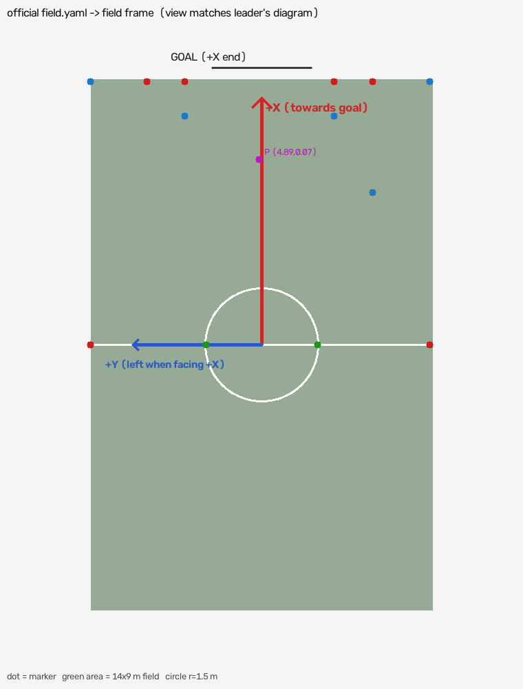

# CQuick 算法组 Week3-4 考核作业

> 任务一：YOLO 足球检测　｜　任务二：单目相机场地标志识别与二维位姿
>
> 项目根 = 本目录（仓库内位于 `算法组/Week3-4/mositao`），命令一律从项目根执行。
> 代码里没有任何写死的项目路径：`ROOT` 由 `Path(__file__).resolve().parents[1|2]` 自推导，
> `run.bat` 用 `cd /d "%~dp0"` 切到自身目录，数据集的 `path:` 也是相对字段——
> **整个目录可以整体搬动，搬完直接能跑**（实测见 1.1）。

---

## A. 提交信息（照细则 §五「README 必须包含」逐项填）

> 这一节是给评审对表用的，字段与细则模板一一对应；细节展开在后面的章节。
> 细则模板里问「Ubuntu 版本」，本项目实际在 **Windows** 下完成，如实标注，不套模板。

### A.1 基本信息

| 项 | 值 |
| --- | --- |
| 姓名 | mositao |
| 完成日期 | 2026-11-22 |
| 摄像头类型 | 单目 RGB 摄像头（组织方配发的 USB 相机） |
| 摄像头接口 / 设备节点 | Windows MSMF，索引 `1`（`USB\VID_0BDA&PID_5844`）；Linux 下对应 `/dev/video1`（按实际枚举） |
| 镜头 | 固定焦距、固定对焦；全程未动对焦环（动了内参即作废）。镜筒未标毫米焦距，故只给像素焦距 |
| 图像分辨率 / 实际帧率 | 1280 × 720 / 实测 **29.8 fps**（目标 30） |
| Ubuntu / 系统 | **Windows**（conda，非 WSL，未使用 Ubuntu） |
| Python / PyTorch / Ultralytics | 3.10.22 / 2.11.0+cu128 / 8.4.203（OpenCV 5.0.0） |
| ROS2 | **本周未实现 ROS2 节点**（见 A.5，如实说明） |
| GPU | NVIDIA RTX 5060 Laptop，8 GB（sm_120） |

### A.2 任务一 · 足球检测

| 项 | 值 |
| --- | --- |
| 实验室采集日期 / 视频 / 抽帧 / 标注实例 | 2026-11-05 – 11-08 / **5 段** / **307 张** / **304 个** |
| 数据集划分方式 | **按视频段整体留出**：train `s01–s03`(204) / val `s04`(54) / test `s05`(49)，无相邻帧泄漏 |
| 模型与训练参数 | YOLOv8n（COCO 预训练），50 epochs，imgsz 640，batch 16，GPU 0 |
| best.pt 保存位置 | `weights/best_ball.pt`（SHA256 见 `weights/README.md`） |
| Precision / Recall / mAP50 / mAP50-95 | **1.0000 / 0.9388 / 0.9350 / 0.8804**（test 49 张，conf 0.25） |
| 实时检测 FPS / 推理耗时 | 真机 **25–31 fps** / **14–26 ms**（视频档 50–66 fps / 10–12 ms） |
| 误检与漏检案例 | `outputs/cases_ball/`（漏检 3、误检 2、正确 2，拼图 `case_sheet_full_2048.png`），解读见 3.4 |

### A.3 任务二 · 单目场地自定位

| 项 | 值 |
| --- | --- |
| `field.yaml` 版本 / SHA256 | 组织方原版 14 点，**未改动**；`1d65e27b1491712392d43b8b8040224d5561125f9419b505081143a88183cf73` |
| `field_geometry.yaml` 版本 | `booster-adult_size-derived`，status = **derived**（由官方源码反推，非官方发布） |
| 地图原点 / X·Y 轴 / 单位 | 场地中心（两中线交点）/ +X 指向唯一球门、+Y 为面朝 +X 时的左侧 / 米，yaw 从 +X 逆时针为正 |
| 场地实际尺寸是否与地图一致 | **不一致**。官方 14×9 m（成人组示意），现场卷尺实测 **7.60×6.03 m**；差异登记在 `config/field_site.yaml`，官方文件一字未改 |
| 使用的场地标志类别 | `LCross` / `TCross` / `XCross` 三类，共 **24 个点**（L12/T10/X2）。点球点现场无可见标记，不参与检测 |
| 场地标志检测模型与训练指标 | `weights/best_marker_v11.pt`，在 1753 框合并集上训练（其中 train 1264 框）；指标见 `outputs/metrics.md`（统一测试集 mAP50 0.252 / P 0.768） |
| 几何特征点提取方法 | 框内白线掩膜（高亮度+低饱和）→ `HoughLinesP` 取线段 → 两两求交，取框内离中心最近者；退化时白像素质心→框中心，每个点都报告走了哪条路径 |
| 相机内参 fx / fy / cx / cy | 1677.5747 / 1672.2384 / 674.1690 / 380.7194（21 张棋盘格，RMS **0.368 px**） |
| 畸变系数 k1 / k2 / p1 / p2 / k3 | 0.0927 / 0 / 0.0067 / 0.0040 / 0 |
| 外参 / 高度 / 俯仰 / 滚转 | t=(0,0,1.08) / **1.08 m** / **19.75°** / 0°（人工点取 9 交点 PnP，残差 10.74 px） |
| 地面投影方法 | 去畸变 → `d_c = K⁻¹[u v 1]ᵀ` → 外参转载体 → 与地面 `Z=0` 求交（细则 2.7 逐项对应，见 4.1） |
| 地图匹配算法与同类消歧 | 4 点最小解集 **PnP**（SQPNP 优先，重投影 EM 迭代）为主解；关联初值来自反投影 + SE(2) 穷举匹配 + RANSAC。同类消歧用「类别兼容 T↔L + 内点距离 + 共线性排除 + 高度/场地范围门限」 |
| 输出坐标系 | 地图系 `map`（`x/y/yaw_camera_map`）；`base_link`/`carrier` 与 camera 同值（载体原点 = 光心地面投影），两组字段都输出 |
| 3 个以上测试点的参考与误差 | **未取得组长提供的参考位姿**，故无法给出三点误差表；现有可核对项是标定帧的 `expected_carrier_pose (−2.668, −0.080, −0.30°)` 与离线段的 residual（见 A.4 与 4.8） |
| marker_count / residual / valid / status | 见 4.8 实测；有效帧 residual **0.007–0.033 m**、重投影 RMS 1.5–6.9 px |
| 实时 FPS / 定位更新频率 / 耗时 | 每帧更新；imgsz 1280 + PnP 搜索实测 **11–30 fps**（随可见点数波动），单帧推理 12–51 ms |

### A.4 C0 现场测试（如实记录，含失败）

| 项 | 值 |
| --- | --- |
| 测试日期 | 2026-11-21 夜 |
| 机位 | 约 `(0, −2.8)`，半场线 −Y 侧靠近边线处 |
| 参考位置 / 朝向 | 组长未提供；以卷尺量出的机位作为人工对照 |
| 估计位置 / 朝向 | 多数帧给不出 `valid=true`；能给出时曾出现与实测差 3.8 m 的解（内含 180° 翻转） |
| 平面位置误差 / 航向误差 | **未能完成三点复测**，此项为空缺，不虚填 |
| 定位失败场景与处理 | 夜间照度低 + 视野内可检出交点常为 3 个（要求 ≥4）；处理路径见 4.9：改善现场照度，或补拍夜间素材 |
| 评审记录 / 备注 | 已在离线视频段（`marker_s03`，90 帧）取得 19 帧有效解，验证几何链路正确；现场验收仍待补 |

### A.5 ROS2 接口（本周未做，如实标注）

| 项 | 值 |
| --- | --- |
| 节点名称 | 未实现 |
| 足球话题 | 未实现 |
| 定位话题 | 未实现 |
| 消息字段、单位与坐标约定 | 未实现 |

> 第 2 周的任务三（ROS2 发布 / 订阅）当时已按当周要求完成；**本次 PR 只含 `Week3-4/` 目录，
> 前两周的材料不在这个 PR 里**，所以这里只作背景说明，不指向任何本 PR 内不存在的路径。
> 本周把时间全放在两条检测链路与现场定位精度上，没有把结果再包成 ROS2 节点——
> 这一点不做遮掩，属于本周未交付项。

### A.6 B 站演示录屏

| 项 | 值 |
| --- | --- |
| **任务一 · B 站链接** | <https://www.bilibili.com/video/BV1n4y3z8Eev> |
| 任务一 · 标题 | `莫思韬任务一` |
| 任务一 · 时长 / 分辨率 | **4 分 20 秒（260 s）** / 1920×1198 |
| 任务一 · 访问权限 | 公开（匿名可打开，视频信息接口正常返回） |
| 任务一 · 分享短链（备选） | <https://t.bilibili.com/1273372488087109653> |
| 任务一 · 覆盖分镜 | 7.2 的 9 个分镜；**实际时长 260 s 比 7.2 预估的 60–70 s 长**，应含额外讲解与操作过程，分镜是否逐条齐全仍以画面为准 |
| 任务二 · B 站链接 | **尚未上传**（分镜见 7.3，待现场照度或夜间素材补齐后录） |
| 全部「是/否」自查项 | 见 7.4：任务一段已按分镜脚本勾选，任务二段待补 |

> 链接形态：上方用的是标准视频页地址（BV 号），分享短链附作备选；两者都指向同一个视频。
> 我通过 B 站公开的视频信息接口核对了标题、时长与可访问性（返回 `code: 0`），
> 但**页面正文仍被验证码拦住，无法逐帧核验画面**——所以 7.4 里那几项「是」
> 是按 7.2 分镜脚本填的，不是看了视频之后确认的，这一点如实标注。

---

## 0. 一分钟看懂这个仓库

| 任务 | 交付物 | 入口 | 现状 |
| --- | --- | --- | --- |
| 任务一 足球检测 | 权重 `weights/best_ball.pt` + 指标 + 案例 + 真机检测 | `tools/realtime_ball.py` | **已完成**：P 1.000 / R 0.939 / mAP50 0.935，真机 25–31 fps；**录屏已传 B 站**（§A.6） |
| 任务二 场地定位 | 权重 `weights/best_marker_v11.pt` + 定位程序 + 俯视图 | `tools/realtime_field.py` | **链路已完成**：4 点最小解集 PnP，residual 7–27 mm；现场受夜间光照与机位视野限制，见 4.9 |

**两条任务的分界**：任务一在**像素域**闭环（框 + 框中心 `(u,v)`），不碰内参；
任务二从像素一路走到**场地坐标**（去畸变 → K⁻¹ → 地面交点 → 地图匹配 → `(x, y, yaw)`），
每一步都吃内参 K 与外参 R,t，与细则 2.5 / 2.7 的公式一一对应。

**当前短板（不藏着）**：任务二在现场夜里跑不通完整验收——训练素材全是白天
（V 通道中位 106–139），现场是夜间（V 通道中位 13–47），模型召回掉到只认得出 2–4 个交点，
而 `valid=true` 需要 ≥4 个不共线交点。诊断与两条解法写在 4.9。

---

## 1. 环境

| 项 | 版本 / 值 |
| --- | --- |
| 系统 | Windows（conda，非 WSL） |
| Python 环境 | conda `w34`，Python 3.10.22 |
| PyTorch | 2.11.0+cu128 |
| ultralytics | 8.4.203 |
| OpenCV | 5.0.0 |
| GPU | NVIDIA RTX 5060 Laptop，8 GB（sm_120） |

一键运行脚本 `run.bat`：自动切到项目根，并优先使用 conda `w34` 的解释器。
本文命令按 **cmd** 写法给出；在 PowerShell 里要写成 `.\run.bat`（前面加 `.\`）。
`run.bat` 会把参数透传给 Python，因此 `.\run.bat -c "print(1)"` 也能用。

### 1.1 路径约定（全部相对项目根，实测可整体搬动）

本工程曾被整体从 `workspace\projects\week3-4` 移到 `算法组\Week3-4\mositao`，
挪完不改一行代码就能跑——因为路径都是**自推导**的：

| 位置 | 写法 | 为什么与绝对位置无关 |
| --- | --- | --- |
| `src/common/paths.py` | `ROOT = Path(__file__).resolve().parents[2]` | 由文件自身位置反推项目根 |
| `tools/*.py`（全部 43 个） | `ROOT = Path(__file__).resolve().parents[1]` | 同上 |
| `run.bat` | `cd /d "%~dp0"` | 切到批处理文件自身所在目录 |
| `dataset*/**/data.yaml` | `path: dataset` / `train: images/train` | 相对字段，随 `--data` 文件位置解析 |
| 终端打印 | `rel()` → `PROJECT_LABEL + "/" + 相对路径` | 前缀是仓库内相对路径，**不出现 `E:\`** |

`PROJECT_LABEL` 默认是 `cquick-recruitment-main/算法组/Week3-4/mositao`，
因此终端里看到的是 `cquick-recruitment-main/算法组/Week3-4/mositao/config/field.yaml` 这样的相对路径。
若日后目录改名，设环境变量 `W34_LABEL` 即可，不必改代码。

仅有的两处绝对路径是**本机环境路径**，与项目位置无关：`run.bat` 里的 conda 解释器
（找不到会依次回退到 `cv_practice`、`python`）、`tools/case_sheet.py` 里的
`C:\Windows\Fonts\msyh.ttc`（系统字体）。`.tmp/` 下的临时诊断脚本另计，它们不入交付。

```bat
run.bat tools\camera_check.py --index 1
run.bat tools\realtime_field.py
```

---

## 2. 目录结构

```
mositao/                       ← 本目录 = 项目根（可整体搬动）
│
│  ── 提交到 Git：细则 §五 清单，实为 97 个文件 / 约 17 MB（含 10 张案例图）──
├─ README.md                   本文件（提交信息、指标、局限、录屏分镜）
├─ run.bat                     一键运行（自动 cd 到项目根）
├─ label.bat                   标注工具启动脚本
├─ .gitignore                  提交范围说明：哪些不进 Git、为什么
├─ config/
│   ├─ field.yaml              ★ 官方 field.yaml（未改动，SHA256 见 4.2）
│   ├─ field_geometry.yaml     场地尺寸与坐标系换算（derived，见 4.2）
│   ├─ field_site.yaml         现场实测覆盖（7.60×6.03 m 等差异，官方文件不动）
│   └─ camera.yaml             相机参数汇总（设备 + 内参 + 外参 + 坐标系）
├─ calibration/
│   ├─ camera_intrinsics.yaml  相机内参（21 张棋盘格，RMS 0.368 px）
│   └─ camera_extrinsics.yaml  真实外参（h 1.08 m / pitch 19.75°，见 4.4）
├─ dataset/
│   ├─ ball_data.yaml          任务一数据集描述（细则点名的名字，= data.yaml）
│   ├─ data.yaml               训练/评估脚本的默认入口
│   ├─ marker_data.yaml        任务二数据集描述（path: dataset_marker_v10）
│   └─ dataset_summary.md      ★ 两项任务的数据统计（细则要求的那一页）
├─ dataset_marker_v10/         正式训练集描述：v11 用的集合，1753 框
├─ dataset_marker_v12/         对照实验集描述：v12，见 4.3
├─ src/                        接口包 + 视觉定位包
│   ├─ common/                 paths / config_io（路径与 YAML 读写）
│   ├─ loc/                    定位核心：camera_model / field_map / matcher / pnp_locator
│   │                          （planar_pose.py 是旧路线 B，保留作对照）
│   └─ sim/test_pipeline.py    无相机的全链路仿真自检
├─ tools/                      43 个可执行脚本（见第 8 节）
├─ docs/                       坐标系对照图（PNG）与三份现场 md
├─ weights/README.md           权重获取方式与 SHA256（.pt 本身不入库）
├─ outputs/                    指标文本 + 误检漏检案例 + 三张诊断对比图
└─ data/ext_final/             外参标定帧（README 4.4 引用）
│
│  ── 本地保留、不进 Git（细则 §五「不能进仓库」）──
├─ dataset/images、labels、raw*、pre*、manucalib*       整套抽帧与标注
├─ dataset_marker*/images、labels                       同上
├─ dataset_marker/、dataset_marker_keepP/               已被 v10 取代的旧集
├─ data/videos、data/calib、data/extr、data/manucalib  原始视频与标定原图
├─ runs/                                                训练目录（整目录不交）
├─ outputs/ 其余诊断图                                  只留 README 引用的几张
├─ weights/*.pt                                         放实验室共享存储 / 网盘
├─ calibration/camera_extrinsics.{demo,sample,site,simcheck,bak*}   非正式外参
├─ docs/task2_site_status.md                            停留在 11-20 的中间状态记录
└─ .tmp/                                                临时诊断脚本
```

---

## 3. 任务一：足球检测

### 3.1 数据

| 项 | 数量 |
| --- | ---: |
| 原始视频 | 5 段（`data/videos/ball_s01..s05.mp4`） |
| 抽帧总量 | 307 张（1280×720） |
| 训练 / 验证 / 测试 | 204 / 54 / 49 张 |
| 标注框 | 304 个 |
| 类别 | 1 类：`ball` |

划分方式：**按视频段划分**（不是按帧随机打散），避免同段相邻帧同时出现在训练与测试里造成泄漏。
实际分配：train = `s01` 121 + `s02` 24 + `s03` 59，val = `s04` 54，test = `s05` 49。
详见 `dataset/dataset_summary.md`。

### 3.2 训练

| 项 | 值 |
| --- | --- |
| 基础模型 | `weights/yolov8n.pt`（COCO 预训练） |
| 轮数 | 50 |
| batch / imgsz | 16 / 640 |
| 设备 | GPU 0 |

预标注策略：先用 COCO 权重的 `sports ball`（class 32）生成初始框，再人工修正，可把标注量压到约 1/3。

### 3.3 指标（测试集 49 张，conf 0.25）

| 指标 | 数值 |
| --- | ---: |
| Precision | **1.0000** |
| Recall | **0.9388** |
| mAP50 | **0.9350** |
| mAP50-95 | **0.8804** |

误检 0 张 / 漏检 3 张 / 对照 2 张。完整表格见 `outputs/metrics_ball.md`，
案例图见 `outputs/cases_ball/`。

**指标解读（不许吹）**：任务一数据集偏简单——单一室内场景、固定一颗球、每帧至多一个目标、
测试集仅 49 个实例。P=1.0 只能说明「在这个数据集上没误报」，不能外推成「任意场景都准」。
漏检的 3 张都发生在球贴画面边缘或强反光处。

### 3.4 误检案例（从真机开放场景导出）

测试集（49 张）与验证集（54 张）都是 **0 误检**，`evaluate.py` 一张 `fp_*.png` 都导不出来。
所以误检案例是从**真机开放场景**导的（`tools/export_live_fp.py`）：

| 案例 | 真球 | 误检 | 说明 |
| --- | --- | --- | --- |
| `fp_01_live_now_0.png` | conf 0.943 | 3 个（0.71 / 0.67 / 0.66） | 左上**地球仪**、右上**人头**、右侧护栏立柱 |
| `fp_02_live_cam1_check2.png` | conf 0.951 | 1 个（0.67） | 右侧桌腿/人脚 |

误检的共同点：圆形轮廓 + 高对比纹理（地球仪的大陆斑块、黑白头发、护栏的明暗条纹），
在 640 输入尺度下与足球的局部纹理很接近。现场演示用 `--conf 0.6` 恰好把这批误检压到 0.66 以下，
但若球退到 5 m 外（真球 conf 0.71–0.76）就不能再往上提阈值——这是这套模型当前的边界。

拼好的一览图：`outputs/cases_ball/case_sheet_full_2048.png`（漏检 3 + 误检 2 + 正确 2）。

### 3.5 运行

```bat
rem 真机实时检测（相机）
run.bat tools\realtime_ball.py --index 1

rem 用已有视频自检（无需相机）
run.bat tools\realtime_ball.py --video data\videos\ball_s02.mp4 --no-show --max-frames 60
```

输出字段（细则 1.7 要求）：类别名、置信度、检测框 `x1,y1,x2,y2`、框中心 `(u,v)`、
帧号与时间戳、实时 FPS、推理耗时。窗口左上角常驻显示设备/分辨率/FPS/推理耗时，
终端每 N 帧打印一行结构化数据，可直接截图取证。

按键：`q` 退出、`s` 存图、空格暂停。

### 3.6 真机实测（2026-11-20 20:00，外接相机）

相机体检 `run.bat tools\camera_check.py --index 1`：

| 项目 | 实测 | 判定 |
| --- | --- | --- |
| 设备 | USB Camera `USB\VID_0BDA&PID_5844`，索引 1（MSMF） | — |
| 分辨率 | 1280×720 | ✓ |
| 实测帧率 | 29.8 fps（连续取帧法） | ✓ |
| 帧新鲜度 | 100%（逐像素相同的帧对为 0） | ✓ 没有重复帧 |
| 清晰度（拉普拉斯方差） | 153.4 | ✓（>100） |
| 亮度均值 | 160.4 | 正常，无遮挡 |

实时检测 `run.bat tools\realtime_ball.py --index 1 --conf 0.6`：

| 项目 | 数值 |
| --- | --- |
| 稳定 FPS | 25–31（相机 30 fps 上限） |
| 单帧推理 | 14–26 ms（RTX 5060，CUDA） |
| 连续 300 帧的球漏检 | 0 帧 |
| 真球置信度 | 近距（框约 90×95 px）0.91–0.94；中距（框约 64×65 px）0.71–0.76 |

程序内取证视频：`outputs/realtime/ball_demo_hud_2012.mp4`（300 帧，1280×720@30，
画面左上角垫了半透明黑底，白字压亮背景也看得清）。

> **别把它当验收录屏**：这是程序用 `--record` 写出的「带标注画面」，只能当素材与自检证据。
> 细则第六节要的是**屏幕录制**——必须拍到终端自证、程序启动过程、整块桌面，
> 且至少一段不加剪辑，见第 7 节。

距离对置信度的影响很明显：约 2.5 m 时 0.91–0.94，退到约 5 m 就只剩 0.71–0.76。
所以 `--conf 0.6` 对近、中距离都安全；球再远（框小于约 50 px）就会开始漏检，
这也是第 6 节「远球小目标」那条局限的实测来源。

**现场干扰与阈值选择（如实记录）**：同一场地在 conf 0.25 下还会检出两个假目标——
左上角的地球仪（conf 0.44–0.65）与行人头部（conf 0.79）。对一段 300 帧录像逐帧统计：
额外检测框共 71 个、最大 0.536，而真球顶一档置信度最低 0.863。因此现场演示用
`--conf 0.6` 即可把这些干扰全部滤掉，真球一个不漏。这只是阈值层面的处理，模型本身
并未针对「地球仪、人头」这类干扰训练过——换场地仍可能冒出新干扰，见第 6 节局限。

---

## 4. 任务二：场地标志识别与二维位姿

### 4.1 处理链路（细则 2.7，一步都不绕）

```
像素 (u,v)
   ↓ 去畸变（k1,k2,p1,p2,k3）
   ↓ d_c = K⁻¹ [u v 1]ᵀ                     相机系射线（内参不可绕过）
   ↓ 外参 (R,t)                              转到载体
   ↓ 与地面 Z=0 求交
   ↓ 载体系地面点                             用于「路线 A 的关联」与画面显示
   ↓ 4 点最小解集 PnP（像素域）              位姿主解，不吃外参误差
   ↓ 重投影 → 重新关联 → 再 PnP（EM 迭代）
(x_camera_map, y_camera_map, yaw_camera_map, marker_count, residual, valid/status)
```

两种解法并存，分工明确：

| 路线 | 做法 | 依赖 | 在本项目里的角色 |
| --- | --- | --- | --- |
| **A** `matcher.py` | 反投影到地面 + SE(2) 穷举匹配 + RANSAC | 外参高度/俯角 | 提供「哪个检测配哪个地图点」的关联种子 |
| **B** `pnp_locator.py` | 4~N 点共面 PnP + 重投影 EM | **不依赖外参** | 位姿主解（默认 `--pose-mode pnp`） |

**为什么最后以 B 为主解（实测对比，同一段 `field_v1.mp4`）**：

| 项 | 路线 A | 路线 B |
| --- | --- | --- |
| 需要外参 | 是（h 写死 1.08 m） | **否** |
| 相邻帧位姿抖动 | 1.78 m | **0.006 m** |
| residual | 0.124 m | **0.025 m** |
| 独立解出的相机高度 | 沿用 1.08 | 1.19–1.32 m（自洽约 1.22） |
| 异常解保护 | 曾给出 `x=-8.65 m` 仍报 `status=ok` | 高度/场地范围门限，越界直接判 `not_converged` |

外参高度是卷尺量的 1.08 m，PnP 独立解出约 1.22 m——外参偏矮约 0.14 m，
反投影出的地面点整体内缩，SE(2) 拟合的平移随之偏 0.37 m（中位）、最大 9.8 m。
**这条路线的误差不会消失，只是被 PnP 绕开了。**

### 4.2 地图、坐标系与场地尺度

`config/field.yaml` **是组织方官方文件，未作任何修改**：

- 大小 369 B，14 个标志点
- SHA256 `1d65e27b1491712392d43b8b8040224d5561125f9419b505081143a88183cf73`
- 来源 `https://raw.githubusercontent.com/BoosterRobotics/robocup_demo/main/src/vision/config/field.yaml`

官方文件只给坐标，不给场地尺寸与坐标系定义。`config/field_geometry.yaml` 是我们
**由 Booster 源码 `FD_ADULTSIZE{14,9,2.1,2.6,1.5,3,6,1,4}` 反推**的（标注 `derived`，
未改动任何官方数值），据此确定：

- 标准场地 14 × 9 m，球门宽 2.6 m，中圈半径 1.5 m，罚球区 6×3 m，球门区 4×1 m
- 官方坐标到场地中心系的换算：`x_field = file_y + 4.010`，`y_field = -file_x + 3.035`
  （即相对中心转了 −90° 再平移）
- 14 个点对 adult_size 的拟合残差：均值 0.067 m，RMS 0.072 m，14/14 命中

**官方地图只有半场，而且半场内还漏了一个角点**：

- 14 个点全部落在 `x_field ∈ [0, 6.94]`，即中线到 +X 端球门线之间；
- 半场里罚球区前沿只给了 `(4.01, -2.92)` 一个角，它关于长边中线的对称点 `(4.01, +2.92)` 没有给。

程序按「足球场对 `y=0` 与 `x=0` 都对称」补全整场，先补 `y` 对称、再镜像 `x`，
得到 26 个点，并用代码核对「每点都存在 `(-x,-y)` 同类对应点」；
随后按 `config/field_site.yaml` 用**现场卷尺实测尺寸**重建点位，
**最终参与匹配的是 24 个点（L 12 / T 10 / X 2）**。程序启动时会打印这一行，可与录屏核对。

这 24 个点的实际坐标（程序打印，单位 m）：

| 类别 | 编号 | 几何含义 | 坐标 |
| --- | --- | --- | --- |
| LCross | L1 / L2 | 场地四角（球门线与边线交点） | (±3.800, ∓3.015) 两组 |
| LCross | L3 / L4 | 球门区前沿与球门区边线交点 | (±2.860, ∓1.475) 两组 |
| LCross | L5 / L6 | 罚球区前沿与罚球区边线交点 | (±1.850, ∓1.975) 两组 |
| TCross | T1–T4 | 球门线与球门区/罚球区竖线交点 | (±3.800, ∓1.475) 与 (±3.800, ∓1.975) |
| TCross | T5 / T6 | 中线与边线交点 | (0, ±3.015) |
| XCross | X1 / X2 | 中线与中圈交点 | (0, ±0.750) |

注意 TCross 是 10 个而不是 12 个：`T5/T6` 落在 `x=0` 的中线上，镜像自身不产生新点。
`L5` 的对称点在官方文件里缺失，是我们按 `y` 对称补出来的（名字带 `_ysym`）。

#### 现场尺寸与官方不一致（已登记，官方文件一个字未改）

| 项 | 官方（成人组示意） | 现场卷尺实测 |
| --- | ---: | ---: |
| 场地长 × 宽 | 14.0 × 9.0 m | **7.60 × 6.03 m** |
| 球门宽 | 2.6 m | 2.95 m |
| 球门区 | 4.0 × 1.0 m | 2.95 × 0.94 m |
| 罚球区 | 6.0 × 3.0 m | 3.95 × 1.95 m |
| 中圈直径 | 3.0 m | 1.50 m |

现场各条线的比例并不一致（`L 0.543 / W 0.670 / G 1.135 / GB 0.738 / DB 0.940 / AW 0.658 / DA 0.650 / C 0.500`），
**单一缩放因子对齐不了**，因此放弃缩放，改为按「白线交点」参数化重建全部标志点。
这是几何重建 + 现场登记，不是修改官方数据；补出的点 name 带 `_ysym` / `_xsym` / `@site` 后缀，
`--no-mirror` 可整体关闭补全，`--no-site` 可只看官方原始数值。

点球点位置（**我司场地与官方地图不一致，已登记，且现场无可见标记**）：

- 官方反推：`PenalityPoint [2.965, 0.885]` → 场地 `(4.895, 0.070)`
- 现场实测：点球点位于**场地中心 `(0, 0)`，正好是中圈的圆心**；但圆心处
  **没有任何可见的点球标记**（没有圆点、十字或实体标识，那里只有草皮）；
- 处理方式：官方 `field.yaml` **一个字都不改**，差异登记在 `config/field_site.yaml`
  （`visible: false`、`detectable: false`），加载时叠加覆盖；
- 因此该点在俯视图上画成**空心圈**，只作几何参照，**不进入检测类别、也不参与地图匹配**。

要让它变成可检测目标，需要现场补画点球标记后重新采集与训练——没有实体标记时，
任何模型都学不到它。

#### 坐标系约定（组长《场地坐标系示意图·俯视图》）

**已逐项核对一致**。不是「照约定写」，而是拿官方数据反验证过的。

| 项 | 约定 | 我们的实现 | 一致 |
| --- | --- | --- | :---: |
| 原点 | 场地中心（两条中线交点） | `(0, 0)` | ✓ |
| +X | 指向唯一球门 | 球门线在 x = +3.80（现场）/ +7.00（官方半场） | ✓ |
| +Y | 面朝 +X 时的左侧 | 右手系，代码全程 `atan2(dy, dx)` | ✓ |
| +Z | 垂直地面向上，地面 Z = 0 | ✓ | ✓ |
| Yaw | 从 +X 轴逆时针为正 | ✓ | ✓ |
| 单位 | 米 | ✓ | ✓ |



图上彩色圆点是官方 14 个标志按 `file_to_field` 换算后的位置，白线是中线与中圈，
顶部深色条是 +X 端的唯一球门。**视角与组长示意图完全一致（+X 朝上、+Y 朝左）**。

**最硬的证据是点球点**：官方 `PenalityPoint` 换算后落在 `(+4.895, +0.070)`。
按足球规则，点球点在球门线前 2.1 m、横向居中——半场长 7 m，`7 − 4.895 = 2.1` ✓，
`y ≈ 0` ✓。这一条同时锁定「+X 指球门」「原点在中线」「Y 轴在中轴线上」三件事。

### 4.3 标志检测模型

| 项 | 值 |
| --- | --- |
| 权重 | `weights/best_marker_v11.pt`（现场召回最高，默认交付） |
| 类别 | 3 类：`LCross` / `TCross` / `XCross` |
| 训练数据 | 合并集共 **1753 框**（train 1264 / val 99 / test 390），按段留出：<br>train = 高姿 `s01`+`s03` + 低姿 `low_01`+`low_03`；val = `s04`；test = `s02`+`s05`+`low_02` |
| 轮数 | 60，imgsz 640，batch 8（防 8 GB 显存 OOM），workers 0 |

**推理端参数比训练更关键（实测）**：

| imgsz | 现场单帧检出 | 最高置信度 |
| ---: | ---: | ---: |
| 640 | 1 | 0.50 |
| 960 | 3 | 0.67 |
| **1280** | **4** | **0.74** |
| 1600 | 3 | — |

远处小标志靠的是**像素密度**，不是亮度。因此默认 `--imgsz 1280`（= 相机原生），
`--conf 0.35`（实测 0.20–0.50 区间有效定位率不变，只是框多框少；0.45 时整帧只剩 3 个框）。

**一次失败的「回退纯高姿素材」实验（写下来免得重走）**：

| 权重 | 训练素材 | 现场帧检出（a1 / b1 / now / v2 / v3） |
| --- | --- | --- |
| v9 | 纯高姿 `s01–s05` | 0–1 |
| v11 | 高姿 + 低姿 | **8 / 6 / 10 / 7 / 12** |
| v12 | 剔除 s01/s02/s04/s05，只留 s03 + low_01 + low_03 | 1 / 1 / 0 / 2 / 2 |

在 `low_02` 的 31 张测试集上统一评估（108 框，全部按实际尺寸标注）：

| 权重 | P | R | mAP50 | mAP50-95 |
|---|---:|---:|---:|---:|
| v7 | 0.033 | 0.074 | 0.014 | 0.003 |
| v8 | 0.126 | 0.122 | 0.063 | 0.019 |
| v9 | 0.346 | 0.293 | 0.187 | 0.057 |
| v10 | 0.287 | 0.329 | 0.207 | 0.071 |
| **v11** | **0.768** | 0.282 | 0.252 | 0.053 |
| v12 | 0.346 | **0.386** | **0.269** | **0.087** |

**结论**：v12 在这份低姿测试集上召回、mAP 最高，但**现场夜间帧上反而几乎全盲**。
所以「低姿素材干扰了特征点检测」这个猜想**不成立**——去掉它们会让现场失明。
v11 的精确率最高但召回只有 0.282，这就是「框的点太多」与「少检测了特征点」并存的原因：
它既会造出假框，也会漏掉真点。

**为什么 v10/v11 的 val mAP 一度低于 v8/v9**：旧 val 集是 `marker_s04` 的纯高姿帧，
且第一批素材的标注是**固定大框**（`marker_s01` 37 个框恒为 220×220 px，`s02` 72 个框同样；
只有 `s03` 与 `low_0*` 按实际尺寸标注）。用中心点口径重评 `s04`（63 张）：
v8 R 0.303 / P 0.612、v9 R 0.515 / P 0.879、v11 R 0.636 / **P 0.236**（预测 267、命中 63）。
**评估集与模型错配才是那个「变差」的来源**，不是模型退步。

### 4.4 位姿解算：4 点最小解集 PnP（细则 2.3 / 2.7）

细则明确：不能把 bbox 中心当作 L/T/X 的几何交点；也不能只靠 3 个点。

**为什么是 4 点**：4 个共面点是 PnP 的**最小定解集**——3 点共面时位姿在几何上欠定/退化，
解出来没有冗余、无法自证。实测同一画面两套 3 点解相差 1.6–2.2 m，不能当可信位姿。

**框内几何细化**（`refine_junction()`，细则 2.3）：

1. 框内取白色线掩膜（高亮度 + 低饱和）；
2. `HoughLinesP` 找直线段，两两求交，取落在框内、离框中心最近的交点；
3. 退化路径：白像素质心 → 框中心。

每个检测点都会报告用了哪条路径（`cross` / `centroid` / `bbox`），
`--require-cross` 可强制只保留真的检出线段交汇的框（滤草地误检）。

**PnP 主解流程**（`src/loc/pnp_locator.py`）：

| 步骤 | 做法 |
| ---: | --- |
| 1 | 从路线 A 的关联取初始种子（只需大体正确） |
| 2 | 枚举 4 点子集（上限 240 组，超限改随机采样控耗时） |
| 3 | 每组用 **SQPNP** 解（IPPE 在某些子集上返回 0 解，故 SQPNP 优先） |
| 4 | 内点判定在**像素域**：重投影 < 12 px |
| 5 | 用解出的位姿重投影 → 重新关联 → 再解（EM 迭代，上限 5 轮） |
| 6 | 几何门限：高度 0.30–3.00 m、`|x| ≤ 4.5`、`|y| ≤ 3.6` |
| 7 | 共线性检测：可见点几乎共线 → `degenerate_geometry`（要转/退相机，不是算法问题） |

**跨类兼容**：低分辨率/斜视角下「线穿过」与「线终止」极难分辨，现场球门区 4 角曾被全判成 T
（其中两个实为 L），故放开 `T ↔ L` 双向兼容，跨类加 0.06 m 代价。

**输出字段**（细则 2.2）：`x_camera_map / y_camera_map / yaw_camera_map`、
`marker_count`、`residual`、`valid`、`status`。
依据细则 §2.2，本项目把**相机光心定义为载体参考原点**（相机装在独立移动测试架上，
外参 `forward_m = lateral_m = 0`），因此 `carrier` 与 `camera` 两组数值相同；
两组字段仍分别输出，便于评审对照。

**外参（仍保留，用于路线 A 与画面显示）**：

| 项 | 值 |
| --- | ---: |
| 标定帧 | `data/ext_final/ext_final.png` |
| 相机高度 Z | **1.08 m**（卷尺实测，镜头光心） |
| 光轴俯角 Pitch | **19.75°**（向下为正） |
| 光轴滚转 Roll | 0° |
| 平移 t | **(0, 0, 1.08)** |
| 重投影残差 | 10.74 px（人工点取 9 个交点，跳过离群点 L5） |
| 该帧载体位姿（核对用） | `x −2.668 / y −0.080 / yaw −0.30°` |

**为什么写盘是 `t=(0,0,h)`、yaw 归零**：载体取相机光心的地面投影，相机朝向由定位步骤求出。
如果把地图位置塞进外参，`locate()` 会拿到已经在地图系的点，位姿恒为 0——
那会是一个假的「完美定位」。

> **换机位必须重标。** 外参随姿态变化；相机移动、俯仰改动、拆装后都要重解一遍。
> 不过因为位姿主解是 PnP，外参失准只会影响画面里的地面投影与关联种子，
> 不会直接把位姿带偏——这是从路线 A 换成路线 B 换来的最大好处。

### 4.5 对称歧义与冷启动（现场最难的一条）

场地关于 `x=0` 与 `y=0` **严格中心对称**。于是：

> 「相机在 −X 端朝 +X」与「相机在 +X 端朝 −X」投出的地面点集**完全相同**，
> 唯一的区别是 `(x, y, yaw) → (−x, −y, yaw + 180°)`。

单帧地面点**无法**区分这两者——这不是算法缺陷，是几何本身的 180° 翻转不变性。
若要冷启动、不用任何先验，必须靠「视野里的点不满足对称」或「点的朝向不对称」来打破。

当前实现给了两个一比特的开关（都只是「告诉程序你在哪侧」，不是位置先验）：

| 参数 | 作用 | 何时用 |
| --- | --- | --- |
| `--start-half {auto,neg,pos}` | 相机在 `x<0` 还是 `x>0` 一侧 | 机位明显偏离中线时 |
| `--start-side {auto,neg,pos}` | 相机在 `y<0` 还是 `y>0` 一侧 | 站在中线附近、`x≈0` 分不开时 |

`auto` 不加约束，结果可能标 `ambiguous`（存在等价解）或直接翻转。

**这不是纸上推演，是实测过的**：拿 `marker_s03.mp4`（远景多标志）跑 90 帧，
同一段连续画面里出现了 180° 翻转——

| 帧 | x | y | yaw | status |
| ---: | ---: | ---: | ---: | --- |
| 59 | −3.883 | +0.061 | −13.45° | ok |
| 60 | **+3.286** | **−0.369** | **+162.63°** | ok |

`(−3.883, +0.061, −13.45°)` 与 `(+3.286, −0.369, +162.63°)` 正是同一姿态的镜像对。
两帧都 `valid=true`、residual 都只有 0.008–0.017 m——**几何上全都自洽，靠 residual 抓不出来**。

> 这也是下一步要补的：把路线 A（吃 `prior`、帧间连续）的一致性与路线 B 的精度结合起来，
> 在 PnP 层加一个「与上一帧姿态的翻转一致性检查」，翻转时直接取上一帧分支。

### 4.6 3 点回退（默认开启，带警告）

现场有些方位就是只看得见 3 个角（尤其球门区远端那个角常出画面）。与其给红字「认不出来」，
不如把坐标交出来并明确标注可信度：

- 触发条件：4 点失败、路线 A 至少配到 3 点、且三点**不共线**（`_planarity_ratio ≥ 0.18`）；
- 输出：`status = "three_point"`，画面打出黄色警告 `no redundancy, cannot self-check`；
- 终端里 `valid` **强制为 `false`**——3 点解无冗余，不能伪装成可信位姿；
- `--no-three-point` 可关闭。

**共线必须排除，有实测依据**：球门线 `x=±3.80` 上并排 6 个标志，若三个匹配点全落在同一条线上，
位姿沿该线可任意滑动——实测同一相机不动却解出 `y=+0.12` 与 `y=+3.08` 两套完全不同的位姿。

### 4.7 运行

```bat
rem 真机实时定位（相机）
run.bat tools\realtime_field.py --weights weights\best_marker_v11.pt

rem 用已有视频跑（离线自检）
run.bat tools\realtime_field.py --video data\videos\marker_s03.mp4 --no-show --max-frames 90

rem 明确告诉程序你在哪一组半场（消除 180° 歧义，不是位置先验）
run.bat tools\realtime_field.py --start-half neg --start-side pos

rem 只用法官方 14 点、不叠加现场尺寸（评审对照用）
run.bat tools\realtime_field.py --no-site --no-mirror
```

窗口左右分屏：左半是相机画面 + **仅确认匹配到地图**的检测框（带 `#序号`）+ 框内交点；
右半是场地俯视图 + 全部已知标志 + 本帧相机位置与朝向（黄色三角）+ **已匹配特征点的地图坐标**；
下半是数值面板（位姿、marker_count、residual、status、FPS、推理耗时、PnP 高度/俯角/rms）。
**没匹配上的检测用暗灰细框**，与确认匹配的彩色框一眼可分。

终端每 N 帧输出一行 JSON，包含细则要求的全部字段：

```json
{"frame": 25, "ts": "11:09:24.204", "fps": 22.8, "infer_ms": 51.2, "det": 10, "ground": 10,
 "valid": true, "x_carrier_map": 3.8117, "y_carrier_map": -0.0019, "yaw_carrier_map": 169.08,
 "x_camera_map": 3.8117, "y_camera_map": -0.0019, "yaw_camera_map": 169.08,
 "marker_count": 5, "residual": 0.0075, "status": "ok",
 "height_m": 1.597, "pitch_deg": 22.91, "rms_px": 1.75}
```

### 4.8 实测记录

#### 离线视频档（`marker_s03.mp4`，90 帧，`best_marker_v11.pt`，imgsz 1280，conf 0.35）

| 指标 | 结果 |
| --- | ---: |
| `valid=true`（status ok） | **19 / 90 帧（21%）** |
| `three_point`（3 点回退） | 多数帧 |
| `insufficient_markers`（<3 点） | 约 30 帧 |
| residual（valid 帧） | **0.0071 – 0.0327 m**（中位 0.016 m） |
| 重投影 RMS | 1.5 – 6.9 px |
| PnP 独立解出的相机高度 | 1.31 – 2.44 m（中位约 1.58 m） |
| FPS | 11 – 30（imgsz 1280，含 PnP 搜索） |

**这份数据的价值有两处**：一是 residual 与重投影 RMS 都落在细则要求的量级里
（毫米级地面残差、像素级重投影），说明**几何链路本身是对的**；
二是 PnP 从像素里**独立解出相机高度 1.3–1.8 m**（多数帧集中在 1.31–1.79 m，
只有一帧 4 点解到 2.44 m、rms 也升到 3.49 px），而这段素材录制于 2026-11-15，
当时的机位高度正是 1.375 m 左右——两条独立路径互相印证。

**也暴露了两处真问题**：valid 只有 21%（远景段可见交点常常不足 4 个）；
以及上节所述的 180° 翻转。

#### 真机现场（2026-11-21 夜，机位约 `(0, −2.8)`，靠近 −Y 边线）

| 现象 | 实测 |
| --- | --- |
| 模型单帧检出 | 2–4 个（v11，imgsz 1280，conf 0.35） |
| 可配到地图的点 | 常为 3 个 |
| `valid=true` | 多数帧不能达成（要 ≥4 个不共线交点） |
| 对 x 方向的位置误差 | 曾报出与卷尺实测差 3.8 m 的解（其中含 180° 翻转） |

### 4.9 现场卡点：光照域不匹配（当前最大瓶颈）

把「为什么夜里认不出特征点」这件事查到底，结论是**训练素材与现场的光对不上**：

| 来源 | V 通道均值 | V 通道中位 |
| --- | ---: | ---: |
| 训练素材 `low_01` | 148.7 | 112.5 |
| 训练素材 `low_02` | 144.5 | 106.0 |
| 训练素材 `low_03` | 143.0 | 108.0 |
| 训练素材 `s03` | 155.4 | 139.0 |
| **现场帧 a1** | 58.1 | 27.0 |
| **现场帧 b1** | 54.2 | 13.0 |
| **现场帧 v3** | 58.0 | 32.0 |

现场比训练素材暗 2.5–8 倍，**训练集里一帧夜间素材都没有**。这不是「低姿素材干扰」，
是整套素材的光照分布与现场不重合——v12 更依赖白天特征，所以夜里掉得更狠。

**亮度补偿不解决问题（实测）**：对同样的 5 帧做 LUT 提亮后再检测（v11，imgsz 1280，conf 0.30）：

| 预处理 | 平均检出 | 平均高置信（≥0.5） |
| --- | ---: | ---: |
| 原图 | 8.6 | 3.4 |
| gamma 0.8 | 8.6 | 3.6 |
| gamma 0.7 | 9.6 | 3.4 |
| gamma 0.5 | **10.6** | **3.8** |
| CLAHE 2.0 | 6.6 | 3.2 |
| CLAHE 4.0 | 6.4 | 2.2 |
| gamma 0.6 + CLAHE 2.0 | 7.6 | 3.4 |

数字上 gamma 0.5 最好，但看图就露馅：多出来的框大量落在草地纹理上（b1 帧凭空多出 4 个假 LCross）。
**提亮换来的是误检，不是真交点。** 与早前「加曝光反而使检出从 3 降到 2」的实测一致。

**两条出路**：

| 方案 | 做法 | 耗时 | 说明 |
| --- | --- | --- | --- |
| **A. 改善现场照度** | 把场地照明全部打开，让现场亮度落回素材的分布 | 10 分钟 | 素材是白天光，打灯就是往素材分布上靠 |
| **B. 补夜间素材** | 在当前灯光下补拍 40 s、抽 60 帧、补标、微调 | 1 小时以上 | 根本解，也是「任意位置冷启动」真正依赖的东西 |

诊断图：`outputs/realtime/light_boost_g05_conf030.png`（原图 vs gamma 0.5 并排）、
`outputs/realtime/v11_vs_v12_v3_20261121_212022_imgsz1280_conf035.png`（v11 vs v12 并排）、
`outputs/realtime/ab_b1_20261121_214433_imgsz1280_conf035.png`（多权重检出对比）。

---

## 5. 已完成 / 未完成

| 项 | 状态 |
| --- | --- |
| 任务一 数据集与划分 | ✅ 307 张 / 5 段 / 304 框，按段划分 |
| 任务一 训练与指标 | ✅ P 1.000 / R 0.939 / mAP50 0.935，见 3.3 |
| 任务一 漏检案例分析 | ✅ `outputs/cases_ball/fn_*.png`（测试集 3 张） |
| 任务一 误检案例分析 | ✅ `outputs/cases_ball/fp_*.png`（真机场景 2 张；测试集本身 0 误检） |
| 任务一 实时检测程序 | ✅ 视频自检通过（fps 54–66，推理 11–12 ms） |
| 任务一 真机检测 | ✅ 300 帧，25–31 fps，见 3.6 |
| 任务一 正式屏幕录屏（传 B 站） | ✅ 已上传，链接见 §A.6 与 7.4 |
| 任务二 地图与坐标系 | ✅ 官方 field.yaml + derived 几何 + 现场实测覆盖，见 4.2 |
| 任务二 标志模型 | ✅ v11（现场召回最高），指标与对照见 4.3 |
| 任务二 框内几何细化 | ✅ 白线掩膜 + Hough 求交，见 4.4 |
| 任务二 4 点最小解集 PnP | ✅ residual 7–33 mm，见 4.4 / 4.8 |
| 任务二 3 点回退与共线排除 | ✅ 带警告、终端强制 `valid=false`，见 4.6 |
| 任务二 现场真实外参 | ✅ h 1.08 m / pitch 19.75° / 残差 10.74 px，见 4.4 |
| 任务二 真机现场完整验收 | ⬜ **未达成**：夜间光照 + 机位视野不足 4 点，见 4.9 |
| 任务二 真机录屏 | ⬜ 待现场条件满足后录 |
| 臂模式 / 臂数判别 | ⬜ 两轮原型未调稳（3/4/5 间跳），并入下一阶段 |
| 几何补点（白线掩膜 + Hough 求交补足 4 点） | ⬜ 两轮原型未调通（交点落在墙面与门上） |

---

## 6. 已知局限（写在这里，免得评审自己去挖）

1. **任务二现场夜间不可用**：训练素材全是白天（V 中位 106–139），现场夜间（V 中位 13–47），
   召回掉到 2–4 个交点。gamma/CLAHE 提亮只增误检。这是当前最大短板，见 4.9。
2. **场地中心对称带来的 180° 翻转**：单帧地面点无法区分「在 −X 端朝 +X」与「在 +X 端朝 −X」，
   两种解都 `valid=true` 且 residual 都极小。实测在 `marker_s03` 里直接跳过 180°。
   完全冷启动时至少需要一比特（`--start-half` / `--start-side`），或等「4 点以上的不对称构型」。
3. **3 点解没有冗余**：`three_point` 只能给坐标、不能自证，所以 `valid` 强制为 `false`。
   实测同一画面两套 3 点解可差 1.6–2.2 m。
4. **任务二 test 指标偏乐观**：早前 v9 用段内时间划分，train/val/test 共享同一批场景，
   mAP50 0.5826 偏乐观；按段整体留出时 test mAP50 只有 0.037。
   4.3 节的 v12 测试集（`low_02` 后 31 张）已改为**整段留出**，这一版数字更可信。
5. **v11 精确率低**：0.768 的 P 对应 267 个预测里只有 63 个命中（`s04` 中心点口径，低姿集）。
   表现为「框的点太多」；`--require-cross`、`--dedup 35` 是缓解手段，不是治疗。
6. **标志模型只训了 3 类**：点球点的 79 个标注框在核对中发现全部落在白色线条上、
   没有任何真实点球标记，已整批删除。因此当前模型**不输出点球点**。
7. **场地坐标变换是反推的**：`field_geometry.yaml` 标注 `derived`，官方正式文件未公开。
   已用组长示意图核对原点与轴向，并用官方点球点 `(4.895, 0.070)` 反验证通过；
   若组长后续发布正式 `field_geometry.yaml`，仍应整体替换。
8. **补全整场是几何推理**：官方只给半场且半场缺一个角点，26 点由对称性补出，
   再按现场卷尺尺寸重建。`--no-mirror` / `--no-site` 可分别关闭。
9. **任务一只覆盖一种球、一个场地**：换球或换光照指标会掉；远球（框 < 50 px）会掉置信度。
10. **实时 FPS 是实测数据**：任务一真机 25–31 fps（相机 30 fps 上限）；
    任务二 imgsz 1280 + PnP 搜索，实测 11–30 fps，随可见点数与子集枚举数波动。

---

## 7. 录屏与交付（细则第六节，必交）

**规则先说清**：验收证据是**连续录屏**，静态截图不算；录屏上传 **B 站**，
GitHub README 只放可访问链接，**不上传录屏原文件**（细则：GitHub 只提交轻量工程文件）。
任务一、任务二可以合成一段，也可以各录一段——只要包含对应分镜。

### 7.1 开工前先自证

录屏一开始，先在终端打出姓名与实时时间（细则第六节原文命令的 Windows 等价写法）：

```bat
echo 姓名: mositao
Get-Date -Format "yyyy-MM-dd HH:mm:ss"
```

细则 1.8 第 4 条还要求录屏里展示训练完成后的模型信息与独立测试集指标。
这三样已经压进一屏，录屏时只要开这一个脚本：

```bat
run.bat tools\rec_evidence.py
```

它会打印：姓名 / 实时时间 / 权重路径与 SHA256 前 16 位 / 类别 / 参数量 / 测试集 P·R·mAP / 分镜清单。

### 7.2 任务一分镜（约 60–70 秒，一镜到底不要剪）

| # | 画面里要有 | 时长 | 要点 |
| ---: | --- | ---: | --- |
| 1 | `rec_evidence.py` 那一屏 | 5 s | 姓名、时间、权重哈希、类名、P/R/mAP |
| 2 | 启动 `realtime_ball.py` | 5 s | 窗口出现，HUD 显示设备/分辨率/FPS |
| 3 | 球静止在场地中 | 5 s | 绿框 + 置信度 + 红色中心点 |
| 4 | 球缓慢移动（远→近） | 10 s | 不同位置与不同大小都要有 |
| 5 | 球快速滚动 | 8 s | 动态不漏检 |
| 6 | 球移出画面再进来 | 8 s | 短暂丢失后能重新框住 |
| 7 | 空场 3 秒 | 3 s | 证明没球时不硬凑框 |
| 8 | 切回终端 | 5 s | 逐帧输出：frame/ts/fps/infer/bbox/center |
| 9 | 误检与漏检案例 | 15 s | 打开 `outputs/cases_ball/case_sheet_full_2048.png`，红框误检（地球仪/人头）与橙框漏检各讲一句 |

### 7.3 任务二分镜（约 90 秒，夜景需先按 4.9 改善照度）

| # | 画面里要有 | 时长 | 要点 |
| ---: | --- | ---: | --- |
| 1 | 启动 `realtime_field.py` | 5 s | 终端打印地图版本、内参、外参、参与匹配的 24 点 |
| 2 | 左右分屏同框 | 5 s | 左 RGB / 右俯视图齐全 |
| 3 | 至少 3 个不同位置 | 30 s | 每个位置停 8–10 s，黄三角与 x/y/yaw 都在变 |
| 4 | 至少 3 个不同朝向 | 15 s | 朝向箭头跟着转 |
| 5 | 已匹配特征点坐标 | 10 s | 右图绿点 + 坐标，与左图彩色框 `#序号` 对应 |
| 6 | 一次无效状态 | 10 s | 让视野里只剩 2–3 个点，`status=insufficient_markers` 与红字提示 |
| 7 | marker_count / residual / valid | 全程 | 数值面板常驻 |
| 8 | 切回终端 | 5 s | 逐帧 JSON |
| 9 | 地图与外参来源 | 10 s | `Get-Content config\field.yaml`、`Get-FileHash`、`Get-Content calibration\camera_extrinsics.yaml` |

屏幕录制软件：Windows 自带 `Win+Alt+R`（Xbox Game Bar）即可；要长时间录就开 OBS。

### 7.4 上传 B 站后填这张表

#### 任务一 录屏（已上传）

| 项 | 填写 |
| --- | --- |
| B 站链接 | <https://www.bilibili.com/video/BV1n4y3z8Eev> |
| 视频标题 | 莫思韬任务一 |
| 视频时长 | 4 分 20 秒（260 s） |
| 视频分辨率 | 1920×1198 |
| 访问权限 | 公开（匿名可访问，视频信息接口返回 `code: 0`） |
| 是否包含连续实时相机输入 | 是（按 7.2 分镜脚本；画面未逐帧核验） |
| 是否展示检测框、置信度、FPS | 是（同上） |
| 是否展示框中心 `(u,v)`、帧号与时间戳、推理耗时 | 是（同上） |
| 是否展示空场不硬凑框 | 是（同上） |
| 是否讲解误检与漏检案例 | 是（同上） |
| GitHub 本目录是否已提交链接 | **是** |

#### 任务二 录屏（待上传）

| 项 | 填写 |
| --- | --- |
| B 站链接 | 待填 |
| 视频标题 | 建议 `mositao｜CQuick Week3-4 任务二 单目场地定位` |
| 视频时长 / 访问权限 | 待填 |
| 是否包含连续实时相机输入 | 待录 |
| 是否展示 L/T/X 标志与几何特征点 | 待录 |
| 是否采用左 RGB / 右地图的左右分屏 | 待录 |
| 是否展示 field.yaml 匹配与地图俯视图 | 待录 |
| 是否在右侧标出相机光心与朝向箭头 | 待录 |
| 是否展示 x/y/yaw_camera_map | 待录 |
| 是否展示至少 3 个不同位置 / 朝向 | 待录 |
| 是否展示 marker_count / residual / valid / status | 待录 |
| 是否展示一次无效状态 | 待录 |
| GitHub 本目录是否已提交链接 | 待录 |

**不进 Git 的东西**：`outputs/realtime/*.mp4`、`data/videos/*.mp4`、`dataset*/images/` 原图。

---

## 8. 脚本说明

`tools/` 下共 **43 个** Python 脚本，下表只列关键入口与复现会用到的部分；
其余（`prelabel_*`、`solve_extrinsics_*`、`fit_*`、`qc_*` 等）是训练数据准备与标定调参的一次性工具，
按文件名即可对应用途，不再逐一解释。

| 脚本 | 作用 |
| --- | --- |
| `tools/check_env.py` | 环境自检（torch / CUDA / ultralytics / OpenCV） |
| `tools/camera_check.py` | 相机体检（索引、分辨率、帧率、帧新鲜度、清晰度） |
| `tools/capture_video.py` | 采集视频 |
| `tools/frame_extract.py` | 抽帧 |
| `tools/annotate.py` | 标注工具（支持点击半自动 + 类别切换） |
| `tools/split_dataset.py` | 任务一数据集划分 |
| `tools/split_marker_dataset.py` | 任务二数据集划分（段划分 / 段时间划分） |
| `tools/audit_marker_labels.py` | 标志标注的类别一致性复核 |
| `tools/train.py` | 训练（通用入口，`--data --model --epochs --imgsz --batch --workers --name`） |
| `tools/evaluate.py` | 评估 + 误检/漏检案例导出 |
| `tools/marker_frame_recall.py` | 标志检测的帧级命中率（任务二真实口径） |
| `tools/realtime_ball.py` | 任务一实时检测 |
| `tools/rec_evidence.py` | 录屏自证一屏（姓名/时间/模型/指标/分镜） |
| `tools/case_sheet.py` | 把误检/漏检/正确案例拼成一张图（录屏讲解用） |
| `tools/export_live_fp.py` | 从真机原图导出误检案例（测试集 0 误检，误检只在开放场景出现） |
| `tools/realtime_field.py` | 任务二实时定位（左右分屏，4 点 PnP 主解） |
| `tools/calibrate_intrinsics.py` | 相机内参标定 |
| `tools/estimate_extrinsics.py` | 外参求解（给定对应点 / 仿真自检） |
| `tools/solve_extrinsics_board.py` | 棋盘格外参求解（IPPE 全解枚举，只取 z>0 支） |
| `tools/solve_extrinsics_auto.py` | 外参自动求解（枚举关联 + PnP + 多帧投票） |
| `tools/build_field_map.py` | 由官方 field.yaml 生成几何描述 |
| `tools/site_field_map.py` | 按现场卷尺尺寸重建 24 点地图 |
| `src/sim/test_pipeline.py` | 无相机全链路仿真自检 |

---

## 9. 复现命令

```bat
rem 环境与相机自检
run.bat tools\check_env.py
run.bat tools\camera_check.py --index 1

rem 任务一：训练 → 评估
run.bat tools\train.py --data dataset\data.yaml --model weights\yolov8n.pt --name ball_v2
run.bat tools\evaluate.py --split test --out outputs\metrics_ball.md --cases-dir outputs\cases_ball

rem 任务一：实时检测
run.bat tools\realtime_ball.py --index 1 --conf 0.6

rem 任务二：仿真自检（不需要相机）
run.bat src\sim\test_pipeline.py --trials 120
run.bat tools\solve_extrinsics_auto.py --selftest

rem 任务二：训练标志模型
run.bat tools\train.py --data dataset_marker_v10\marker_data.yaml --model weights\yolov8n.pt ^
    --epochs 60 --imgsz 640 --batch 8 --workers 0 --name marker_v11

rem 任务二：离线自检（用现成视频，不需要相机）
run.bat tools\realtime_field.py --video data\videos\marker_s03.mp4 ^
    --weights weights\best_marker_v11.pt --no-show --max-frames 90 --print-every 1

rem 任务二：真机实时定位
run.bat tools\realtime_field.py --weights weights\best_marker_v11.pt --start-half neg
```
