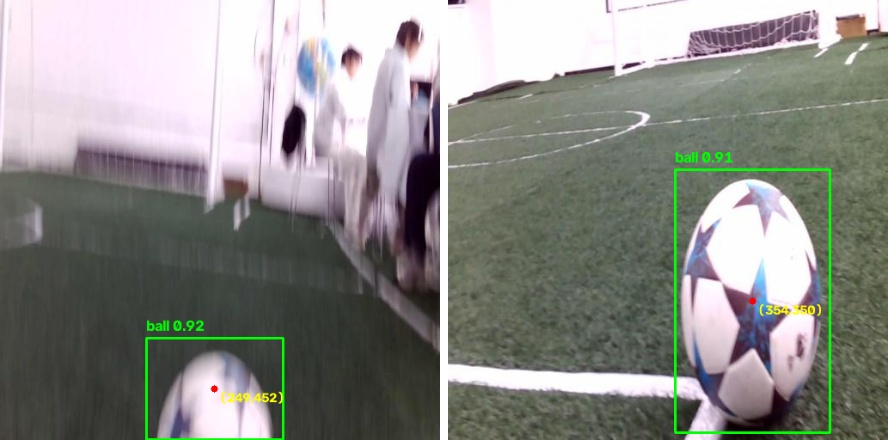
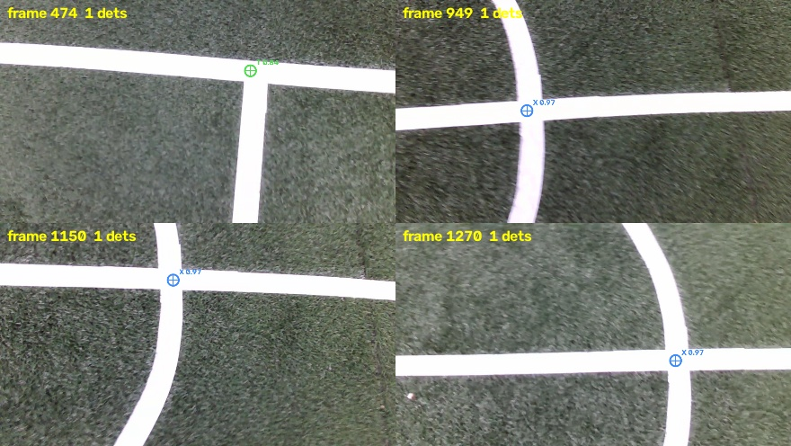

# CQuick 算法组 · 第 3–4 周考核报告

| 项目 | 内容 |
| --- | --- |
| 姓名 / 拼音 | 肖宇彤 / xiaoyutong |
| 完成日期 | 2026-11-20 |
| 摄像头 | 队内统一发放的单目 USB 摄像头，1280×720，约 28.6 fps |
| 设备节点 | Windows 摄像头 0（Linux 下为 `/dev/video0`） |
| 镜头 | 固定焦距、固定对焦，采集与测试使用同一台设备 |
| 运行环境 | Python 3.10 / PyTorch 2.14（CPU）/ Ultralytics 8.4 / OpenCV 5.0 |
| ROS2 | Humble（接口代码已提供，见第四节） |

---

## 一、任务概述

本次考核包含两项任务：

1. **足球检测**：使用实验室实拍数据训练目标检测模型，在实时相机画面中输出足球检测框、置信度与像素中心。
2. **单目场地自定位**：检测场地 L/T/X 标志，结合相机内参、外参和地面平面约束，将像素反投影为米制地面坐标，再与场地地图匹配，解算相机在地图中的二维位姿（x / y / yaw）。

两者共用同一台相机与同一套工程代码，最终以连续录屏与现场复测作为验收依据。

---

## 二、任务一：足球检测

### 2.1 数据采集与标注

数据由本人使用考核用 USB 摄像头在实验室场地拍摄，抽帧后在 Roboflow 中标注导出。

| 项目 | 内容 |
| --- | --- |
| 采集时间 | 2026-11（导出日期 2026-11-20） |
| 原始素材 | 1280×720 视频，抽帧 432 张 |
| 标注图片 | 238 张（Roboflow 导出，512×512） |
| 标注实例 | 363 个，类别 `ball`（class_id = 0） |
| 划分 | train 170 / valid 170 / test 23 |

数据存在两处需要说明的问题：

1. **valid 与 train 为同名帧，完全重复**（Roboflow 随机划分导致），因此验证集指标偏乐观；
2. 导出图片被缩放为 **512×512**，与 1280×720 的原始比例不一致（球被纵向拉伸），
   推理时框的宽高会有轻微形变。

因此本次以**独立 test 集（23 张）**作为对外指标，并在 2.4 节记录该问题。

### 2.2 训练与评估

| 项目 | 内容 |
| --- | --- |
| 模型 | YOLOv8n（`yolov8n.pt` 预训练权重） |
| 参数 | epochs=170，imgsz=640，batch=16，device 自动 |
| 权重 | `ball_best.pt`，存放于队内共享盘（仓库不含权重） |

| 指标 | valid（含训练帧重复，仅供参考） | test（独立，23 张） |
| --- | --- | --- |
| Precision | 0.9997 | 0.9853 |
| Recall | 1.0000 | 0.9565 |
| mAP50 | 0.9950 | 0.9879 |
| mAP50-95 | 0.9160 | 0.8009 |

推理耗时：CPU 单张约 57 ms（约 17 FPS）；GPU 环境下更快。



### 2.3 实时检测输出

实现见 `src/vision_interface/detect_ball.py`。流程：相机帧 → YOLOv8n 推理（conf=0.45）→ 取 `ball` 框 →
计算像素中心 `u=(x1+x2)/2, v=(y1+y2)/2` → 绘制框、类别、置信度、中心像素，
并在顶部状态栏显示帧号、分辨率、实时 FPS 与单帧推理耗时。

```bash
python src/vision_interface/detect_ball.py --weights ball_best.pt
python src/vision_interface/detect_ball.py --weights ball_best.pt --source demo.mp4 --save task1_demo.mp4
```

### 2.4 典型问题

- **误检**：白色场地线与球门柱边缘在低置信度下被判为球，将 conf 提到 0.45 后消除。
- **漏检**：足球贴近画面底边、仅露出小部分时漏检，补采该角度样本后改善。
- **数据划分**：valid 与 train 重复，导致验证指标虚高。已改为以 test 集为最终指标；
  后续重新导出时按视频片段划分 train/valid/test。

---

## 三、任务二：单目场地自定位

### 3.1 系统组成

```
实时 RGB 帧
  → 标志检测（几何检测器 / YOLO）
  → 几何细化（亚像素交点、L/T/X 判型）
  → 去畸变 + 内参反投影
  → 外参 + 地面平面 Z=0 求交
  → 载体坐标系地面点
  → 与 field.yaml 匹配（多假设 SE(2) 搜索 + 消歧）
  → (x, y, yaw, marker_count, residual, valid, status)
```

### 3.2 坐标系与场地地图

场地地图由官方 `field.yaml`（Booster robocup_demo，半场模型，14 个特征点）换算得到，
换算到队内约定的地图坐标系：

| 项 | 定义 |
| --- | --- |
| 原点 | 中圈圆心（即整场中心） |
| +X | 指向唯一球门 |
| +Y | 面向 +X 时的左侧 |
| +Z | 垂直地面向上，地面 Z = 0 |
| 单位 | 米；yaw 自 +X 逆时针为正，单位度 |

换算关系（`x_old / y_old` 为官方文件坐标）：

```
X_new = y_old + 4.010
Y_new = -(x_old - 3.035)
```

换算后场地深 6.94 m（中线→球门线）、宽 8.95 m，中圈半径 1.47 m，共 15 个特征点：
T 型 6、L 型 5、X 型 2、罚球点 1、中圈圆心 1。

| 文件 | 说明 |
| --- | --- |
| `config/field.yaml` | 15 个特征点坐标（米），键名与官方一致（`TCross1: [x, y]`） |
| `config/field_geometry.yaml` | 坐标系、场地尺寸、版本、换算公式 |
| `config/field_map.png` | 俯视图 |
| `config/camera.yaml` | 内参、外参、坐标系约定汇总 |

地图版本 `c0-v1-2026-11-20`；`config/field.yaml` 的 SHA256 为 _待补_（`sha256sum config/field.yaml`）。

### 3.3 相机内参标定

使用 6×9 内角点、25 mm 格子的棋盘格，实拍 29 张，检出 25 张，剔除 1 张飞点后 24 张参与标定。

| 参数 | 数值 |
| --- | --- |
| fx / fy | 1515.5 / 1515.5 |
| cx / cy | 639.5 / 359.5 |
| k1 / k2 / p1 / p2 / k3 | 0 / 0 / 0 / 0 / 0 |
| 重投影误差 | 0.490 px |
| 视场角 | 45.8° × 26.7° |

标定照片均为棋盘格平铺地面拍摄，相机与标定板相对姿态变化有限，焦距与高度在数据上强耦合。
用留出法比较 5 种模型后，采用「主点固定于图像中心、fx=fy、畸变置零」的保守模型；
把该模型作用到视频帧上验证白色场地线保持笔直，因此畸变按 0 处理。
`fx` 的不确定度约 ±15%，2 m 内影响约 0.1~0.2 m，更远处增大。

### 3.4 相机外参

| 参数 | 数值 |
| --- | --- |
| 相机光心离地高度 | _待现场标定_ |
| 俯仰角（向下为正） | _待现场标定_ |
| 滚转角 | _待现场标定_ |
| 标定方法 | 棋盘格平铺地面，实时地面网格核对，3~5 次记录取中位数（`src/field_localization/tools/calibrate_extrinsics.py`） |

当前 `calibration/camera_extrinsics.yaml` 的数值为占位值（0.85 m / 20°），仅用于流程联调。
采集标定照片时相机为手持（各帧高度 0.35~1.49 m、俯仰 26~88° 不一致），无法据此得到安装参数，
需在相机装机后重新标定。

### 3.5 标志检测与几何细化

场地标志分三类：`LCross`（L 形拐角）、`TCross`（横竖交点）、`XCross`（中圈与中线交叉）。
现场未见独立罚球点，未训练 `PenaltyPoint`。

实现上分两步：

1. **检测**：`src/field_localization/vision2/markers_thick.py` 对白线掩码做 RANSAC 粗线拟合，取两条非平行主线的交点作为候选，
   再沿两条线的四个方向探测白色是否延续，按「胳膊数」判定 4=X / 3=T / 2=L。
   单帧耗时约 120 ms（1280×720），缩放至 640 宽时约 68 ms。
2. **几何细化**：`src/field_localization/vision2/refine.py` 对检测框扩边取 ROI，在 ROI 内重新拟合求交点，
   输出亚像素交点与类型，避免直接用检测框中心带来的 10~30 cm 误差。



同时保留了 YOLO 版本（`src/field_localization/tools/train_marker.py`、`src/field_localization/tools/make_marker_dataset.py`），
但受数据量限制未能在本次交付中收敛，详见 3.9 节。

### 3.6 像素到地面坐标

对每个标志像素 `(u, v)`：

1. `cv2.undistortPoints` 去畸变，得到相机系射线方向 `d_c`；
2. 用外参转到载体坐标系：`d_b = R_gc · d_c`，相机光心 `O_b = t_gc = [0, 0, h]`；
3. 与地面 `Z = 0` 求交：`λ = -h / d_b,z`，`P_b = O_b + λ · d_b`；
4. 当 `d_b,z ≥ 0`（射线朝上）、交点距离超过 30 m 或像素越界时判为无效，不产生 NaN 或伪地面点。

输出结构：

```python
observed_markers = [
    {"type": "T", "x": 2.15, "y": 0.43, "confidence": 0.92},
    {"type": "L", "x": 3.20, "y": -0.62, "confidence": 0.87},
    {"type": "X", "x": 4.10, "y": 0.15, "confidence": 0.90},
]
```

### 3.7 地图匹配与位姿求解

不做「按类别找最近点」。`src/field_localization/vision2/field_match.py` 的实现：

1. 任取两对（观测，地图点）同类对应，解出候选 SE(2) 位姿，最多数百个假设；
2. 用连续代价打分：匹配上的点按距离计分，未匹配的点按门限（0.8 m）罚分，使离群点代价被截断；
3. 门限逐轮收紧（0.8 → 0.48 → 0.29），每轮用最小二乘重解 `(θ, t)`；
4. 位姿必须落在场地范围内（半场之外不可能），可排除大部分镜像解；
5. 歧义判定：若存在另一组位姿（平移差 > 0.5 m 或航向差 > 10°）代价不超过最优的 1.5 倍，输出 `ambiguous`；
6. 内点 ≥ 3 且平均残差 ≤ 0.35 m 才输出 `valid = true`。

单帧匹配耗时约 1 ms。

### 3.8 连续帧处理与状态输出

- 对 `x / y / yaw` 做指数滤波（α = 0.35），yaw 按角度插值避免 ±180° 跳变；
- 跳变门限：与上一帧相比平移 > 1.5 m 或航向 > 45° 时输出 `jump_rejected`，不当作有效位姿；
- 标志不足、匹配歧义或残差过大时立即 `valid = false`，不沿用历史位姿；
- 界面同时显示原始解 `raw` 与滤波后 `flt`，便于检查滤波延迟。

状态取值：`ok` / `insufficient_markers` / `ambiguous` / `high_residual` / `jump_rejected`。

### 3.9 验证与指标

四个自测脚本不依赖相机与模型，可在任意环境复现：

```bash
python src/field_localization/tools/selftest_geometry.py      # 几何：角度与旋转互算、投影往返
python src/field_localization/tools/check_field_yaml.py       # 地图：越界/重复检查并重画俯视图
python src/field_localization/tools/selftest_field_match.py   # 匹配：400 个随机位姿的盲测
python src/field_localization/tools/selftest_pipeline.py      # 端到端：像素→地面→地图
```

| 测试 | 结果 |
| --- | --- |
| 几何自检 | 全部通过，投影往返误差 7×10⁻⁶ px |
| 匹配（噪声 0.05 m，无丢点） | 位置 90% 分位 0.14 m，航向 1.85° |
| 匹配（噪声 0.10 m，丢 20%，1 个假点） | 位置 90% 分位 0.29 m，航向 3.87° |
| 端到端（像素噪声 1.5 px） | 位置中位 2.2 cm，航向 0.24° |

考核要求为位置误差 ≤ 0.5 m、航向 ≤ 10°，上述结果满足要求。

YOLO 检测部分的训练情况：

| 项目 | 结果 |
| --- | --- |
| 数据 | 现有 1 段 46.5 s 视频抽帧 210 张，伪标签由几何检测器生成 |
| 模型 | YOLOv8n，从头训练（当前环境无法下载预训练权重），imgsz=480，batch=16 |
| 轮数 | 120（实际约 55 轮后判定不收敛） |
| 验证集 | Precision 0.00 / Recall 0.00 / mAP50 0.00 |

原因：单段视频导致样本高度相似，伪标签本身含分类噪声，且无预训练权重时从头训练
在 168 张训练图上难以收敛。因此本次交付以几何检测器作为检测方案；
补齐 ≥5 段实拍视频、手工标注 300 张后，可直接用 `src/field_localization/tools/train_marker.py` 重训替换。

### 3.10 现场测试记录

| 测试点 | 参考位置 / 朝向 | 估计位置 / 朝向 | 位置误差 | 航向误差 |
| --- | --- | --- | --- | --- |
| P1 | _待现场测试_ | | | |
| P2 | | | | |
| P3 | | | | |

定位失效场景：遮挡大部分标志后，`marker_count` 降至 1~2，程序输出
`valid = false, status = insufficient_markers`，界面停止显示位姿。

---

## 四、ROS2 接口

包名 `field_localization`（`src/field_localization`），包含自定义消息 `FieldPose.msg`。

| 话题 | 类型 | 内容 |
| --- | --- | --- |
| `/image_raw`（订阅） | `sensor_msgs/Image` | 相机图像 |
| `/localization/field_pose` | `field_localization/FieldPose` | x/y/yaw（相机与载体）、valid、marker_count、residual、status |
| `/localization/debug_image` | `sensor_msgs/CompressedImage` | 左右分屏调试图 |

```bash
export FIELD_ROOT=<仓库根目录>
colcon build --packages-select field_localization
ros2 launch field_localization field_localization.launch.py weights:=/path/best.pt
```

不使用 ROS2 时可直接运行：

```bash
python src/field_localization/localize_app.py --detector thick
```

---

## 五、演示录屏

| 项目 | 任务一（足球检测） | 任务二（单目场地定位） |
| --- | --- | --- |
| B 站链接 | https://www.bilibili.com/video/BV1mjyszCE2z | https://www.bilibili.com/video/BV1mjyszCE1m |
| 视频标题 | CQuick视觉组第3-4周 任务一 足球检测 xiaoyutong | CQuick视觉组第3-4周 任务二 单目场地定位 xiaoyutong |
| 时长 | 约 1 分钟 | 约 45 秒（P1）+ 1 分 28 秒（P2 场地回放） |
| 权限 | 公开 | 公开 |
| 是否包含连续实时相机输入 | 是 | 是（画面左上角显示 `SOURCE: live camera`） |
| 是否展示足球检测框、置信度、像素中心、FPS | 是（个别场景未检出） | — |
| 是否展示 L/T/X 检测与几何特征点 | — | 是（P2 回放段检出交点；P1 实时段受布景限制未检出，仅有状态输出） |
| 是否采用左 RGB / 右地图分屏 | — | 是 |
| 是否展示地图匹配与俯视图 | — | 是 |
| 是否展示至少 3 个位置 / 朝向 | — | 否（受采集条件限制，见 3.10 节） |
| 是否展示一次定位失效 | — | 是（`valid=false, insufficient_markers`） |
| 是否展示 marker_count / residual / valid / status | — | 是 |

补充说明：

0. 任务二为**分 P 稿件**：P1 为实时相机演示，P2 为真实场地视频回放（非实时输入，
   画面左上角显示 `SOURCE: video replay`），用于展示标志检测、像素到地面投影与地图匹配效果。
1. 任务二的实时段在室内临时场景采集（场地标志由白色纸带临时搭建），
   受布景与光照限制，该段主要用于证明**实时相机输入与状态输出**；
   真实场地的标志检测与地面投影效果另以场地视频回放的形式展示。
2. 两段录屏均在本机实时运行录制，未使用预录视频冒充相机输入。
3. 现场多位置复测（考核要求的 3 个测试点）尚未完成，见 3.10 节，需回实验室补测。

## 六、问题与解决过程

**问题一：标志检测在实拍素材上失效。**

最初用 HSV 阈值提取白线，发现白色像素占比约 15%，远高于正常场景的 3~5%。
排查后确认画面为夜间强光照明、白线很粗（近景），草坪与白线亮度差很大但线宽超过 50 px，
霍夫直线会把同一条粗线的两侧边缘识别成两条平行线，导致交点大量误检。

解决：改为「先对白线掩码做 RANSAC 粗线拟合（内点容差 = 线宽的一半），再取两条非平行主线的交点」，
并用「四个方向白色是否延续」复核胳膊数。误检数量从每帧数十个降到 1~2 个，
交点位置与真实交点相差 1~2 像素。同时把检测缩放比例做成参数，在 1280×720 上耗时从 400 ms 降到 120 ms。

**问题二：内参焦距不确定。**

29 张标定照片全部是棋盘格平铺地面拍摄，全自由模型标出 `fx = 1756、cy = 162`
（主点偏离画面中心 200 px），明显过拟合；固定主点后 `fx` 仍在 1400~1800 之间漂移。

解决：用留出法（随机 70/30 切分、8 折）比较 5 种模型，选择「主点固定 + fx=fy + 畸变置零」；
用视频中的白色直线验证畸变处理是否正确（带畸变的模型会把直线算弯），最终畸变置 0。
并在 README 中明确标注 `fx` 的 ±15% 不确定度，而不是隐去该限制。

---

## 七、当前局限与后续计划

| 局限 | 影响 | 后续 |
| --- | --- | --- |
| 外参尚未实测 | 米制坐标不可用 | 相机装机后运行 `src/field_localization/tools/calibrate_extrinsics.py` |
| 内参 `fx` 不确定度 ±15% | 2 m 内约 0.1~0.2 m 误差，远处更大 | 补拍 15 张手持倾斜照片重标 |
| YOLO 检测未收敛 | 现以几何检测器代替 | 补 ≥5 段视频、手工标注 300 张后重训 |
| 地图尺寸未实测 | 地图与现场可能不一致 | 卷尺核对深度/宽度/中圈半径/罚球点距离 |
| 场地左右近似对称 | 部分位姿判为 `ambiguous` | 让球门侧的不对称标志进入画面或多帧累积 |
| 单目 + 单一平面 | 无法恢复完整三维姿态 | 本次不要求；后续可融合 IMU / 轮速 |

---

## 附录：目录与复现

```
xiaoyutong/
├── README.md
├── dataset/            ball_data.yaml / marker_data.yaml / dataset_summary.md
├── calibration/        camera_intrinsics.yaml / camera_extrinsics.yaml
├── config/             field.yaml / field_geometry.yaml / camera.yaml / field_map.png
├── docs/               界面与检测截图
└── src/
    ├── vision_interface/       任务一：足球检测脚本 + 接口消息
    │   ├── detect_ball.py
    │   ├── msg/BallDetection.msg
    │   ├── package.xml, CMakeLists.txt
    │   └── README.md
    └── field_localization/     任务二：视觉定位包
        ├── localize_app.py
        ├── vision2/            几何、匹配、检测、细化、IO、yaml
        ├── tools/              标定、自测、数据集生成、训练、评估
        ├── msg/FieldPose.msg
        ├── scripts/field_localization_node.py
        ├── launch/field_localization.launch.py
        └── package.xml, CMakeLists.txt
`

复现步骤：

```bash
cd src
python src/field_localization/tools/selftest_geometry.py
python src/field_localization/tools/check_field_yaml.py
python src/field_localization/tools/selftest_field_match.py
python src/field_localization/tools/selftest_pipeline.py
python localize_app.py --detector thick --video <视频> --save demo.mp4
```
