# 第 2 周考核 · liubingqing
- **姓名**：刘冰清
- **完成日期**：2026-11-01
- **Ubuntu / ROS2 / Python / OpenCV 版本**：Ubuntu 22.04 / ROS2 Humble / Python 3.10.12 / OpenCV 4.5.4

## 任务 1：颜色目标检测

**算法处理流程：**
读取 BGR 图像 -> 转换为 HSV 空间 -> 根据设定阈值生成 Mask 掩膜 -> 形态学开闭运算去噪 -> 提取外轮廓 -> 根据面积和宽高比筛选目标 -> 使用图像矩 (Moments) 计算中心点 `(u, v)`。
- **目标颜色**：黑色（主要寻找图片中的黑白球体）
- **HSV 阈值**：下限 `[0, 0, 0]`，上限 `[180, 255, 60]`
- **最小轮廓面积**：`500` 像素
- **中心点计算方法**：使用 `cv2.moments` 计算图像矩，通过 `m10/m00` 得到 `u`，通过 `m01/m00` 得到 `v`。如果 `m00` 为 0 则视为无效。
- **多候选目标选择规则**：先通过宽高比（0.7~1.3）和填充度（>0.5）过滤，然后将剩下的有效轮廓按面积从大到小排序，选择面积最大的作为最终目标。
- **测试图片结果**：在 3 张测试图中，成功检测到 2 张图的目标并输出了真实的 `(u, v)`，对于不含目标的图片准确输出了“未检测到目标”。

**失败原因分析（至少 2 个）：**
1. **背景同色干扰**：如果背景中有大量与目标颜色相近的黑色物体，且面积较大，会导致轮廓筛选错误。
2. **光照变化**：强光直射或反光会使目标的 V 值（明度）显著升高，超出设定的上限 `60`，导致目标在 Mask 中残缺甚至消失，引发漏检。

**图片路径:  **
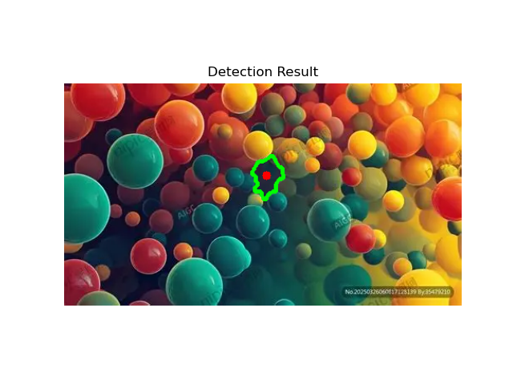
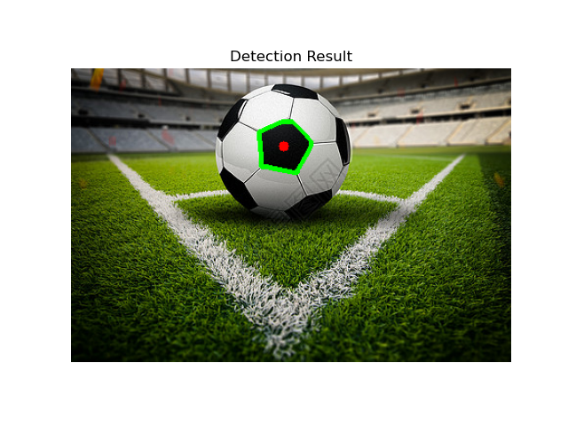
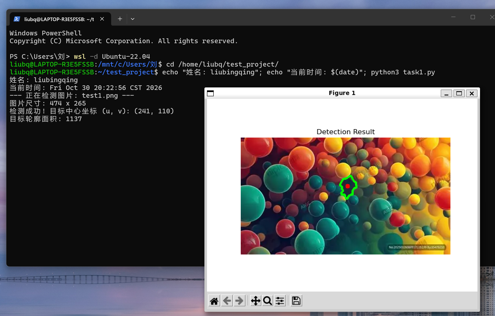
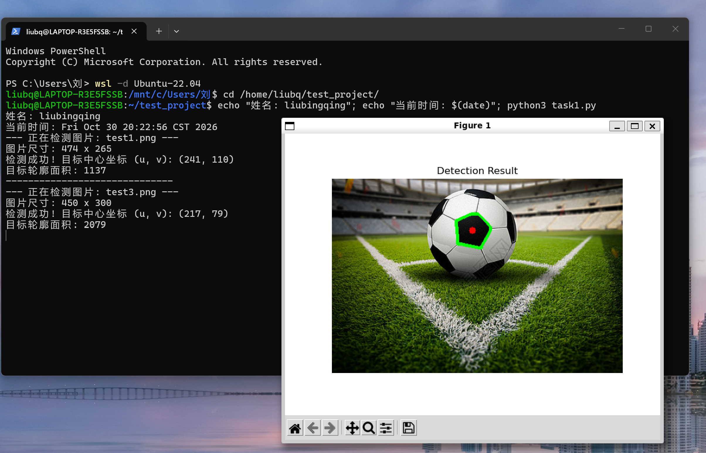
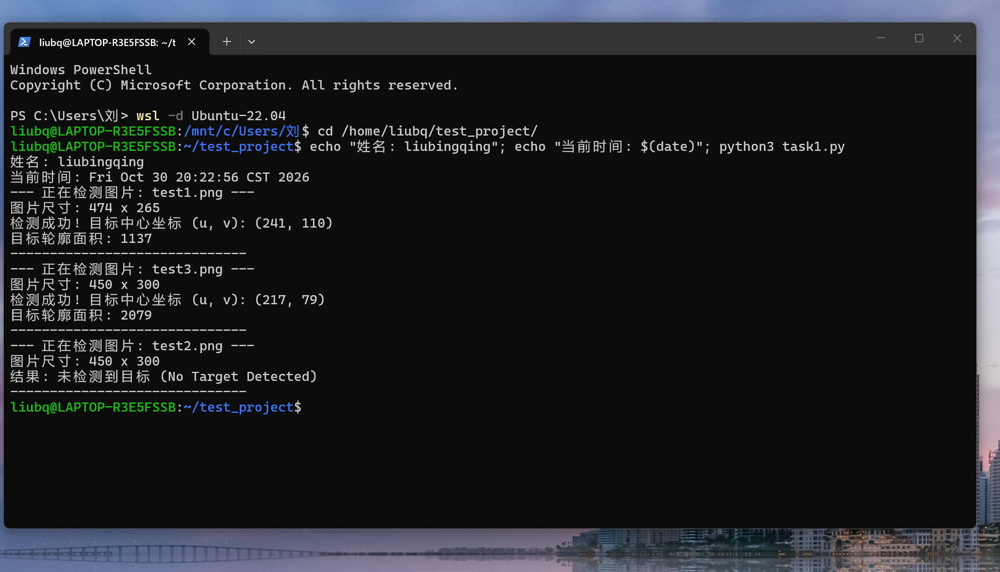

## 任务 2：可视化与参数对比

**参数对比实验：**
我对**最小轮廓面积**进行了参数调整对比：
- **参数 A（面积 > 500）**：检测结果如图 `task2_result_A.png`。能够完整框出目标，但如果图片中有小黑点噪点，有时会被误识别。
- **参数 B（面积 > 1500）**：检测结果如图 `task2_result_B.png`。面积阈值变大后，过滤掉了更多小噪点，对大型目标的检测更稳定，但如果有距离较远（目标变小）的球，就会发生漏检。

**误检/漏检案例说明：**
- **误检案例**：在调低面积阈值时，图片边缘的黑色阴影被识别为圆形目标。
- **漏检案例**：当光照过强导致球体反光严重时，Mask 破碎，整体面积小于 500，导致该帧未检测到目标。

**像素坐标与真实坐标的区别：**
像素坐标 `(u, v)` 是图像左上角为原点 `(0,0)`、向右向下递增的二维图像坐标，它只表示目标在画面中的相对位置。它**不能**直接当作机器人的真实世界坐标（米制距离），因为缺乏相机内参、焦距、高度等标定信息。如果要控制机器人，必须经过坐标系转换。

**图片路径：**

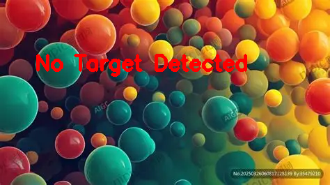

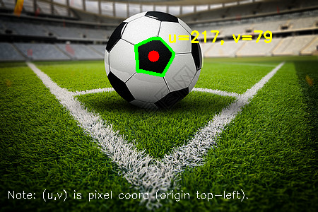
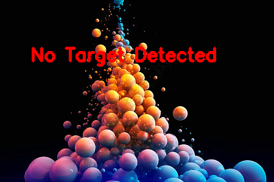
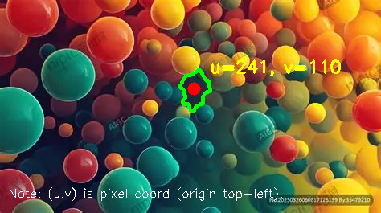
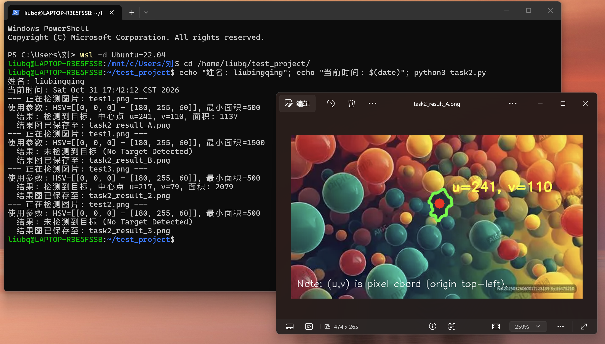
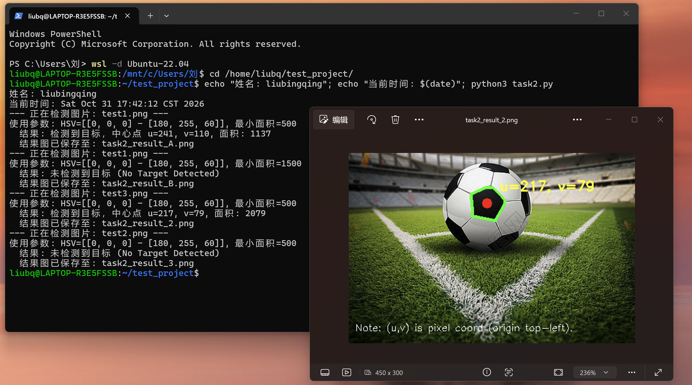
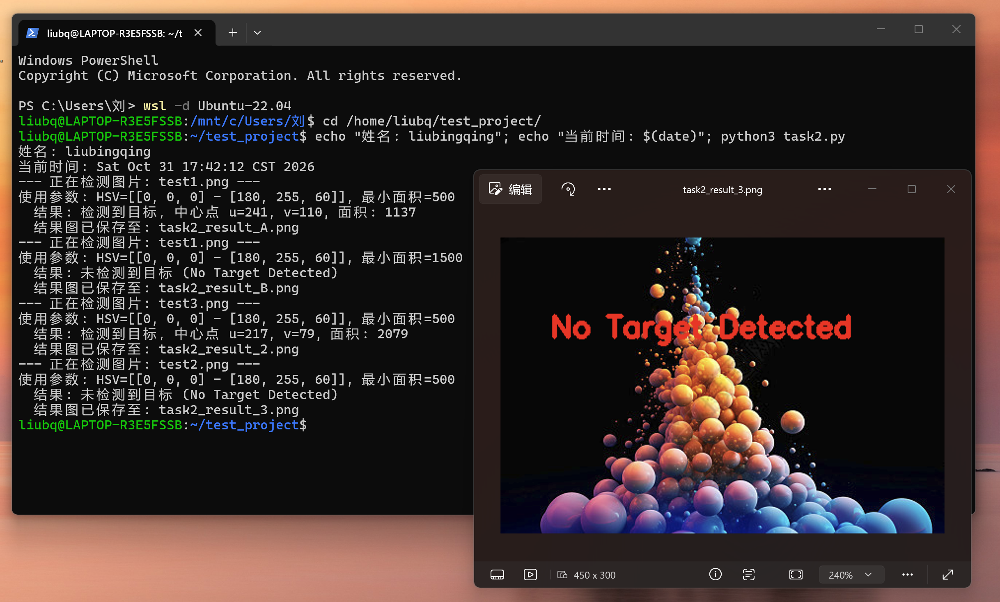
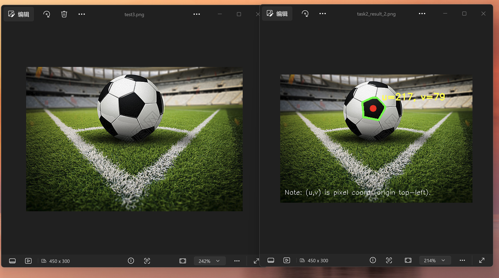
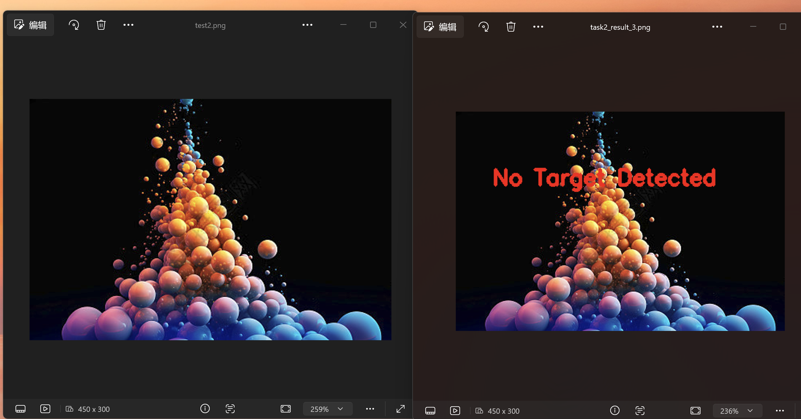
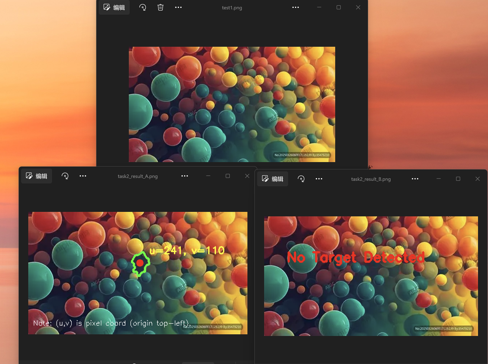

## 任务 3：ROS2 通信

- **消息字段**：自定义了 `TargetPosition.msg`，包含 `bool detected`、`float32 u`、`float32 v`、`float32 area`。
- **话题名**：`/target_position`
- **发布/订阅流程**：
  - **发布端 (`target_publisher.py`)**：通过定时器循环读取图片，调用任务 1 的视觉检测代码。将检测结果（成功或失败）赋值给消息对象，调用`self.publisher_.publish(msg)` 发布。
  - **订阅端 (`ros2 topic echo` / 自写节点)**：监听 `/target_position` 话题，实时打印收到的 4 个字段。分屏截图证明了发布端和订阅端正常连接并接收真实数据。
- **实际检测结果接入**：放弃了固定坐标，而是将 `cv2.moments` 算出的 `cx`、`cy` 转换为 `float` 格式后赋给 `msg.u` 和 `msg.v`；检测失败时，`msg.detected` 设为 `False` 并将坐标置零。
**图片路径：**
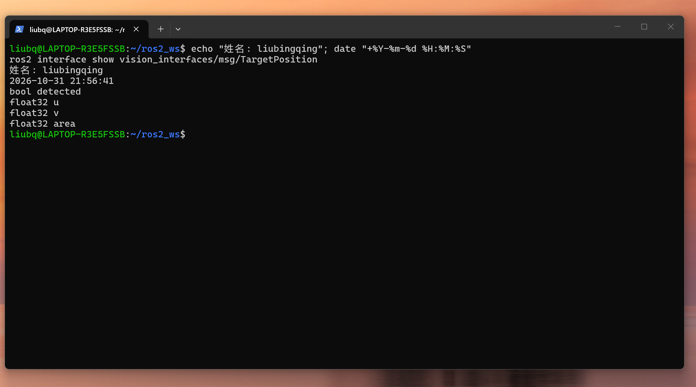

## 问题与解决过程

**问题 1：误删了 setup.py 导致无法编译。**
- **排查**：执行 `colcon build` 时提示找不到包或者无法构建。
- **解决**：重新进入包目录，使用 `nano setup.py` 手动创建，并补全了 `data_files` 和 `entry_points` 里的 `console_scripts` 配置，重新编译后成功。

**问题 2：终端里运行节点，发出来的数据一直是 100.0 死数据。**
- **排查**：发现代码里写了 `msg.u = 100.0` 作为测试，且在修改代码后忘记重新编译。
- **解决**：删除了写死的固定值，将 OpenCV 的检测结果赋值给消息，并在修改后执行了 `colcon build` 和 `source install/setup.bash`。

## 仍未解决的问题
**关于 HSV 阈值的自适应问题：**
目前的 HSV 阈值是硬编码写死的，这在背景简单时有效。但在实际比赛场地中，光照变化、阴影和反光会导致固定阈值失效。我还没完全搞清楚如何实现**根据环境光自适应调整 HSV 阈值**（比如根据画面平均亮度动态调整 V 的上下限），或者如何利用 ROS 2 的参数动态配置阈值而不需要重新编译代码。希望后续能解决。

**关于目标检测的问题：**
目前目标检测单纯靠颜色，这样检测准确性不够，可以结合霍夫圆变换辅助验证它是否是一个圆。目前还没有掌握，希望经过更多的学习解决。

## 素材来源
1.测试图片 test1.png:nipic.com
2.测试图片 test2.png:699pic.com
3.测试图片 test3.png:699pic.com

